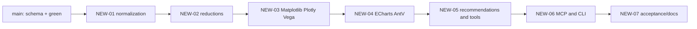

# Dependency and conflict map

- Default branch: `main`
- Main SHA analyzed: `484ff08ddcae6c36d43ce61de774c00b6c422c88`
- Date: 2026-11-28
- Plan version: 1.0

Git diff found 331 overlapping paths and 1818 pairs sharing paths across 65 non-default branches. Pairwise `git merge-tree --write-tree origin/A origin/B` reported 521 conflicts and 1297 clean merges. Many branches share stale candidate ancestry; never merge entire branches based only on this matrix.

## File -> branches

| File | Branches touching it | Count |
|---|---|---:|
| `.gitattributes` | `agents/r10-01-correctness-regressions`, `agents/r10-02-security-boundaries`, `agents/r10-03-echarts-numeric-x`, `agents/r10-04-utf8-field-envelope`, `agents/r10-05-inspector-claim-retest`, `agents/r10-06-native-kind-browser`, `agents/r10-07-python-clean-distribution`, `agents/r10-08-npm-packed-consumer`, `agents/r10-09-helper-null-fix`, `agents/r10-10-stdio-artifact-lifecycle`, `agents/r10-11-python-scale-envelope`, `agents/r10-12-typescript-scale-envelope`, `agents/r10-13-ci-negative-controls`, `agents/r10-14-assets-offline-provenance`, `agents/r10-15-owned-input-cleanup`, `agents/r10-16-finite-overflow-fix`, `agents/r10-17-vega-visible-title`, `agents/r10-18-docs-prompts-claims`, `agents/r10-19-real-backlog-commits`, `agents/r10-20-plotly-literal-labels`, `agents/r10-21-recovery-git-bootstrap`, `agents/r10-root-coordination`, `agents/r11-08-npm-prompts`, `agents/r11-10-strict-mcp-boundaries`, `agents/r11-12-svg-tick-margin`, `agents/r22-07-count-readiness`, `agents/r25-18-plotly-literal-proposal`, `agents/r38-18-antv-source-review`, `agents/r45-04-private-numeric-accounting`, `docs/engineering-management`, `feat/hardening`, `fix/r12-dense-table-budget`, `fix/r14-helper-null`, `fix/r14-mcp-json-budget`, `fix/r17-normalizer-boundaries`, `fix/r20-antv-color-scale`, `fix/r23-count-channel`, `fix/r23-svg-finite-density`, `fix/r27-plotly-literal-text`, `fix/r34-12-svg-density-compatible`, `fix/r41-callback-admission`, `fix/r45-17-antv-subnormal`, `perf/verification`, `release/candidate`, `review/r35-12-count-source`, `test/aggregation-semantics`, `test/backend-antv`, `test/backend-plotly`, `test/backend-vega`, `test/browser`, `test/graphql-contract`, `test/mcp-transport`, `test/portability`, `test/schema-parity` | 54 |
| `.github/CI.md` | `agents/r10-01-correctness-regressions`, `agents/r10-02-security-boundaries`, `agents/r10-03-echarts-numeric-x`, `agents/r10-04-utf8-field-envelope`, `agents/r10-05-inspector-claim-retest`, `agents/r10-06-native-kind-browser`, `agents/r10-07-python-clean-distribution`, `agents/r10-08-npm-packed-consumer`, `agents/r10-09-helper-null-fix`, `agents/r10-10-stdio-artifact-lifecycle`, `agents/r10-11-python-scale-envelope`, `agents/r10-12-typescript-scale-envelope`, `agents/r10-13-ci-negative-controls`, `agents/r10-14-assets-offline-provenance`, `agents/r10-15-owned-input-cleanup`, `agents/r10-16-finite-overflow-fix`, `agents/r10-17-vega-visible-title`, `agents/r10-18-docs-prompts-claims`, `agents/r10-19-real-backlog-commits`, `agents/r10-20-plotly-literal-labels`, `agents/r10-21-recovery-git-bootstrap`, `agents/r10-root-coordination`, `agents/r11-08-npm-prompts`, `agents/r11-10-strict-mcp-boundaries`, `agents/r11-12-svg-tick-margin`, `agents/r22-07-count-readiness`, `agents/r25-18-plotly-literal-proposal`, `agents/r38-18-antv-source-review`, `agents/r45-04-private-numeric-accounting`, `fix/r12-dense-table-budget`, `fix/r14-helper-null`, `fix/r14-mcp-json-budget`, `fix/r17-normalizer-boundaries`, `fix/r20-antv-color-scale`, `fix/r23-count-channel`, `fix/r23-svg-finite-density`, `fix/r27-plotly-literal-text`, `fix/r34-12-svg-density-compatible`, `fix/r41-callback-admission`, `fix/r45-17-antv-subnormal`, `release/candidate`, `review/r35-12-count-source` | 42 |
| `.github/ISSUE_TEMPLATE/bug.yml` | `agents/r10-01-correctness-regressions`, `agents/r10-02-security-boundaries`, `agents/r10-03-echarts-numeric-x`, `agents/r10-04-utf8-field-envelope`, `agents/r10-05-inspector-claim-retest`, `agents/r10-06-native-kind-browser`, `agents/r10-07-python-clean-distribution`, `agents/r10-08-npm-packed-consumer`, `agents/r10-09-helper-null-fix`, `agents/r10-10-stdio-artifact-lifecycle`, `agents/r10-11-python-scale-envelope`, `agents/r10-12-typescript-scale-envelope`, `agents/r10-13-ci-negative-controls`, `agents/r10-14-assets-offline-provenance`, `agents/r10-15-owned-input-cleanup`, `agents/r10-16-finite-overflow-fix`, `agents/r10-17-vega-visible-title`, `agents/r10-18-docs-prompts-claims`, `agents/r10-19-real-backlog-commits`, `agents/r10-20-plotly-literal-labels`, `agents/r10-21-recovery-git-bootstrap`, `agents/r10-root-coordination`, `agents/r11-08-npm-prompts`, `agents/r11-10-strict-mcp-boundaries`, `agents/r11-12-svg-tick-margin`, `agents/r22-07-count-readiness`, `agents/r25-18-plotly-literal-proposal`, `agents/r38-18-antv-source-review`, `agents/r45-04-private-numeric-accounting`, `fix/r12-dense-table-budget`, `fix/r14-helper-null`, `fix/r14-mcp-json-budget`, `fix/r17-normalizer-boundaries`, `fix/r20-antv-color-scale`, `fix/r23-count-channel`, `fix/r23-svg-finite-density`, `fix/r27-plotly-literal-text`, `fix/r34-12-svg-density-compatible`, `fix/r41-callback-admission`, `fix/r45-17-antv-subnormal`, `release/candidate`, `review/r35-12-count-source` | 42 |
| `.github/ISSUE_TEMPLATE/change.yml` | `agents/r10-01-correctness-regressions`, `agents/r10-02-security-boundaries`, `agents/r10-03-echarts-numeric-x`, `agents/r10-04-utf8-field-envelope`, `agents/r10-05-inspector-claim-retest`, `agents/r10-06-native-kind-browser`, `agents/r10-07-python-clean-distribution`, `agents/r10-08-npm-packed-consumer`, `agents/r10-09-helper-null-fix`, `agents/r10-10-stdio-artifact-lifecycle`, `agents/r10-11-python-scale-envelope`, `agents/r10-12-typescript-scale-envelope`, `agents/r10-13-ci-negative-controls`, `agents/r10-14-assets-offline-provenance`, `agents/r10-15-owned-input-cleanup`, `agents/r10-16-finite-overflow-fix`, `agents/r10-17-vega-visible-title`, `agents/r10-18-docs-prompts-claims`, `agents/r10-19-real-backlog-commits`, `agents/r10-20-plotly-literal-labels`, `agents/r10-21-recovery-git-bootstrap`, `agents/r10-root-coordination`, `agents/r11-08-npm-prompts`, `agents/r11-10-strict-mcp-boundaries`, `agents/r11-12-svg-tick-margin`, `agents/r22-07-count-readiness`, `agents/r25-18-plotly-literal-proposal`, `agents/r38-18-antv-source-review`, `agents/r45-04-private-numeric-accounting`, `fix/r12-dense-table-budget`, `fix/r14-helper-null`, `fix/r14-mcp-json-budget`, `fix/r17-normalizer-boundaries`, `fix/r20-antv-color-scale`, `fix/r23-count-channel`, `fix/r23-svg-finite-density`, `fix/r27-plotly-literal-text`, `fix/r34-12-svg-density-compatible`, `fix/r41-callback-admission`, `fix/r45-17-antv-subnormal`, `release/candidate`, `review/r35-12-count-source` | 42 |
| `.github/ISSUE_TEMPLATE/config.yml` | `agents/r10-01-correctness-regressions`, `agents/r10-02-security-boundaries`, `agents/r10-03-echarts-numeric-x`, `agents/r10-04-utf8-field-envelope`, `agents/r10-05-inspector-claim-retest`, `agents/r10-06-native-kind-browser`, `agents/r10-07-python-clean-distribution`, `agents/r10-08-npm-packed-consumer`, `agents/r10-09-helper-null-fix`, `agents/r10-10-stdio-artifact-lifecycle`, `agents/r10-11-python-scale-envelope`, `agents/r10-12-typescript-scale-envelope`, `agents/r10-13-ci-negative-controls`, `agents/r10-14-assets-offline-provenance`, `agents/r10-15-owned-input-cleanup`, `agents/r10-16-finite-overflow-fix`, `agents/r10-17-vega-visible-title`, `agents/r10-18-docs-prompts-claims`, `agents/r10-19-real-backlog-commits`, `agents/r10-20-plotly-literal-labels`, `agents/r10-21-recovery-git-bootstrap`, `agents/r10-root-coordination`, `agents/r11-08-npm-prompts`, `agents/r11-10-strict-mcp-boundaries`, `agents/r11-12-svg-tick-margin`, `agents/r22-07-count-readiness`, `agents/r25-18-plotly-literal-proposal`, `agents/r38-18-antv-source-review`, `agents/r45-04-private-numeric-accounting`, `fix/r12-dense-table-budget`, `fix/r14-helper-null`, `fix/r14-mcp-json-budget`, `fix/r17-normalizer-boundaries`, `fix/r20-antv-color-scale`, `fix/r23-count-channel`, `fix/r23-svg-finite-density`, `fix/r27-plotly-literal-text`, `fix/r34-12-svg-density-compatible`, `fix/r41-callback-admission`, `fix/r45-17-antv-subnormal`, `release/candidate`, `review/r35-12-count-source` | 42 |
| `.github/PULL_REQUEST_TEMPLATE.md` | `agents/r10-01-correctness-regressions`, `agents/r10-02-security-boundaries`, `agents/r10-03-echarts-numeric-x`, `agents/r10-04-utf8-field-envelope`, `agents/r10-05-inspector-claim-retest`, `agents/r10-06-native-kind-browser`, `agents/r10-07-python-clean-distribution`, `agents/r10-08-npm-packed-consumer`, `agents/r10-09-helper-null-fix`, `agents/r10-10-stdio-artifact-lifecycle`, `agents/r10-11-python-scale-envelope`, `agents/r10-12-typescript-scale-envelope`, `agents/r10-13-ci-negative-controls`, `agents/r10-14-assets-offline-provenance`, `agents/r10-15-owned-input-cleanup`, `agents/r10-16-finite-overflow-fix`, `agents/r10-17-vega-visible-title`, `agents/r10-18-docs-prompts-claims`, `agents/r10-19-real-backlog-commits`, `agents/r10-20-plotly-literal-labels`, `agents/r10-21-recovery-git-bootstrap`, `agents/r10-root-coordination`, `agents/r11-08-npm-prompts`, `agents/r11-10-strict-mcp-boundaries`, `agents/r11-12-svg-tick-margin`, `agents/r22-07-count-readiness`, `agents/r25-18-plotly-literal-proposal`, `agents/r38-18-antv-source-review`, `agents/r45-04-private-numeric-accounting`, `fix/r12-dense-table-budget`, `fix/r14-helper-null`, `fix/r14-mcp-json-budget`, `fix/r17-normalizer-boundaries`, `fix/r20-antv-color-scale`, `fix/r23-count-channel`, `fix/r23-svg-finite-density`, `fix/r27-plotly-literal-text`, `fix/r34-12-svg-density-compatible`, `fix/r41-callback-admission`, `fix/r45-17-antv-subnormal`, `release/candidate`, `review/r35-12-count-source` | 42 |
| `.github/dependabot.yml` | `agents/r10-01-correctness-regressions`, `agents/r10-02-security-boundaries`, `agents/r10-03-echarts-numeric-x`, `agents/r10-04-utf8-field-envelope`, `agents/r10-05-inspector-claim-retest`, `agents/r10-06-native-kind-browser`, `agents/r10-07-python-clean-distribution`, `agents/r10-08-npm-packed-consumer`, `agents/r10-09-helper-null-fix`, `agents/r10-10-stdio-artifact-lifecycle`, `agents/r10-11-python-scale-envelope`, `agents/r10-12-typescript-scale-envelope`, `agents/r10-13-ci-negative-controls`, `agents/r10-14-assets-offline-provenance`, `agents/r10-15-owned-input-cleanup`, `agents/r10-16-finite-overflow-fix`, `agents/r10-17-vega-visible-title`, `agents/r10-18-docs-prompts-claims`, `agents/r10-19-real-backlog-commits`, `agents/r10-20-plotly-literal-labels`, `agents/r10-21-recovery-git-bootstrap`, `agents/r10-root-coordination`, `agents/r11-08-npm-prompts`, `agents/r11-10-strict-mcp-boundaries`, `agents/r11-12-svg-tick-margin`, `agents/r22-07-count-readiness`, `agents/r25-18-plotly-literal-proposal`, `agents/r38-18-antv-source-review`, `agents/r45-04-private-numeric-accounting`, `fix/r12-dense-table-budget`, `fix/r14-helper-null`, `fix/r14-mcp-json-budget`, `fix/r17-normalizer-boundaries`, `fix/r20-antv-color-scale`, `fix/r23-count-channel`, `fix/r23-svg-finite-density`, `fix/r27-plotly-literal-text`, `fix/r34-12-svg-density-compatible`, `fix/r41-callback-admission`, `fix/r45-17-antv-subnormal`, `release/candidate`, `review/r35-12-count-source` | 42 |
| `.github/tests/test_verification.py` | `agents/r10-01-correctness-regressions`, `agents/r10-02-security-boundaries`, `agents/r10-03-echarts-numeric-x`, `agents/r10-04-utf8-field-envelope`, `agents/r10-05-inspector-claim-retest`, `agents/r10-06-native-kind-browser`, `agents/r10-07-python-clean-distribution`, `agents/r10-08-npm-packed-consumer`, `agents/r10-09-helper-null-fix`, `agents/r10-10-stdio-artifact-lifecycle`, `agents/r10-11-python-scale-envelope`, `agents/r10-12-typescript-scale-envelope`, `agents/r10-13-ci-negative-controls`, `agents/r10-14-assets-offline-provenance`, `agents/r10-15-owned-input-cleanup`, `agents/r10-16-finite-overflow-fix`, `agents/r10-17-vega-visible-title`, `agents/r10-18-docs-prompts-claims`, `agents/r10-19-real-backlog-commits`, `agents/r10-20-plotly-literal-labels`, `agents/r10-21-recovery-git-bootstrap`, `agents/r10-root-coordination`, `agents/r11-08-npm-prompts`, `agents/r11-10-strict-mcp-boundaries`, `agents/r11-12-svg-tick-margin`, `agents/r22-07-count-readiness`, `agents/r25-18-plotly-literal-proposal`, `agents/r38-18-antv-source-review`, `agents/r45-04-private-numeric-accounting`, `fix/r12-dense-table-budget`, `fix/r14-helper-null`, `fix/r14-mcp-json-budget`, `fix/r17-normalizer-boundaries`, `fix/r20-antv-color-scale`, `fix/r23-count-channel`, `fix/r23-svg-finite-density`, `fix/r27-plotly-literal-text`, `fix/r34-12-svg-density-compatible`, `fix/r41-callback-admission`, `fix/r45-17-antv-subnormal`, `release/candidate`, `review/r35-12-count-source` | 42 |
| `.github/workflows/ci.yml` | `agents/r10-01-correctness-regressions`, `agents/r10-02-security-boundaries`, `agents/r10-03-echarts-numeric-x`, `agents/r10-04-utf8-field-envelope`, `agents/r10-05-inspector-claim-retest`, `agents/r10-06-native-kind-browser`, `agents/r10-07-python-clean-distribution`, `agents/r10-08-npm-packed-consumer`, `agents/r10-09-helper-null-fix`, `agents/r10-10-stdio-artifact-lifecycle`, `agents/r10-11-python-scale-envelope`, `agents/r10-12-typescript-scale-envelope`, `agents/r10-13-ci-negative-controls`, `agents/r10-14-assets-offline-provenance`, `agents/r10-15-owned-input-cleanup`, `agents/r10-16-finite-overflow-fix`, `agents/r10-17-vega-visible-title`, `agents/r10-18-docs-prompts-claims`, `agents/r10-19-real-backlog-commits`, `agents/r10-20-plotly-literal-labels`, `agents/r10-21-recovery-git-bootstrap`, `agents/r10-root-coordination`, `agents/r11-08-npm-prompts`, `agents/r11-10-strict-mcp-boundaries`, `agents/r11-12-svg-tick-margin`, `agents/r22-07-count-readiness`, `agents/r25-18-plotly-literal-proposal`, `agents/r38-18-antv-source-review`, `agents/r45-04-private-numeric-accounting`, `fix/r12-dense-table-budget`, `fix/r14-helper-null`, `fix/r14-mcp-json-budget`, `fix/r17-normalizer-boundaries`, `fix/r20-antv-color-scale`, `fix/r23-count-channel`, `fix/r23-svg-finite-density`, `fix/r27-plotly-literal-text`, `fix/r34-12-svg-density-compatible`, `fix/r41-callback-admission`, `fix/r45-17-antv-subnormal`, `release/candidate`, `review/r35-12-count-source` | 42 |
| `.github/workflows/evidence.yml` | `agents/r10-01-correctness-regressions`, `agents/r10-02-security-boundaries`, `agents/r10-03-echarts-numeric-x`, `agents/r10-04-utf8-field-envelope`, `agents/r10-05-inspector-claim-retest`, `agents/r10-06-native-kind-browser`, `agents/r10-07-python-clean-distribution`, `agents/r10-08-npm-packed-consumer`, `agents/r10-09-helper-null-fix`, `agents/r10-10-stdio-artifact-lifecycle`, `agents/r10-11-python-scale-envelope`, `agents/r10-12-typescript-scale-envelope`, `agents/r10-13-ci-negative-controls`, `agents/r10-14-assets-offline-provenance`, `agents/r10-15-owned-input-cleanup`, `agents/r10-16-finite-overflow-fix`, `agents/r10-17-vega-visible-title`, `agents/r10-18-docs-prompts-claims`, `agents/r10-19-real-backlog-commits`, `agents/r10-20-plotly-literal-labels`, `agents/r10-21-recovery-git-bootstrap`, `agents/r10-root-coordination`, `agents/r11-08-npm-prompts`, `agents/r11-10-strict-mcp-boundaries`, `agents/r11-12-svg-tick-margin`, `agents/r22-07-count-readiness`, `agents/r25-18-plotly-literal-proposal`, `agents/r38-18-antv-source-review`, `agents/r45-04-private-numeric-accounting`, `fix/r12-dense-table-budget`, `fix/r14-helper-null`, `fix/r14-mcp-json-budget`, `fix/r17-normalizer-boundaries`, `fix/r20-antv-color-scale`, `fix/r23-count-channel`, `fix/r23-svg-finite-density`, `fix/r27-plotly-literal-text`, `fix/r34-12-svg-density-compatible`, `fix/r41-callback-admission`, `fix/r45-17-antv-subnormal`, `release/candidate`, `review/r35-12-count-source` | 42 |
| `AGENTS.md` | `agents/r10-01-correctness-regressions`, `agents/r10-02-security-boundaries`, `agents/r10-03-echarts-numeric-x`, `agents/r10-04-utf8-field-envelope`, `agents/r10-05-inspector-claim-retest`, `agents/r10-06-native-kind-browser`, `agents/r10-07-python-clean-distribution`, `agents/r10-08-npm-packed-consumer`, `agents/r10-09-helper-null-fix`, `agents/r10-10-stdio-artifact-lifecycle`, `agents/r10-11-python-scale-envelope`, `agents/r10-12-typescript-scale-envelope`, `agents/r10-13-ci-negative-controls`, `agents/r10-14-assets-offline-provenance`, `agents/r10-15-owned-input-cleanup`, `agents/r10-16-finite-overflow-fix`, `agents/r10-17-vega-visible-title`, `agents/r10-18-docs-prompts-claims`, `agents/r10-19-real-backlog-commits`, `agents/r10-20-plotly-literal-labels`, `agents/r10-21-recovery-git-bootstrap`, `agents/r10-root-coordination`, `agents/r11-08-npm-prompts`, `agents/r11-10-strict-mcp-boundaries`, `agents/r11-12-svg-tick-margin`, `agents/r22-07-count-readiness`, `agents/r25-18-plotly-literal-proposal`, `agents/r38-18-antv-source-review`, `agents/r45-04-private-numeric-accounting`, `docs/engineering-management`, `feat/hardening`, `fix/r12-dense-table-budget`, `fix/r14-helper-null`, `fix/r14-mcp-json-budget`, `fix/r17-normalizer-boundaries`, `fix/r20-antv-color-scale`, `fix/r23-count-channel`, `fix/r23-svg-finite-density`, `fix/r27-plotly-literal-text`, `fix/r34-12-svg-density-compatible`, `fix/r41-callback-admission`, `fix/r45-17-antv-subnormal`, `perf/verification`, `release/candidate`, `review/r35-12-count-source`, `test/aggregation-semantics`, `test/backend-antv`, `test/backend-plotly`, `test/backend-vega`, `test/browser`, `test/graphql-contract`, `test/mcp-transport`, `test/portability`, `test/schema-parity` | 54 |
| `README.md` | `agents/r10-01-correctness-regressions`, `agents/r10-02-security-boundaries`, `agents/r10-03-echarts-numeric-x`, `agents/r10-04-utf8-field-envelope`, `agents/r10-05-inspector-claim-retest`, `agents/r10-06-native-kind-browser`, `agents/r10-07-python-clean-distribution`, `agents/r10-08-npm-packed-consumer`, `agents/r10-09-helper-null-fix`, `agents/r10-10-stdio-artifact-lifecycle`, `agents/r10-11-python-scale-envelope`, `agents/r10-12-typescript-scale-envelope`, `agents/r10-13-ci-negative-controls`, `agents/r10-14-assets-offline-provenance`, `agents/r10-15-owned-input-cleanup`, `agents/r10-16-finite-overflow-fix`, `agents/r10-17-vega-visible-title`, `agents/r10-18-docs-prompts-claims`, `agents/r10-19-real-backlog-commits`, `agents/r10-20-plotly-literal-labels`, `agents/r10-21-recovery-git-bootstrap`, `agents/r10-root-coordination`, `agents/r11-08-npm-prompts`, `agents/r11-10-strict-mcp-boundaries`, `agents/r11-12-svg-tick-margin`, `agents/r22-07-count-readiness`, `agents/r25-18-plotly-literal-proposal`, `agents/r38-18-antv-source-review`, `agents/r45-04-private-numeric-accounting`, `feat/integrations`, `feat/r34-python-data-foundation`, `fix/r12-dense-table-budget`, `fix/r14-helper-null`, `fix/r14-mcp-json-budget`, `fix/r17-normalizer-boundaries`, `fix/r20-antv-color-scale`, `fix/r23-count-channel`, `fix/r23-svg-finite-density`, `fix/r27-plotly-literal-text`, `fix/r34-12-svg-density-compatible`, `fix/r41-callback-admission`, `fix/r45-17-antv-subnormal`, `release/candidate`, `review/r35-12-count-source` | 44 |
| `RESUME.md` | `agents/r10-01-correctness-regressions`, `agents/r10-02-security-boundaries`, `agents/r10-03-echarts-numeric-x`, `agents/r10-04-utf8-field-envelope`, `agents/r10-05-inspector-claim-retest`, `agents/r10-06-native-kind-browser`, `agents/r10-07-python-clean-distribution`, `agents/r10-08-npm-packed-consumer`, `agents/r10-09-helper-null-fix`, `agents/r10-10-stdio-artifact-lifecycle`, `agents/r10-11-python-scale-envelope`, `agents/r10-12-typescript-scale-envelope`, `agents/r10-13-ci-negative-controls`, `agents/r10-14-assets-offline-provenance`, `agents/r10-15-owned-input-cleanup`, `agents/r10-16-finite-overflow-fix`, `agents/r10-17-vega-visible-title`, `agents/r10-18-docs-prompts-claims`, `agents/r10-19-real-backlog-commits`, `agents/r10-20-plotly-literal-labels`, `agents/r10-21-recovery-git-bootstrap`, `agents/r10-root-coordination`, `agents/r11-08-npm-prompts`, `agents/r11-10-strict-mcp-boundaries`, `agents/r11-12-svg-tick-margin`, `agents/r22-07-count-readiness`, `agents/r25-18-plotly-literal-proposal`, `agents/r38-18-antv-source-review`, `agents/r45-04-private-numeric-accounting`, `fix/r12-dense-table-budget`, `fix/r14-helper-null`, `fix/r14-mcp-json-budget`, `fix/r17-normalizer-boundaries`, `fix/r20-antv-color-scale`, `fix/r23-count-channel`, `fix/r23-svg-finite-density`, `fix/r27-plotly-literal-text`, `fix/r34-12-svg-density-compatible`, `fix/r41-callback-admission`, `fix/r45-17-antv-subnormal`, `release/candidate`, `review/r35-12-count-source` | 42 |
| `SECURITY.md` | `agents/r10-01-correctness-regressions`, `agents/r10-02-security-boundaries`, `agents/r10-03-echarts-numeric-x`, `agents/r10-04-utf8-field-envelope`, `agents/r10-05-inspector-claim-retest`, `agents/r10-06-native-kind-browser`, `agents/r10-07-python-clean-distribution`, `agents/r10-08-npm-packed-consumer`, `agents/r10-09-helper-null-fix`, `agents/r10-10-stdio-artifact-lifecycle`, `agents/r10-11-python-scale-envelope`, `agents/r10-12-typescript-scale-envelope`, `agents/r10-13-ci-negative-controls`, `agents/r10-14-assets-offline-provenance`, `agents/r10-15-owned-input-cleanup`, `agents/r10-16-finite-overflow-fix`, `agents/r10-17-vega-visible-title`, `agents/r10-18-docs-prompts-claims`, `agents/r10-19-real-backlog-commits`, `agents/r10-20-plotly-literal-labels`, `agents/r10-21-recovery-git-bootstrap`, `agents/r10-root-coordination`, `agents/r11-08-npm-prompts`, `agents/r11-10-strict-mcp-boundaries`, `agents/r11-12-svg-tick-margin`, `agents/r22-07-count-readiness`, `agents/r25-18-plotly-literal-proposal`, `agents/r38-18-antv-source-review`, `agents/r45-04-private-numeric-accounting`, `docs/engineering-management`, `feat/hardening`, `fix/r12-dense-table-budget`, `fix/r14-helper-null`, `fix/r14-mcp-json-budget`, `fix/r17-normalizer-boundaries`, `fix/r20-antv-color-scale`, `fix/r23-count-channel`, `fix/r23-svg-finite-density`, `fix/r27-plotly-literal-text`, `fix/r34-12-svg-density-compatible`, `fix/r41-callback-admission`, `fix/r45-17-antv-subnormal`, `perf/verification`, `release/candidate`, `review/r35-12-count-source`, `test/aggregation-semantics`, `test/backend-antv`, `test/backend-plotly`, `test/backend-vega`, `test/browser`, `test/graphql-contract`, `test/mcp-transport`, `test/portability`, `test/schema-parity` | 54 |
| `docs/PROJECT_STATE.md` | `agents/r10-05-inspector-claim-retest`, `agents/r10-root-coordination`, `agents/r11-08-npm-prompts`, `agents/r11-10-strict-mcp-boundaries`, `agents/r11-12-svg-tick-margin`, `agents/r22-07-count-readiness`, `agents/r25-18-plotly-literal-proposal`, `agents/r38-18-antv-source-review`, `fix/r12-dense-table-budget`, `fix/r14-helper-null`, `fix/r14-mcp-json-budget`, `fix/r20-antv-color-scale`, `fix/r23-count-channel`, `fix/r23-svg-finite-density`, `fix/r27-plotly-literal-text`, `fix/r34-12-svg-density-compatible`, `fix/r41-callback-admission`, `fix/r45-17-antv-subnormal`, `release/candidate`, `review/r35-12-count-source` | 20 |
| `docs/agent-state/ses_de567805bffdER1GlVd0ngLgKg.md` | `agents/r10-18-docs-prompts-claims`, `agents/r25-18-plotly-literal-proposal`, `agents/r38-18-antv-source-review`, `fix/r14-mcp-json-budget`, `fix/r27-plotly-literal-text`, `fix/r41-callback-admission` | 6 |
| `docs/agent-state/ses_de567808bffdXko8hyKFRhPv77.md` | `agents/r10-16-finite-overflow-fix`, `agents/r45-04-private-numeric-accounting`, `fix/r17-normalizer-boundaries`, `fix/r41-callback-admission` | 4 |
| `docs/agent-state/ses_de5678115ffewUEpZFi8faBW8C.md` | `agents/r10-12-typescript-scale-envelope`, `agents/r11-12-svg-tick-margin`, `fix/r23-svg-finite-density`, `fix/r34-12-svg-density-compatible`, `review/r35-12-count-source` | 5 |
| `docs/agent-state/ses_de56782e3ffeI5D4lzsNVeLcDk.md` | `agents/r10-10-stdio-artifact-lifecycle`, `agents/r11-10-strict-mcp-boundaries` | 2 |
| `docs/agent-state/ses_de56782e6ffeVWDIuY3v01kkBt.md` | `agents/r10-08-npm-packed-consumer`, `agents/r11-08-npm-prompts`, `feat/r40-npm-foundation`, `fix/r20-antv-color-scale` | 4 |
| `docs/agent-state/ses_de56782e8ffentAvzUUfMncFRA.md` | `agents/r10-07-python-clean-distribution`, `agents/r22-07-count-readiness`, `feat/r34-python-data-foundation`, `fix/r14-helper-null`, `fix/r23-count-channel` | 5 |
| `docs/agent-state/ses_de5678314ffeuDXtC7RfGsbD6V.md` | `agents/r10-04-utf8-field-envelope`, `agents/r45-04-private-numeric-accounting` | 2 |
| `docs/agent-state/ses_de56ad930fferPKGibj5Mc304B.md` | `agents/r10-05-inspector-claim-retest`, `agents/r10-root-coordination`, `agents/r11-08-npm-prompts`, `agents/r11-10-strict-mcp-boundaries`, `agents/r11-12-svg-tick-margin`, `agents/r22-07-count-readiness`, `agents/r25-18-plotly-literal-proposal`, `agents/r38-18-antv-source-review`, `fix/r12-dense-table-budget`, `fix/r14-helper-null`, `fix/r14-mcp-json-budget`, `fix/r20-antv-color-scale`, `fix/r23-count-channel`, `fix/r23-svg-finite-density`, `fix/r27-plotly-literal-text`, `fix/r34-12-svg-density-compatible`, `fix/r41-callback-admission`, `fix/r45-17-antv-subnormal`, `release/candidate`, `review/r35-12-count-source` | 20 |
| `docs/architecture.md` | `agents/r10-01-correctness-regressions`, `agents/r10-02-security-boundaries`, `agents/r10-03-echarts-numeric-x`, `agents/r10-04-utf8-field-envelope`, `agents/r10-05-inspector-claim-retest`, `agents/r10-06-native-kind-browser`, `agents/r10-07-python-clean-distribution`, `agents/r10-08-npm-packed-consumer`, `agents/r10-09-helper-null-fix`, `agents/r10-10-stdio-artifact-lifecycle`, `agents/r10-11-python-scale-envelope`, `agents/r10-12-typescript-scale-envelope`, `agents/r10-13-ci-negative-controls`, `agents/r10-14-assets-offline-provenance`, `agents/r10-15-owned-input-cleanup`, `agents/r10-16-finite-overflow-fix`, `agents/r10-17-vega-visible-title`, `agents/r10-18-docs-prompts-claims`, `agents/r10-19-real-backlog-commits`, `agents/r10-20-plotly-literal-labels`, `agents/r10-21-recovery-git-bootstrap`, `agents/r10-root-coordination`, `agents/r11-08-npm-prompts`, `agents/r11-10-strict-mcp-boundaries`, `agents/r11-12-svg-tick-margin`, `agents/r22-07-count-readiness`, `agents/r25-18-plotly-literal-proposal`, `agents/r38-18-antv-source-review`, `agents/r45-04-private-numeric-accounting`, `docs/research`, `fix/r12-dense-table-budget`, `fix/r14-helper-null`, `fix/r14-mcp-json-budget`, `fix/r17-normalizer-boundaries`, `fix/r20-antv-color-scale`, `fix/r23-count-channel`, `fix/r23-svg-finite-density`, `fix/r27-plotly-literal-text`, `fix/r34-12-svg-density-compatible`, `fix/r41-callback-admission`, `fix/r45-17-antv-subnormal`, `release/candidate`, `review/r35-12-count-source` | 43 |
| `docs/capabilities.md` | `agents/r10-01-correctness-regressions`, `agents/r10-02-security-boundaries`, `agents/r10-03-echarts-numeric-x`, `agents/r10-04-utf8-field-envelope`, `agents/r10-05-inspector-claim-retest`, `agents/r10-06-native-kind-browser`, `agents/r10-07-python-clean-distribution`, `agents/r10-08-npm-packed-consumer`, `agents/r10-09-helper-null-fix`, `agents/r10-10-stdio-artifact-lifecycle`, `agents/r10-11-python-scale-envelope`, `agents/r10-12-typescript-scale-envelope`, `agents/r10-13-ci-negative-controls`, `agents/r10-14-assets-offline-provenance`, `agents/r10-15-owned-input-cleanup`, `agents/r10-16-finite-overflow-fix`, `agents/r10-17-vega-visible-title`, `agents/r10-18-docs-prompts-claims`, `agents/r10-19-real-backlog-commits`, `agents/r10-20-plotly-literal-labels`, `agents/r10-21-recovery-git-bootstrap`, `agents/r10-root-coordination`, `agents/r11-08-npm-prompts`, `agents/r11-10-strict-mcp-boundaries`, `agents/r11-12-svg-tick-margin`, `agents/r22-07-count-readiness`, `agents/r25-18-plotly-literal-proposal`, `agents/r38-18-antv-source-review`, `agents/r45-04-private-numeric-accounting`, `docs/research`, `fix/r12-dense-table-budget`, `fix/r14-helper-null`, `fix/r14-mcp-json-budget`, `fix/r17-normalizer-boundaries`, `fix/r20-antv-color-scale`, `fix/r23-count-channel`, `fix/r23-svg-finite-density`, `fix/r27-plotly-literal-text`, `fix/r34-12-svg-density-compatible`, `fix/r41-callback-admission`, `fix/r45-17-antv-subnormal`, `release/candidate`, `review/r35-12-count-source` | 43 |
| `docs/coordination/BRIEF.md` | `agents/r10-01-correctness-regressions`, `agents/r10-02-security-boundaries`, `agents/r10-03-echarts-numeric-x`, `agents/r10-04-utf8-field-envelope`, `agents/r10-05-inspector-claim-retest`, `agents/r10-06-native-kind-browser`, `agents/r10-07-python-clean-distribution`, `agents/r10-08-npm-packed-consumer`, `agents/r10-09-helper-null-fix`, `agents/r10-10-stdio-artifact-lifecycle`, `agents/r10-11-python-scale-envelope`, `agents/r10-12-typescript-scale-envelope`, `agents/r10-13-ci-negative-controls`, `agents/r10-14-assets-offline-provenance`, `agents/r10-15-owned-input-cleanup`, `agents/r10-16-finite-overflow-fix`, `agents/r10-17-vega-visible-title`, `agents/r10-18-docs-prompts-claims`, `agents/r10-19-real-backlog-commits`, `agents/r10-20-plotly-literal-labels`, `agents/r10-21-recovery-git-bootstrap`, `agents/r10-root-coordination`, `agents/r11-08-npm-prompts`, `agents/r11-10-strict-mcp-boundaries`, `agents/r11-12-svg-tick-margin`, `agents/r22-07-count-readiness`, `agents/r25-18-plotly-literal-proposal`, `agents/r38-18-antv-source-review`, `agents/r45-04-private-numeric-accounting`, `fix/r12-dense-table-budget`, `fix/r14-helper-null`, `fix/r14-mcp-json-budget`, `fix/r17-normalizer-boundaries`, `fix/r20-antv-color-scale`, `fix/r23-count-channel`, `fix/r23-svg-finite-density`, `fix/r27-plotly-literal-text`, `fix/r34-12-svg-density-compatible`, `fix/r41-callback-admission`, `fix/r45-17-antv-subnormal`, `release/candidate`, `review/r35-12-count-source` | 42 |
| `docs/coordination/C17-live-slots.md` | `agents/r10-01-correctness-regressions`, `agents/r10-02-security-boundaries`, `agents/r10-03-echarts-numeric-x`, `agents/r10-04-utf8-field-envelope`, `agents/r10-05-inspector-claim-retest`, `agents/r10-06-native-kind-browser`, `agents/r10-07-python-clean-distribution`, `agents/r10-08-npm-packed-consumer`, `agents/r10-09-helper-null-fix`, `agents/r10-10-stdio-artifact-lifecycle`, `agents/r10-11-python-scale-envelope`, `agents/r10-12-typescript-scale-envelope`, `agents/r10-13-ci-negative-controls`, `agents/r10-14-assets-offline-provenance`, `agents/r10-15-owned-input-cleanup`, `agents/r10-16-finite-overflow-fix`, `agents/r10-17-vega-visible-title`, `agents/r10-18-docs-prompts-claims`, `agents/r10-19-real-backlog-commits`, `agents/r10-20-plotly-literal-labels`, `agents/r10-21-recovery-git-bootstrap`, `agents/r10-root-coordination`, `agents/r11-08-npm-prompts`, `agents/r11-10-strict-mcp-boundaries`, `agents/r11-12-svg-tick-margin`, `agents/r22-07-count-readiness`, `agents/r25-18-plotly-literal-proposal`, `agents/r38-18-antv-source-review`, `agents/r45-04-private-numeric-accounting`, `fix/r12-dense-table-budget`, `fix/r14-helper-null`, `fix/r14-mcp-json-budget`, `fix/r17-normalizer-boundaries`, `fix/r20-antv-color-scale`, `fix/r23-count-channel`, `fix/r23-svg-finite-density`, `fix/r27-plotly-literal-text`, `fix/r34-12-svg-density-compatible`, `fix/r41-callback-admission`, `fix/r45-17-antv-subnormal`, `release/candidate`, `review/r35-12-count-source` | 42 |
| `docs/coordination/R03-live-slots.md` | `agents/r10-05-inspector-claim-retest`, `agents/r10-root-coordination`, `agents/r11-08-npm-prompts`, `agents/r11-10-strict-mcp-boundaries`, `agents/r11-12-svg-tick-margin`, `agents/r22-07-count-readiness`, `agents/r25-18-plotly-literal-proposal`, `agents/r38-18-antv-source-review`, `fix/r12-dense-table-budget`, `fix/r14-helper-null`, `fix/r14-mcp-json-budget`, `fix/r20-antv-color-scale`, `fix/r23-count-channel`, `fix/r23-svg-finite-density`, `fix/r27-plotly-literal-text`, `fix/r34-12-svg-density-compatible`, `fix/r41-callback-admission`, `fix/r45-17-antv-subnormal`, `release/candidate`, `review/r35-12-count-source` | 20 |
| `docs/coordination/REQUEST.md` | `agents/r10-01-correctness-regressions`, `agents/r10-02-security-boundaries`, `agents/r10-03-echarts-numeric-x`, `agents/r10-04-utf8-field-envelope`, `agents/r10-05-inspector-claim-retest`, `agents/r10-06-native-kind-browser`, `agents/r10-07-python-clean-distribution`, `agents/r10-08-npm-packed-consumer`, `agents/r10-09-helper-null-fix`, `agents/r10-10-stdio-artifact-lifecycle`, `agents/r10-11-python-scale-envelope`, `agents/r10-12-typescript-scale-envelope`, `agents/r10-13-ci-negative-controls`, `agents/r10-14-assets-offline-provenance`, `agents/r10-15-owned-input-cleanup`, `agents/r10-16-finite-overflow-fix`, `agents/r10-17-vega-visible-title`, `agents/r10-18-docs-prompts-claims`, `agents/r10-19-real-backlog-commits`, `agents/r10-20-plotly-literal-labels`, `agents/r10-21-recovery-git-bootstrap`, `agents/r10-root-coordination`, `agents/r11-08-npm-prompts`, `agents/r11-10-strict-mcp-boundaries`, `agents/r11-12-svg-tick-margin`, `agents/r22-07-count-readiness`, `agents/r25-18-plotly-literal-proposal`, `agents/r38-18-antv-source-review`, `agents/r45-04-private-numeric-accounting`, `fix/r12-dense-table-budget`, `fix/r14-helper-null`, `fix/r14-mcp-json-budget`, `fix/r17-normalizer-boundaries`, `fix/r20-antv-color-scale`, `fix/r23-count-channel`, `fix/r23-svg-finite-density`, `fix/r27-plotly-literal-text`, `fix/r34-12-svg-density-compatible`, `fix/r41-callback-admission`, `fix/r45-17-antv-subnormal`, `release/candidate`, `review/r35-12-count-source` | 42 |
| `docs/coordination/ROSTER.md` | `agents/r10-01-correctness-regressions`, `agents/r10-02-security-boundaries`, `agents/r10-03-echarts-numeric-x`, `agents/r10-04-utf8-field-envelope`, `agents/r10-05-inspector-claim-retest`, `agents/r10-06-native-kind-browser`, `agents/r10-07-python-clean-distribution`, `agents/r10-08-npm-packed-consumer`, `agents/r10-09-helper-null-fix`, `agents/r10-10-stdio-artifact-lifecycle`, `agents/r10-11-python-scale-envelope`, `agents/r10-12-typescript-scale-envelope`, `agents/r10-13-ci-negative-controls`, `agents/r10-14-assets-offline-provenance`, `agents/r10-15-owned-input-cleanup`, `agents/r10-16-finite-overflow-fix`, `agents/r10-17-vega-visible-title`, `agents/r10-18-docs-prompts-claims`, `agents/r10-19-real-backlog-commits`, `agents/r10-20-plotly-literal-labels`, `agents/r10-21-recovery-git-bootstrap`, `agents/r10-root-coordination`, `agents/r11-08-npm-prompts`, `agents/r11-10-strict-mcp-boundaries`, `agents/r11-12-svg-tick-margin`, `agents/r22-07-count-readiness`, `agents/r25-18-plotly-literal-proposal`, `agents/r38-18-antv-source-review`, `agents/r45-04-private-numeric-accounting`, `fix/r12-dense-table-budget`, `fix/r14-helper-null`, `fix/r14-mcp-json-budget`, `fix/r17-normalizer-boundaries`, `fix/r20-antv-color-scale`, `fix/r23-count-channel`, `fix/r23-svg-finite-density`, `fix/r27-plotly-literal-text`, `fix/r34-12-svg-density-compatible`, `fix/r41-callback-admission`, `fix/r45-17-antv-subnormal`, `release/candidate`, `review/r35-12-count-source` | 42 |
| `docs/coordination/STATE.md` | `agents/r10-01-correctness-regressions`, `agents/r10-02-security-boundaries`, `agents/r10-03-echarts-numeric-x`, `agents/r10-04-utf8-field-envelope`, `agents/r10-05-inspector-claim-retest`, `agents/r10-06-native-kind-browser`, `agents/r10-07-python-clean-distribution`, `agents/r10-08-npm-packed-consumer`, `agents/r10-09-helper-null-fix`, `agents/r10-10-stdio-artifact-lifecycle`, `agents/r10-11-python-scale-envelope`, `agents/r10-12-typescript-scale-envelope`, `agents/r10-13-ci-negative-controls`, `agents/r10-14-assets-offline-provenance`, `agents/r10-15-owned-input-cleanup`, `agents/r10-16-finite-overflow-fix`, `agents/r10-17-vega-visible-title`, `agents/r10-18-docs-prompts-claims`, `agents/r10-19-real-backlog-commits`, `agents/r10-20-plotly-literal-labels`, `agents/r10-21-recovery-git-bootstrap`, `agents/r10-root-coordination`, `agents/r11-08-npm-prompts`, `agents/r11-10-strict-mcp-boundaries`, `agents/r11-12-svg-tick-margin`, `agents/r22-07-count-readiness`, `agents/r25-18-plotly-literal-proposal`, `agents/r38-18-antv-source-review`, `agents/r45-04-private-numeric-accounting`, `fix/r12-dense-table-budget`, `fix/r14-helper-null`, `fix/r14-mcp-json-budget`, `fix/r17-normalizer-boundaries`, `fix/r20-antv-color-scale`, `fix/r23-count-channel`, `fix/r23-svg-finite-density`, `fix/r27-plotly-literal-text`, `fix/r34-12-svg-density-compatible`, `fix/r41-callback-admission`, `fix/r45-17-antv-subnormal`, `release/candidate`, `review/r35-12-count-source` | 42 |
| `docs/coordination/WORKLOG.md` | `agents/r10-01-correctness-regressions`, `agents/r10-02-security-boundaries`, `agents/r10-03-echarts-numeric-x`, `agents/r10-04-utf8-field-envelope`, `agents/r10-05-inspector-claim-retest`, `agents/r10-06-native-kind-browser`, `agents/r10-07-python-clean-distribution`, `agents/r10-08-npm-packed-consumer`, `agents/r10-09-helper-null-fix`, `agents/r10-10-stdio-artifact-lifecycle`, `agents/r10-11-python-scale-envelope`, `agents/r10-12-typescript-scale-envelope`, `agents/r10-13-ci-negative-controls`, `agents/r10-14-assets-offline-provenance`, `agents/r10-15-owned-input-cleanup`, `agents/r10-16-finite-overflow-fix`, `agents/r10-17-vega-visible-title`, `agents/r10-18-docs-prompts-claims`, `agents/r10-19-real-backlog-commits`, `agents/r10-20-plotly-literal-labels`, `agents/r10-21-recovery-git-bootstrap`, `agents/r10-root-coordination`, `agents/r11-08-npm-prompts`, `agents/r11-10-strict-mcp-boundaries`, `agents/r11-12-svg-tick-margin`, `agents/r22-07-count-readiness`, `agents/r25-18-plotly-literal-proposal`, `agents/r38-18-antv-source-review`, `agents/r45-04-private-numeric-accounting`, `fix/r12-dense-table-budget`, `fix/r14-helper-null`, `fix/r14-mcp-json-budget`, `fix/r17-normalizer-boundaries`, `fix/r20-antv-color-scale`, `fix/r23-count-channel`, `fix/r23-svg-finite-density`, `fix/r27-plotly-literal-text`, `fix/r34-12-svg-density-compatible`, `fix/r41-callback-admission`, `fix/r45-17-antv-subnormal`, `release/candidate`, `review/r35-12-count-source` | 42 |
| `docs/coordination/evidence/C00-document-check.md` | `agents/r10-01-correctness-regressions`, `agents/r10-02-security-boundaries`, `agents/r10-03-echarts-numeric-x`, `agents/r10-04-utf8-field-envelope`, `agents/r10-05-inspector-claim-retest`, `agents/r10-06-native-kind-browser`, `agents/r10-07-python-clean-distribution`, `agents/r10-08-npm-packed-consumer`, `agents/r10-09-helper-null-fix`, `agents/r10-10-stdio-artifact-lifecycle`, `agents/r10-11-python-scale-envelope`, `agents/r10-12-typescript-scale-envelope`, `agents/r10-13-ci-negative-controls`, `agents/r10-14-assets-offline-provenance`, `agents/r10-15-owned-input-cleanup`, `agents/r10-16-finite-overflow-fix`, `agents/r10-17-vega-visible-title`, `agents/r10-18-docs-prompts-claims`, `agents/r10-19-real-backlog-commits`, `agents/r10-20-plotly-literal-labels`, `agents/r10-21-recovery-git-bootstrap`, `agents/r10-root-coordination`, `agents/r11-08-npm-prompts`, `agents/r11-10-strict-mcp-boundaries`, `agents/r11-12-svg-tick-margin`, `agents/r22-07-count-readiness`, `agents/r25-18-plotly-literal-proposal`, `agents/r38-18-antv-source-review`, `agents/r45-04-private-numeric-accounting`, `fix/r12-dense-table-budget`, `fix/r14-helper-null`, `fix/r14-mcp-json-budget`, `fix/r17-normalizer-boundaries`, `fix/r20-antv-color-scale`, `fix/r23-count-channel`, `fix/r23-svg-finite-density`, `fix/r27-plotly-literal-text`, `fix/r34-12-svg-density-compatible`, `fix/r41-callback-admission`, `fix/r45-17-antv-subnormal`, `release/candidate`, `review/r35-12-count-source` | 42 |
| `docs/coordination/evidence/C17-pr-body.md` | `agents/r10-01-correctness-regressions`, `agents/r10-02-security-boundaries`, `agents/r10-03-echarts-numeric-x`, `agents/r10-04-utf8-field-envelope`, `agents/r10-05-inspector-claim-retest`, `agents/r10-06-native-kind-browser`, `agents/r10-07-python-clean-distribution`, `agents/r10-08-npm-packed-consumer`, `agents/r10-09-helper-null-fix`, `agents/r10-10-stdio-artifact-lifecycle`, `agents/r10-11-python-scale-envelope`, `agents/r10-12-typescript-scale-envelope`, `agents/r10-13-ci-negative-controls`, `agents/r10-14-assets-offline-provenance`, `agents/r10-15-owned-input-cleanup`, `agents/r10-16-finite-overflow-fix`, `agents/r10-17-vega-visible-title`, `agents/r10-18-docs-prompts-claims`, `agents/r10-19-real-backlog-commits`, `agents/r10-20-plotly-literal-labels`, `agents/r10-21-recovery-git-bootstrap`, `agents/r10-root-coordination`, `agents/r11-08-npm-prompts`, `agents/r11-10-strict-mcp-boundaries`, `agents/r11-12-svg-tick-margin`, `agents/r22-07-count-readiness`, `agents/r25-18-plotly-literal-proposal`, `agents/r38-18-antv-source-review`, `agents/r45-04-private-numeric-accounting`, `fix/r12-dense-table-budget`, `fix/r14-helper-null`, `fix/r14-mcp-json-budget`, `fix/r17-normalizer-boundaries`, `fix/r20-antv-color-scale`, `fix/r23-count-channel`, `fix/r23-svg-finite-density`, `fix/r27-plotly-literal-text`, `fix/r34-12-svg-density-compatible`, `fix/r41-callback-admission`, `fix/r45-17-antv-subnormal`, `release/candidate`, `review/r35-12-count-source` | 42 |
| `docs/coordination/evidence/N01-data-review-20261127/artifact-evidence.json` | `agents/r10-01-correctness-regressions`, `agents/r10-02-security-boundaries`, `agents/r10-03-echarts-numeric-x`, `agents/r10-04-utf8-field-envelope`, `agents/r10-05-inspector-claim-retest`, `agents/r10-06-native-kind-browser`, `agents/r10-07-python-clean-distribution`, `agents/r10-08-npm-packed-consumer`, `agents/r10-09-helper-null-fix`, `agents/r10-10-stdio-artifact-lifecycle`, `agents/r10-11-python-scale-envelope`, `agents/r10-12-typescript-scale-envelope`, `agents/r10-13-ci-negative-controls`, `agents/r10-14-assets-offline-provenance`, `agents/r10-15-owned-input-cleanup`, `agents/r10-16-finite-overflow-fix`, `agents/r10-17-vega-visible-title`, `agents/r10-18-docs-prompts-claims`, `agents/r10-19-real-backlog-commits`, `agents/r10-20-plotly-literal-labels`, `agents/r10-21-recovery-git-bootstrap`, `agents/r10-root-coordination`, `agents/r11-08-npm-prompts`, `agents/r11-10-strict-mcp-boundaries`, `agents/r11-12-svg-tick-margin`, `agents/r22-07-count-readiness`, `agents/r25-18-plotly-literal-proposal`, `agents/r38-18-antv-source-review`, `agents/r45-04-private-numeric-accounting`, `fix/r12-dense-table-budget`, `fix/r14-helper-null`, `fix/r14-mcp-json-budget`, `fix/r17-normalizer-boundaries`, `fix/r20-antv-color-scale`, `fix/r23-count-channel`, `fix/r23-svg-finite-density`, `fix/r27-plotly-literal-text`, `fix/r34-12-svg-density-compatible`, `fix/r41-callback-admission`, `fix/r45-17-antv-subnormal`, `release/candidate`, `review/r35-12-count-source` | 42 |
| `docs/coordination/evidence/N01-data-review-20261127/figures/count-heatmap/deepviz-ou24z73t/chart.html` | `agents/r10-01-correctness-regressions`, `agents/r10-02-security-boundaries`, `agents/r10-03-echarts-numeric-x`, `agents/r10-04-utf8-field-envelope`, `agents/r10-05-inspector-claim-retest`, `agents/r10-06-native-kind-browser`, `agents/r10-07-python-clean-distribution`, `agents/r10-08-npm-packed-consumer`, `agents/r10-09-helper-null-fix`, `agents/r10-10-stdio-artifact-lifecycle`, `agents/r10-11-python-scale-envelope`, `agents/r10-12-typescript-scale-envelope`, `agents/r10-13-ci-negative-controls`, `agents/r10-14-assets-offline-provenance`, `agents/r10-15-owned-input-cleanup`, `agents/r10-16-finite-overflow-fix`, `agents/r10-17-vega-visible-title`, `agents/r10-18-docs-prompts-claims`, `agents/r10-19-real-backlog-commits`, `agents/r10-20-plotly-literal-labels`, `agents/r10-21-recovery-git-bootstrap`, `agents/r10-root-coordination`, `agents/r11-08-npm-prompts`, `agents/r11-10-strict-mcp-boundaries`, `agents/r11-12-svg-tick-margin`, `agents/r22-07-count-readiness`, `agents/r25-18-plotly-literal-proposal`, `agents/r38-18-antv-source-review`, `agents/r45-04-private-numeric-accounting`, `fix/r12-dense-table-budget`, `fix/r14-helper-null`, `fix/r14-mcp-json-budget`, `fix/r17-normalizer-boundaries`, `fix/r20-antv-color-scale`, `fix/r23-count-channel`, `fix/r23-svg-finite-density`, `fix/r27-plotly-literal-text`, `fix/r34-12-svg-density-compatible`, `fix/r41-callback-admission`, `fix/r45-17-antv-subnormal`, `release/candidate`, `review/r35-12-count-source` | 42 |
| `docs/coordination/evidence/N01-data-review-20261127/figures/count-heatmap/deepviz-ou24z73t/chart.png` | `agents/r10-01-correctness-regressions`, `agents/r10-02-security-boundaries`, `agents/r10-03-echarts-numeric-x`, `agents/r10-04-utf8-field-envelope`, `agents/r10-05-inspector-claim-retest`, `agents/r10-06-native-kind-browser`, `agents/r10-07-python-clean-distribution`, `agents/r10-08-npm-packed-consumer`, `agents/r10-09-helper-null-fix`, `agents/r10-10-stdio-artifact-lifecycle`, `agents/r10-11-python-scale-envelope`, `agents/r10-12-typescript-scale-envelope`, `agents/r10-13-ci-negative-controls`, `agents/r10-14-assets-offline-provenance`, `agents/r10-15-owned-input-cleanup`, `agents/r10-16-finite-overflow-fix`, `agents/r10-17-vega-visible-title`, `agents/r10-18-docs-prompts-claims`, `agents/r10-19-real-backlog-commits`, `agents/r10-20-plotly-literal-labels`, `agents/r10-21-recovery-git-bootstrap`, `agents/r10-root-coordination`, `agents/r11-08-npm-prompts`, `agents/r11-10-strict-mcp-boundaries`, `agents/r11-12-svg-tick-margin`, `agents/r22-07-count-readiness`, `agents/r25-18-plotly-literal-proposal`, `agents/r38-18-antv-source-review`, `agents/r45-04-private-numeric-accounting`, `fix/r12-dense-table-budget`, `fix/r14-helper-null`, `fix/r14-mcp-json-budget`, `fix/r17-normalizer-boundaries`, `fix/r20-antv-color-scale`, `fix/r23-count-channel`, `fix/r23-svg-finite-density`, `fix/r27-plotly-literal-text`, `fix/r34-12-svg-density-compatible`, `fix/r41-callback-admission`, `fix/r45-17-antv-subnormal`, `release/candidate`, `review/r35-12-count-source` | 42 |
| `docs/coordination/evidence/N01-data-review-20261127/figures/count-heatmap/deepviz-ou24z73t/chart.svg` | `agents/r10-01-correctness-regressions`, `agents/r10-02-security-boundaries`, `agents/r10-03-echarts-numeric-x`, `agents/r10-04-utf8-field-envelope`, `agents/r10-05-inspector-claim-retest`, `agents/r10-06-native-kind-browser`, `agents/r10-07-python-clean-distribution`, `agents/r10-08-npm-packed-consumer`, `agents/r10-09-helper-null-fix`, `agents/r10-10-stdio-artifact-lifecycle`, `agents/r10-11-python-scale-envelope`, `agents/r10-12-typescript-scale-envelope`, `agents/r10-13-ci-negative-controls`, `agents/r10-14-assets-offline-provenance`, `agents/r10-15-owned-input-cleanup`, `agents/r10-16-finite-overflow-fix`, `agents/r10-17-vega-visible-title`, `agents/r10-18-docs-prompts-claims`, `agents/r10-19-real-backlog-commits`, `agents/r10-20-plotly-literal-labels`, `agents/r10-21-recovery-git-bootstrap`, `agents/r10-root-coordination`, `agents/r11-08-npm-prompts`, `agents/r11-10-strict-mcp-boundaries`, `agents/r11-12-svg-tick-margin`, `agents/r22-07-count-readiness`, `agents/r25-18-plotly-literal-proposal`, `agents/r38-18-antv-source-review`, `agents/r45-04-private-numeric-accounting`, `fix/r12-dense-table-budget`, `fix/r14-helper-null`, `fix/r14-mcp-json-budget`, `fix/r17-normalizer-boundaries`, `fix/r20-antv-color-scale`, `fix/r23-count-channel`, `fix/r23-svg-finite-density`, `fix/r27-plotly-literal-text`, `fix/r34-12-svg-density-compatible`, `fix/r41-callback-admission`, `fix/r45-17-antv-subnormal`, `release/candidate`, `review/r35-12-count-source` | 42 |
| `docs/coordination/evidence/N01-data-review-20261127/figures/count-heatmap/deepviz-ou24z73t/manifest.json` | `agents/r10-01-correctness-regressions`, `agents/r10-02-security-boundaries`, `agents/r10-03-echarts-numeric-x`, `agents/r10-04-utf8-field-envelope`, `agents/r10-05-inspector-claim-retest`, `agents/r10-06-native-kind-browser`, `agents/r10-07-python-clean-distribution`, `agents/r10-08-npm-packed-consumer`, `agents/r10-09-helper-null-fix`, `agents/r10-10-stdio-artifact-lifecycle`, `agents/r10-11-python-scale-envelope`, `agents/r10-12-typescript-scale-envelope`, `agents/r10-13-ci-negative-controls`, `agents/r10-14-assets-offline-provenance`, `agents/r10-15-owned-input-cleanup`, `agents/r10-16-finite-overflow-fix`, `agents/r10-17-vega-visible-title`, `agents/r10-18-docs-prompts-claims`, `agents/r10-19-real-backlog-commits`, `agents/r10-20-plotly-literal-labels`, `agents/r10-21-recovery-git-bootstrap`, `agents/r10-root-coordination`, `agents/r11-08-npm-prompts`, `agents/r11-10-strict-mcp-boundaries`, `agents/r11-12-svg-tick-margin`, `agents/r22-07-count-readiness`, `agents/r25-18-plotly-literal-proposal`, `agents/r38-18-antv-source-review`, `agents/r45-04-private-numeric-accounting`, `fix/r12-dense-table-budget`, `fix/r14-helper-null`, `fix/r14-mcp-json-budget`, `fix/r17-normalizer-boundaries`, `fix/r20-antv-color-scale`, `fix/r23-count-channel`, `fix/r23-svg-finite-density`, `fix/r27-plotly-literal-text`, `fix/r34-12-svg-density-compatible`, `fix/r41-callback-admission`, `fix/r45-17-antv-subnormal`, `release/candidate`, `review/r35-12-count-source` | 42 |
| `docs/coordination/evidence/N01-data-review-20261127/figures/missing-line/deepviz-eyx9xhzd/chart.html` | `agents/r10-01-correctness-regressions`, `agents/r10-02-security-boundaries`, `agents/r10-03-echarts-numeric-x`, `agents/r10-04-utf8-field-envelope`, `agents/r10-05-inspector-claim-retest`, `agents/r10-06-native-kind-browser`, `agents/r10-07-python-clean-distribution`, `agents/r10-08-npm-packed-consumer`, `agents/r10-09-helper-null-fix`, `agents/r10-10-stdio-artifact-lifecycle`, `agents/r10-11-python-scale-envelope`, `agents/r10-12-typescript-scale-envelope`, `agents/r10-13-ci-negative-controls`, `agents/r10-14-assets-offline-provenance`, `agents/r10-15-owned-input-cleanup`, `agents/r10-16-finite-overflow-fix`, `agents/r10-17-vega-visible-title`, `agents/r10-18-docs-prompts-claims`, `agents/r10-19-real-backlog-commits`, `agents/r10-20-plotly-literal-labels`, `agents/r10-21-recovery-git-bootstrap`, `agents/r10-root-coordination`, `agents/r11-08-npm-prompts`, `agents/r11-10-strict-mcp-boundaries`, `agents/r11-12-svg-tick-margin`, `agents/r22-07-count-readiness`, `agents/r25-18-plotly-literal-proposal`, `agents/r38-18-antv-source-review`, `agents/r45-04-private-numeric-accounting`, `fix/r12-dense-table-budget`, `fix/r14-helper-null`, `fix/r14-mcp-json-budget`, `fix/r17-normalizer-boundaries`, `fix/r20-antv-color-scale`, `fix/r23-count-channel`, `fix/r23-svg-finite-density`, `fix/r27-plotly-literal-text`, `fix/r34-12-svg-density-compatible`, `fix/r41-callback-admission`, `fix/r45-17-antv-subnormal`, `release/candidate`, `review/r35-12-count-source` | 42 |
| `docs/coordination/evidence/N01-data-review-20261127/figures/missing-line/deepviz-eyx9xhzd/chart.png` | `agents/r10-01-correctness-regressions`, `agents/r10-02-security-boundaries`, `agents/r10-03-echarts-numeric-x`, `agents/r10-04-utf8-field-envelope`, `agents/r10-05-inspector-claim-retest`, `agents/r10-06-native-kind-browser`, `agents/r10-07-python-clean-distribution`, `agents/r10-08-npm-packed-consumer`, `agents/r10-09-helper-null-fix`, `agents/r10-10-stdio-artifact-lifecycle`, `agents/r10-11-python-scale-envelope`, `agents/r10-12-typescript-scale-envelope`, `agents/r10-13-ci-negative-controls`, `agents/r10-14-assets-offline-provenance`, `agents/r10-15-owned-input-cleanup`, `agents/r10-16-finite-overflow-fix`, `agents/r10-17-vega-visible-title`, `agents/r10-18-docs-prompts-claims`, `agents/r10-19-real-backlog-commits`, `agents/r10-20-plotly-literal-labels`, `agents/r10-21-recovery-git-bootstrap`, `agents/r10-root-coordination`, `agents/r11-08-npm-prompts`, `agents/r11-10-strict-mcp-boundaries`, `agents/r11-12-svg-tick-margin`, `agents/r22-07-count-readiness`, `agents/r25-18-plotly-literal-proposal`, `agents/r38-18-antv-source-review`, `agents/r45-04-private-numeric-accounting`, `fix/r12-dense-table-budget`, `fix/r14-helper-null`, `fix/r14-mcp-json-budget`, `fix/r17-normalizer-boundaries`, `fix/r20-antv-color-scale`, `fix/r23-count-channel`, `fix/r23-svg-finite-density`, `fix/r27-plotly-literal-text`, `fix/r34-12-svg-density-compatible`, `fix/r41-callback-admission`, `fix/r45-17-antv-subnormal`, `release/candidate`, `review/r35-12-count-source` | 42 |
| `docs/coordination/evidence/N01-data-review-20261127/figures/missing-line/deepviz-eyx9xhzd/chart.svg` | `agents/r10-01-correctness-regressions`, `agents/r10-02-security-boundaries`, `agents/r10-03-echarts-numeric-x`, `agents/r10-04-utf8-field-envelope`, `agents/r10-05-inspector-claim-retest`, `agents/r10-06-native-kind-browser`, `agents/r10-07-python-clean-distribution`, `agents/r10-08-npm-packed-consumer`, `agents/r10-09-helper-null-fix`, `agents/r10-10-stdio-artifact-lifecycle`, `agents/r10-11-python-scale-envelope`, `agents/r10-12-typescript-scale-envelope`, `agents/r10-13-ci-negative-controls`, `agents/r10-14-assets-offline-provenance`, `agents/r10-15-owned-input-cleanup`, `agents/r10-16-finite-overflow-fix`, `agents/r10-17-vega-visible-title`, `agents/r10-18-docs-prompts-claims`, `agents/r10-19-real-backlog-commits`, `agents/r10-20-plotly-literal-labels`, `agents/r10-21-recovery-git-bootstrap`, `agents/r10-root-coordination`, `agents/r11-08-npm-prompts`, `agents/r11-10-strict-mcp-boundaries`, `agents/r11-12-svg-tick-margin`, `agents/r22-07-count-readiness`, `agents/r25-18-plotly-literal-proposal`, `agents/r38-18-antv-source-review`, `agents/r45-04-private-numeric-accounting`, `fix/r12-dense-table-budget`, `fix/r14-helper-null`, `fix/r14-mcp-json-budget`, `fix/r17-normalizer-boundaries`, `fix/r20-antv-color-scale`, `fix/r23-count-channel`, `fix/r23-svg-finite-density`, `fix/r27-plotly-literal-text`, `fix/r34-12-svg-density-compatible`, `fix/r41-callback-admission`, `fix/r45-17-antv-subnormal`, `release/candidate`, `review/r35-12-count-source` | 42 |
| `docs/coordination/evidence/N01-data-review-20261127/figures/missing-line/deepviz-eyx9xhzd/manifest.json` | `agents/r10-01-correctness-regressions`, `agents/r10-02-security-boundaries`, `agents/r10-03-echarts-numeric-x`, `agents/r10-04-utf8-field-envelope`, `agents/r10-05-inspector-claim-retest`, `agents/r10-06-native-kind-browser`, `agents/r10-07-python-clean-distribution`, `agents/r10-08-npm-packed-consumer`, `agents/r10-09-helper-null-fix`, `agents/r10-10-stdio-artifact-lifecycle`, `agents/r10-11-python-scale-envelope`, `agents/r10-12-typescript-scale-envelope`, `agents/r10-13-ci-negative-controls`, `agents/r10-14-assets-offline-provenance`, `agents/r10-15-owned-input-cleanup`, `agents/r10-16-finite-overflow-fix`, `agents/r10-17-vega-visible-title`, `agents/r10-18-docs-prompts-claims`, `agents/r10-19-real-backlog-commits`, `agents/r10-20-plotly-literal-labels`, `agents/r10-21-recovery-git-bootstrap`, `agents/r10-root-coordination`, `agents/r11-08-npm-prompts`, `agents/r11-10-strict-mcp-boundaries`, `agents/r11-12-svg-tick-margin`, `agents/r22-07-count-readiness`, `agents/r25-18-plotly-literal-proposal`, `agents/r38-18-antv-source-review`, `agents/r45-04-private-numeric-accounting`, `fix/r12-dense-table-budget`, `fix/r14-helper-null`, `fix/r14-mcp-json-budget`, `fix/r17-normalizer-boundaries`, `fix/r20-antv-color-scale`, `fix/r23-count-channel`, `fix/r23-svg-finite-density`, `fix/r27-plotly-literal-text`, `fix/r34-12-svg-density-compatible`, `fix/r41-callback-admission`, `fix/r45-17-antv-subnormal`, `release/candidate`, `review/r35-12-count-source` | 42 |
| `docs/coordination/evidence/N01-data-review-20261127/figures/scalar-histogram/deepviz-0l7v5zsi/chart.html` | `agents/r10-01-correctness-regressions`, `agents/r10-02-security-boundaries`, `agents/r10-03-echarts-numeric-x`, `agents/r10-04-utf8-field-envelope`, `agents/r10-05-inspector-claim-retest`, `agents/r10-06-native-kind-browser`, `agents/r10-07-python-clean-distribution`, `agents/r10-08-npm-packed-consumer`, `agents/r10-09-helper-null-fix`, `agents/r10-10-stdio-artifact-lifecycle`, `agents/r10-11-python-scale-envelope`, `agents/r10-12-typescript-scale-envelope`, `agents/r10-13-ci-negative-controls`, `agents/r10-14-assets-offline-provenance`, `agents/r10-15-owned-input-cleanup`, `agents/r10-16-finite-overflow-fix`, `agents/r10-17-vega-visible-title`, `agents/r10-18-docs-prompts-claims`, `agents/r10-19-real-backlog-commits`, `agents/r10-20-plotly-literal-labels`, `agents/r10-21-recovery-git-bootstrap`, `agents/r10-root-coordination`, `agents/r11-08-npm-prompts`, `agents/r11-10-strict-mcp-boundaries`, `agents/r11-12-svg-tick-margin`, `agents/r22-07-count-readiness`, `agents/r25-18-plotly-literal-proposal`, `agents/r38-18-antv-source-review`, `agents/r45-04-private-numeric-accounting`, `fix/r12-dense-table-budget`, `fix/r14-helper-null`, `fix/r14-mcp-json-budget`, `fix/r17-normalizer-boundaries`, `fix/r20-antv-color-scale`, `fix/r23-count-channel`, `fix/r23-svg-finite-density`, `fix/r27-plotly-literal-text`, `fix/r34-12-svg-density-compatible`, `fix/r41-callback-admission`, `fix/r45-17-antv-subnormal`, `release/candidate`, `review/r35-12-count-source` | 42 |
| `docs/coordination/evidence/N01-data-review-20261127/figures/scalar-histogram/deepviz-0l7v5zsi/chart.png` | `agents/r10-01-correctness-regressions`, `agents/r10-02-security-boundaries`, `agents/r10-03-echarts-numeric-x`, `agents/r10-04-utf8-field-envelope`, `agents/r10-05-inspector-claim-retest`, `agents/r10-06-native-kind-browser`, `agents/r10-07-python-clean-distribution`, `agents/r10-08-npm-packed-consumer`, `agents/r10-09-helper-null-fix`, `agents/r10-10-stdio-artifact-lifecycle`, `agents/r10-11-python-scale-envelope`, `agents/r10-12-typescript-scale-envelope`, `agents/r10-13-ci-negative-controls`, `agents/r10-14-assets-offline-provenance`, `agents/r10-15-owned-input-cleanup`, `agents/r10-16-finite-overflow-fix`, `agents/r10-17-vega-visible-title`, `agents/r10-18-docs-prompts-claims`, `agents/r10-19-real-backlog-commits`, `agents/r10-20-plotly-literal-labels`, `agents/r10-21-recovery-git-bootstrap`, `agents/r10-root-coordination`, `agents/r11-08-npm-prompts`, `agents/r11-10-strict-mcp-boundaries`, `agents/r11-12-svg-tick-margin`, `agents/r22-07-count-readiness`, `agents/r25-18-plotly-literal-proposal`, `agents/r38-18-antv-source-review`, `agents/r45-04-private-numeric-accounting`, `fix/r12-dense-table-budget`, `fix/r14-helper-null`, `fix/r14-mcp-json-budget`, `fix/r17-normalizer-boundaries`, `fix/r20-antv-color-scale`, `fix/r23-count-channel`, `fix/r23-svg-finite-density`, `fix/r27-plotly-literal-text`, `fix/r34-12-svg-density-compatible`, `fix/r41-callback-admission`, `fix/r45-17-antv-subnormal`, `release/candidate`, `review/r35-12-count-source` | 42 |
| `docs/coordination/evidence/N01-data-review-20261127/figures/scalar-histogram/deepviz-0l7v5zsi/chart.svg` | `agents/r10-01-correctness-regressions`, `agents/r10-02-security-boundaries`, `agents/r10-03-echarts-numeric-x`, `agents/r10-04-utf8-field-envelope`, `agents/r10-05-inspector-claim-retest`, `agents/r10-06-native-kind-browser`, `agents/r10-07-python-clean-distribution`, `agents/r10-08-npm-packed-consumer`, `agents/r10-09-helper-null-fix`, `agents/r10-10-stdio-artifact-lifecycle`, `agents/r10-11-python-scale-envelope`, `agents/r10-12-typescript-scale-envelope`, `agents/r10-13-ci-negative-controls`, `agents/r10-14-assets-offline-provenance`, `agents/r10-15-owned-input-cleanup`, `agents/r10-16-finite-overflow-fix`, `agents/r10-17-vega-visible-title`, `agents/r10-18-docs-prompts-claims`, `agents/r10-19-real-backlog-commits`, `agents/r10-20-plotly-literal-labels`, `agents/r10-21-recovery-git-bootstrap`, `agents/r10-root-coordination`, `agents/r11-08-npm-prompts`, `agents/r11-10-strict-mcp-boundaries`, `agents/r11-12-svg-tick-margin`, `agents/r22-07-count-readiness`, `agents/r25-18-plotly-literal-proposal`, `agents/r38-18-antv-source-review`, `agents/r45-04-private-numeric-accounting`, `fix/r12-dense-table-budget`, `fix/r14-helper-null`, `fix/r14-mcp-json-budget`, `fix/r17-normalizer-boundaries`, `fix/r20-antv-color-scale`, `fix/r23-count-channel`, `fix/r23-svg-finite-density`, `fix/r27-plotly-literal-text`, `fix/r34-12-svg-density-compatible`, `fix/r41-callback-admission`, `fix/r45-17-antv-subnormal`, `release/candidate`, `review/r35-12-count-source` | 42 |
| `docs/coordination/evidence/N01-data-review-20261127/figures/scalar-histogram/deepviz-0l7v5zsi/manifest.json` | `agents/r10-01-correctness-regressions`, `agents/r10-02-security-boundaries`, `agents/r10-03-echarts-numeric-x`, `agents/r10-04-utf8-field-envelope`, `agents/r10-05-inspector-claim-retest`, `agents/r10-06-native-kind-browser`, `agents/r10-07-python-clean-distribution`, `agents/r10-08-npm-packed-consumer`, `agents/r10-09-helper-null-fix`, `agents/r10-10-stdio-artifact-lifecycle`, `agents/r10-11-python-scale-envelope`, `agents/r10-12-typescript-scale-envelope`, `agents/r10-13-ci-negative-controls`, `agents/r10-14-assets-offline-provenance`, `agents/r10-15-owned-input-cleanup`, `agents/r10-16-finite-overflow-fix`, `agents/r10-17-vega-visible-title`, `agents/r10-18-docs-prompts-claims`, `agents/r10-19-real-backlog-commits`, `agents/r10-20-plotly-literal-labels`, `agents/r10-21-recovery-git-bootstrap`, `agents/r10-root-coordination`, `agents/r11-08-npm-prompts`, `agents/r11-10-strict-mcp-boundaries`, `agents/r11-12-svg-tick-margin`, `agents/r22-07-count-readiness`, `agents/r25-18-plotly-literal-proposal`, `agents/r38-18-antv-source-review`, `agents/r45-04-private-numeric-accounting`, `fix/r12-dense-table-budget`, `fix/r14-helper-null`, `fix/r14-mcp-json-budget`, `fix/r17-normalizer-boundaries`, `fix/r20-antv-color-scale`, `fix/r23-count-channel`, `fix/r23-svg-finite-density`, `fix/r27-plotly-literal-text`, `fix/r34-12-svg-density-compatible`, `fix/r41-callback-admission`, `fix/r45-17-antv-subnormal`, `release/candidate`, `review/r35-12-count-source` | 42 |
| `docs/coordination/evidence/N01-data-review-20261127/final-identity.json` | `agents/r10-01-correctness-regressions`, `agents/r10-02-security-boundaries`, `agents/r10-03-echarts-numeric-x`, `agents/r10-04-utf8-field-envelope`, `agents/r10-05-inspector-claim-retest`, `agents/r10-06-native-kind-browser`, `agents/r10-07-python-clean-distribution`, `agents/r10-08-npm-packed-consumer`, `agents/r10-09-helper-null-fix`, `agents/r10-10-stdio-artifact-lifecycle`, `agents/r10-11-python-scale-envelope`, `agents/r10-12-typescript-scale-envelope`, `agents/r10-13-ci-negative-controls`, `agents/r10-14-assets-offline-provenance`, `agents/r10-15-owned-input-cleanup`, `agents/r10-16-finite-overflow-fix`, `agents/r10-17-vega-visible-title`, `agents/r10-18-docs-prompts-claims`, `agents/r10-19-real-backlog-commits`, `agents/r10-20-plotly-literal-labels`, `agents/r10-21-recovery-git-bootstrap`, `agents/r10-root-coordination`, `agents/r11-08-npm-prompts`, `agents/r11-10-strict-mcp-boundaries`, `agents/r11-12-svg-tick-margin`, `agents/r22-07-count-readiness`, `agents/r25-18-plotly-literal-proposal`, `agents/r38-18-antv-source-review`, `agents/r45-04-private-numeric-accounting`, `fix/r12-dense-table-budget`, `fix/r14-helper-null`, `fix/r14-mcp-json-budget`, `fix/r17-normalizer-boundaries`, `fix/r20-antv-color-scale`, `fix/r23-count-channel`, `fix/r23-svg-finite-density`, `fix/r27-plotly-literal-text`, `fix/r34-12-svg-density-compatible`, `fix/r41-callback-admission`, `fix/r45-17-antv-subnormal`, `release/candidate`, `review/r35-12-count-source` | 42 |
| `docs/coordination/evidence/N01-data-review-20261127/final-pytest.log` | `agents/r10-01-correctness-regressions`, `agents/r10-02-security-boundaries`, `agents/r10-03-echarts-numeric-x`, `agents/r10-04-utf8-field-envelope`, `agents/r10-05-inspector-claim-retest`, `agents/r10-06-native-kind-browser`, `agents/r10-07-python-clean-distribution`, `agents/r10-08-npm-packed-consumer`, `agents/r10-09-helper-null-fix`, `agents/r10-10-stdio-artifact-lifecycle`, `agents/r10-11-python-scale-envelope`, `agents/r10-12-typescript-scale-envelope`, `agents/r10-13-ci-negative-controls`, `agents/r10-14-assets-offline-provenance`, `agents/r10-15-owned-input-cleanup`, `agents/r10-16-finite-overflow-fix`, `agents/r10-17-vega-visible-title`, `agents/r10-18-docs-prompts-claims`, `agents/r10-19-real-backlog-commits`, `agents/r10-20-plotly-literal-labels`, `agents/r10-21-recovery-git-bootstrap`, `agents/r10-root-coordination`, `agents/r11-08-npm-prompts`, `agents/r11-10-strict-mcp-boundaries`, `agents/r11-12-svg-tick-margin`, `agents/r22-07-count-readiness`, `agents/r25-18-plotly-literal-proposal`, `agents/r38-18-antv-source-review`, `agents/r45-04-private-numeric-accounting`, `fix/r12-dense-table-budget`, `fix/r14-helper-null`, `fix/r14-mcp-json-budget`, `fix/r17-normalizer-boundaries`, `fix/r20-antv-color-scale`, `fix/r23-count-channel`, `fix/r23-svg-finite-density`, `fix/r27-plotly-literal-text`, `fix/r34-12-svg-density-compatible`, `fix/r41-callback-admission`, `fix/r45-17-antv-subnormal`, `release/candidate`, `review/r35-12-count-source` | 42 |
| `docs/coordination/evidence/N01-data-review-20261127/handoff-identity.json` | `agents/r10-01-correctness-regressions`, `agents/r10-02-security-boundaries`, `agents/r10-03-echarts-numeric-x`, `agents/r10-04-utf8-field-envelope`, `agents/r10-05-inspector-claim-retest`, `agents/r10-06-native-kind-browser`, `agents/r10-07-python-clean-distribution`, `agents/r10-08-npm-packed-consumer`, `agents/r10-09-helper-null-fix`, `agents/r10-10-stdio-artifact-lifecycle`, `agents/r10-11-python-scale-envelope`, `agents/r10-12-typescript-scale-envelope`, `agents/r10-13-ci-negative-controls`, `agents/r10-14-assets-offline-provenance`, `agents/r10-15-owned-input-cleanup`, `agents/r10-16-finite-overflow-fix`, `agents/r10-17-vega-visible-title`, `agents/r10-18-docs-prompts-claims`, `agents/r10-19-real-backlog-commits`, `agents/r10-20-plotly-literal-labels`, `agents/r10-21-recovery-git-bootstrap`, `agents/r10-root-coordination`, `agents/r11-08-npm-prompts`, `agents/r11-10-strict-mcp-boundaries`, `agents/r11-12-svg-tick-margin`, `agents/r22-07-count-readiness`, `agents/r25-18-plotly-literal-proposal`, `agents/r38-18-antv-source-review`, `agents/r45-04-private-numeric-accounting`, `fix/r12-dense-table-budget`, `fix/r14-helper-null`, `fix/r14-mcp-json-budget`, `fix/r17-normalizer-boundaries`, `fix/r20-antv-color-scale`, `fix/r23-count-channel`, `fix/r23-svg-finite-density`, `fix/r27-plotly-literal-text`, `fix/r34-12-svg-density-compatible`, `fix/r41-callback-admission`, `fix/r45-17-antv-subnormal`, `release/candidate`, `review/r35-12-count-source` | 42 |
| `docs/coordination/evidence/N01-data-review-20261127/handoff-pytest.log` | `agents/r10-01-correctness-regressions`, `agents/r10-02-security-boundaries`, `agents/r10-03-echarts-numeric-x`, `agents/r10-04-utf8-field-envelope`, `agents/r10-05-inspector-claim-retest`, `agents/r10-06-native-kind-browser`, `agents/r10-07-python-clean-distribution`, `agents/r10-08-npm-packed-consumer`, `agents/r10-09-helper-null-fix`, `agents/r10-10-stdio-artifact-lifecycle`, `agents/r10-11-python-scale-envelope`, `agents/r10-12-typescript-scale-envelope`, `agents/r10-13-ci-negative-controls`, `agents/r10-14-assets-offline-provenance`, `agents/r10-15-owned-input-cleanup`, `agents/r10-16-finite-overflow-fix`, `agents/r10-17-vega-visible-title`, `agents/r10-18-docs-prompts-claims`, `agents/r10-19-real-backlog-commits`, `agents/r10-20-plotly-literal-labels`, `agents/r10-21-recovery-git-bootstrap`, `agents/r10-root-coordination`, `agents/r11-08-npm-prompts`, `agents/r11-10-strict-mcp-boundaries`, `agents/r11-12-svg-tick-margin`, `agents/r22-07-count-readiness`, `agents/r25-18-plotly-literal-proposal`, `agents/r38-18-antv-source-review`, `agents/r45-04-private-numeric-accounting`, `fix/r12-dense-table-budget`, `fix/r14-helper-null`, `fix/r14-mcp-json-budget`, `fix/r17-normalizer-boundaries`, `fix/r20-antv-color-scale`, `fix/r23-count-channel`, `fix/r23-svg-finite-density`, `fix/r27-plotly-literal-text`, `fix/r34-12-svg-density-compatible`, `fix/r41-callback-admission`, `fix/r45-17-antv-subnormal`, `release/candidate`, `review/r35-12-count-source` | 42 |
| `docs/coordination/evidence/N01-data-review-20261127/probe_artifacts.py` | `agents/r10-01-correctness-regressions`, `agents/r10-02-security-boundaries`, `agents/r10-03-echarts-numeric-x`, `agents/r10-04-utf8-field-envelope`, `agents/r10-05-inspector-claim-retest`, `agents/r10-06-native-kind-browser`, `agents/r10-07-python-clean-distribution`, `agents/r10-08-npm-packed-consumer`, `agents/r10-09-helper-null-fix`, `agents/r10-10-stdio-artifact-lifecycle`, `agents/r10-11-python-scale-envelope`, `agents/r10-12-typescript-scale-envelope`, `agents/r10-13-ci-negative-controls`, `agents/r10-14-assets-offline-provenance`, `agents/r10-15-owned-input-cleanup`, `agents/r10-16-finite-overflow-fix`, `agents/r10-17-vega-visible-title`, `agents/r10-18-docs-prompts-claims`, `agents/r10-19-real-backlog-commits`, `agents/r10-20-plotly-literal-labels`, `agents/r10-21-recovery-git-bootstrap`, `agents/r10-root-coordination`, `agents/r11-08-npm-prompts`, `agents/r11-10-strict-mcp-boundaries`, `agents/r11-12-svg-tick-margin`, `agents/r22-07-count-readiness`, `agents/r25-18-plotly-literal-proposal`, `agents/r38-18-antv-source-review`, `agents/r45-04-private-numeric-accounting`, `fix/r12-dense-table-budget`, `fix/r14-helper-null`, `fix/r14-mcp-json-budget`, `fix/r17-normalizer-boundaries`, `fix/r20-antv-color-scale`, `fix/r23-count-channel`, `fix/r23-svg-finite-density`, `fix/r27-plotly-literal-text`, `fix/r34-12-svg-density-compatible`, `fix/r41-callback-admission`, `fix/r45-17-antv-subnormal`, `release/candidate`, `review/r35-12-count-source` | 42 |
| `docs/coordination/evidence/N01-data-review-20261127/test_independent_controls.py` | `agents/r10-01-correctness-regressions`, `agents/r10-02-security-boundaries`, `agents/r10-03-echarts-numeric-x`, `agents/r10-04-utf8-field-envelope`, `agents/r10-05-inspector-claim-retest`, `agents/r10-06-native-kind-browser`, `agents/r10-07-python-clean-distribution`, `agents/r10-08-npm-packed-consumer`, `agents/r10-09-helper-null-fix`, `agents/r10-10-stdio-artifact-lifecycle`, `agents/r10-11-python-scale-envelope`, `agents/r10-12-typescript-scale-envelope`, `agents/r10-13-ci-negative-controls`, `agents/r10-14-assets-offline-provenance`, `agents/r10-15-owned-input-cleanup`, `agents/r10-16-finite-overflow-fix`, `agents/r10-17-vega-visible-title`, `agents/r10-18-docs-prompts-claims`, `agents/r10-19-real-backlog-commits`, `agents/r10-20-plotly-literal-labels`, `agents/r10-21-recovery-git-bootstrap`, `agents/r10-root-coordination`, `agents/r11-08-npm-prompts`, `agents/r11-10-strict-mcp-boundaries`, `agents/r11-12-svg-tick-margin`, `agents/r22-07-count-readiness`, `agents/r25-18-plotly-literal-proposal`, `agents/r38-18-antv-source-review`, `agents/r45-04-private-numeric-accounting`, `fix/r12-dense-table-budget`, `fix/r14-helper-null`, `fix/r14-mcp-json-budget`, `fix/r17-normalizer-boundaries`, `fix/r20-antv-color-scale`, `fix/r23-count-channel`, `fix/r23-svg-finite-density`, `fix/r27-plotly-literal-text`, `fix/r34-12-svg-density-compatible`, `fix/r41-callback-admission`, `fix/r45-17-antv-subnormal`, `release/candidate`, `review/r35-12-count-source` | 42 |
| `docs/coordination/evidence/N01-data-review-20261127/test_independent_data.py` | `agents/r10-01-correctness-regressions`, `agents/r10-02-security-boundaries`, `agents/r10-03-echarts-numeric-x`, `agents/r10-04-utf8-field-envelope`, `agents/r10-05-inspector-claim-retest`, `agents/r10-06-native-kind-browser`, `agents/r10-07-python-clean-distribution`, `agents/r10-08-npm-packed-consumer`, `agents/r10-09-helper-null-fix`, `agents/r10-10-stdio-artifact-lifecycle`, `agents/r10-11-python-scale-envelope`, `agents/r10-12-typescript-scale-envelope`, `agents/r10-13-ci-negative-controls`, `agents/r10-14-assets-offline-provenance`, `agents/r10-15-owned-input-cleanup`, `agents/r10-16-finite-overflow-fix`, `agents/r10-17-vega-visible-title`, `agents/r10-18-docs-prompts-claims`, `agents/r10-19-real-backlog-commits`, `agents/r10-20-plotly-literal-labels`, `agents/r10-21-recovery-git-bootstrap`, `agents/r10-root-coordination`, `agents/r11-08-npm-prompts`, `agents/r11-10-strict-mcp-boundaries`, `agents/r11-12-svg-tick-margin`, `agents/r22-07-count-readiness`, `agents/r25-18-plotly-literal-proposal`, `agents/r38-18-antv-source-review`, `agents/r45-04-private-numeric-accounting`, `fix/r12-dense-table-budget`, `fix/r14-helper-null`, `fix/r14-mcp-json-budget`, `fix/r17-normalizer-boundaries`, `fix/r20-antv-color-scale`, `fix/r23-count-channel`, `fix/r23-svg-finite-density`, `fix/r27-plotly-literal-text`, `fix/r34-12-svg-density-compatible`, `fix/r41-callback-admission`, `fix/r45-17-antv-subnormal`, `release/candidate`, `review/r35-12-count-source` | 42 |
| `docs/coordination/evidence/R04-inspector-green.log` | `agents/r10-05-inspector-claim-retest`, `agents/r10-root-coordination`, `agents/r11-08-npm-prompts`, `agents/r11-10-strict-mcp-boundaries`, `agents/r11-12-svg-tick-margin`, `agents/r22-07-count-readiness`, `agents/r25-18-plotly-literal-proposal`, `agents/r38-18-antv-source-review`, `fix/r12-dense-table-budget`, `fix/r14-helper-null`, `fix/r14-mcp-json-budget`, `fix/r20-antv-color-scale`, `fix/r23-count-channel`, `fix/r23-svg-finite-density`, `fix/r27-plotly-literal-text`, `fix/r34-12-svg-density-compatible`, `fix/r41-callback-admission`, `fix/r45-17-antv-subnormal`, `release/candidate`, `review/r35-12-count-source` | 20 |
| `docs/coordination/evidence/R04-inspector-integrated-green.log` | `agents/r10-05-inspector-claim-retest`, `agents/r10-root-coordination`, `agents/r11-08-npm-prompts`, `agents/r11-10-strict-mcp-boundaries`, `agents/r11-12-svg-tick-margin`, `agents/r22-07-count-readiness`, `agents/r25-18-plotly-literal-proposal`, `agents/r38-18-antv-source-review`, `fix/r12-dense-table-budget`, `fix/r14-helper-null`, `fix/r14-mcp-json-budget`, `fix/r20-antv-color-scale`, `fix/r23-count-channel`, `fix/r23-svg-finite-density`, `fix/r27-plotly-literal-text`, `fix/r34-12-svg-density-compatible`, `fix/r41-callback-admission`, `fix/r45-17-antv-subnormal`, `release/candidate`, `review/r35-12-count-source` | 20 |
| `docs/coordination/evidence/R04-inspector-red.log` | `agents/r10-05-inspector-claim-retest`, `agents/r10-root-coordination`, `agents/r11-08-npm-prompts`, `agents/r11-10-strict-mcp-boundaries`, `agents/r11-12-svg-tick-margin`, `agents/r22-07-count-readiness`, `agents/r25-18-plotly-literal-proposal`, `agents/r38-18-antv-source-review`, `fix/r12-dense-table-budget`, `fix/r14-helper-null`, `fix/r14-mcp-json-budget`, `fix/r20-antv-color-scale`, `fix/r23-count-channel`, `fix/r23-svg-finite-density`, `fix/r27-plotly-literal-text`, `fix/r34-12-svg-density-compatible`, `fix/r41-callback-admission`, `fix/r45-17-antv-subnormal`, `release/candidate`, `review/r35-12-count-source` | 20 |
| `docs/coordination/evidence/R04-inspector-ruff.log` | `agents/r10-05-inspector-claim-retest`, `agents/r10-root-coordination`, `agents/r11-08-npm-prompts`, `agents/r11-10-strict-mcp-boundaries`, `agents/r11-12-svg-tick-margin`, `agents/r22-07-count-readiness`, `agents/r25-18-plotly-literal-proposal`, `agents/r38-18-antv-source-review`, `fix/r12-dense-table-budget`, `fix/r14-helper-null`, `fix/r14-mcp-json-budget`, `fix/r20-antv-color-scale`, `fix/r23-count-channel`, `fix/r23-svg-finite-density`, `fix/r27-plotly-literal-text`, `fix/r34-12-svg-density-compatible`, `fix/r41-callback-admission`, `fix/r45-17-antv-subnormal`, `release/candidate`, `review/r35-12-count-source` | 20 |
| `docs/coordination/evidence/R04-publication.json` | `agents/r10-05-inspector-claim-retest`, `agents/r10-root-coordination`, `agents/r11-08-npm-prompts`, `agents/r11-10-strict-mcp-boundaries`, `agents/r11-12-svg-tick-margin`, `agents/r22-07-count-readiness`, `agents/r25-18-plotly-literal-proposal`, `agents/r38-18-antv-source-review`, `fix/r12-dense-table-budget`, `fix/r14-helper-null`, `fix/r14-mcp-json-budget`, `fix/r20-antv-color-scale`, `fix/r23-count-channel`, `fix/r23-svg-finite-density`, `fix/r27-plotly-literal-text`, `fix/r34-12-svg-density-compatible`, `fix/r41-callback-admission`, `fix/r45-17-antv-subnormal`, `release/candidate`, `review/r35-12-count-source` | 20 |
| `docs/coordination/evidence/R04-published-evidence-hashes.json` | `agents/r10-05-inspector-claim-retest`, `agents/r10-root-coordination`, `agents/r11-08-npm-prompts`, `agents/r11-10-strict-mcp-boundaries`, `agents/r11-12-svg-tick-margin`, `agents/r22-07-count-readiness`, `agents/r25-18-plotly-literal-proposal`, `agents/r38-18-antv-source-review`, `fix/r12-dense-table-budget`, `fix/r14-helper-null`, `fix/r14-mcp-json-budget`, `fix/r20-antv-color-scale`, `fix/r23-count-channel`, `fix/r23-svg-finite-density`, `fix/r27-plotly-literal-text`, `fix/r34-12-svg-density-compatible`, `fix/r41-callback-admission`, `fix/r45-17-antv-subnormal`, `release/candidate`, `review/r35-12-count-source` | 20 |
| `docs/coordination/evidence/R04-pytest-failure-index-6d0e72e.json` | `agents/r10-05-inspector-claim-retest`, `agents/r10-root-coordination`, `agents/r11-08-npm-prompts`, `agents/r11-10-strict-mcp-boundaries`, `agents/r11-12-svg-tick-margin`, `agents/r22-07-count-readiness`, `agents/r25-18-plotly-literal-proposal`, `agents/r38-18-antv-source-review`, `fix/r12-dense-table-budget`, `fix/r14-helper-null`, `fix/r14-mcp-json-budget`, `fix/r20-antv-color-scale`, `fix/r23-count-channel`, `fix/r23-svg-finite-density`, `fix/r27-plotly-literal-text`, `fix/r34-12-svg-density-compatible`, `fix/r41-callback-admission`, `fix/r45-17-antv-subnormal`, `release/candidate`, `review/r35-12-count-source` | 20 |
| `docs/coordination/evidence/R04-pytest-full-6d0e72e.log` | `agents/r10-05-inspector-claim-retest`, `agents/r10-root-coordination`, `agents/r11-08-npm-prompts`, `agents/r11-10-strict-mcp-boundaries`, `agents/r11-12-svg-tick-margin`, `agents/r22-07-count-readiness`, `agents/r25-18-plotly-literal-proposal`, `agents/r38-18-antv-source-review`, `fix/r12-dense-table-budget`, `fix/r14-helper-null`, `fix/r14-mcp-json-budget`, `fix/r20-antv-color-scale`, `fix/r23-count-channel`, `fix/r23-svg-finite-density`, `fix/r27-plotly-literal-text`, `fix/r34-12-svg-density-compatible`, `fix/r41-callback-admission`, `fix/r45-17-antv-subnormal`, `release/candidate`, `review/r35-12-count-source` | 20 |
| `docs/coordination/evidence/R04-pytest-full-6d0e72e.xml` | `agents/r10-05-inspector-claim-retest`, `agents/r10-root-coordination`, `agents/r11-08-npm-prompts`, `agents/r11-10-strict-mcp-boundaries`, `agents/r11-12-svg-tick-margin`, `agents/r22-07-count-readiness`, `agents/r25-18-plotly-literal-proposal`, `agents/r38-18-antv-source-review`, `fix/r12-dense-table-budget`, `fix/r14-helper-null`, `fix/r14-mcp-json-budget`, `fix/r20-antv-color-scale`, `fix/r23-count-channel`, `fix/r23-svg-finite-density`, `fix/r27-plotly-literal-text`, `fix/r34-12-svg-density-compatible`, `fix/r41-callback-admission`, `fix/r45-17-antv-subnormal`, `release/candidate`, `review/r35-12-count-source` | 20 |
| `docs/coordination/evidence/R04-remote-prepublication.json` | `agents/r10-05-inspector-claim-retest`, `agents/r10-root-coordination`, `agents/r11-08-npm-prompts`, `agents/r11-10-strict-mcp-boundaries`, `agents/r11-12-svg-tick-margin`, `agents/r22-07-count-readiness`, `agents/r25-18-plotly-literal-proposal`, `agents/r38-18-antv-source-review`, `fix/r12-dense-table-budget`, `fix/r14-helper-null`, `fix/r14-mcp-json-budget`, `fix/r20-antv-color-scale`, `fix/r23-count-channel`, `fix/r23-svg-finite-density`, `fix/r27-plotly-literal-text`, `fix/r34-12-svg-density-compatible`, `fix/r41-callback-admission`, `fix/r45-17-antv-subnormal`, `release/candidate`, `review/r35-12-count-source` | 20 |
| `docs/coordination/evidence/R04-theme-focused.log` | `agents/r10-05-inspector-claim-retest`, `agents/r10-root-coordination`, `agents/r11-08-npm-prompts`, `agents/r11-10-strict-mcp-boundaries`, `agents/r11-12-svg-tick-margin`, `agents/r22-07-count-readiness`, `agents/r25-18-plotly-literal-proposal`, `agents/r38-18-antv-source-review`, `fix/r12-dense-table-budget`, `fix/r14-helper-null`, `fix/r14-mcp-json-budget`, `fix/r20-antv-color-scale`, `fix/r23-count-channel`, `fix/r23-svg-finite-density`, `fix/r27-plotly-literal-text`, `fix/r34-12-svg-density-compatible`, `fix/r41-callback-admission`, `fix/r45-17-antv-subnormal`, `release/candidate`, `review/r35-12-count-source` | 20 |
| `docs/coordination/evidence/R04-theme-integrated-capture.log` | `agents/r10-05-inspector-claim-retest`, `agents/r10-root-coordination`, `agents/r11-08-npm-prompts`, `agents/r11-10-strict-mcp-boundaries`, `agents/r11-12-svg-tick-margin`, `agents/r22-07-count-readiness`, `agents/r25-18-plotly-literal-proposal`, `agents/r38-18-antv-source-review`, `fix/r12-dense-table-budget`, `fix/r14-helper-null`, `fix/r14-mcp-json-budget`, `fix/r20-antv-color-scale`, `fix/r23-count-channel`, `fix/r23-svg-finite-density`, `fix/r27-plotly-literal-text`, `fix/r34-12-svg-density-compatible`, `fix/r41-callback-admission`, `fix/r45-17-antv-subnormal`, `release/candidate`, `review/r35-12-count-source` | 20 |
| `docs/coordination/evidence/R04-theme-integrated-focused.log` | `agents/r10-05-inspector-claim-retest`, `agents/r10-root-coordination`, `agents/r11-08-npm-prompts`, `agents/r11-10-strict-mcp-boundaries`, `agents/r11-12-svg-tick-margin`, `agents/r22-07-count-readiness`, `agents/r25-18-plotly-literal-proposal`, `agents/r38-18-antv-source-review`, `fix/r12-dense-table-budget`, `fix/r14-helper-null`, `fix/r14-mcp-json-budget`, `fix/r20-antv-color-scale`, `fix/r23-count-channel`, `fix/r23-svg-finite-density`, `fix/r27-plotly-literal-text`, `fix/r34-12-svg-density-compatible`, `fix/r41-callback-admission`, `fix/r45-17-antv-subnormal`, `release/candidate`, `review/r35-12-count-source` | 20 |
| `docs/coordination/evidence/R04-theme-integrated-generation.log` | `agents/r10-05-inspector-claim-retest`, `agents/r10-root-coordination`, `agents/r11-08-npm-prompts`, `agents/r11-10-strict-mcp-boundaries`, `agents/r11-12-svg-tick-margin`, `agents/r22-07-count-readiness`, `agents/r25-18-plotly-literal-proposal`, `agents/r38-18-antv-source-review`, `fix/r12-dense-table-budget`, `fix/r14-helper-null`, `fix/r14-mcp-json-budget`, `fix/r20-antv-color-scale`, `fix/r23-count-channel`, `fix/r23-svg-finite-density`, `fix/r27-plotly-literal-text`, `fix/r34-12-svg-density-compatible`, `fix/r41-callback-admission`, `fix/r45-17-antv-subnormal`, `release/candidate`, `review/r35-12-count-source` | 20 |
| `docs/coordination/evidence/R04-theme-integrated-mypy.log` | `agents/r10-05-inspector-claim-retest`, `agents/r10-root-coordination`, `agents/r11-08-npm-prompts`, `agents/r11-10-strict-mcp-boundaries`, `agents/r11-12-svg-tick-margin`, `agents/r22-07-count-readiness`, `agents/r25-18-plotly-literal-proposal`, `agents/r38-18-antv-source-review`, `fix/r12-dense-table-budget`, `fix/r14-helper-null`, `fix/r14-mcp-json-budget`, `fix/r20-antv-color-scale`, `fix/r23-count-channel`, `fix/r23-svg-finite-density`, `fix/r27-plotly-literal-text`, `fix/r34-12-svg-density-compatible`, `fix/r41-callback-admission`, `fix/r45-17-antv-subnormal`, `release/candidate`, `review/r35-12-count-source` | 20 |
| `docs/coordination/evidence/R04-theme-integrated-ruff.log` | `agents/r10-05-inspector-claim-retest`, `agents/r10-root-coordination`, `agents/r11-08-npm-prompts`, `agents/r11-10-strict-mcp-boundaries`, `agents/r11-12-svg-tick-margin`, `agents/r22-07-count-readiness`, `agents/r25-18-plotly-literal-proposal`, `agents/r38-18-antv-source-review`, `fix/r12-dense-table-budget`, `fix/r14-helper-null`, `fix/r14-mcp-json-budget`, `fix/r20-antv-color-scale`, `fix/r23-count-channel`, `fix/r23-svg-finite-density`, `fix/r27-plotly-literal-text`, `fix/r34-12-svg-density-compatible`, `fix/r41-callback-admission`, `fix/r45-17-antv-subnormal`, `release/candidate`, `review/r35-12-count-source` | 20 |
| `docs/coordination/evidence/R04-theme-integrated-summary.json` | `agents/r10-05-inspector-claim-retest`, `agents/r10-root-coordination`, `agents/r11-08-npm-prompts`, `agents/r11-10-strict-mcp-boundaries`, `agents/r11-12-svg-tick-margin`, `agents/r22-07-count-readiness`, `agents/r25-18-plotly-literal-proposal`, `agents/r38-18-antv-source-review`, `fix/r12-dense-table-budget`, `fix/r14-helper-null`, `fix/r14-mcp-json-budget`, `fix/r20-antv-color-scale`, `fix/r23-count-channel`, `fix/r23-svg-finite-density`, `fix/r27-plotly-literal-text`, `fix/r34-12-svg-density-compatible`, `fix/r41-callback-admission`, `fix/r45-17-antv-subnormal`, `release/candidate`, `review/r35-12-count-source` | 20 |
| `docs/coordination/evidence/R04-theme-module-identity.log` | `agents/r10-05-inspector-claim-retest`, `agents/r10-root-coordination`, `agents/r11-08-npm-prompts`, `agents/r11-10-strict-mcp-boundaries`, `agents/r11-12-svg-tick-margin`, `agents/r22-07-count-readiness`, `agents/r25-18-plotly-literal-proposal`, `agents/r38-18-antv-source-review`, `fix/r12-dense-table-budget`, `fix/r14-helper-null`, `fix/r14-mcp-json-budget`, `fix/r20-antv-color-scale`, `fix/r23-count-channel`, `fix/r23-svg-finite-density`, `fix/r27-plotly-literal-text`, `fix/r34-12-svg-density-compatible`, `fix/r41-callback-admission`, `fix/r45-17-antv-subnormal`, `release/candidate`, `review/r35-12-count-source` | 20 |
| `docs/coordination/evidence/R11-12/README.md` | `agents/r11-12-svg-tick-margin`, `fix/r23-svg-finite-density`, `fix/r34-12-svg-density-compatible` | 3 |
| `docs/coordination/evidence/R11-12/fixed-small-negative-240-svg.png` | `agents/r11-12-svg-tick-margin`, `fix/r23-svg-finite-density`, `fix/r34-12-svg-density-compatible` | 3 |
| `docs/coordination/evidence/R11-12/github-preflight.json` | `agents/r11-12-svg-tick-margin`, `fix/r23-svg-finite-density`, `fix/r34-12-svg-density-compatible` | 3 |
| `docs/coordination/evidence/R11-12/measured-aggregate-960-html.png` | `agents/r11-12-svg-tick-margin`, `fix/r23-svg-finite-density`, `fix/r34-12-svg-density-compatible` | 3 |
| `docs/coordination/evidence/R11-12/measured-aggregate-960-svg.png` | `agents/r11-12-svg-tick-margin`, `fix/r23-svg-finite-density`, `fix/r34-12-svg-density-compatible` | 3 |
| `docs/coordination/evidence/R11-12/red-green-summary.json` | `agents/r11-12-svg-tick-margin`, `fix/r23-svg-finite-density`, `fix/r34-12-svg-density-compatible` | 3 |
| `docs/coordination/evidence/R11-12/signed-scientific-240-html.png` | `agents/r11-12-svg-tick-margin`, `fix/r23-svg-finite-density`, `fix/r34-12-svg-density-compatible` | 3 |
| `docs/coordination/evidence/R14-18/capacity-alpha-beta.png` | `fix/r14-mcp-json-budget`, `fix/r41-callback-admission` | 2 |
| `docs/coordination/evidence/R14-18/final-handoff.json` | `fix/r14-mcp-json-budget`, `fix/r41-callback-admission` | 2 |
| `docs/coordination/evidence/R14-18/full-python-results.json` | `fix/r14-mcp-json-budget`, `fix/r41-callback-admission` | 2 |
| `docs/coordination/evidence/R14-18/github-prepublication-get.json` | `fix/r14-mcp-json-budget`, `fix/r41-callback-admission` | 2 |
| `docs/coordination/evidence/R14-18/p1-publication.json` | `fix/r14-mcp-json-budget`, `fix/r41-callback-admission` | 2 |
| `docs/coordination/evidence/R14-18/p1-results.json` | `fix/r14-mcp-json-budget`, `fix/r41-callback-admission` | 2 |
| `docs/coordination/evidence/R14-18/p2-publication.json` | `fix/r14-mcp-json-budget`, `fix/r41-callback-admission` | 2 |
| `docs/coordination/evidence/R14-18/p2-results.json` | `fix/r14-mcp-json-budget`, `fix/r41-callback-admission` | 2 |
| `docs/coordination/evidence/R14-18/tool-revenue.png` | `fix/r14-mcp-json-budget`, `fix/r41-callback-admission` | 2 |
| `docs/coordination/evidence/R17-16/collect_m2_evidence.py.txt` | `agents/r45-04-private-numeric-accounting`, `fix/r17-normalizer-boundaries` | 2 |
| `docs/coordination/evidence/R17-16/collect_mean_cost.py.txt` | `agents/r45-04-private-numeric-accounting`, `fix/r17-normalizer-boundaries` | 2 |
| `docs/coordination/evidence/R17-16/m2-mean-cost.json` | `agents/r45-04-private-numeric-accounting`, `fix/r17-normalizer-boundaries` | 2 |
| `docs/coordination/evidence/R17-16/m2-verification.json` | `agents/r45-04-private-numeric-accounting`, `fix/r17-normalizer-boundaries` | 2 |
| `docs/coordination/evidence/R17-16/mean_cost_worker.mjs.txt` | `agents/r45-04-private-numeric-accounting`, `fix/r17-normalizer-boundaries` | 2 |
| `docs/coordination/evidence/R17-16/mean_cost_worker.py.txt` | `agents/r45-04-private-numeric-accounting`, `fix/r17-normalizer-boundaries` | 2 |
| `docs/coordination/evidence/R17-16/p1-summary.json` | `agents/r45-04-private-numeric-accounting`, `fix/r17-normalizer-boundaries` | 2 |
| `docs/coordination/reports/C00-recovery.md` | `agents/r10-01-correctness-regressions`, `agents/r10-02-security-boundaries`, `agents/r10-03-echarts-numeric-x`, `agents/r10-04-utf8-field-envelope`, `agents/r10-05-inspector-claim-retest`, `agents/r10-06-native-kind-browser`, `agents/r10-07-python-clean-distribution`, `agents/r10-08-npm-packed-consumer`, `agents/r10-09-helper-null-fix`, `agents/r10-10-stdio-artifact-lifecycle`, `agents/r10-11-python-scale-envelope`, `agents/r10-12-typescript-scale-envelope`, `agents/r10-13-ci-negative-controls`, `agents/r10-14-assets-offline-provenance`, `agents/r10-15-owned-input-cleanup`, `agents/r10-16-finite-overflow-fix`, `agents/r10-17-vega-visible-title`, `agents/r10-18-docs-prompts-claims`, `agents/r10-19-real-backlog-commits`, `agents/r10-20-plotly-literal-labels`, `agents/r10-21-recovery-git-bootstrap`, `agents/r10-root-coordination`, `agents/r11-08-npm-prompts`, `agents/r11-10-strict-mcp-boundaries`, `agents/r11-12-svg-tick-margin`, `agents/r22-07-count-readiness`, `agents/r25-18-plotly-literal-proposal`, `agents/r38-18-antv-source-review`, `agents/r45-04-private-numeric-accounting`, `fix/r12-dense-table-budget`, `fix/r14-helper-null`, `fix/r14-mcp-json-budget`, `fix/r17-normalizer-boundaries`, `fix/r20-antv-color-scale`, `fix/r23-count-channel`, `fix/r23-svg-finite-density`, `fix/r27-plotly-literal-text`, `fix/r34-12-svg-density-compatible`, `fix/r41-callback-admission`, `fix/r45-17-antv-subnormal`, `release/candidate`, `review/r35-12-count-source` | 42 |
| `docs/coordination/reports/C17-integration.md` | `agents/r10-01-correctness-regressions`, `agents/r10-02-security-boundaries`, `agents/r10-03-echarts-numeric-x`, `agents/r10-04-utf8-field-envelope`, `agents/r10-05-inspector-claim-retest`, `agents/r10-06-native-kind-browser`, `agents/r10-07-python-clean-distribution`, `agents/r10-08-npm-packed-consumer`, `agents/r10-09-helper-null-fix`, `agents/r10-10-stdio-artifact-lifecycle`, `agents/r10-11-python-scale-envelope`, `agents/r10-12-typescript-scale-envelope`, `agents/r10-13-ci-negative-controls`, `agents/r10-14-assets-offline-provenance`, `agents/r10-15-owned-input-cleanup`, `agents/r10-16-finite-overflow-fix`, `agents/r10-17-vega-visible-title`, `agents/r10-18-docs-prompts-claims`, `agents/r10-19-real-backlog-commits`, `agents/r10-20-plotly-literal-labels`, `agents/r10-21-recovery-git-bootstrap`, `agents/r10-root-coordination`, `agents/r11-08-npm-prompts`, `agents/r11-10-strict-mcp-boundaries`, `agents/r11-12-svg-tick-margin`, `agents/r22-07-count-readiness`, `agents/r25-18-plotly-literal-proposal`, `agents/r38-18-antv-source-review`, `agents/r45-04-private-numeric-accounting`, `fix/r12-dense-table-budget`, `fix/r14-helper-null`, `fix/r14-mcp-json-budget`, `fix/r17-normalizer-boundaries`, `fix/r20-antv-color-scale`, `fix/r23-count-channel`, `fix/r23-svg-finite-density`, `fix/r27-plotly-literal-text`, `fix/r34-12-svg-density-compatible`, `fix/r41-callback-admission`, `fix/r45-17-antv-subnormal`, `release/candidate`, `review/r35-12-count-source` | 42 |
| `docs/coordination/reports/C18-recovery-audit.md` | `agents/r10-01-correctness-regressions`, `agents/r10-02-security-boundaries`, `agents/r10-03-echarts-numeric-x`, `agents/r10-04-utf8-field-envelope`, `agents/r10-05-inspector-claim-retest`, `agents/r10-06-native-kind-browser`, `agents/r10-07-python-clean-distribution`, `agents/r10-08-npm-packed-consumer`, `agents/r10-09-helper-null-fix`, `agents/r10-10-stdio-artifact-lifecycle`, `agents/r10-11-python-scale-envelope`, `agents/r10-12-typescript-scale-envelope`, `agents/r10-13-ci-negative-controls`, `agents/r10-14-assets-offline-provenance`, `agents/r10-15-owned-input-cleanup`, `agents/r10-16-finite-overflow-fix`, `agents/r10-17-vega-visible-title`, `agents/r10-18-docs-prompts-claims`, `agents/r10-19-real-backlog-commits`, `agents/r10-20-plotly-literal-labels`, `agents/r10-21-recovery-git-bootstrap`, `agents/r10-root-coordination`, `agents/r11-08-npm-prompts`, `agents/r11-10-strict-mcp-boundaries`, `agents/r11-12-svg-tick-margin`, `agents/r22-07-count-readiness`, `agents/r25-18-plotly-literal-proposal`, `agents/r38-18-antv-source-review`, `agents/r45-04-private-numeric-accounting`, `fix/r12-dense-table-budget`, `fix/r14-helper-null`, `fix/r14-mcp-json-budget`, `fix/r17-normalizer-boundaries`, `fix/r20-antv-color-scale`, `fix/r23-count-channel`, `fix/r23-svg-finite-density`, `fix/r27-plotly-literal-text`, `fix/r34-12-svg-density-compatible`, `fix/r41-callback-admission`, `fix/r45-17-antv-subnormal`, `release/candidate`, `review/r35-12-count-source` | 42 |
| `docs/coordination/reports/N01-data-review.md` | `agents/r10-01-correctness-regressions`, `agents/r10-02-security-boundaries`, `agents/r10-03-echarts-numeric-x`, `agents/r10-04-utf8-field-envelope`, `agents/r10-05-inspector-claim-retest`, `agents/r10-06-native-kind-browser`, `agents/r10-07-python-clean-distribution`, `agents/r10-08-npm-packed-consumer`, `agents/r10-09-helper-null-fix`, `agents/r10-10-stdio-artifact-lifecycle`, `agents/r10-11-python-scale-envelope`, `agents/r10-12-typescript-scale-envelope`, `agents/r10-13-ci-negative-controls`, `agents/r10-14-assets-offline-provenance`, `agents/r10-15-owned-input-cleanup`, `agents/r10-16-finite-overflow-fix`, `agents/r10-17-vega-visible-title`, `agents/r10-18-docs-prompts-claims`, `agents/r10-19-real-backlog-commits`, `agents/r10-20-plotly-literal-labels`, `agents/r10-21-recovery-git-bootstrap`, `agents/r10-root-coordination`, `agents/r11-08-npm-prompts`, `agents/r11-10-strict-mcp-boundaries`, `agents/r11-12-svg-tick-margin`, `agents/r22-07-count-readiness`, `agents/r25-18-plotly-literal-proposal`, `agents/r38-18-antv-source-review`, `agents/r45-04-private-numeric-accounting`, `fix/r12-dense-table-budget`, `fix/r14-helper-null`, `fix/r14-mcp-json-budget`, `fix/r17-normalizer-boundaries`, `fix/r20-antv-color-scale`, `fix/r23-count-channel`, `fix/r23-svg-finite-density`, `fix/r27-plotly-literal-text`, `fix/r34-12-svg-density-compatible`, `fix/r41-callback-admission`, `fix/r45-17-antv-subnormal`, `release/candidate`, `review/r35-12-count-source` | 42 |
| `docs/coordination/reports/N02-package-review.md` | `agents/r10-01-correctness-regressions`, `agents/r10-02-security-boundaries`, `agents/r10-03-echarts-numeric-x`, `agents/r10-04-utf8-field-envelope`, `agents/r10-05-inspector-claim-retest`, `agents/r10-06-native-kind-browser`, `agents/r10-07-python-clean-distribution`, `agents/r10-08-npm-packed-consumer`, `agents/r10-09-helper-null-fix`, `agents/r10-10-stdio-artifact-lifecycle`, `agents/r10-11-python-scale-envelope`, `agents/r10-12-typescript-scale-envelope`, `agents/r10-13-ci-negative-controls`, `agents/r10-14-assets-offline-provenance`, `agents/r10-15-owned-input-cleanup`, `agents/r10-16-finite-overflow-fix`, `agents/r10-17-vega-visible-title`, `agents/r10-18-docs-prompts-claims`, `agents/r10-19-real-backlog-commits`, `agents/r10-20-plotly-literal-labels`, `agents/r10-21-recovery-git-bootstrap`, `agents/r10-root-coordination`, `agents/r11-08-npm-prompts`, `agents/r11-10-strict-mcp-boundaries`, `agents/r11-12-svg-tick-margin`, `agents/r22-07-count-readiness`, `agents/r25-18-plotly-literal-proposal`, `agents/r38-18-antv-source-review`, `agents/r45-04-private-numeric-accounting`, `fix/r12-dense-table-budget`, `fix/r14-helper-null`, `fix/r14-mcp-json-budget`, `fix/r17-normalizer-boundaries`, `fix/r20-antv-color-scale`, `fix/r23-count-channel`, `fix/r23-svg-finite-density`, `fix/r27-plotly-literal-text`, `fix/r34-12-svg-density-compatible`, `fix/r41-callback-admission`, `fix/r45-17-antv-subnormal`, `release/candidate`, `review/r35-12-count-source` | 42 |
| `docs/coordination/reports/N03-ts-correctness.md` | `agents/r10-01-correctness-regressions`, `agents/r10-02-security-boundaries`, `agents/r10-03-echarts-numeric-x`, `agents/r10-04-utf8-field-envelope`, `agents/r10-05-inspector-claim-retest`, `agents/r10-06-native-kind-browser`, `agents/r10-07-python-clean-distribution`, `agents/r10-08-npm-packed-consumer`, `agents/r10-09-helper-null-fix`, `agents/r10-10-stdio-artifact-lifecycle`, `agents/r10-11-python-scale-envelope`, `agents/r10-12-typescript-scale-envelope`, `agents/r10-13-ci-negative-controls`, `agents/r10-14-assets-offline-provenance`, `agents/r10-15-owned-input-cleanup`, `agents/r10-16-finite-overflow-fix`, `agents/r10-17-vega-visible-title`, `agents/r10-18-docs-prompts-claims`, `agents/r10-19-real-backlog-commits`, `agents/r10-20-plotly-literal-labels`, `agents/r10-21-recovery-git-bootstrap`, `agents/r10-root-coordination`, `agents/r11-08-npm-prompts`, `agents/r11-10-strict-mcp-boundaries`, `agents/r11-12-svg-tick-margin`, `agents/r22-07-count-readiness`, `agents/r25-18-plotly-literal-proposal`, `agents/r38-18-antv-source-review`, `agents/r45-04-private-numeric-accounting`, `fix/r12-dense-table-budget`, `fix/r14-helper-null`, `fix/r14-mcp-json-budget`, `fix/r17-normalizer-boundaries`, `fix/r20-antv-color-scale`, `fix/r23-count-channel`, `fix/r23-svg-finite-density`, `fix/r27-plotly-literal-text`, `fix/r34-12-svg-density-compatible`, `fix/r41-callback-admission`, `fix/r45-17-antv-subnormal`, `release/candidate`, `review/r35-12-count-source` | 42 |
| `docs/coordination/reports/N04-python-data.md` | `agents/r10-01-correctness-regressions`, `agents/r10-02-security-boundaries`, `agents/r10-03-echarts-numeric-x`, `agents/r10-04-utf8-field-envelope`, `agents/r10-05-inspector-claim-retest`, `agents/r10-06-native-kind-browser`, `agents/r10-07-python-clean-distribution`, `agents/r10-08-npm-packed-consumer`, `agents/r10-09-helper-null-fix`, `agents/r10-10-stdio-artifact-lifecycle`, `agents/r10-11-python-scale-envelope`, `agents/r10-12-typescript-scale-envelope`, `agents/r10-13-ci-negative-controls`, `agents/r10-14-assets-offline-provenance`, `agents/r10-15-owned-input-cleanup`, `agents/r10-16-finite-overflow-fix`, `agents/r10-17-vega-visible-title`, `agents/r10-18-docs-prompts-claims`, `agents/r10-19-real-backlog-commits`, `agents/r10-20-plotly-literal-labels`, `agents/r10-21-recovery-git-bootstrap`, `agents/r10-root-coordination`, `agents/r11-08-npm-prompts`, `agents/r11-10-strict-mcp-boundaries`, `agents/r11-12-svg-tick-margin`, `agents/r22-07-count-readiness`, `agents/r25-18-plotly-literal-proposal`, `agents/r38-18-antv-source-review`, `agents/r45-04-private-numeric-accounting`, `fix/r12-dense-table-budget`, `fix/r14-helper-null`, `fix/r14-mcp-json-budget`, `fix/r17-normalizer-boundaries`, `fix/r20-antv-color-scale`, `fix/r23-count-channel`, `fix/r23-svg-finite-density`, `fix/r27-plotly-literal-text`, `fix/r34-12-svg-density-compatible`, `fix/r41-callback-admission`, `fix/r45-17-antv-subnormal`, `release/candidate`, `review/r35-12-count-source` | 42 |
| `docs/coordination/reports/N05-python-render.md` | `agents/r10-01-correctness-regressions`, `agents/r10-02-security-boundaries`, `agents/r10-03-echarts-numeric-x`, `agents/r10-04-utf8-field-envelope`, `agents/r10-05-inspector-claim-retest`, `agents/r10-06-native-kind-browser`, `agents/r10-07-python-clean-distribution`, `agents/r10-08-npm-packed-consumer`, `agents/r10-09-helper-null-fix`, `agents/r10-10-stdio-artifact-lifecycle`, `agents/r10-11-python-scale-envelope`, `agents/r10-12-typescript-scale-envelope`, `agents/r10-13-ci-negative-controls`, `agents/r10-14-assets-offline-provenance`, `agents/r10-15-owned-input-cleanup`, `agents/r10-16-finite-overflow-fix`, `agents/r10-17-vega-visible-title`, `agents/r10-18-docs-prompts-claims`, `agents/r10-19-real-backlog-commits`, `agents/r10-20-plotly-literal-labels`, `agents/r10-21-recovery-git-bootstrap`, `agents/r10-root-coordination`, `agents/r11-08-npm-prompts`, `agents/r11-10-strict-mcp-boundaries`, `agents/r11-12-svg-tick-margin`, `agents/r22-07-count-readiness`, `agents/r25-18-plotly-literal-proposal`, `agents/r38-18-antv-source-review`, `agents/r45-04-private-numeric-accounting`, `fix/r12-dense-table-budget`, `fix/r14-helper-null`, `fix/r14-mcp-json-budget`, `fix/r17-normalizer-boundaries`, `fix/r20-antv-color-scale`, `fix/r23-count-channel`, `fix/r23-svg-finite-density`, `fix/r27-plotly-literal-text`, `fix/r34-12-svg-density-compatible`, `fix/r41-callback-admission`, `fix/r45-17-antv-subnormal`, `release/candidate`, `review/r35-12-count-source` | 42 |
| `docs/coordination/reports/N06-agent-tools.md` | `agents/r10-01-correctness-regressions`, `agents/r10-02-security-boundaries`, `agents/r10-03-echarts-numeric-x`, `agents/r10-04-utf8-field-envelope`, `agents/r10-05-inspector-claim-retest`, `agents/r10-06-native-kind-browser`, `agents/r10-07-python-clean-distribution`, `agents/r10-08-npm-packed-consumer`, `agents/r10-09-helper-null-fix`, `agents/r10-10-stdio-artifact-lifecycle`, `agents/r10-11-python-scale-envelope`, `agents/r10-12-typescript-scale-envelope`, `agents/r10-13-ci-negative-controls`, `agents/r10-14-assets-offline-provenance`, `agents/r10-15-owned-input-cleanup`, `agents/r10-16-finite-overflow-fix`, `agents/r10-17-vega-visible-title`, `agents/r10-18-docs-prompts-claims`, `agents/r10-19-real-backlog-commits`, `agents/r10-20-plotly-literal-labels`, `agents/r10-21-recovery-git-bootstrap`, `agents/r10-root-coordination`, `agents/r11-08-npm-prompts`, `agents/r11-10-strict-mcp-boundaries`, `agents/r11-12-svg-tick-margin`, `agents/r22-07-count-readiness`, `agents/r25-18-plotly-literal-proposal`, `agents/r38-18-antv-source-review`, `agents/r45-04-private-numeric-accounting`, `fix/r12-dense-table-budget`, `fix/r14-helper-null`, `fix/r14-mcp-json-budget`, `fix/r17-normalizer-boundaries`, `fix/r20-antv-color-scale`, `fix/r23-count-channel`, `fix/r23-svg-finite-density`, `fix/r27-plotly-literal-text`, `fix/r34-12-svg-density-compatible`, `fix/r41-callback-admission`, `fix/r45-17-antv-subnormal`, `release/candidate`, `review/r35-12-count-source` | 42 |
| `docs/coordination/reports/N07-build-ci.md` | `agents/r10-01-correctness-regressions`, `agents/r10-02-security-boundaries`, `agents/r10-03-echarts-numeric-x`, `agents/r10-04-utf8-field-envelope`, `agents/r10-05-inspector-claim-retest`, `agents/r10-06-native-kind-browser`, `agents/r10-07-python-clean-distribution`, `agents/r10-08-npm-packed-consumer`, `agents/r10-09-helper-null-fix`, `agents/r10-10-stdio-artifact-lifecycle`, `agents/r10-11-python-scale-envelope`, `agents/r10-12-typescript-scale-envelope`, `agents/r10-13-ci-negative-controls`, `agents/r10-14-assets-offline-provenance`, `agents/r10-15-owned-input-cleanup`, `agents/r10-16-finite-overflow-fix`, `agents/r10-17-vega-visible-title`, `agents/r10-18-docs-prompts-claims`, `agents/r10-19-real-backlog-commits`, `agents/r10-20-plotly-literal-labels`, `agents/r10-21-recovery-git-bootstrap`, `agents/r10-root-coordination`, `agents/r11-08-npm-prompts`, `agents/r11-10-strict-mcp-boundaries`, `agents/r11-12-svg-tick-margin`, `agents/r22-07-count-readiness`, `agents/r25-18-plotly-literal-proposal`, `agents/r38-18-antv-source-review`, `agents/r45-04-private-numeric-accounting`, `fix/r12-dense-table-budget`, `fix/r14-helper-null`, `fix/r14-mcp-json-budget`, `fix/r17-normalizer-boundaries`, `fix/r20-antv-color-scale`, `fix/r23-count-channel`, `fix/r23-svg-finite-density`, `fix/r27-plotly-literal-text`, `fix/r34-12-svg-density-compatible`, `fix/r41-callback-admission`, `fix/r45-17-antv-subnormal`, `release/candidate`, `review/r35-12-count-source` | 42 |
| `docs/coordination/reports/N08-docs.md` | `agents/r10-01-correctness-regressions`, `agents/r10-02-security-boundaries`, `agents/r10-03-echarts-numeric-x`, `agents/r10-04-utf8-field-envelope`, `agents/r10-05-inspector-claim-retest`, `agents/r10-06-native-kind-browser`, `agents/r10-07-python-clean-distribution`, `agents/r10-08-npm-packed-consumer`, `agents/r10-09-helper-null-fix`, `agents/r10-10-stdio-artifact-lifecycle`, `agents/r10-11-python-scale-envelope`, `agents/r10-12-typescript-scale-envelope`, `agents/r10-13-ci-negative-controls`, `agents/r10-14-assets-offline-provenance`, `agents/r10-15-owned-input-cleanup`, `agents/r10-16-finite-overflow-fix`, `agents/r10-17-vega-visible-title`, `agents/r10-18-docs-prompts-claims`, `agents/r10-19-real-backlog-commits`, `agents/r10-20-plotly-literal-labels`, `agents/r10-21-recovery-git-bootstrap`, `agents/r10-root-coordination`, `agents/r11-08-npm-prompts`, `agents/r11-10-strict-mcp-boundaries`, `agents/r11-12-svg-tick-margin`, `agents/r22-07-count-readiness`, `agents/r25-18-plotly-literal-proposal`, `agents/r38-18-antv-source-review`, `agents/r45-04-private-numeric-accounting`, `fix/r12-dense-table-budget`, `fix/r14-helper-null`, `fix/r14-mcp-json-budget`, `fix/r17-normalizer-boundaries`, `fix/r20-antv-color-scale`, `fix/r23-count-channel`, `fix/r23-svg-finite-density`, `fix/r27-plotly-literal-text`, `fix/r34-12-svg-density-compatible`, `fix/r41-callback-admission`, `fix/r45-17-antv-subnormal`, `release/candidate`, `review/r35-12-count-source` | 42 |
| `docs/coordination/reports/N09-static-tester.md` | `agents/r10-01-correctness-regressions`, `agents/r10-02-security-boundaries`, `agents/r10-03-echarts-numeric-x`, `agents/r10-04-utf8-field-envelope`, `agents/r10-05-inspector-claim-retest`, `agents/r10-06-native-kind-browser`, `agents/r10-07-python-clean-distribution`, `agents/r10-08-npm-packed-consumer`, `agents/r10-09-helper-null-fix`, `agents/r10-10-stdio-artifact-lifecycle`, `agents/r10-11-python-scale-envelope`, `agents/r10-12-typescript-scale-envelope`, `agents/r10-13-ci-negative-controls`, `agents/r10-14-assets-offline-provenance`, `agents/r10-15-owned-input-cleanup`, `agents/r10-16-finite-overflow-fix`, `agents/r10-17-vega-visible-title`, `agents/r10-18-docs-prompts-claims`, `agents/r10-19-real-backlog-commits`, `agents/r10-20-plotly-literal-labels`, `agents/r10-21-recovery-git-bootstrap`, `agents/r10-root-coordination`, `agents/r11-08-npm-prompts`, `agents/r11-10-strict-mcp-boundaries`, `agents/r11-12-svg-tick-margin`, `agents/r22-07-count-readiness`, `agents/r25-18-plotly-literal-proposal`, `agents/r38-18-antv-source-review`, `agents/r45-04-private-numeric-accounting`, `fix/r12-dense-table-budget`, `fix/r14-helper-null`, `fix/r14-mcp-json-budget`, `fix/r17-normalizer-boundaries`, `fix/r20-antv-color-scale`, `fix/r23-count-channel`, `fix/r23-svg-finite-density`, `fix/r27-plotly-literal-text`, `fix/r34-12-svg-density-compatible`, `fix/r41-callback-admission`, `fix/r45-17-antv-subnormal`, `release/candidate`, `review/r35-12-count-source` | 42 |
| `docs/coordination/reports/N10-browser-tester.md` | `agents/r10-01-correctness-regressions`, `agents/r10-02-security-boundaries`, `agents/r10-03-echarts-numeric-x`, `agents/r10-04-utf8-field-envelope`, `agents/r10-05-inspector-claim-retest`, `agents/r10-06-native-kind-browser`, `agents/r10-07-python-clean-distribution`, `agents/r10-08-npm-packed-consumer`, `agents/r10-09-helper-null-fix`, `agents/r10-10-stdio-artifact-lifecycle`, `agents/r10-11-python-scale-envelope`, `agents/r10-12-typescript-scale-envelope`, `agents/r10-13-ci-negative-controls`, `agents/r10-14-assets-offline-provenance`, `agents/r10-15-owned-input-cleanup`, `agents/r10-16-finite-overflow-fix`, `agents/r10-17-vega-visible-title`, `agents/r10-18-docs-prompts-claims`, `agents/r10-19-real-backlog-commits`, `agents/r10-20-plotly-literal-labels`, `agents/r10-21-recovery-git-bootstrap`, `agents/r10-root-coordination`, `agents/r11-08-npm-prompts`, `agents/r11-10-strict-mcp-boundaries`, `agents/r11-12-svg-tick-margin`, `agents/r22-07-count-readiness`, `agents/r25-18-plotly-literal-proposal`, `agents/r38-18-antv-source-review`, `agents/r45-04-private-numeric-accounting`, `fix/r12-dense-table-budget`, `fix/r14-helper-null`, `fix/r14-mcp-json-budget`, `fix/r17-normalizer-boundaries`, `fix/r20-antv-color-scale`, `fix/r23-count-channel`, `fix/r23-svg-finite-density`, `fix/r27-plotly-literal-text`, `fix/r34-12-svg-density-compatible`, `fix/r41-callback-admission`, `fix/r45-17-antv-subnormal`, `release/candidate`, `review/r35-12-count-source` | 42 |
| `docs/coordination/reports/N11-scale.md` | `agents/r10-01-correctness-regressions`, `agents/r10-02-security-boundaries`, `agents/r10-03-echarts-numeric-x`, `agents/r10-04-utf8-field-envelope`, `agents/r10-05-inspector-claim-retest`, `agents/r10-06-native-kind-browser`, `agents/r10-07-python-clean-distribution`, `agents/r10-08-npm-packed-consumer`, `agents/r10-09-helper-null-fix`, `agents/r10-10-stdio-artifact-lifecycle`, `agents/r10-11-python-scale-envelope`, `agents/r10-12-typescript-scale-envelope`, `agents/r10-13-ci-negative-controls`, `agents/r10-14-assets-offline-provenance`, `agents/r10-15-owned-input-cleanup`, `agents/r10-16-finite-overflow-fix`, `agents/r10-17-vega-visible-title`, `agents/r10-18-docs-prompts-claims`, `agents/r10-19-real-backlog-commits`, `agents/r10-20-plotly-literal-labels`, `agents/r10-21-recovery-git-bootstrap`, `agents/r10-root-coordination`, `agents/r11-08-npm-prompts`, `agents/r11-10-strict-mcp-boundaries`, `agents/r11-12-svg-tick-margin`, `agents/r22-07-count-readiness`, `agents/r25-18-plotly-literal-proposal`, `agents/r38-18-antv-source-review`, `agents/r45-04-private-numeric-accounting`, `fix/r12-dense-table-budget`, `fix/r14-helper-null`, `fix/r14-mcp-json-budget`, `fix/r17-normalizer-boundaries`, `fix/r20-antv-color-scale`, `fix/r23-count-channel`, `fix/r23-svg-finite-density`, `fix/r27-plotly-literal-text`, `fix/r34-12-svg-density-compatible`, `fix/r41-callback-admission`, `fix/r45-17-antv-subnormal`, `release/candidate`, `review/r35-12-count-source` | 42 |
| `docs/coordination/reports/N12-parity.md` | `agents/r10-01-correctness-regressions`, `agents/r10-02-security-boundaries`, `agents/r10-03-echarts-numeric-x`, `agents/r10-04-utf8-field-envelope`, `agents/r10-05-inspector-claim-retest`, `agents/r10-06-native-kind-browser`, `agents/r10-07-python-clean-distribution`, `agents/r10-08-npm-packed-consumer`, `agents/r10-09-helper-null-fix`, `agents/r10-10-stdio-artifact-lifecycle`, `agents/r10-11-python-scale-envelope`, `agents/r10-12-typescript-scale-envelope`, `agents/r10-13-ci-negative-controls`, `agents/r10-14-assets-offline-provenance`, `agents/r10-15-owned-input-cleanup`, `agents/r10-16-finite-overflow-fix`, `agents/r10-17-vega-visible-title`, `agents/r10-18-docs-prompts-claims`, `agents/r10-19-real-backlog-commits`, `agents/r10-20-plotly-literal-labels`, `agents/r10-21-recovery-git-bootstrap`, `agents/r10-root-coordination`, `agents/r11-08-npm-prompts`, `agents/r11-10-strict-mcp-boundaries`, `agents/r11-12-svg-tick-margin`, `agents/r22-07-count-readiness`, `agents/r25-18-plotly-literal-proposal`, `agents/r38-18-antv-source-review`, `agents/r45-04-private-numeric-accounting`, `fix/r12-dense-table-budget`, `fix/r14-helper-null`, `fix/r14-mcp-json-budget`, `fix/r17-normalizer-boundaries`, `fix/r20-antv-color-scale`, `fix/r23-count-channel`, `fix/r23-svg-finite-density`, `fix/r27-plotly-literal-text`, `fix/r34-12-svg-density-compatible`, `fix/r41-callback-admission`, `fix/r45-17-antv-subnormal`, `release/candidate`, `review/r35-12-count-source` | 42 |
| `docs/coordination/reports/N13-transport.md` | `agents/r10-01-correctness-regressions`, `agents/r10-02-security-boundaries`, `agents/r10-03-echarts-numeric-x`, `agents/r10-04-utf8-field-envelope`, `agents/r10-05-inspector-claim-retest`, `agents/r10-06-native-kind-browser`, `agents/r10-07-python-clean-distribution`, `agents/r10-08-npm-packed-consumer`, `agents/r10-09-helper-null-fix`, `agents/r10-10-stdio-artifact-lifecycle`, `agents/r10-11-python-scale-envelope`, `agents/r10-12-typescript-scale-envelope`, `agents/r10-13-ci-negative-controls`, `agents/r10-14-assets-offline-provenance`, `agents/r10-15-owned-input-cleanup`, `agents/r10-16-finite-overflow-fix`, `agents/r10-17-vega-visible-title`, `agents/r10-18-docs-prompts-claims`, `agents/r10-19-real-backlog-commits`, `agents/r10-20-plotly-literal-labels`, `agents/r10-21-recovery-git-bootstrap`, `agents/r10-root-coordination`, `agents/r11-08-npm-prompts`, `agents/r11-10-strict-mcp-boundaries`, `agents/r11-12-svg-tick-margin`, `agents/r22-07-count-readiness`, `agents/r25-18-plotly-literal-proposal`, `agents/r38-18-antv-source-review`, `agents/r45-04-private-numeric-accounting`, `fix/r12-dense-table-budget`, `fix/r14-helper-null`, `fix/r14-mcp-json-budget`, `fix/r17-normalizer-boundaries`, `fix/r20-antv-color-scale`, `fix/r23-count-channel`, `fix/r23-svg-finite-density`, `fix/r27-plotly-literal-text`, `fix/r34-12-svg-density-compatible`, `fix/r41-callback-admission`, `fix/r45-17-antv-subnormal`, `release/candidate`, `review/r35-12-count-source` | 42 |
| `docs/coordination/reports/N14-distributions.md` | `agents/r10-01-correctness-regressions`, `agents/r10-02-security-boundaries`, `agents/r10-03-echarts-numeric-x`, `agents/r10-04-utf8-field-envelope`, `agents/r10-05-inspector-claim-retest`, `agents/r10-06-native-kind-browser`, `agents/r10-07-python-clean-distribution`, `agents/r10-08-npm-packed-consumer`, `agents/r10-09-helper-null-fix`, `agents/r10-10-stdio-artifact-lifecycle`, `agents/r10-11-python-scale-envelope`, `agents/r10-12-typescript-scale-envelope`, `agents/r10-13-ci-negative-controls`, `agents/r10-14-assets-offline-provenance`, `agents/r10-15-owned-input-cleanup`, `agents/r10-16-finite-overflow-fix`, `agents/r10-17-vega-visible-title`, `agents/r10-18-docs-prompts-claims`, `agents/r10-19-real-backlog-commits`, `agents/r10-20-plotly-literal-labels`, `agents/r10-21-recovery-git-bootstrap`, `agents/r10-root-coordination`, `agents/r11-08-npm-prompts`, `agents/r11-10-strict-mcp-boundaries`, `agents/r11-12-svg-tick-margin`, `agents/r22-07-count-readiness`, `agents/r25-18-plotly-literal-proposal`, `agents/r38-18-antv-source-review`, `agents/r45-04-private-numeric-accounting`, `fix/r12-dense-table-budget`, `fix/r14-helper-null`, `fix/r14-mcp-json-budget`, `fix/r17-normalizer-boundaries`, `fix/r20-antv-color-scale`, `fix/r23-count-channel`, `fix/r23-svg-finite-density`, `fix/r27-plotly-literal-text`, `fix/r34-12-svg-density-compatible`, `fix/r41-callback-admission`, `fix/r45-17-antv-subnormal`, `release/candidate`, `review/r35-12-count-source` | 42 |
| `docs/coordination/reports/N15-research-audit.md` | `agents/r10-01-correctness-regressions`, `agents/r10-02-security-boundaries`, `agents/r10-03-echarts-numeric-x`, `agents/r10-04-utf8-field-envelope`, `agents/r10-05-inspector-claim-retest`, `agents/r10-06-native-kind-browser`, `agents/r10-07-python-clean-distribution`, `agents/r10-08-npm-packed-consumer`, `agents/r10-09-helper-null-fix`, `agents/r10-10-stdio-artifact-lifecycle`, `agents/r10-11-python-scale-envelope`, `agents/r10-12-typescript-scale-envelope`, `agents/r10-13-ci-negative-controls`, `agents/r10-14-assets-offline-provenance`, `agents/r10-15-owned-input-cleanup`, `agents/r10-16-finite-overflow-fix`, `agents/r10-17-vega-visible-title`, `agents/r10-18-docs-prompts-claims`, `agents/r10-19-real-backlog-commits`, `agents/r10-20-plotly-literal-labels`, `agents/r10-21-recovery-git-bootstrap`, `agents/r10-root-coordination`, `agents/r11-08-npm-prompts`, `agents/r11-10-strict-mcp-boundaries`, `agents/r11-12-svg-tick-margin`, `agents/r22-07-count-readiness`, `agents/r25-18-plotly-literal-proposal`, `agents/r38-18-antv-source-review`, `agents/r45-04-private-numeric-accounting`, `fix/r12-dense-table-budget`, `fix/r14-helper-null`, `fix/r14-mcp-json-budget`, `fix/r17-normalizer-boundaries`, `fix/r20-antv-color-scale`, `fix/r23-count-channel`, `fix/r23-svg-finite-density`, `fix/r27-plotly-literal-text`, `fix/r34-12-svg-density-compatible`, `fix/r41-callback-admission`, `fix/r45-17-antv-subnormal`, `release/candidate`, `review/r35-12-count-source` | 42 |
| `docs/coordination/reports/N16-remote-audit.md` | `agents/r10-01-correctness-regressions`, `agents/r10-02-security-boundaries`, `agents/r10-03-echarts-numeric-x`, `agents/r10-04-utf8-field-envelope`, `agents/r10-05-inspector-claim-retest`, `agents/r10-06-native-kind-browser`, `agents/r10-07-python-clean-distribution`, `agents/r10-08-npm-packed-consumer`, `agents/r10-09-helper-null-fix`, `agents/r10-10-stdio-artifact-lifecycle`, `agents/r10-11-python-scale-envelope`, `agents/r10-12-typescript-scale-envelope`, `agents/r10-13-ci-negative-controls`, `agents/r10-14-assets-offline-provenance`, `agents/r10-15-owned-input-cleanup`, `agents/r10-16-finite-overflow-fix`, `agents/r10-17-vega-visible-title`, `agents/r10-18-docs-prompts-claims`, `agents/r10-19-real-backlog-commits`, `agents/r10-20-plotly-literal-labels`, `agents/r10-21-recovery-git-bootstrap`, `agents/r10-root-coordination`, `agents/r11-08-npm-prompts`, `agents/r11-10-strict-mcp-boundaries`, `agents/r11-12-svg-tick-margin`, `agents/r22-07-count-readiness`, `agents/r25-18-plotly-literal-proposal`, `agents/r38-18-antv-source-review`, `agents/r45-04-private-numeric-accounting`, `fix/r12-dense-table-budget`, `fix/r14-helper-null`, `fix/r14-mcp-json-budget`, `fix/r17-normalizer-boundaries`, `fix/r20-antv-color-scale`, `fix/r23-count-channel`, `fix/r23-svg-finite-density`, `fix/r27-plotly-literal-text`, `fix/r34-12-svg-density-compatible`, `fix/r41-callback-admission`, `fix/r45-17-antv-subnormal`, `release/candidate`, `review/r35-12-count-source` | 42 |
| `docs/coordination/reports/N17-boundaries.md` | `agents/r10-01-correctness-regressions`, `agents/r10-02-security-boundaries`, `agents/r10-03-echarts-numeric-x`, `agents/r10-04-utf8-field-envelope`, `agents/r10-05-inspector-claim-retest`, `agents/r10-06-native-kind-browser`, `agents/r10-07-python-clean-distribution`, `agents/r10-08-npm-packed-consumer`, `agents/r10-09-helper-null-fix`, `agents/r10-10-stdio-artifact-lifecycle`, `agents/r10-11-python-scale-envelope`, `agents/r10-12-typescript-scale-envelope`, `agents/r10-13-ci-negative-controls`, `agents/r10-14-assets-offline-provenance`, `agents/r10-15-owned-input-cleanup`, `agents/r10-16-finite-overflow-fix`, `agents/r10-17-vega-visible-title`, `agents/r10-18-docs-prompts-claims`, `agents/r10-19-real-backlog-commits`, `agents/r10-20-plotly-literal-labels`, `agents/r10-21-recovery-git-bootstrap`, `agents/r10-root-coordination`, `agents/r11-08-npm-prompts`, `agents/r11-10-strict-mcp-boundaries`, `agents/r11-12-svg-tick-margin`, `agents/r22-07-count-readiness`, `agents/r25-18-plotly-literal-proposal`, `agents/r38-18-antv-source-review`, `agents/r45-04-private-numeric-accounting`, `fix/r12-dense-table-budget`, `fix/r14-helper-null`, `fix/r14-mcp-json-budget`, `fix/r17-normalizer-boundaries`, `fix/r20-antv-color-scale`, `fix/r23-count-channel`, `fix/r23-svg-finite-density`, `fix/r27-plotly-literal-text`, `fix/r34-12-svg-density-compatible`, `fix/r41-callback-admission`, `fix/r45-17-antv-subnormal`, `release/candidate`, `review/r35-12-count-source` | 42 |
| `docs/coordination/reports/N18-ts-render.md` | `agents/r10-01-correctness-regressions`, `agents/r10-02-security-boundaries`, `agents/r10-03-echarts-numeric-x`, `agents/r10-04-utf8-field-envelope`, `agents/r10-05-inspector-claim-retest`, `agents/r10-06-native-kind-browser`, `agents/r10-07-python-clean-distribution`, `agents/r10-08-npm-packed-consumer`, `agents/r10-09-helper-null-fix`, `agents/r10-10-stdio-artifact-lifecycle`, `agents/r10-11-python-scale-envelope`, `agents/r10-12-typescript-scale-envelope`, `agents/r10-13-ci-negative-controls`, `agents/r10-14-assets-offline-provenance`, `agents/r10-15-owned-input-cleanup`, `agents/r10-16-finite-overflow-fix`, `agents/r10-17-vega-visible-title`, `agents/r10-18-docs-prompts-claims`, `agents/r10-19-real-backlog-commits`, `agents/r10-20-plotly-literal-labels`, `agents/r10-21-recovery-git-bootstrap`, `agents/r10-root-coordination`, `agents/r11-08-npm-prompts`, `agents/r11-10-strict-mcp-boundaries`, `agents/r11-12-svg-tick-margin`, `agents/r22-07-count-readiness`, `agents/r25-18-plotly-literal-proposal`, `agents/r38-18-antv-source-review`, `agents/r45-04-private-numeric-accounting`, `fix/r12-dense-table-budget`, `fix/r14-helper-null`, `fix/r14-mcp-json-budget`, `fix/r17-normalizer-boundaries`, `fix/r20-antv-color-scale`, `fix/r23-count-channel`, `fix/r23-svg-finite-density`, `fix/r27-plotly-literal-text`, `fix/r34-12-svg-density-compatible`, `fix/r41-callback-admission`, `fix/r45-17-antv-subnormal`, `release/candidate`, `review/r35-12-count-source` | 42 |
| `docs/coordination/reports/N19-formats.md` | `agents/r10-01-correctness-regressions`, `agents/r10-02-security-boundaries`, `agents/r10-03-echarts-numeric-x`, `agents/r10-04-utf8-field-envelope`, `agents/r10-05-inspector-claim-retest`, `agents/r10-06-native-kind-browser`, `agents/r10-07-python-clean-distribution`, `agents/r10-08-npm-packed-consumer`, `agents/r10-09-helper-null-fix`, `agents/r10-10-stdio-artifact-lifecycle`, `agents/r10-11-python-scale-envelope`, `agents/r10-12-typescript-scale-envelope`, `agents/r10-13-ci-negative-controls`, `agents/r10-14-assets-offline-provenance`, `agents/r10-15-owned-input-cleanup`, `agents/r10-16-finite-overflow-fix`, `agents/r10-17-vega-visible-title`, `agents/r10-18-docs-prompts-claims`, `agents/r10-19-real-backlog-commits`, `agents/r10-20-plotly-literal-labels`, `agents/r10-21-recovery-git-bootstrap`, `agents/r10-root-coordination`, `agents/r11-08-npm-prompts`, `agents/r11-10-strict-mcp-boundaries`, `agents/r11-12-svg-tick-margin`, `agents/r22-07-count-readiness`, `agents/r25-18-plotly-literal-proposal`, `agents/r38-18-antv-source-review`, `agents/r45-04-private-numeric-accounting`, `fix/r12-dense-table-budget`, `fix/r14-helper-null`, `fix/r14-mcp-json-budget`, `fix/r17-normalizer-boundaries`, `fix/r20-antv-color-scale`, `fix/r23-count-channel`, `fix/r23-svg-finite-density`, `fix/r27-plotly-literal-text`, `fix/r34-12-svg-density-compatible`, `fix/r41-callback-admission`, `fix/r45-17-antv-subnormal`, `release/candidate`, `review/r35-12-count-source` | 42 |
| `docs/coordination/reports/N20-dependency-audit.md` | `agents/r10-01-correctness-regressions`, `agents/r10-02-security-boundaries`, `agents/r10-03-echarts-numeric-x`, `agents/r10-04-utf8-field-envelope`, `agents/r10-05-inspector-claim-retest`, `agents/r10-06-native-kind-browser`, `agents/r10-07-python-clean-distribution`, `agents/r10-08-npm-packed-consumer`, `agents/r10-09-helper-null-fix`, `agents/r10-10-stdio-artifact-lifecycle`, `agents/r10-11-python-scale-envelope`, `agents/r10-12-typescript-scale-envelope`, `agents/r10-13-ci-negative-controls`, `agents/r10-14-assets-offline-provenance`, `agents/r10-15-owned-input-cleanup`, `agents/r10-16-finite-overflow-fix`, `agents/r10-17-vega-visible-title`, `agents/r10-18-docs-prompts-claims`, `agents/r10-19-real-backlog-commits`, `agents/r10-20-plotly-literal-labels`, `agents/r10-21-recovery-git-bootstrap`, `agents/r10-root-coordination`, `agents/r11-08-npm-prompts`, `agents/r11-10-strict-mcp-boundaries`, `agents/r11-12-svg-tick-margin`, `agents/r22-07-count-readiness`, `agents/r25-18-plotly-literal-proposal`, `agents/r38-18-antv-source-review`, `agents/r45-04-private-numeric-accounting`, `fix/r12-dense-table-budget`, `fix/r14-helper-null`, `fix/r14-mcp-json-budget`, `fix/r17-normalizer-boundaries`, `fix/r20-antv-color-scale`, `fix/r23-count-channel`, `fix/r23-svg-finite-density`, `fix/r27-plotly-literal-text`, `fix/r34-12-svg-density-compatible`, `fix/r41-callback-admission`, `fix/r45-17-antv-subnormal`, `release/candidate`, `review/r35-12-count-source` | 42 |
| `docs/coordination/reports/R04-integration.md` | `agents/r10-05-inspector-claim-retest`, `agents/r10-root-coordination`, `agents/r11-08-npm-prompts`, `agents/r11-10-strict-mcp-boundaries`, `agents/r11-12-svg-tick-margin`, `agents/r22-07-count-readiness`, `agents/r25-18-plotly-literal-proposal`, `agents/r38-18-antv-source-review`, `fix/r12-dense-table-budget`, `fix/r14-helper-null`, `fix/r14-mcp-json-budget`, `fix/r20-antv-color-scale`, `fix/r23-count-channel`, `fix/r23-svg-finite-density`, `fix/r27-plotly-literal-text`, `fix/r34-12-svg-density-compatible`, `fix/r41-callback-admission`, `fix/r45-17-antv-subnormal`, `release/candidate`, `review/r35-12-count-source` | 20 |
| `docs/coordination/reports/R11-12-svg-tick-margin.md` | `agents/r11-12-svg-tick-margin`, `fix/r23-svg-finite-density`, `fix/r34-12-svg-density-compatible` | 3 |
| `docs/coordination/reports/R14-18-mcp-json-budget.md` | `fix/r14-mcp-json-budget`, `fix/r41-callback-admission` | 2 |
| `docs/coordination/reports/R17-16-normalizer-boundaries.md` | `agents/r45-04-private-numeric-accounting`, `fix/r17-normalizer-boundaries` | 2 |
| `docs/coordination/status/role04.md` | `agents/r10-04-utf8-field-envelope`, `agents/r45-04-private-numeric-accounting` | 2 |
| `docs/coordination/tasks/C16-integration-lead.md` | `agents/r10-01-correctness-regressions`, `agents/r10-02-security-boundaries`, `agents/r10-03-echarts-numeric-x`, `agents/r10-04-utf8-field-envelope`, `agents/r10-05-inspector-claim-retest`, `agents/r10-06-native-kind-browser`, `agents/r10-07-python-clean-distribution`, `agents/r10-08-npm-packed-consumer`, `agents/r10-09-helper-null-fix`, `agents/r10-10-stdio-artifact-lifecycle`, `agents/r10-11-python-scale-envelope`, `agents/r10-12-typescript-scale-envelope`, `agents/r10-13-ci-negative-controls`, `agents/r10-14-assets-offline-provenance`, `agents/r10-15-owned-input-cleanup`, `agents/r10-16-finite-overflow-fix`, `agents/r10-17-vega-visible-title`, `agents/r10-18-docs-prompts-claims`, `agents/r10-19-real-backlog-commits`, `agents/r10-20-plotly-literal-labels`, `agents/r10-21-recovery-git-bootstrap`, `agents/r10-root-coordination`, `agents/r11-08-npm-prompts`, `agents/r11-10-strict-mcp-boundaries`, `agents/r11-12-svg-tick-margin`, `agents/r22-07-count-readiness`, `agents/r25-18-plotly-literal-proposal`, `agents/r38-18-antv-source-review`, `agents/r45-04-private-numeric-accounting`, `fix/r12-dense-table-budget`, `fix/r14-helper-null`, `fix/r14-mcp-json-budget`, `fix/r17-normalizer-boundaries`, `fix/r20-antv-color-scale`, `fix/r23-count-channel`, `fix/r23-svg-finite-density`, `fix/r27-plotly-literal-text`, `fix/r34-12-svg-density-compatible`, `fix/r41-callback-admission`, `fix/r45-17-antv-subnormal`, `release/candidate`, `review/r35-12-count-source` | 42 |
| `docs/coordination/tasks/C17-baseline-findings.md` | `agents/r10-01-correctness-regressions`, `agents/r10-02-security-boundaries`, `agents/r10-03-echarts-numeric-x`, `agents/r10-04-utf8-field-envelope`, `agents/r10-05-inspector-claim-retest`, `agents/r10-06-native-kind-browser`, `agents/r10-07-python-clean-distribution`, `agents/r10-08-npm-packed-consumer`, `agents/r10-09-helper-null-fix`, `agents/r10-10-stdio-artifact-lifecycle`, `agents/r10-11-python-scale-envelope`, `agents/r10-12-typescript-scale-envelope`, `agents/r10-13-ci-negative-controls`, `agents/r10-14-assets-offline-provenance`, `agents/r10-15-owned-input-cleanup`, `agents/r10-16-finite-overflow-fix`, `agents/r10-17-vega-visible-title`, `agents/r10-18-docs-prompts-claims`, `agents/r10-19-real-backlog-commits`, `agents/r10-20-plotly-literal-labels`, `agents/r10-21-recovery-git-bootstrap`, `agents/r10-root-coordination`, `agents/r11-08-npm-prompts`, `agents/r11-10-strict-mcp-boundaries`, `agents/r11-12-svg-tick-margin`, `agents/r22-07-count-readiness`, `agents/r25-18-plotly-literal-proposal`, `agents/r38-18-antv-source-review`, `agents/r45-04-private-numeric-accounting`, `fix/r12-dense-table-budget`, `fix/r14-helper-null`, `fix/r14-mcp-json-budget`, `fix/r17-normalizer-boundaries`, `fix/r20-antv-color-scale`, `fix/r23-count-channel`, `fix/r23-svg-finite-density`, `fix/r27-plotly-literal-text`, `fix/r34-12-svg-density-compatible`, `fix/r41-callback-admission`, `fix/r45-17-antv-subnormal`, `release/candidate`, `review/r35-12-count-source` | 42 |
| `docs/coordination/tasks/C17-capacity-steering.md` | `agents/r10-01-correctness-regressions`, `agents/r10-02-security-boundaries`, `agents/r10-03-echarts-numeric-x`, `agents/r10-04-utf8-field-envelope`, `agents/r10-05-inspector-claim-retest`, `agents/r10-06-native-kind-browser`, `agents/r10-07-python-clean-distribution`, `agents/r10-08-npm-packed-consumer`, `agents/r10-09-helper-null-fix`, `agents/r10-10-stdio-artifact-lifecycle`, `agents/r10-11-python-scale-envelope`, `agents/r10-12-typescript-scale-envelope`, `agents/r10-13-ci-negative-controls`, `agents/r10-14-assets-offline-provenance`, `agents/r10-15-owned-input-cleanup`, `agents/r10-16-finite-overflow-fix`, `agents/r10-17-vega-visible-title`, `agents/r10-18-docs-prompts-claims`, `agents/r10-19-real-backlog-commits`, `agents/r10-20-plotly-literal-labels`, `agents/r10-21-recovery-git-bootstrap`, `agents/r10-root-coordination`, `agents/r11-08-npm-prompts`, `agents/r11-10-strict-mcp-boundaries`, `agents/r11-12-svg-tick-margin`, `agents/r22-07-count-readiness`, `agents/r25-18-plotly-literal-proposal`, `agents/r38-18-antv-source-review`, `agents/r45-04-private-numeric-accounting`, `fix/r12-dense-table-budget`, `fix/r14-helper-null`, `fix/r14-mcp-json-budget`, `fix/r17-normalizer-boundaries`, `fix/r20-antv-color-scale`, `fix/r23-count-channel`, `fix/r23-svg-finite-density`, `fix/r27-plotly-literal-text`, `fix/r34-12-svg-density-compatible`, `fix/r41-callback-admission`, `fix/r45-17-antv-subnormal`, `release/candidate`, `review/r35-12-count-source` | 42 |
| `docs/coordination/tasks/C17-integration.md` | `agents/r10-01-correctness-regressions`, `agents/r10-02-security-boundaries`, `agents/r10-03-echarts-numeric-x`, `agents/r10-04-utf8-field-envelope`, `agents/r10-05-inspector-claim-retest`, `agents/r10-06-native-kind-browser`, `agents/r10-07-python-clean-distribution`, `agents/r10-08-npm-packed-consumer`, `agents/r10-09-helper-null-fix`, `agents/r10-10-stdio-artifact-lifecycle`, `agents/r10-11-python-scale-envelope`, `agents/r10-12-typescript-scale-envelope`, `agents/r10-13-ci-negative-controls`, `agents/r10-14-assets-offline-provenance`, `agents/r10-15-owned-input-cleanup`, `agents/r10-16-finite-overflow-fix`, `agents/r10-17-vega-visible-title`, `agents/r10-18-docs-prompts-claims`, `agents/r10-19-real-backlog-commits`, `agents/r10-20-plotly-literal-labels`, `agents/r10-21-recovery-git-bootstrap`, `agents/r10-root-coordination`, `agents/r11-08-npm-prompts`, `agents/r11-10-strict-mcp-boundaries`, `agents/r11-12-svg-tick-margin`, `agents/r22-07-count-readiness`, `agents/r25-18-plotly-literal-proposal`, `agents/r38-18-antv-source-review`, `agents/r45-04-private-numeric-accounting`, `fix/r12-dense-table-budget`, `fix/r14-helper-null`, `fix/r14-mcp-json-budget`, `fix/r17-normalizer-boundaries`, `fix/r20-antv-color-scale`, `fix/r23-count-channel`, `fix/r23-svg-finite-density`, `fix/r27-plotly-literal-text`, `fix/r34-12-svg-density-compatible`, `fix/r41-callback-admission`, `fix/r45-17-antv-subnormal`, `release/candidate`, `review/r35-12-count-source` | 42 |
| `docs/coordination/tasks/C17-review-routing.md` | `agents/r10-01-correctness-regressions`, `agents/r10-02-security-boundaries`, `agents/r10-03-echarts-numeric-x`, `agents/r10-04-utf8-field-envelope`, `agents/r10-05-inspector-claim-retest`, `agents/r10-06-native-kind-browser`, `agents/r10-07-python-clean-distribution`, `agents/r10-08-npm-packed-consumer`, `agents/r10-09-helper-null-fix`, `agents/r10-10-stdio-artifact-lifecycle`, `agents/r10-11-python-scale-envelope`, `agents/r10-12-typescript-scale-envelope`, `agents/r10-13-ci-negative-controls`, `agents/r10-14-assets-offline-provenance`, `agents/r10-15-owned-input-cleanup`, `agents/r10-16-finite-overflow-fix`, `agents/r10-17-vega-visible-title`, `agents/r10-18-docs-prompts-claims`, `agents/r10-19-real-backlog-commits`, `agents/r10-20-plotly-literal-labels`, `agents/r10-21-recovery-git-bootstrap`, `agents/r10-root-coordination`, `agents/r11-08-npm-prompts`, `agents/r11-10-strict-mcp-boundaries`, `agents/r11-12-svg-tick-margin`, `agents/r22-07-count-readiness`, `agents/r25-18-plotly-literal-proposal`, `agents/r38-18-antv-source-review`, `agents/r45-04-private-numeric-accounting`, `fix/r12-dense-table-budget`, `fix/r14-helper-null`, `fix/r14-mcp-json-budget`, `fix/r17-normalizer-boundaries`, `fix/r20-antv-color-scale`, `fix/r23-count-channel`, `fix/r23-svg-finite-density`, `fix/r27-plotly-literal-text`, `fix/r34-12-svg-density-compatible`, `fix/r41-callback-admission`, `fix/r45-17-antv-subnormal`, `release/candidate`, `review/r35-12-count-source` | 42 |
| `docs/coordination/tasks/C17-wave-common.md` | `agents/r10-01-correctness-regressions`, `agents/r10-02-security-boundaries`, `agents/r10-03-echarts-numeric-x`, `agents/r10-04-utf8-field-envelope`, `agents/r10-05-inspector-claim-retest`, `agents/r10-06-native-kind-browser`, `agents/r10-07-python-clean-distribution`, `agents/r10-08-npm-packed-consumer`, `agents/r10-09-helper-null-fix`, `agents/r10-10-stdio-artifact-lifecycle`, `agents/r10-11-python-scale-envelope`, `agents/r10-12-typescript-scale-envelope`, `agents/r10-13-ci-negative-controls`, `agents/r10-14-assets-offline-provenance`, `agents/r10-15-owned-input-cleanup`, `agents/r10-16-finite-overflow-fix`, `agents/r10-17-vega-visible-title`, `agents/r10-18-docs-prompts-claims`, `agents/r10-19-real-backlog-commits`, `agents/r10-20-plotly-literal-labels`, `agents/r10-21-recovery-git-bootstrap`, `agents/r10-root-coordination`, `agents/r11-08-npm-prompts`, `agents/r11-10-strict-mcp-boundaries`, `agents/r11-12-svg-tick-margin`, `agents/r22-07-count-readiness`, `agents/r25-18-plotly-literal-proposal`, `agents/r38-18-antv-source-review`, `agents/r45-04-private-numeric-accounting`, `fix/r12-dense-table-budget`, `fix/r14-helper-null`, `fix/r14-mcp-json-budget`, `fix/r17-normalizer-boundaries`, `fix/r20-antv-color-scale`, `fix/r23-count-channel`, `fix/r23-svg-finite-density`, `fix/r27-plotly-literal-text`, `fix/r34-12-svg-density-compatible`, `fix/r41-callback-admission`, `fix/r45-17-antv-subnormal`, `release/candidate`, `review/r35-12-count-source` | 42 |
| `docs/coordination/tasks/C18-recovery-audit.md` | `agents/r10-01-correctness-regressions`, `agents/r10-02-security-boundaries`, `agents/r10-03-echarts-numeric-x`, `agents/r10-04-utf8-field-envelope`, `agents/r10-05-inspector-claim-retest`, `agents/r10-06-native-kind-browser`, `agents/r10-07-python-clean-distribution`, `agents/r10-08-npm-packed-consumer`, `agents/r10-09-helper-null-fix`, `agents/r10-10-stdio-artifact-lifecycle`, `agents/r10-11-python-scale-envelope`, `agents/r10-12-typescript-scale-envelope`, `agents/r10-13-ci-negative-controls`, `agents/r10-14-assets-offline-provenance`, `agents/r10-15-owned-input-cleanup`, `agents/r10-16-finite-overflow-fix`, `agents/r10-17-vega-visible-title`, `agents/r10-18-docs-prompts-claims`, `agents/r10-19-real-backlog-commits`, `agents/r10-20-plotly-literal-labels`, `agents/r10-21-recovery-git-bootstrap`, `agents/r10-root-coordination`, `agents/r11-08-npm-prompts`, `agents/r11-10-strict-mcp-boundaries`, `agents/r11-12-svg-tick-margin`, `agents/r22-07-count-readiness`, `agents/r25-18-plotly-literal-proposal`, `agents/r38-18-antv-source-review`, `agents/r45-04-private-numeric-accounting`, `fix/r12-dense-table-budget`, `fix/r14-helper-null`, `fix/r14-mcp-json-budget`, `fix/r17-normalizer-boundaries`, `fix/r20-antv-color-scale`, `fix/r23-count-channel`, `fix/r23-svg-finite-density`, `fix/r27-plotly-literal-text`, `fix/r34-12-svg-density-compatible`, `fix/r41-callback-admission`, `fix/r45-17-antv-subnormal`, `release/candidate`, `review/r35-12-count-source` | 42 |
| `docs/coordination/tasks/N01-data-review.md` | `agents/r10-01-correctness-regressions`, `agents/r10-02-security-boundaries`, `agents/r10-03-echarts-numeric-x`, `agents/r10-04-utf8-field-envelope`, `agents/r10-05-inspector-claim-retest`, `agents/r10-06-native-kind-browser`, `agents/r10-07-python-clean-distribution`, `agents/r10-08-npm-packed-consumer`, `agents/r10-09-helper-null-fix`, `agents/r10-10-stdio-artifact-lifecycle`, `agents/r10-11-python-scale-envelope`, `agents/r10-12-typescript-scale-envelope`, `agents/r10-13-ci-negative-controls`, `agents/r10-14-assets-offline-provenance`, `agents/r10-15-owned-input-cleanup`, `agents/r10-16-finite-overflow-fix`, `agents/r10-17-vega-visible-title`, `agents/r10-18-docs-prompts-claims`, `agents/r10-19-real-backlog-commits`, `agents/r10-20-plotly-literal-labels`, `agents/r10-21-recovery-git-bootstrap`, `agents/r10-root-coordination`, `agents/r11-08-npm-prompts`, `agents/r11-10-strict-mcp-boundaries`, `agents/r11-12-svg-tick-margin`, `agents/r22-07-count-readiness`, `agents/r25-18-plotly-literal-proposal`, `agents/r38-18-antv-source-review`, `agents/r45-04-private-numeric-accounting`, `fix/r12-dense-table-budget`, `fix/r14-helper-null`, `fix/r14-mcp-json-budget`, `fix/r17-normalizer-boundaries`, `fix/r20-antv-color-scale`, `fix/r23-count-channel`, `fix/r23-svg-finite-density`, `fix/r27-plotly-literal-text`, `fix/r34-12-svg-density-compatible`, `fix/r41-callback-admission`, `fix/r45-17-antv-subnormal`, `release/candidate`, `review/r35-12-count-source` | 42 |
| `docs/coordination/tasks/N02-package-review.md` | `agents/r10-01-correctness-regressions`, `agents/r10-02-security-boundaries`, `agents/r10-03-echarts-numeric-x`, `agents/r10-04-utf8-field-envelope`, `agents/r10-05-inspector-claim-retest`, `agents/r10-06-native-kind-browser`, `agents/r10-07-python-clean-distribution`, `agents/r10-08-npm-packed-consumer`, `agents/r10-09-helper-null-fix`, `agents/r10-10-stdio-artifact-lifecycle`, `agents/r10-11-python-scale-envelope`, `agents/r10-12-typescript-scale-envelope`, `agents/r10-13-ci-negative-controls`, `agents/r10-14-assets-offline-provenance`, `agents/r10-15-owned-input-cleanup`, `agents/r10-16-finite-overflow-fix`, `agents/r10-17-vega-visible-title`, `agents/r10-18-docs-prompts-claims`, `agents/r10-19-real-backlog-commits`, `agents/r10-20-plotly-literal-labels`, `agents/r10-21-recovery-git-bootstrap`, `agents/r10-root-coordination`, `agents/r11-08-npm-prompts`, `agents/r11-10-strict-mcp-boundaries`, `agents/r11-12-svg-tick-margin`, `agents/r22-07-count-readiness`, `agents/r25-18-plotly-literal-proposal`, `agents/r38-18-antv-source-review`, `agents/r45-04-private-numeric-accounting`, `fix/r12-dense-table-budget`, `fix/r14-helper-null`, `fix/r14-mcp-json-budget`, `fix/r17-normalizer-boundaries`, `fix/r20-antv-color-scale`, `fix/r23-count-channel`, `fix/r23-svg-finite-density`, `fix/r27-plotly-literal-text`, `fix/r34-12-svg-density-compatible`, `fix/r41-callback-admission`, `fix/r45-17-antv-subnormal`, `release/candidate`, `review/r35-12-count-source` | 42 |
| `docs/coordination/tasks/N03-ts-correctness.md` | `agents/r10-01-correctness-regressions`, `agents/r10-02-security-boundaries`, `agents/r10-03-echarts-numeric-x`, `agents/r10-04-utf8-field-envelope`, `agents/r10-05-inspector-claim-retest`, `agents/r10-06-native-kind-browser`, `agents/r10-07-python-clean-distribution`, `agents/r10-08-npm-packed-consumer`, `agents/r10-09-helper-null-fix`, `agents/r10-10-stdio-artifact-lifecycle`, `agents/r10-11-python-scale-envelope`, `agents/r10-12-typescript-scale-envelope`, `agents/r10-13-ci-negative-controls`, `agents/r10-14-assets-offline-provenance`, `agents/r10-15-owned-input-cleanup`, `agents/r10-16-finite-overflow-fix`, `agents/r10-17-vega-visible-title`, `agents/r10-18-docs-prompts-claims`, `agents/r10-19-real-backlog-commits`, `agents/r10-20-plotly-literal-labels`, `agents/r10-21-recovery-git-bootstrap`, `agents/r10-root-coordination`, `agents/r11-08-npm-prompts`, `agents/r11-10-strict-mcp-boundaries`, `agents/r11-12-svg-tick-margin`, `agents/r22-07-count-readiness`, `agents/r25-18-plotly-literal-proposal`, `agents/r38-18-antv-source-review`, `agents/r45-04-private-numeric-accounting`, `fix/r12-dense-table-budget`, `fix/r14-helper-null`, `fix/r14-mcp-json-budget`, `fix/r17-normalizer-boundaries`, `fix/r20-antv-color-scale`, `fix/r23-count-channel`, `fix/r23-svg-finite-density`, `fix/r27-plotly-literal-text`, `fix/r34-12-svg-density-compatible`, `fix/r41-callback-admission`, `fix/r45-17-antv-subnormal`, `release/candidate`, `review/r35-12-count-source` | 42 |
| `docs/coordination/tasks/N04-python-data.md` | `agents/r10-01-correctness-regressions`, `agents/r10-02-security-boundaries`, `agents/r10-03-echarts-numeric-x`, `agents/r10-04-utf8-field-envelope`, `agents/r10-05-inspector-claim-retest`, `agents/r10-06-native-kind-browser`, `agents/r10-07-python-clean-distribution`, `agents/r10-08-npm-packed-consumer`, `agents/r10-09-helper-null-fix`, `agents/r10-10-stdio-artifact-lifecycle`, `agents/r10-11-python-scale-envelope`, `agents/r10-12-typescript-scale-envelope`, `agents/r10-13-ci-negative-controls`, `agents/r10-14-assets-offline-provenance`, `agents/r10-15-owned-input-cleanup`, `agents/r10-16-finite-overflow-fix`, `agents/r10-17-vega-visible-title`, `agents/r10-18-docs-prompts-claims`, `agents/r10-19-real-backlog-commits`, `agents/r10-20-plotly-literal-labels`, `agents/r10-21-recovery-git-bootstrap`, `agents/r10-root-coordination`, `agents/r11-08-npm-prompts`, `agents/r11-10-strict-mcp-boundaries`, `agents/r11-12-svg-tick-margin`, `agents/r22-07-count-readiness`, `agents/r25-18-plotly-literal-proposal`, `agents/r38-18-antv-source-review`, `agents/r45-04-private-numeric-accounting`, `fix/r12-dense-table-budget`, `fix/r14-helper-null`, `fix/r14-mcp-json-budget`, `fix/r17-normalizer-boundaries`, `fix/r20-antv-color-scale`, `fix/r23-count-channel`, `fix/r23-svg-finite-density`, `fix/r27-plotly-literal-text`, `fix/r34-12-svg-density-compatible`, `fix/r41-callback-admission`, `fix/r45-17-antv-subnormal`, `release/candidate`, `review/r35-12-count-source` | 42 |
| `docs/coordination/tasks/N05-python-render.md` | `agents/r10-01-correctness-regressions`, `agents/r10-02-security-boundaries`, `agents/r10-03-echarts-numeric-x`, `agents/r10-04-utf8-field-envelope`, `agents/r10-05-inspector-claim-retest`, `agents/r10-06-native-kind-browser`, `agents/r10-07-python-clean-distribution`, `agents/r10-08-npm-packed-consumer`, `agents/r10-09-helper-null-fix`, `agents/r10-10-stdio-artifact-lifecycle`, `agents/r10-11-python-scale-envelope`, `agents/r10-12-typescript-scale-envelope`, `agents/r10-13-ci-negative-controls`, `agents/r10-14-assets-offline-provenance`, `agents/r10-15-owned-input-cleanup`, `agents/r10-16-finite-overflow-fix`, `agents/r10-17-vega-visible-title`, `agents/r10-18-docs-prompts-claims`, `agents/r10-19-real-backlog-commits`, `agents/r10-20-plotly-literal-labels`, `agents/r10-21-recovery-git-bootstrap`, `agents/r10-root-coordination`, `agents/r11-08-npm-prompts`, `agents/r11-10-strict-mcp-boundaries`, `agents/r11-12-svg-tick-margin`, `agents/r22-07-count-readiness`, `agents/r25-18-plotly-literal-proposal`, `agents/r38-18-antv-source-review`, `agents/r45-04-private-numeric-accounting`, `fix/r12-dense-table-budget`, `fix/r14-helper-null`, `fix/r14-mcp-json-budget`, `fix/r17-normalizer-boundaries`, `fix/r20-antv-color-scale`, `fix/r23-count-channel`, `fix/r23-svg-finite-density`, `fix/r27-plotly-literal-text`, `fix/r34-12-svg-density-compatible`, `fix/r41-callback-admission`, `fix/r45-17-antv-subnormal`, `release/candidate`, `review/r35-12-count-source` | 42 |
| `docs/coordination/tasks/N06-agent-tools.md` | `agents/r10-01-correctness-regressions`, `agents/r10-02-security-boundaries`, `agents/r10-03-echarts-numeric-x`, `agents/r10-04-utf8-field-envelope`, `agents/r10-05-inspector-claim-retest`, `agents/r10-06-native-kind-browser`, `agents/r10-07-python-clean-distribution`, `agents/r10-08-npm-packed-consumer`, `agents/r10-09-helper-null-fix`, `agents/r10-10-stdio-artifact-lifecycle`, `agents/r10-11-python-scale-envelope`, `agents/r10-12-typescript-scale-envelope`, `agents/r10-13-ci-negative-controls`, `agents/r10-14-assets-offline-provenance`, `agents/r10-15-owned-input-cleanup`, `agents/r10-16-finite-overflow-fix`, `agents/r10-17-vega-visible-title`, `agents/r10-18-docs-prompts-claims`, `agents/r10-19-real-backlog-commits`, `agents/r10-20-plotly-literal-labels`, `agents/r10-21-recovery-git-bootstrap`, `agents/r10-root-coordination`, `agents/r11-08-npm-prompts`, `agents/r11-10-strict-mcp-boundaries`, `agents/r11-12-svg-tick-margin`, `agents/r22-07-count-readiness`, `agents/r25-18-plotly-literal-proposal`, `agents/r38-18-antv-source-review`, `agents/r45-04-private-numeric-accounting`, `fix/r12-dense-table-budget`, `fix/r14-helper-null`, `fix/r14-mcp-json-budget`, `fix/r17-normalizer-boundaries`, `fix/r20-antv-color-scale`, `fix/r23-count-channel`, `fix/r23-svg-finite-density`, `fix/r27-plotly-literal-text`, `fix/r34-12-svg-density-compatible`, `fix/r41-callback-admission`, `fix/r45-17-antv-subnormal`, `release/candidate`, `review/r35-12-count-source` | 42 |
| `docs/coordination/tasks/N07-build-ci.md` | `agents/r10-01-correctness-regressions`, `agents/r10-02-security-boundaries`, `agents/r10-03-echarts-numeric-x`, `agents/r10-04-utf8-field-envelope`, `agents/r10-05-inspector-claim-retest`, `agents/r10-06-native-kind-browser`, `agents/r10-07-python-clean-distribution`, `agents/r10-08-npm-packed-consumer`, `agents/r10-09-helper-null-fix`, `agents/r10-10-stdio-artifact-lifecycle`, `agents/r10-11-python-scale-envelope`, `agents/r10-12-typescript-scale-envelope`, `agents/r10-13-ci-negative-controls`, `agents/r10-14-assets-offline-provenance`, `agents/r10-15-owned-input-cleanup`, `agents/r10-16-finite-overflow-fix`, `agents/r10-17-vega-visible-title`, `agents/r10-18-docs-prompts-claims`, `agents/r10-19-real-backlog-commits`, `agents/r10-20-plotly-literal-labels`, `agents/r10-21-recovery-git-bootstrap`, `agents/r10-root-coordination`, `agents/r11-08-npm-prompts`, `agents/r11-10-strict-mcp-boundaries`, `agents/r11-12-svg-tick-margin`, `agents/r22-07-count-readiness`, `agents/r25-18-plotly-literal-proposal`, `agents/r38-18-antv-source-review`, `agents/r45-04-private-numeric-accounting`, `fix/r12-dense-table-budget`, `fix/r14-helper-null`, `fix/r14-mcp-json-budget`, `fix/r17-normalizer-boundaries`, `fix/r20-antv-color-scale`, `fix/r23-count-channel`, `fix/r23-svg-finite-density`, `fix/r27-plotly-literal-text`, `fix/r34-12-svg-density-compatible`, `fix/r41-callback-admission`, `fix/r45-17-antv-subnormal`, `release/candidate`, `review/r35-12-count-source` | 42 |
| `docs/coordination/tasks/N08-docs.md` | `agents/r10-01-correctness-regressions`, `agents/r10-02-security-boundaries`, `agents/r10-03-echarts-numeric-x`, `agents/r10-04-utf8-field-envelope`, `agents/r10-05-inspector-claim-retest`, `agents/r10-06-native-kind-browser`, `agents/r10-07-python-clean-distribution`, `agents/r10-08-npm-packed-consumer`, `agents/r10-09-helper-null-fix`, `agents/r10-10-stdio-artifact-lifecycle`, `agents/r10-11-python-scale-envelope`, `agents/r10-12-typescript-scale-envelope`, `agents/r10-13-ci-negative-controls`, `agents/r10-14-assets-offline-provenance`, `agents/r10-15-owned-input-cleanup`, `agents/r10-16-finite-overflow-fix`, `agents/r10-17-vega-visible-title`, `agents/r10-18-docs-prompts-claims`, `agents/r10-19-real-backlog-commits`, `agents/r10-20-plotly-literal-labels`, `agents/r10-21-recovery-git-bootstrap`, `agents/r10-root-coordination`, `agents/r11-08-npm-prompts`, `agents/r11-10-strict-mcp-boundaries`, `agents/r11-12-svg-tick-margin`, `agents/r22-07-count-readiness`, `agents/r25-18-plotly-literal-proposal`, `agents/r38-18-antv-source-review`, `agents/r45-04-private-numeric-accounting`, `fix/r12-dense-table-budget`, `fix/r14-helper-null`, `fix/r14-mcp-json-budget`, `fix/r17-normalizer-boundaries`, `fix/r20-antv-color-scale`, `fix/r23-count-channel`, `fix/r23-svg-finite-density`, `fix/r27-plotly-literal-text`, `fix/r34-12-svg-density-compatible`, `fix/r41-callback-admission`, `fix/r45-17-antv-subnormal`, `release/candidate`, `review/r35-12-count-source` | 42 |
| `docs/coordination/tasks/N09-static-tester.md` | `agents/r10-01-correctness-regressions`, `agents/r10-02-security-boundaries`, `agents/r10-03-echarts-numeric-x`, `agents/r10-04-utf8-field-envelope`, `agents/r10-05-inspector-claim-retest`, `agents/r10-06-native-kind-browser`, `agents/r10-07-python-clean-distribution`, `agents/r10-08-npm-packed-consumer`, `agents/r10-09-helper-null-fix`, `agents/r10-10-stdio-artifact-lifecycle`, `agents/r10-11-python-scale-envelope`, `agents/r10-12-typescript-scale-envelope`, `agents/r10-13-ci-negative-controls`, `agents/r10-14-assets-offline-provenance`, `agents/r10-15-owned-input-cleanup`, `agents/r10-16-finite-overflow-fix`, `agents/r10-17-vega-visible-title`, `agents/r10-18-docs-prompts-claims`, `agents/r10-19-real-backlog-commits`, `agents/r10-20-plotly-literal-labels`, `agents/r10-21-recovery-git-bootstrap`, `agents/r10-root-coordination`, `agents/r11-08-npm-prompts`, `agents/r11-10-strict-mcp-boundaries`, `agents/r11-12-svg-tick-margin`, `agents/r22-07-count-readiness`, `agents/r25-18-plotly-literal-proposal`, `agents/r38-18-antv-source-review`, `agents/r45-04-private-numeric-accounting`, `fix/r12-dense-table-budget`, `fix/r14-helper-null`, `fix/r14-mcp-json-budget`, `fix/r17-normalizer-boundaries`, `fix/r20-antv-color-scale`, `fix/r23-count-channel`, `fix/r23-svg-finite-density`, `fix/r27-plotly-literal-text`, `fix/r34-12-svg-density-compatible`, `fix/r41-callback-admission`, `fix/r45-17-antv-subnormal`, `release/candidate`, `review/r35-12-count-source` | 42 |
| `docs/coordination/tasks/N10-browser-tester.md` | `agents/r10-01-correctness-regressions`, `agents/r10-02-security-boundaries`, `agents/r10-03-echarts-numeric-x`, `agents/r10-04-utf8-field-envelope`, `agents/r10-05-inspector-claim-retest`, `agents/r10-06-native-kind-browser`, `agents/r10-07-python-clean-distribution`, `agents/r10-08-npm-packed-consumer`, `agents/r10-09-helper-null-fix`, `agents/r10-10-stdio-artifact-lifecycle`, `agents/r10-11-python-scale-envelope`, `agents/r10-12-typescript-scale-envelope`, `agents/r10-13-ci-negative-controls`, `agents/r10-14-assets-offline-provenance`, `agents/r10-15-owned-input-cleanup`, `agents/r10-16-finite-overflow-fix`, `agents/r10-17-vega-visible-title`, `agents/r10-18-docs-prompts-claims`, `agents/r10-19-real-backlog-commits`, `agents/r10-20-plotly-literal-labels`, `agents/r10-21-recovery-git-bootstrap`, `agents/r10-root-coordination`, `agents/r11-08-npm-prompts`, `agents/r11-10-strict-mcp-boundaries`, `agents/r11-12-svg-tick-margin`, `agents/r22-07-count-readiness`, `agents/r25-18-plotly-literal-proposal`, `agents/r38-18-antv-source-review`, `agents/r45-04-private-numeric-accounting`, `fix/r12-dense-table-budget`, `fix/r14-helper-null`, `fix/r14-mcp-json-budget`, `fix/r17-normalizer-boundaries`, `fix/r20-antv-color-scale`, `fix/r23-count-channel`, `fix/r23-svg-finite-density`, `fix/r27-plotly-literal-text`, `fix/r34-12-svg-density-compatible`, `fix/r41-callback-admission`, `fix/r45-17-antv-subnormal`, `release/candidate`, `review/r35-12-count-source` | 42 |
| `docs/coordination/tasks/N11-scale.md` | `agents/r10-01-correctness-regressions`, `agents/r10-02-security-boundaries`, `agents/r10-03-echarts-numeric-x`, `agents/r10-04-utf8-field-envelope`, `agents/r10-05-inspector-claim-retest`, `agents/r10-06-native-kind-browser`, `agents/r10-07-python-clean-distribution`, `agents/r10-08-npm-packed-consumer`, `agents/r10-09-helper-null-fix`, `agents/r10-10-stdio-artifact-lifecycle`, `agents/r10-11-python-scale-envelope`, `agents/r10-12-typescript-scale-envelope`, `agents/r10-13-ci-negative-controls`, `agents/r10-14-assets-offline-provenance`, `agents/r10-15-owned-input-cleanup`, `agents/r10-16-finite-overflow-fix`, `agents/r10-17-vega-visible-title`, `agents/r10-18-docs-prompts-claims`, `agents/r10-19-real-backlog-commits`, `agents/r10-20-plotly-literal-labels`, `agents/r10-21-recovery-git-bootstrap`, `agents/r10-root-coordination`, `agents/r11-08-npm-prompts`, `agents/r11-10-strict-mcp-boundaries`, `agents/r11-12-svg-tick-margin`, `agents/r22-07-count-readiness`, `agents/r25-18-plotly-literal-proposal`, `agents/r38-18-antv-source-review`, `agents/r45-04-private-numeric-accounting`, `fix/r12-dense-table-budget`, `fix/r14-helper-null`, `fix/r14-mcp-json-budget`, `fix/r17-normalizer-boundaries`, `fix/r20-antv-color-scale`, `fix/r23-count-channel`, `fix/r23-svg-finite-density`, `fix/r27-plotly-literal-text`, `fix/r34-12-svg-density-compatible`, `fix/r41-callback-admission`, `fix/r45-17-antv-subnormal`, `release/candidate`, `review/r35-12-count-source` | 42 |
| `docs/coordination/tasks/N12-parity.md` | `agents/r10-01-correctness-regressions`, `agents/r10-02-security-boundaries`, `agents/r10-03-echarts-numeric-x`, `agents/r10-04-utf8-field-envelope`, `agents/r10-05-inspector-claim-retest`, `agents/r10-06-native-kind-browser`, `agents/r10-07-python-clean-distribution`, `agents/r10-08-npm-packed-consumer`, `agents/r10-09-helper-null-fix`, `agents/r10-10-stdio-artifact-lifecycle`, `agents/r10-11-python-scale-envelope`, `agents/r10-12-typescript-scale-envelope`, `agents/r10-13-ci-negative-controls`, `agents/r10-14-assets-offline-provenance`, `agents/r10-15-owned-input-cleanup`, `agents/r10-16-finite-overflow-fix`, `agents/r10-17-vega-visible-title`, `agents/r10-18-docs-prompts-claims`, `agents/r10-19-real-backlog-commits`, `agents/r10-20-plotly-literal-labels`, `agents/r10-21-recovery-git-bootstrap`, `agents/r10-root-coordination`, `agents/r11-08-npm-prompts`, `agents/r11-10-strict-mcp-boundaries`, `agents/r11-12-svg-tick-margin`, `agents/r22-07-count-readiness`, `agents/r25-18-plotly-literal-proposal`, `agents/r38-18-antv-source-review`, `agents/r45-04-private-numeric-accounting`, `fix/r12-dense-table-budget`, `fix/r14-helper-null`, `fix/r14-mcp-json-budget`, `fix/r17-normalizer-boundaries`, `fix/r20-antv-color-scale`, `fix/r23-count-channel`, `fix/r23-svg-finite-density`, `fix/r27-plotly-literal-text`, `fix/r34-12-svg-density-compatible`, `fix/r41-callback-admission`, `fix/r45-17-antv-subnormal`, `release/candidate`, `review/r35-12-count-source` | 42 |
| `docs/coordination/tasks/N13-transport.md` | `agents/r10-01-correctness-regressions`, `agents/r10-02-security-boundaries`, `agents/r10-03-echarts-numeric-x`, `agents/r10-04-utf8-field-envelope`, `agents/r10-05-inspector-claim-retest`, `agents/r10-06-native-kind-browser`, `agents/r10-07-python-clean-distribution`, `agents/r10-08-npm-packed-consumer`, `agents/r10-09-helper-null-fix`, `agents/r10-10-stdio-artifact-lifecycle`, `agents/r10-11-python-scale-envelope`, `agents/r10-12-typescript-scale-envelope`, `agents/r10-13-ci-negative-controls`, `agents/r10-14-assets-offline-provenance`, `agents/r10-15-owned-input-cleanup`, `agents/r10-16-finite-overflow-fix`, `agents/r10-17-vega-visible-title`, `agents/r10-18-docs-prompts-claims`, `agents/r10-19-real-backlog-commits`, `agents/r10-20-plotly-literal-labels`, `agents/r10-21-recovery-git-bootstrap`, `agents/r10-root-coordination`, `agents/r11-08-npm-prompts`, `agents/r11-10-strict-mcp-boundaries`, `agents/r11-12-svg-tick-margin`, `agents/r22-07-count-readiness`, `agents/r25-18-plotly-literal-proposal`, `agents/r38-18-antv-source-review`, `agents/r45-04-private-numeric-accounting`, `fix/r12-dense-table-budget`, `fix/r14-helper-null`, `fix/r14-mcp-json-budget`, `fix/r17-normalizer-boundaries`, `fix/r20-antv-color-scale`, `fix/r23-count-channel`, `fix/r23-svg-finite-density`, `fix/r27-plotly-literal-text`, `fix/r34-12-svg-density-compatible`, `fix/r41-callback-admission`, `fix/r45-17-antv-subnormal`, `release/candidate`, `review/r35-12-count-source` | 42 |
| `docs/coordination/tasks/N14-distributions.md` | `agents/r10-01-correctness-regressions`, `agents/r10-02-security-boundaries`, `agents/r10-03-echarts-numeric-x`, `agents/r10-04-utf8-field-envelope`, `agents/r10-05-inspector-claim-retest`, `agents/r10-06-native-kind-browser`, `agents/r10-07-python-clean-distribution`, `agents/r10-08-npm-packed-consumer`, `agents/r10-09-helper-null-fix`, `agents/r10-10-stdio-artifact-lifecycle`, `agents/r10-11-python-scale-envelope`, `agents/r10-12-typescript-scale-envelope`, `agents/r10-13-ci-negative-controls`, `agents/r10-14-assets-offline-provenance`, `agents/r10-15-owned-input-cleanup`, `agents/r10-16-finite-overflow-fix`, `agents/r10-17-vega-visible-title`, `agents/r10-18-docs-prompts-claims`, `agents/r10-19-real-backlog-commits`, `agents/r10-20-plotly-literal-labels`, `agents/r10-21-recovery-git-bootstrap`, `agents/r10-root-coordination`, `agents/r11-08-npm-prompts`, `agents/r11-10-strict-mcp-boundaries`, `agents/r11-12-svg-tick-margin`, `agents/r22-07-count-readiness`, `agents/r25-18-plotly-literal-proposal`, `agents/r38-18-antv-source-review`, `agents/r45-04-private-numeric-accounting`, `fix/r12-dense-table-budget`, `fix/r14-helper-null`, `fix/r14-mcp-json-budget`, `fix/r17-normalizer-boundaries`, `fix/r20-antv-color-scale`, `fix/r23-count-channel`, `fix/r23-svg-finite-density`, `fix/r27-plotly-literal-text`, `fix/r34-12-svg-density-compatible`, `fix/r41-callback-admission`, `fix/r45-17-antv-subnormal`, `release/candidate`, `review/r35-12-count-source` | 42 |
| `docs/coordination/tasks/N15-research-audit.md` | `agents/r10-01-correctness-regressions`, `agents/r10-02-security-boundaries`, `agents/r10-03-echarts-numeric-x`, `agents/r10-04-utf8-field-envelope`, `agents/r10-05-inspector-claim-retest`, `agents/r10-06-native-kind-browser`, `agents/r10-07-python-clean-distribution`, `agents/r10-08-npm-packed-consumer`, `agents/r10-09-helper-null-fix`, `agents/r10-10-stdio-artifact-lifecycle`, `agents/r10-11-python-scale-envelope`, `agents/r10-12-typescript-scale-envelope`, `agents/r10-13-ci-negative-controls`, `agents/r10-14-assets-offline-provenance`, `agents/r10-15-owned-input-cleanup`, `agents/r10-16-finite-overflow-fix`, `agents/r10-17-vega-visible-title`, `agents/r10-18-docs-prompts-claims`, `agents/r10-19-real-backlog-commits`, `agents/r10-20-plotly-literal-labels`, `agents/r10-21-recovery-git-bootstrap`, `agents/r10-root-coordination`, `agents/r11-08-npm-prompts`, `agents/r11-10-strict-mcp-boundaries`, `agents/r11-12-svg-tick-margin`, `agents/r22-07-count-readiness`, `agents/r25-18-plotly-literal-proposal`, `agents/r38-18-antv-source-review`, `agents/r45-04-private-numeric-accounting`, `fix/r12-dense-table-budget`, `fix/r14-helper-null`, `fix/r14-mcp-json-budget`, `fix/r17-normalizer-boundaries`, `fix/r20-antv-color-scale`, `fix/r23-count-channel`, `fix/r23-svg-finite-density`, `fix/r27-plotly-literal-text`, `fix/r34-12-svg-density-compatible`, `fix/r41-callback-admission`, `fix/r45-17-antv-subnormal`, `release/candidate`, `review/r35-12-count-source` | 42 |
| `docs/coordination/tasks/N16-remote-audit.md` | `agents/r10-01-correctness-regressions`, `agents/r10-02-security-boundaries`, `agents/r10-03-echarts-numeric-x`, `agents/r10-04-utf8-field-envelope`, `agents/r10-05-inspector-claim-retest`, `agents/r10-06-native-kind-browser`, `agents/r10-07-python-clean-distribution`, `agents/r10-08-npm-packed-consumer`, `agents/r10-09-helper-null-fix`, `agents/r10-10-stdio-artifact-lifecycle`, `agents/r10-11-python-scale-envelope`, `agents/r10-12-typescript-scale-envelope`, `agents/r10-13-ci-negative-controls`, `agents/r10-14-assets-offline-provenance`, `agents/r10-15-owned-input-cleanup`, `agents/r10-16-finite-overflow-fix`, `agents/r10-17-vega-visible-title`, `agents/r10-18-docs-prompts-claims`, `agents/r10-19-real-backlog-commits`, `agents/r10-20-plotly-literal-labels`, `agents/r10-21-recovery-git-bootstrap`, `agents/r10-root-coordination`, `agents/r11-08-npm-prompts`, `agents/r11-10-strict-mcp-boundaries`, `agents/r11-12-svg-tick-margin`, `agents/r22-07-count-readiness`, `agents/r25-18-plotly-literal-proposal`, `agents/r38-18-antv-source-review`, `agents/r45-04-private-numeric-accounting`, `fix/r12-dense-table-budget`, `fix/r14-helper-null`, `fix/r14-mcp-json-budget`, `fix/r17-normalizer-boundaries`, `fix/r20-antv-color-scale`, `fix/r23-count-channel`, `fix/r23-svg-finite-density`, `fix/r27-plotly-literal-text`, `fix/r34-12-svg-density-compatible`, `fix/r41-callback-admission`, `fix/r45-17-antv-subnormal`, `release/candidate`, `review/r35-12-count-source` | 42 |
| `docs/coordination/tasks/N17-boundaries.md` | `agents/r10-01-correctness-regressions`, `agents/r10-02-security-boundaries`, `agents/r10-03-echarts-numeric-x`, `agents/r10-04-utf8-field-envelope`, `agents/r10-05-inspector-claim-retest`, `agents/r10-06-native-kind-browser`, `agents/r10-07-python-clean-distribution`, `agents/r10-08-npm-packed-consumer`, `agents/r10-09-helper-null-fix`, `agents/r10-10-stdio-artifact-lifecycle`, `agents/r10-11-python-scale-envelope`, `agents/r10-12-typescript-scale-envelope`, `agents/r10-13-ci-negative-controls`, `agents/r10-14-assets-offline-provenance`, `agents/r10-15-owned-input-cleanup`, `agents/r10-16-finite-overflow-fix`, `agents/r10-17-vega-visible-title`, `agents/r10-18-docs-prompts-claims`, `agents/r10-19-real-backlog-commits`, `agents/r10-20-plotly-literal-labels`, `agents/r10-21-recovery-git-bootstrap`, `agents/r10-root-coordination`, `agents/r11-08-npm-prompts`, `agents/r11-10-strict-mcp-boundaries`, `agents/r11-12-svg-tick-margin`, `agents/r22-07-count-readiness`, `agents/r25-18-plotly-literal-proposal`, `agents/r38-18-antv-source-review`, `agents/r45-04-private-numeric-accounting`, `fix/r12-dense-table-budget`, `fix/r14-helper-null`, `fix/r14-mcp-json-budget`, `fix/r17-normalizer-boundaries`, `fix/r20-antv-color-scale`, `fix/r23-count-channel`, `fix/r23-svg-finite-density`, `fix/r27-plotly-literal-text`, `fix/r34-12-svg-density-compatible`, `fix/r41-callback-admission`, `fix/r45-17-antv-subnormal`, `release/candidate`, `review/r35-12-count-source` | 42 |
| `docs/coordination/tasks/N18-ts-render.md` | `agents/r10-01-correctness-regressions`, `agents/r10-02-security-boundaries`, `agents/r10-03-echarts-numeric-x`, `agents/r10-04-utf8-field-envelope`, `agents/r10-05-inspector-claim-retest`, `agents/r10-06-native-kind-browser`, `agents/r10-07-python-clean-distribution`, `agents/r10-08-npm-packed-consumer`, `agents/r10-09-helper-null-fix`, `agents/r10-10-stdio-artifact-lifecycle`, `agents/r10-11-python-scale-envelope`, `agents/r10-12-typescript-scale-envelope`, `agents/r10-13-ci-negative-controls`, `agents/r10-14-assets-offline-provenance`, `agents/r10-15-owned-input-cleanup`, `agents/r10-16-finite-overflow-fix`, `agents/r10-17-vega-visible-title`, `agents/r10-18-docs-prompts-claims`, `agents/r10-19-real-backlog-commits`, `agents/r10-20-plotly-literal-labels`, `agents/r10-21-recovery-git-bootstrap`, `agents/r10-root-coordination`, `agents/r11-08-npm-prompts`, `agents/r11-10-strict-mcp-boundaries`, `agents/r11-12-svg-tick-margin`, `agents/r22-07-count-readiness`, `agents/r25-18-plotly-literal-proposal`, `agents/r38-18-antv-source-review`, `agents/r45-04-private-numeric-accounting`, `fix/r12-dense-table-budget`, `fix/r14-helper-null`, `fix/r14-mcp-json-budget`, `fix/r17-normalizer-boundaries`, `fix/r20-antv-color-scale`, `fix/r23-count-channel`, `fix/r23-svg-finite-density`, `fix/r27-plotly-literal-text`, `fix/r34-12-svg-density-compatible`, `fix/r41-callback-admission`, `fix/r45-17-antv-subnormal`, `release/candidate`, `review/r35-12-count-source` | 42 |
| `docs/coordination/tasks/N19-formats.md` | `agents/r10-01-correctness-regressions`, `agents/r10-02-security-boundaries`, `agents/r10-03-echarts-numeric-x`, `agents/r10-04-utf8-field-envelope`, `agents/r10-05-inspector-claim-retest`, `agents/r10-06-native-kind-browser`, `agents/r10-07-python-clean-distribution`, `agents/r10-08-npm-packed-consumer`, `agents/r10-09-helper-null-fix`, `agents/r10-10-stdio-artifact-lifecycle`, `agents/r10-11-python-scale-envelope`, `agents/r10-12-typescript-scale-envelope`, `agents/r10-13-ci-negative-controls`, `agents/r10-14-assets-offline-provenance`, `agents/r10-15-owned-input-cleanup`, `agents/r10-16-finite-overflow-fix`, `agents/r10-17-vega-visible-title`, `agents/r10-18-docs-prompts-claims`, `agents/r10-19-real-backlog-commits`, `agents/r10-20-plotly-literal-labels`, `agents/r10-21-recovery-git-bootstrap`, `agents/r10-root-coordination`, `agents/r11-08-npm-prompts`, `agents/r11-10-strict-mcp-boundaries`, `agents/r11-12-svg-tick-margin`, `agents/r22-07-count-readiness`, `agents/r25-18-plotly-literal-proposal`, `agents/r38-18-antv-source-review`, `agents/r45-04-private-numeric-accounting`, `fix/r12-dense-table-budget`, `fix/r14-helper-null`, `fix/r14-mcp-json-budget`, `fix/r17-normalizer-boundaries`, `fix/r20-antv-color-scale`, `fix/r23-count-channel`, `fix/r23-svg-finite-density`, `fix/r27-plotly-literal-text`, `fix/r34-12-svg-density-compatible`, `fix/r41-callback-admission`, `fix/r45-17-antv-subnormal`, `release/candidate`, `review/r35-12-count-source` | 42 |
| `docs/coordination/tasks/N20-dependency-audit.md` | `agents/r10-01-correctness-regressions`, `agents/r10-02-security-boundaries`, `agents/r10-03-echarts-numeric-x`, `agents/r10-04-utf8-field-envelope`, `agents/r10-05-inspector-claim-retest`, `agents/r10-06-native-kind-browser`, `agents/r10-07-python-clean-distribution`, `agents/r10-08-npm-packed-consumer`, `agents/r10-09-helper-null-fix`, `agents/r10-10-stdio-artifact-lifecycle`, `agents/r10-11-python-scale-envelope`, `agents/r10-12-typescript-scale-envelope`, `agents/r10-13-ci-negative-controls`, `agents/r10-14-assets-offline-provenance`, `agents/r10-15-owned-input-cleanup`, `agents/r10-16-finite-overflow-fix`, `agents/r10-17-vega-visible-title`, `agents/r10-18-docs-prompts-claims`, `agents/r10-19-real-backlog-commits`, `agents/r10-20-plotly-literal-labels`, `agents/r10-21-recovery-git-bootstrap`, `agents/r10-root-coordination`, `agents/r11-08-npm-prompts`, `agents/r11-10-strict-mcp-boundaries`, `agents/r11-12-svg-tick-margin`, `agents/r22-07-count-readiness`, `agents/r25-18-plotly-literal-proposal`, `agents/r38-18-antv-source-review`, `agents/r45-04-private-numeric-accounting`, `fix/r12-dense-table-budget`, `fix/r14-helper-null`, `fix/r14-mcp-json-budget`, `fix/r17-normalizer-boundaries`, `fix/r20-antv-color-scale`, `fix/r23-count-channel`, `fix/r23-svg-finite-density`, `fix/r27-plotly-literal-text`, `fix/r34-12-svg-density-compatible`, `fix/r41-callback-admission`, `fix/r45-17-antv-subnormal`, `release/candidate`, `review/r35-12-count-source` | 42 |
| `docs/coordination/tasks/R02-coordinator-succession.md` | `agents/r10-05-inspector-claim-retest`, `agents/r10-root-coordination`, `agents/r11-08-npm-prompts`, `agents/r11-10-strict-mcp-boundaries`, `agents/r11-12-svg-tick-margin`, `agents/r22-07-count-readiness`, `agents/r25-18-plotly-literal-proposal`, `agents/r38-18-antv-source-review`, `fix/r12-dense-table-budget`, `fix/r14-helper-null`, `fix/r14-mcp-json-budget`, `fix/r20-antv-color-scale`, `fix/r23-count-channel`, `fix/r23-svg-finite-density`, `fix/r27-plotly-literal-text`, `fix/r34-12-svg-density-compatible`, `fix/r41-callback-admission`, `fix/r45-17-antv-subnormal`, `release/candidate`, `review/r35-12-count-source` | 20 |
| `docs/coordination/tasks/R03-independent-wave.md` | `agents/r10-05-inspector-claim-retest`, `agents/r10-root-coordination`, `agents/r11-08-npm-prompts`, `agents/r11-10-strict-mcp-boundaries`, `agents/r11-12-svg-tick-margin`, `agents/r22-07-count-readiness`, `agents/r25-18-plotly-literal-proposal`, `agents/r38-18-antv-source-review`, `fix/r12-dense-table-budget`, `fix/r14-helper-null`, `fix/r14-mcp-json-budget`, `fix/r20-antv-color-scale`, `fix/r23-count-channel`, `fix/r23-svg-finite-density`, `fix/r27-plotly-literal-text`, `fix/r34-12-svg-density-compatible`, `fix/r41-callback-admission`, `fix/r45-17-antv-subnormal`, `release/candidate`, `review/r35-12-count-source` | 20 |
| `docs/coordination/tasks/R04-coordinator-rotation.md` | `agents/r10-05-inspector-claim-retest`, `agents/r10-root-coordination`, `agents/r11-08-npm-prompts`, `agents/r11-10-strict-mcp-boundaries`, `agents/r11-12-svg-tick-margin`, `agents/r22-07-count-readiness`, `agents/r25-18-plotly-literal-proposal`, `agents/r38-18-antv-source-review`, `fix/r12-dense-table-budget`, `fix/r14-helper-null`, `fix/r14-mcp-json-budget`, `fix/r20-antv-color-scale`, `fix/r23-count-channel`, `fix/r23-svg-finite-density`, `fix/r27-plotly-literal-text`, `fix/r34-12-svg-density-compatible`, `fix/r41-callback-admission`, `fix/r45-17-antv-subnormal`, `release/candidate`, `review/r35-12-count-source` | 20 |
| `docs/coordination/tasks/R05-22-subagents.md` | `agents/r10-05-inspector-claim-retest`, `agents/r10-root-coordination`, `agents/r11-08-npm-prompts`, `agents/r11-10-strict-mcp-boundaries`, `agents/r11-12-svg-tick-margin`, `agents/r22-07-count-readiness`, `agents/r25-18-plotly-literal-proposal`, `agents/r38-18-antv-source-review`, `fix/r12-dense-table-budget`, `fix/r14-helper-null`, `fix/r14-mcp-json-budget`, `fix/r20-antv-color-scale`, `fix/r23-count-channel`, `fix/r23-svg-finite-density`, `fix/r27-plotly-literal-text`, `fix/r34-12-svg-density-compatible`, `fix/r41-callback-admission`, `fix/r45-17-antv-subnormal`, `release/candidate`, `review/r35-12-count-source` | 20 |
| `docs/coordination/tasks/R07-scoped-source-fixes.md` | `agents/r10-05-inspector-claim-retest`, `agents/r10-root-coordination`, `agents/r11-08-npm-prompts`, `agents/r11-10-strict-mcp-boundaries`, `agents/r11-12-svg-tick-margin`, `agents/r22-07-count-readiness`, `agents/r25-18-plotly-literal-proposal`, `agents/r38-18-antv-source-review`, `fix/r12-dense-table-budget`, `fix/r14-helper-null`, `fix/r14-mcp-json-budget`, `fix/r20-antv-color-scale`, `fix/r23-count-channel`, `fix/r23-svg-finite-density`, `fix/r27-plotly-literal-text`, `fix/r34-12-svg-density-compatible`, `fix/r41-callback-admission`, `fix/r45-17-antv-subnormal`, `release/candidate`, `review/r35-12-count-source` | 20 |
| `docs/coordination/tasks/R08-github-poc-publication.md` | `agents/r10-05-inspector-claim-retest`, `agents/r10-root-coordination`, `agents/r11-08-npm-prompts`, `agents/r11-10-strict-mcp-boundaries`, `agents/r11-12-svg-tick-margin`, `agents/r22-07-count-readiness`, `agents/r25-18-plotly-literal-proposal`, `agents/r38-18-antv-source-review`, `fix/r12-dense-table-budget`, `fix/r14-helper-null`, `fix/r14-mcp-json-budget`, `fix/r20-antv-color-scale`, `fix/r23-count-channel`, `fix/r23-svg-finite-density`, `fix/r27-plotly-literal-text`, `fix/r34-12-svg-density-compatible`, `fix/r41-callback-admission`, `fix/r45-17-antv-subnormal`, `release/candidate`, `review/r35-12-count-source` | 20 |
| `docs/coordination/tasks/R10-rolling-agile-sdlc.md` | `agents/r10-05-inspector-claim-retest`, `agents/r10-root-coordination`, `agents/r11-08-npm-prompts`, `agents/r11-10-strict-mcp-boundaries`, `agents/r11-12-svg-tick-margin`, `agents/r22-07-count-readiness`, `agents/r25-18-plotly-literal-proposal`, `agents/r38-18-antv-source-review`, `fix/r12-dense-table-budget`, `fix/r14-helper-null`, `fix/r14-mcp-json-budget`, `fix/r20-antv-color-scale`, `fix/r23-count-channel`, `fix/r23-svg-finite-density`, `fix/r27-plotly-literal-text`, `fix/r34-12-svg-density-compatible`, `fix/r41-callback-admission`, `fix/r45-17-antv-subnormal`, `release/candidate`, `review/r35-12-count-source` | 20 |
| `docs/coordination/tasks/R11-disjoint-producer-releases.md` | `agents/r10-05-inspector-claim-retest`, `agents/r22-07-count-readiness`, `agents/r25-18-plotly-literal-proposal`, `agents/r38-18-antv-source-review`, `fix/r12-dense-table-budget`, `fix/r14-helper-null`, `fix/r14-mcp-json-budget`, `fix/r20-antv-color-scale`, `fix/r23-count-channel`, `fix/r27-plotly-literal-text`, `fix/r41-callback-admission`, `fix/r45-17-antv-subnormal`, `release/candidate`, `review/r35-12-count-source` | 14 |
| `docs/process/README.md` | `agents/r10-01-correctness-regressions`, `agents/r10-02-security-boundaries`, `agents/r10-03-echarts-numeric-x`, `agents/r10-04-utf8-field-envelope`, `agents/r10-05-inspector-claim-retest`, `agents/r10-06-native-kind-browser`, `agents/r10-07-python-clean-distribution`, `agents/r10-08-npm-packed-consumer`, `agents/r10-09-helper-null-fix`, `agents/r10-10-stdio-artifact-lifecycle`, `agents/r10-11-python-scale-envelope`, `agents/r10-12-typescript-scale-envelope`, `agents/r10-13-ci-negative-controls`, `agents/r10-14-assets-offline-provenance`, `agents/r10-15-owned-input-cleanup`, `agents/r10-16-finite-overflow-fix`, `agents/r10-17-vega-visible-title`, `agents/r10-18-docs-prompts-claims`, `agents/r10-19-real-backlog-commits`, `agents/r10-20-plotly-literal-labels`, `agents/r10-21-recovery-git-bootstrap`, `agents/r10-root-coordination`, `agents/r11-08-npm-prompts`, `agents/r11-10-strict-mcp-boundaries`, `agents/r11-12-svg-tick-margin`, `agents/r22-07-count-readiness`, `agents/r25-18-plotly-literal-proposal`, `agents/r38-18-antv-source-review`, `agents/r45-04-private-numeric-accounting`, `docs/process`, `fix/r12-dense-table-budget`, `fix/r14-helper-null`, `fix/r14-mcp-json-budget`, `fix/r17-normalizer-boundaries`, `fix/r20-antv-color-scale`, `fix/r23-count-channel`, `fix/r23-svg-finite-density`, `fix/r27-plotly-literal-text`, `fix/r34-12-svg-density-compatible`, `fix/r41-callback-admission`, `fix/r45-17-antv-subnormal`, `release/candidate`, `review/r35-12-count-source` | 43 |
| `docs/process/backlog.json` | `agents/r10-01-correctness-regressions`, `agents/r10-02-security-boundaries`, `agents/r10-03-echarts-numeric-x`, `agents/r10-04-utf8-field-envelope`, `agents/r10-05-inspector-claim-retest`, `agents/r10-06-native-kind-browser`, `agents/r10-07-python-clean-distribution`, `agents/r10-08-npm-packed-consumer`, `agents/r10-09-helper-null-fix`, `agents/r10-10-stdio-artifact-lifecycle`, `agents/r10-11-python-scale-envelope`, `agents/r10-12-typescript-scale-envelope`, `agents/r10-13-ci-negative-controls`, `agents/r10-14-assets-offline-provenance`, `agents/r10-15-owned-input-cleanup`, `agents/r10-16-finite-overflow-fix`, `agents/r10-17-vega-visible-title`, `agents/r10-18-docs-prompts-claims`, `agents/r10-19-real-backlog-commits`, `agents/r10-20-plotly-literal-labels`, `agents/r10-21-recovery-git-bootstrap`, `agents/r10-root-coordination`, `agents/r11-08-npm-prompts`, `agents/r11-10-strict-mcp-boundaries`, `agents/r11-12-svg-tick-margin`, `agents/r22-07-count-readiness`, `agents/r25-18-plotly-literal-proposal`, `agents/r38-18-antv-source-review`, `agents/r45-04-private-numeric-accounting`, `docs/process`, `fix/r12-dense-table-budget`, `fix/r14-helper-null`, `fix/r14-mcp-json-budget`, `fix/r17-normalizer-boundaries`, `fix/r20-antv-color-scale`, `fix/r23-count-channel`, `fix/r23-svg-finite-density`, `fix/r27-plotly-literal-text`, `fix/r34-12-svg-density-compatible`, `fix/r41-callback-admission`, `fix/r45-17-antv-subnormal`, `release/candidate`, `review/r35-12-count-source` | 43 |
| `docs/process/dependency-gates.md` | `agents/r10-01-correctness-regressions`, `agents/r10-02-security-boundaries`, `agents/r10-03-echarts-numeric-x`, `agents/r10-04-utf8-field-envelope`, `agents/r10-05-inspector-claim-retest`, `agents/r10-06-native-kind-browser`, `agents/r10-07-python-clean-distribution`, `agents/r10-08-npm-packed-consumer`, `agents/r10-09-helper-null-fix`, `agents/r10-10-stdio-artifact-lifecycle`, `agents/r10-11-python-scale-envelope`, `agents/r10-12-typescript-scale-envelope`, `agents/r10-13-ci-negative-controls`, `agents/r10-14-assets-offline-provenance`, `agents/r10-15-owned-input-cleanup`, `agents/r10-16-finite-overflow-fix`, `agents/r10-17-vega-visible-title`, `agents/r10-18-docs-prompts-claims`, `agents/r10-19-real-backlog-commits`, `agents/r10-20-plotly-literal-labels`, `agents/r10-21-recovery-git-bootstrap`, `agents/r10-root-coordination`, `agents/r11-08-npm-prompts`, `agents/r11-10-strict-mcp-boundaries`, `agents/r11-12-svg-tick-margin`, `agents/r22-07-count-readiness`, `agents/r25-18-plotly-literal-proposal`, `agents/r38-18-antv-source-review`, `agents/r45-04-private-numeric-accounting`, `docs/engineering-management`, `fix/r12-dense-table-budget`, `fix/r14-helper-null`, `fix/r14-mcp-json-budget`, `fix/r17-normalizer-boundaries`, `fix/r20-antv-color-scale`, `fix/r23-count-channel`, `fix/r23-svg-finite-density`, `fix/r27-plotly-literal-text`, `fix/r34-12-svg-density-compatible`, `fix/r41-callback-admission`, `fix/r45-17-antv-subnormal`, `release/candidate`, `review/r35-12-count-source` | 43 |
| `docs/process/engineering-org.md` | `agents/r10-01-correctness-regressions`, `agents/r10-02-security-boundaries`, `agents/r10-03-echarts-numeric-x`, `agents/r10-04-utf8-field-envelope`, `agents/r10-05-inspector-claim-retest`, `agents/r10-06-native-kind-browser`, `agents/r10-07-python-clean-distribution`, `agents/r10-08-npm-packed-consumer`, `agents/r10-09-helper-null-fix`, `agents/r10-10-stdio-artifact-lifecycle`, `agents/r10-11-python-scale-envelope`, `agents/r10-12-typescript-scale-envelope`, `agents/r10-13-ci-negative-controls`, `agents/r10-14-assets-offline-provenance`, `agents/r10-15-owned-input-cleanup`, `agents/r10-16-finite-overflow-fix`, `agents/r10-17-vega-visible-title`, `agents/r10-18-docs-prompts-claims`, `agents/r10-19-real-backlog-commits`, `agents/r10-20-plotly-literal-labels`, `agents/r10-21-recovery-git-bootstrap`, `agents/r10-root-coordination`, `agents/r11-08-npm-prompts`, `agents/r11-10-strict-mcp-boundaries`, `agents/r11-12-svg-tick-margin`, `agents/r22-07-count-readiness`, `agents/r25-18-plotly-literal-proposal`, `agents/r38-18-antv-source-review`, `agents/r45-04-private-numeric-accounting`, `docs/engineering-management`, `fix/r12-dense-table-budget`, `fix/r14-helper-null`, `fix/r14-mcp-json-budget`, `fix/r17-normalizer-boundaries`, `fix/r20-antv-color-scale`, `fix/r23-count-channel`, `fix/r23-svg-finite-density`, `fix/r27-plotly-literal-text`, `fix/r34-12-svg-density-compatible`, `fix/r41-callback-admission`, `fix/r45-17-antv-subnormal`, `release/candidate`, `review/r35-12-count-source` | 43 |
| `docs/process/github-constraints.md` | `agents/r10-01-correctness-regressions`, `agents/r10-02-security-boundaries`, `agents/r10-03-echarts-numeric-x`, `agents/r10-04-utf8-field-envelope`, `agents/r10-05-inspector-claim-retest`, `agents/r10-06-native-kind-browser`, `agents/r10-07-python-clean-distribution`, `agents/r10-08-npm-packed-consumer`, `agents/r10-09-helper-null-fix`, `agents/r10-10-stdio-artifact-lifecycle`, `agents/r10-11-python-scale-envelope`, `agents/r10-12-typescript-scale-envelope`, `agents/r10-13-ci-negative-controls`, `agents/r10-14-assets-offline-provenance`, `agents/r10-15-owned-input-cleanup`, `agents/r10-16-finite-overflow-fix`, `agents/r10-17-vega-visible-title`, `agents/r10-18-docs-prompts-claims`, `agents/r10-19-real-backlog-commits`, `agents/r10-20-plotly-literal-labels`, `agents/r10-21-recovery-git-bootstrap`, `agents/r10-root-coordination`, `agents/r11-08-npm-prompts`, `agents/r11-10-strict-mcp-boundaries`, `agents/r11-12-svg-tick-margin`, `agents/r22-07-count-readiness`, `agents/r25-18-plotly-literal-proposal`, `agents/r38-18-antv-source-review`, `agents/r45-04-private-numeric-accounting`, `docs/process`, `fix/r12-dense-table-budget`, `fix/r14-helper-null`, `fix/r14-mcp-json-budget`, `fix/r17-normalizer-boundaries`, `fix/r20-antv-color-scale`, `fix/r23-count-channel`, `fix/r23-svg-finite-density`, `fix/r27-plotly-literal-text`, `fix/r34-12-svg-density-compatible`, `fix/r41-callback-admission`, `fix/r45-17-antv-subnormal`, `release/candidate`, `review/r35-12-count-source` | 43 |
| `docs/process/issues.json` | `agents/r10-01-correctness-regressions`, `agents/r10-02-security-boundaries`, `agents/r10-03-echarts-numeric-x`, `agents/r10-04-utf8-field-envelope`, `agents/r10-05-inspector-claim-retest`, `agents/r10-06-native-kind-browser`, `agents/r10-07-python-clean-distribution`, `agents/r10-08-npm-packed-consumer`, `agents/r10-09-helper-null-fix`, `agents/r10-10-stdio-artifact-lifecycle`, `agents/r10-11-python-scale-envelope`, `agents/r10-12-typescript-scale-envelope`, `agents/r10-13-ci-negative-controls`, `agents/r10-14-assets-offline-provenance`, `agents/r10-15-owned-input-cleanup`, `agents/r10-16-finite-overflow-fix`, `agents/r10-17-vega-visible-title`, `agents/r10-18-docs-prompts-claims`, `agents/r10-19-real-backlog-commits`, `agents/r10-20-plotly-literal-labels`, `agents/r10-21-recovery-git-bootstrap`, `agents/r10-root-coordination`, `agents/r11-08-npm-prompts`, `agents/r11-10-strict-mcp-boundaries`, `agents/r11-12-svg-tick-margin`, `agents/r22-07-count-readiness`, `agents/r25-18-plotly-literal-proposal`, `agents/r38-18-antv-source-review`, `agents/r45-04-private-numeric-accounting`, `docs/process`, `fix/r12-dense-table-budget`, `fix/r14-helper-null`, `fix/r14-mcp-json-budget`, `fix/r17-normalizer-boundaries`, `fix/r20-antv-color-scale`, `fix/r23-count-channel`, `fix/r23-svg-finite-density`, `fix/r27-plotly-literal-text`, `fix/r34-12-svg-density-compatible`, `fix/r41-callback-admission`, `fix/r45-17-antv-subnormal`, `release/candidate`, `review/r35-12-count-source` | 43 |
| `docs/process/review-and-evidence.md` | `agents/r10-01-correctness-regressions`, `agents/r10-02-security-boundaries`, `agents/r10-03-echarts-numeric-x`, `agents/r10-04-utf8-field-envelope`, `agents/r10-05-inspector-claim-retest`, `agents/r10-06-native-kind-browser`, `agents/r10-07-python-clean-distribution`, `agents/r10-08-npm-packed-consumer`, `agents/r10-09-helper-null-fix`, `agents/r10-10-stdio-artifact-lifecycle`, `agents/r10-11-python-scale-envelope`, `agents/r10-12-typescript-scale-envelope`, `agents/r10-13-ci-negative-controls`, `agents/r10-14-assets-offline-provenance`, `agents/r10-15-owned-input-cleanup`, `agents/r10-16-finite-overflow-fix`, `agents/r10-17-vega-visible-title`, `agents/r10-18-docs-prompts-claims`, `agents/r10-19-real-backlog-commits`, `agents/r10-20-plotly-literal-labels`, `agents/r10-21-recovery-git-bootstrap`, `agents/r10-root-coordination`, `agents/r11-08-npm-prompts`, `agents/r11-10-strict-mcp-boundaries`, `agents/r11-12-svg-tick-margin`, `agents/r22-07-count-readiness`, `agents/r25-18-plotly-literal-proposal`, `agents/r38-18-antv-source-review`, `agents/r45-04-private-numeric-accounting`, `docs/process`, `fix/r12-dense-table-budget`, `fix/r14-helper-null`, `fix/r14-mcp-json-budget`, `fix/r17-normalizer-boundaries`, `fix/r20-antv-color-scale`, `fix/r23-count-channel`, `fix/r23-svg-finite-density`, `fix/r27-plotly-literal-text`, `fix/r34-12-svg-density-compatible`, `fix/r41-callback-admission`, `fix/r45-17-antv-subnormal`, `release/candidate`, `review/r35-12-count-source` | 43 |
| `docs/process/review-gate.png` | `agents/r10-01-correctness-regressions`, `agents/r10-02-security-boundaries`, `agents/r10-03-echarts-numeric-x`, `agents/r10-04-utf8-field-envelope`, `agents/r10-05-inspector-claim-retest`, `agents/r10-06-native-kind-browser`, `agents/r10-07-python-clean-distribution`, `agents/r10-08-npm-packed-consumer`, `agents/r10-09-helper-null-fix`, `agents/r10-10-stdio-artifact-lifecycle`, `agents/r10-11-python-scale-envelope`, `agents/r10-12-typescript-scale-envelope`, `agents/r10-13-ci-negative-controls`, `agents/r10-14-assets-offline-provenance`, `agents/r10-15-owned-input-cleanup`, `agents/r10-16-finite-overflow-fix`, `agents/r10-17-vega-visible-title`, `agents/r10-18-docs-prompts-claims`, `agents/r10-19-real-backlog-commits`, `agents/r10-20-plotly-literal-labels`, `agents/r10-21-recovery-git-bootstrap`, `agents/r10-root-coordination`, `agents/r11-08-npm-prompts`, `agents/r11-10-strict-mcp-boundaries`, `agents/r11-12-svg-tick-margin`, `agents/r22-07-count-readiness`, `agents/r25-18-plotly-literal-proposal`, `agents/r38-18-antv-source-review`, `agents/r45-04-private-numeric-accounting`, `docs/process`, `fix/r12-dense-table-budget`, `fix/r14-helper-null`, `fix/r14-mcp-json-budget`, `fix/r17-normalizer-boundaries`, `fix/r20-antv-color-scale`, `fix/r23-count-channel`, `fix/r23-svg-finite-density`, `fix/r27-plotly-literal-text`, `fix/r34-12-svg-density-compatible`, `fix/r41-callback-admission`, `fix/r45-17-antv-subnormal`, `release/candidate`, `review/r35-12-count-source` | 43 |
| `docs/process/review-gate.svg` | `agents/r10-01-correctness-regressions`, `agents/r10-02-security-boundaries`, `agents/r10-03-echarts-numeric-x`, `agents/r10-04-utf8-field-envelope`, `agents/r10-05-inspector-claim-retest`, `agents/r10-06-native-kind-browser`, `agents/r10-07-python-clean-distribution`, `agents/r10-08-npm-packed-consumer`, `agents/r10-09-helper-null-fix`, `agents/r10-10-stdio-artifact-lifecycle`, `agents/r10-11-python-scale-envelope`, `agents/r10-12-typescript-scale-envelope`, `agents/r10-13-ci-negative-controls`, `agents/r10-14-assets-offline-provenance`, `agents/r10-15-owned-input-cleanup`, `agents/r10-16-finite-overflow-fix`, `agents/r10-17-vega-visible-title`, `agents/r10-18-docs-prompts-claims`, `agents/r10-19-real-backlog-commits`, `agents/r10-20-plotly-literal-labels`, `agents/r10-21-recovery-git-bootstrap`, `agents/r10-root-coordination`, `agents/r11-08-npm-prompts`, `agents/r11-10-strict-mcp-boundaries`, `agents/r11-12-svg-tick-margin`, `agents/r22-07-count-readiness`, `agents/r25-18-plotly-literal-proposal`, `agents/r38-18-antv-source-review`, `agents/r45-04-private-numeric-accounting`, `docs/process`, `fix/r12-dense-table-budget`, `fix/r14-helper-null`, `fix/r14-mcp-json-budget`, `fix/r17-normalizer-boundaries`, `fix/r20-antv-color-scale`, `fix/r23-count-channel`, `fix/r23-svg-finite-density`, `fix/r27-plotly-literal-text`, `fix/r34-12-svg-density-compatible`, `fix/r41-callback-admission`, `fix/r45-17-antv-subnormal`, `release/candidate`, `review/r35-12-count-source` | 43 |
| `docs/process/status.md` | `agents/r10-01-correctness-regressions`, `agents/r10-02-security-boundaries`, `agents/r10-03-echarts-numeric-x`, `agents/r10-04-utf8-field-envelope`, `agents/r10-05-inspector-claim-retest`, `agents/r10-06-native-kind-browser`, `agents/r10-07-python-clean-distribution`, `agents/r10-08-npm-packed-consumer`, `agents/r10-09-helper-null-fix`, `agents/r10-10-stdio-artifact-lifecycle`, `agents/r10-11-python-scale-envelope`, `agents/r10-12-typescript-scale-envelope`, `agents/r10-13-ci-negative-controls`, `agents/r10-14-assets-offline-provenance`, `agents/r10-15-owned-input-cleanup`, `agents/r10-16-finite-overflow-fix`, `agents/r10-17-vega-visible-title`, `agents/r10-18-docs-prompts-claims`, `agents/r10-19-real-backlog-commits`, `agents/r10-20-plotly-literal-labels`, `agents/r10-21-recovery-git-bootstrap`, `agents/r10-root-coordination`, `agents/r11-08-npm-prompts`, `agents/r11-10-strict-mcp-boundaries`, `agents/r11-12-svg-tick-margin`, `agents/r22-07-count-readiness`, `agents/r25-18-plotly-literal-proposal`, `agents/r38-18-antv-source-review`, `agents/r45-04-private-numeric-accounting`, `docs/process`, `fix/r12-dense-table-budget`, `fix/r14-helper-null`, `fix/r14-mcp-json-budget`, `fix/r17-normalizer-boundaries`, `fix/r20-antv-color-scale`, `fix/r23-count-channel`, `fix/r23-svg-finite-density`, `fix/r27-plotly-literal-text`, `fix/r34-12-svg-density-compatible`, `fix/r41-callback-admission`, `fix/r45-17-antv-subnormal`, `release/candidate`, `review/r35-12-count-source` | 43 |
| `docs/process/verification.json` | `agents/r10-01-correctness-regressions`, `agents/r10-02-security-boundaries`, `agents/r10-03-echarts-numeric-x`, `agents/r10-04-utf8-field-envelope`, `agents/r10-05-inspector-claim-retest`, `agents/r10-06-native-kind-browser`, `agents/r10-07-python-clean-distribution`, `agents/r10-08-npm-packed-consumer`, `agents/r10-09-helper-null-fix`, `agents/r10-10-stdio-artifact-lifecycle`, `agents/r10-11-python-scale-envelope`, `agents/r10-12-typescript-scale-envelope`, `agents/r10-13-ci-negative-controls`, `agents/r10-14-assets-offline-provenance`, `agents/r10-15-owned-input-cleanup`, `agents/r10-16-finite-overflow-fix`, `agents/r10-17-vega-visible-title`, `agents/r10-18-docs-prompts-claims`, `agents/r10-19-real-backlog-commits`, `agents/r10-20-plotly-literal-labels`, `agents/r10-21-recovery-git-bootstrap`, `agents/r10-root-coordination`, `agents/r11-08-npm-prompts`, `agents/r11-10-strict-mcp-boundaries`, `agents/r11-12-svg-tick-margin`, `agents/r22-07-count-readiness`, `agents/r25-18-plotly-literal-proposal`, `agents/r38-18-antv-source-review`, `agents/r45-04-private-numeric-accounting`, `docs/process`, `fix/r12-dense-table-budget`, `fix/r14-helper-null`, `fix/r14-mcp-json-budget`, `fix/r17-normalizer-boundaries`, `fix/r20-antv-color-scale`, `fix/r23-count-channel`, `fix/r23-svg-finite-density`, `fix/r27-plotly-literal-text`, `fix/r34-12-svg-density-compatible`, `fix/r41-callback-admission`, `fix/r45-17-antv-subnormal`, `release/candidate`, `review/r35-12-count-source` | 43 |
| `docs/research/README.md` | `agents/r10-01-correctness-regressions`, `agents/r10-02-security-boundaries`, `agents/r10-03-echarts-numeric-x`, `agents/r10-04-utf8-field-envelope`, `agents/r10-05-inspector-claim-retest`, `agents/r10-06-native-kind-browser`, `agents/r10-07-python-clean-distribution`, `agents/r10-08-npm-packed-consumer`, `agents/r10-09-helper-null-fix`, `agents/r10-10-stdio-artifact-lifecycle`, `agents/r10-11-python-scale-envelope`, `agents/r10-12-typescript-scale-envelope`, `agents/r10-13-ci-negative-controls`, `agents/r10-14-assets-offline-provenance`, `agents/r10-15-owned-input-cleanup`, `agents/r10-16-finite-overflow-fix`, `agents/r10-17-vega-visible-title`, `agents/r10-18-docs-prompts-claims`, `agents/r10-19-real-backlog-commits`, `agents/r10-20-plotly-literal-labels`, `agents/r10-21-recovery-git-bootstrap`, `agents/r10-root-coordination`, `agents/r11-08-npm-prompts`, `agents/r11-10-strict-mcp-boundaries`, `agents/r11-12-svg-tick-margin`, `agents/r22-07-count-readiness`, `agents/r25-18-plotly-literal-proposal`, `agents/r38-18-antv-source-review`, `agents/r45-04-private-numeric-accounting`, `docs/research`, `fix/r12-dense-table-budget`, `fix/r14-helper-null`, `fix/r14-mcp-json-budget`, `fix/r17-normalizer-boundaries`, `fix/r20-antv-color-scale`, `fix/r23-count-channel`, `fix/r23-svg-finite-density`, `fix/r27-plotly-literal-text`, `fix/r34-12-svg-density-compatible`, `fix/r41-callback-admission`, `fix/r45-17-antv-subnormal`, `release/candidate`, `review/r35-12-count-source` | 43 |
| `docs/research/agent-pipelines.md` | `agents/r10-01-correctness-regressions`, `agents/r10-02-security-boundaries`, `agents/r10-03-echarts-numeric-x`, `agents/r10-04-utf8-field-envelope`, `agents/r10-05-inspector-claim-retest`, `agents/r10-06-native-kind-browser`, `agents/r10-07-python-clean-distribution`, `agents/r10-08-npm-packed-consumer`, `agents/r10-09-helper-null-fix`, `agents/r10-10-stdio-artifact-lifecycle`, `agents/r10-11-python-scale-envelope`, `agents/r10-12-typescript-scale-envelope`, `agents/r10-13-ci-negative-controls`, `agents/r10-14-assets-offline-provenance`, `agents/r10-15-owned-input-cleanup`, `agents/r10-16-finite-overflow-fix`, `agents/r10-17-vega-visible-title`, `agents/r10-18-docs-prompts-claims`, `agents/r10-19-real-backlog-commits`, `agents/r10-20-plotly-literal-labels`, `agents/r10-21-recovery-git-bootstrap`, `agents/r10-root-coordination`, `agents/r11-08-npm-prompts`, `agents/r11-10-strict-mcp-boundaries`, `agents/r11-12-svg-tick-margin`, `agents/r22-07-count-readiness`, `agents/r25-18-plotly-literal-proposal`, `agents/r38-18-antv-source-review`, `agents/r45-04-private-numeric-accounting`, `docs/research`, `fix/r12-dense-table-budget`, `fix/r14-helper-null`, `fix/r14-mcp-json-budget`, `fix/r17-normalizer-boundaries`, `fix/r20-antv-color-scale`, `fix/r23-count-channel`, `fix/r23-svg-finite-density`, `fix/r27-plotly-literal-text`, `fix/r34-12-svg-density-compatible`, `fix/r41-callback-admission`, `fix/r45-17-antv-subnormal`, `release/candidate`, `review/r35-12-count-source` | 43 |
| `docs/research/coordination.md` | `agents/r10-01-correctness-regressions`, `agents/r10-02-security-boundaries`, `agents/r10-03-echarts-numeric-x`, `agents/r10-04-utf8-field-envelope`, `agents/r10-05-inspector-claim-retest`, `agents/r10-06-native-kind-browser`, `agents/r10-07-python-clean-distribution`, `agents/r10-08-npm-packed-consumer`, `agents/r10-09-helper-null-fix`, `agents/r10-10-stdio-artifact-lifecycle`, `agents/r10-11-python-scale-envelope`, `agents/r10-12-typescript-scale-envelope`, `agents/r10-13-ci-negative-controls`, `agents/r10-14-assets-offline-provenance`, `agents/r10-15-owned-input-cleanup`, `agents/r10-16-finite-overflow-fix`, `agents/r10-17-vega-visible-title`, `agents/r10-18-docs-prompts-claims`, `agents/r10-19-real-backlog-commits`, `agents/r10-20-plotly-literal-labels`, `agents/r10-21-recovery-git-bootstrap`, `agents/r10-root-coordination`, `agents/r11-08-npm-prompts`, `agents/r11-10-strict-mcp-boundaries`, `agents/r11-12-svg-tick-margin`, `agents/r22-07-count-readiness`, `agents/r25-18-plotly-literal-proposal`, `agents/r38-18-antv-source-review`, `agents/r45-04-private-numeric-accounting`, `docs/research`, `fix/r12-dense-table-budget`, `fix/r14-helper-null`, `fix/r14-mcp-json-budget`, `fix/r17-normalizer-boundaries`, `fix/r20-antv-color-scale`, `fix/r23-count-channel`, `fix/r23-svg-finite-density`, `fix/r27-plotly-literal-text`, `fix/r34-12-svg-density-compatible`, `fix/r41-callback-admission`, `fix/r45-17-antv-subnormal`, `release/candidate`, `review/r35-12-count-source` | 43 |
| `docs/research/implementation-audit.md` | `agents/r10-01-correctness-regressions`, `agents/r10-02-security-boundaries`, `agents/r10-03-echarts-numeric-x`, `agents/r10-04-utf8-field-envelope`, `agents/r10-05-inspector-claim-retest`, `agents/r10-06-native-kind-browser`, `agents/r10-07-python-clean-distribution`, `agents/r10-08-npm-packed-consumer`, `agents/r10-09-helper-null-fix`, `agents/r10-10-stdio-artifact-lifecycle`, `agents/r10-11-python-scale-envelope`, `agents/r10-12-typescript-scale-envelope`, `agents/r10-13-ci-negative-controls`, `agents/r10-14-assets-offline-provenance`, `agents/r10-15-owned-input-cleanup`, `agents/r10-16-finite-overflow-fix`, `agents/r10-17-vega-visible-title`, `agents/r10-18-docs-prompts-claims`, `agents/r10-19-real-backlog-commits`, `agents/r10-20-plotly-literal-labels`, `agents/r10-21-recovery-git-bootstrap`, `agents/r10-root-coordination`, `agents/r11-08-npm-prompts`, `agents/r11-10-strict-mcp-boundaries`, `agents/r11-12-svg-tick-margin`, `agents/r22-07-count-readiness`, `agents/r25-18-plotly-literal-proposal`, `agents/r38-18-antv-source-review`, `agents/r45-04-private-numeric-accounting`, `fix/r12-dense-table-budget`, `fix/r14-helper-null`, `fix/r14-mcp-json-budget`, `fix/r17-normalizer-boundaries`, `fix/r20-antv-color-scale`, `fix/r23-count-channel`, `fix/r23-svg-finite-density`, `fix/r27-plotly-literal-text`, `fix/r34-12-svg-density-compatible`, `fix/r41-callback-admission`, `fix/r45-17-antv-subnormal`, `release/candidate`, `review/r35-12-count-source` | 42 |
| `docs/research/libraries.md` | `agents/r10-01-correctness-regressions`, `agents/r10-02-security-boundaries`, `agents/r10-03-echarts-numeric-x`, `agents/r10-04-utf8-field-envelope`, `agents/r10-05-inspector-claim-retest`, `agents/r10-06-native-kind-browser`, `agents/r10-07-python-clean-distribution`, `agents/r10-08-npm-packed-consumer`, `agents/r10-09-helper-null-fix`, `agents/r10-10-stdio-artifact-lifecycle`, `agents/r10-11-python-scale-envelope`, `agents/r10-12-typescript-scale-envelope`, `agents/r10-13-ci-negative-controls`, `agents/r10-14-assets-offline-provenance`, `agents/r10-15-owned-input-cleanup`, `agents/r10-16-finite-overflow-fix`, `agents/r10-17-vega-visible-title`, `agents/r10-18-docs-prompts-claims`, `agents/r10-19-real-backlog-commits`, `agents/r10-20-plotly-literal-labels`, `agents/r10-21-recovery-git-bootstrap`, `agents/r10-root-coordination`, `agents/r11-08-npm-prompts`, `agents/r11-10-strict-mcp-boundaries`, `agents/r11-12-svg-tick-margin`, `agents/r22-07-count-readiness`, `agents/r25-18-plotly-literal-proposal`, `agents/r38-18-antv-source-review`, `agents/r45-04-private-numeric-accounting`, `docs/research`, `fix/r12-dense-table-budget`, `fix/r14-helper-null`, `fix/r14-mcp-json-budget`, `fix/r17-normalizer-boundaries`, `fix/r20-antv-color-scale`, `fix/r23-count-channel`, `fix/r23-svg-finite-density`, `fix/r27-plotly-literal-text`, `fix/r34-12-svg-density-compatible`, `fix/r41-callback-admission`, `fix/r45-17-antv-subnormal`, `release/candidate`, `review/r35-12-count-source` | 43 |
| `docs/research/scaling-and-benchmarks.md` | `agents/r10-01-correctness-regressions`, `agents/r10-02-security-boundaries`, `agents/r10-03-echarts-numeric-x`, `agents/r10-04-utf8-field-envelope`, `agents/r10-05-inspector-claim-retest`, `agents/r10-06-native-kind-browser`, `agents/r10-07-python-clean-distribution`, `agents/r10-08-npm-packed-consumer`, `agents/r10-09-helper-null-fix`, `agents/r10-10-stdio-artifact-lifecycle`, `agents/r10-11-python-scale-envelope`, `agents/r10-12-typescript-scale-envelope`, `agents/r10-13-ci-negative-controls`, `agents/r10-14-assets-offline-provenance`, `agents/r10-15-owned-input-cleanup`, `agents/r10-16-finite-overflow-fix`, `agents/r10-17-vega-visible-title`, `agents/r10-18-docs-prompts-claims`, `agents/r10-19-real-backlog-commits`, `agents/r10-20-plotly-literal-labels`, `agents/r10-21-recovery-git-bootstrap`, `agents/r10-root-coordination`, `agents/r11-08-npm-prompts`, `agents/r11-10-strict-mcp-boundaries`, `agents/r11-12-svg-tick-margin`, `agents/r22-07-count-readiness`, `agents/r25-18-plotly-literal-proposal`, `agents/r38-18-antv-source-review`, `agents/r45-04-private-numeric-accounting`, `docs/research`, `fix/r12-dense-table-budget`, `fix/r14-helper-null`, `fix/r14-mcp-json-budget`, `fix/r17-normalizer-boundaries`, `fix/r20-antv-color-scale`, `fix/r23-count-channel`, `fix/r23-svg-finite-density`, `fix/r27-plotly-literal-text`, `fix/r34-12-svg-density-compatible`, `fix/r41-callback-admission`, `fix/r45-17-antv-subnormal`, `release/candidate`, `review/r35-12-count-source` | 43 |
| `docs/research/source-index.json` | `agents/r10-01-correctness-regressions`, `agents/r10-02-security-boundaries`, `agents/r10-03-echarts-numeric-x`, `agents/r10-04-utf8-field-envelope`, `agents/r10-05-inspector-claim-retest`, `agents/r10-06-native-kind-browser`, `agents/r10-07-python-clean-distribution`, `agents/r10-08-npm-packed-consumer`, `agents/r10-09-helper-null-fix`, `agents/r10-10-stdio-artifact-lifecycle`, `agents/r10-11-python-scale-envelope`, `agents/r10-12-typescript-scale-envelope`, `agents/r10-13-ci-negative-controls`, `agents/r10-14-assets-offline-provenance`, `agents/r10-15-owned-input-cleanup`, `agents/r10-16-finite-overflow-fix`, `agents/r10-17-vega-visible-title`, `agents/r10-18-docs-prompts-claims`, `agents/r10-19-real-backlog-commits`, `agents/r10-20-plotly-literal-labels`, `agents/r10-21-recovery-git-bootstrap`, `agents/r10-root-coordination`, `agents/r11-08-npm-prompts`, `agents/r11-10-strict-mcp-boundaries`, `agents/r11-12-svg-tick-margin`, `agents/r22-07-count-readiness`, `agents/r25-18-plotly-literal-proposal`, `agents/r38-18-antv-source-review`, `agents/r45-04-private-numeric-accounting`, `docs/research`, `fix/r12-dense-table-budget`, `fix/r14-helper-null`, `fix/r14-mcp-json-budget`, `fix/r17-normalizer-boundaries`, `fix/r20-antv-color-scale`, `fix/r23-count-channel`, `fix/r23-svg-finite-density`, `fix/r27-plotly-literal-text`, `fix/r34-12-svg-density-compatible`, `fix/r41-callback-admission`, `fix/r45-17-antv-subnormal`, `release/candidate`, `review/r35-12-count-source` | 43 |
| `docs/superpowers/specs/2026-11-26-deepviz-design.md` | `agents/r10-01-correctness-regressions`, `agents/r10-02-security-boundaries`, `agents/r10-03-echarts-numeric-x`, `agents/r10-04-utf8-field-envelope`, `agents/r10-05-inspector-claim-retest`, `agents/r10-06-native-kind-browser`, `agents/r10-07-python-clean-distribution`, `agents/r10-08-npm-packed-consumer`, `agents/r10-09-helper-null-fix`, `agents/r10-10-stdio-artifact-lifecycle`, `agents/r10-11-python-scale-envelope`, `agents/r10-12-typescript-scale-envelope`, `agents/r10-13-ci-negative-controls`, `agents/r10-14-assets-offline-provenance`, `agents/r10-15-owned-input-cleanup`, `agents/r10-16-finite-overflow-fix`, `agents/r10-17-vega-visible-title`, `agents/r10-18-docs-prompts-claims`, `agents/r10-19-real-backlog-commits`, `agents/r10-20-plotly-literal-labels`, `agents/r10-21-recovery-git-bootstrap`, `agents/r10-root-coordination`, `agents/r11-08-npm-prompts`, `agents/r11-10-strict-mcp-boundaries`, `agents/r11-12-svg-tick-margin`, `agents/r22-07-count-readiness`, `agents/r25-18-plotly-literal-proposal`, `agents/r38-18-antv-source-review`, `agents/r45-04-private-numeric-accounting`, `feat/hardening`, `fix/r12-dense-table-budget`, `fix/r14-helper-null`, `fix/r14-mcp-json-budget`, `fix/r17-normalizer-boundaries`, `fix/r20-antv-color-scale`, `fix/r23-count-channel`, `fix/r23-svg-finite-density`, `fix/r27-plotly-literal-text`, `fix/r34-12-svg-density-compatible`, `fix/r41-callback-admission`, `fix/r45-17-antv-subnormal`, `release/candidate`, `review/r35-12-count-source` | 43 |
| `docs/verification/artifacts/c17-preflight/matplotlib/deepviz-d6qmdxbh/chart.png` | `agents/r10-01-correctness-regressions`, `agents/r10-02-security-boundaries`, `agents/r10-03-echarts-numeric-x`, `agents/r10-04-utf8-field-envelope`, `agents/r10-05-inspector-claim-retest`, `agents/r10-06-native-kind-browser`, `agents/r10-07-python-clean-distribution`, `agents/r10-08-npm-packed-consumer`, `agents/r10-09-helper-null-fix`, `agents/r10-10-stdio-artifact-lifecycle`, `agents/r10-11-python-scale-envelope`, `agents/r10-12-typescript-scale-envelope`, `agents/r10-13-ci-negative-controls`, `agents/r10-14-assets-offline-provenance`, `agents/r10-15-owned-input-cleanup`, `agents/r10-16-finite-overflow-fix`, `agents/r10-17-vega-visible-title`, `agents/r10-18-docs-prompts-claims`, `agents/r10-19-real-backlog-commits`, `agents/r10-20-plotly-literal-labels`, `agents/r10-21-recovery-git-bootstrap`, `agents/r10-root-coordination`, `agents/r11-08-npm-prompts`, `agents/r11-10-strict-mcp-boundaries`, `agents/r11-12-svg-tick-margin`, `agents/r22-07-count-readiness`, `agents/r25-18-plotly-literal-proposal`, `agents/r38-18-antv-source-review`, `agents/r45-04-private-numeric-accounting`, `fix/r12-dense-table-budget`, `fix/r14-helper-null`, `fix/r14-mcp-json-budget`, `fix/r17-normalizer-boundaries`, `fix/r20-antv-color-scale`, `fix/r23-count-channel`, `fix/r23-svg-finite-density`, `fix/r27-plotly-literal-text`, `fix/r34-12-svg-density-compatible`, `fix/r41-callback-admission`, `fix/r45-17-antv-subnormal`, `release/candidate`, `review/r35-12-count-source` | 42 |
| `docs/verification/artifacts/c17-preflight/matplotlib/deepviz-d6qmdxbh/chart.svg` | `agents/r10-01-correctness-regressions`, `agents/r10-02-security-boundaries`, `agents/r10-03-echarts-numeric-x`, `agents/r10-04-utf8-field-envelope`, `agents/r10-05-inspector-claim-retest`, `agents/r10-06-native-kind-browser`, `agents/r10-07-python-clean-distribution`, `agents/r10-08-npm-packed-consumer`, `agents/r10-09-helper-null-fix`, `agents/r10-10-stdio-artifact-lifecycle`, `agents/r10-11-python-scale-envelope`, `agents/r10-12-typescript-scale-envelope`, `agents/r10-13-ci-negative-controls`, `agents/r10-14-assets-offline-provenance`, `agents/r10-15-owned-input-cleanup`, `agents/r10-16-finite-overflow-fix`, `agents/r10-17-vega-visible-title`, `agents/r10-18-docs-prompts-claims`, `agents/r10-19-real-backlog-commits`, `agents/r10-20-plotly-literal-labels`, `agents/r10-21-recovery-git-bootstrap`, `agents/r10-root-coordination`, `agents/r11-08-npm-prompts`, `agents/r11-10-strict-mcp-boundaries`, `agents/r11-12-svg-tick-margin`, `agents/r22-07-count-readiness`, `agents/r25-18-plotly-literal-proposal`, `agents/r38-18-antv-source-review`, `agents/r45-04-private-numeric-accounting`, `fix/r12-dense-table-budget`, `fix/r14-helper-null`, `fix/r14-mcp-json-budget`, `fix/r17-normalizer-boundaries`, `fix/r20-antv-color-scale`, `fix/r23-count-channel`, `fix/r23-svg-finite-density`, `fix/r27-plotly-literal-text`, `fix/r34-12-svg-density-compatible`, `fix/r41-callback-admission`, `fix/r45-17-antv-subnormal`, `release/candidate`, `review/r35-12-count-source` | 42 |
| `docs/verification/artifacts/c17-preflight/vega/deepviz-ktbplv1k/chart.svg` | `agents/r10-01-correctness-regressions`, `agents/r10-02-security-boundaries`, `agents/r10-03-echarts-numeric-x`, `agents/r10-04-utf8-field-envelope`, `agents/r10-05-inspector-claim-retest`, `agents/r10-06-native-kind-browser`, `agents/r10-07-python-clean-distribution`, `agents/r10-08-npm-packed-consumer`, `agents/r10-09-helper-null-fix`, `agents/r10-10-stdio-artifact-lifecycle`, `agents/r10-11-python-scale-envelope`, `agents/r10-12-typescript-scale-envelope`, `agents/r10-13-ci-negative-controls`, `agents/r10-14-assets-offline-provenance`, `agents/r10-15-owned-input-cleanup`, `agents/r10-16-finite-overflow-fix`, `agents/r10-17-vega-visible-title`, `agents/r10-18-docs-prompts-claims`, `agents/r10-19-real-backlog-commits`, `agents/r10-20-plotly-literal-labels`, `agents/r10-21-recovery-git-bootstrap`, `agents/r10-root-coordination`, `agents/r11-08-npm-prompts`, `agents/r11-10-strict-mcp-boundaries`, `agents/r11-12-svg-tick-margin`, `agents/r22-07-count-readiness`, `agents/r25-18-plotly-literal-proposal`, `agents/r38-18-antv-source-review`, `agents/r45-04-private-numeric-accounting`, `fix/r12-dense-table-budget`, `fix/r14-helper-null`, `fix/r14-mcp-json-budget`, `fix/r17-normalizer-boundaries`, `fix/r20-antv-color-scale`, `fix/r23-count-channel`, `fix/r23-svg-finite-density`, `fix/r27-plotly-literal-text`, `fix/r34-12-svg-density-compatible`, `fix/r41-callback-admission`, `fix/r45-17-antv-subnormal`, `release/candidate`, `review/r35-12-count-source` | 42 |
| `docs/verification/artifacts/r04-dashboard-theme/README.md` | `agents/r10-05-inspector-claim-retest`, `agents/r10-root-coordination`, `agents/r11-08-npm-prompts`, `agents/r11-10-strict-mcp-boundaries`, `agents/r11-12-svg-tick-margin`, `agents/r22-07-count-readiness`, `agents/r25-18-plotly-literal-proposal`, `agents/r38-18-antv-source-review`, `fix/r12-dense-table-budget`, `fix/r14-helper-null`, `fix/r14-mcp-json-budget`, `fix/r20-antv-color-scale`, `fix/r23-count-channel`, `fix/r23-svg-finite-density`, `fix/r27-plotly-literal-text`, `fix/r34-12-svg-density-compatible`, `fix/r41-callback-admission`, `fix/r45-17-antv-subnormal`, `release/candidate`, `review/r35-12-count-source` | 20 |
| `docs/verification/artifacts/r04-dashboard-theme/antv-dashboard-mixed.png` | `agents/r10-05-inspector-claim-retest`, `agents/r10-root-coordination`, `agents/r11-08-npm-prompts`, `agents/r11-10-strict-mcp-boundaries`, `agents/r11-12-svg-tick-margin`, `agents/r22-07-count-readiness`, `agents/r25-18-plotly-literal-proposal`, `agents/r38-18-antv-source-review`, `fix/r12-dense-table-budget`, `fix/r14-helper-null`, `fix/r14-mcp-json-budget`, `fix/r20-antv-color-scale`, `fix/r23-count-channel`, `fix/r23-svg-finite-density`, `fix/r27-plotly-literal-text`, `fix/r34-12-svg-density-compatible`, `fix/r41-callback-admission`, `fix/r45-17-antv-subnormal`, `release/candidate`, `review/r35-12-count-source` | 20 |
| `docs/verification/performance.md` | `agents/r10-01-correctness-regressions`, `agents/r10-02-security-boundaries`, `agents/r10-03-echarts-numeric-x`, `agents/r10-04-utf8-field-envelope`, `agents/r10-05-inspector-claim-retest`, `agents/r10-06-native-kind-browser`, `agents/r10-07-python-clean-distribution`, `agents/r10-08-npm-packed-consumer`, `agents/r10-09-helper-null-fix`, `agents/r10-10-stdio-artifact-lifecycle`, `agents/r10-11-python-scale-envelope`, `agents/r10-12-typescript-scale-envelope`, `agents/r10-13-ci-negative-controls`, `agents/r10-14-assets-offline-provenance`, `agents/r10-15-owned-input-cleanup`, `agents/r10-16-finite-overflow-fix`, `agents/r10-17-vega-visible-title`, `agents/r10-18-docs-prompts-claims`, `agents/r10-19-real-backlog-commits`, `agents/r10-20-plotly-literal-labels`, `agents/r10-21-recovery-git-bootstrap`, `agents/r10-root-coordination`, `agents/r11-08-npm-prompts`, `agents/r11-10-strict-mcp-boundaries`, `agents/r11-12-svg-tick-margin`, `agents/r22-07-count-readiness`, `agents/r25-18-plotly-literal-proposal`, `agents/r38-18-antv-source-review`, `agents/r45-04-private-numeric-accounting`, `fix/r12-dense-table-budget`, `fix/r14-helper-null`, `fix/r14-mcp-json-budget`, `fix/r17-normalizer-boundaries`, `fix/r20-antv-color-scale`, `fix/r23-count-channel`, `fix/r23-svg-finite-density`, `fix/r27-plotly-literal-text`, `fix/r34-12-svg-density-compatible`, `fix/r41-callback-admission`, `fix/r45-17-antv-subnormal`, `perf/verification`, `release/candidate`, `review/r35-12-count-source` | 43 |
| `docs/verification/tester-a.md` | `agents/r10-01-correctness-regressions`, `agents/r10-02-security-boundaries`, `agents/r10-03-echarts-numeric-x`, `agents/r10-04-utf8-field-envelope`, `agents/r10-05-inspector-claim-retest`, `agents/r10-06-native-kind-browser`, `agents/r10-07-python-clean-distribution`, `agents/r10-08-npm-packed-consumer`, `agents/r10-09-helper-null-fix`, `agents/r10-10-stdio-artifact-lifecycle`, `agents/r10-11-python-scale-envelope`, `agents/r10-12-typescript-scale-envelope`, `agents/r10-13-ci-negative-controls`, `agents/r10-14-assets-offline-provenance`, `agents/r10-15-owned-input-cleanup`, `agents/r10-16-finite-overflow-fix`, `agents/r10-17-vega-visible-title`, `agents/r10-18-docs-prompts-claims`, `agents/r10-19-real-backlog-commits`, `agents/r10-20-plotly-literal-labels`, `agents/r10-21-recovery-git-bootstrap`, `agents/r10-root-coordination`, `agents/r11-08-npm-prompts`, `agents/r11-10-strict-mcp-boundaries`, `agents/r11-12-svg-tick-margin`, `agents/r22-07-count-readiness`, `agents/r25-18-plotly-literal-proposal`, `agents/r38-18-antv-source-review`, `agents/r45-04-private-numeric-accounting`, `fix/r12-dense-table-budget`, `fix/r14-helper-null`, `fix/r14-mcp-json-budget`, `fix/r17-normalizer-boundaries`, `fix/r20-antv-color-scale`, `fix/r23-count-channel`, `fix/r23-svg-finite-density`, `fix/r27-plotly-literal-text`, `fix/r34-12-svg-density-compatible`, `fix/r41-callback-admission`, `fix/r45-17-antv-subnormal`, `release/candidate`, `review/r35-12-count-source`, `test/acceptance` | 43 |
| `docs/verification/tester-b.md` | `agents/r10-01-correctness-regressions`, `agents/r10-02-security-boundaries`, `agents/r10-03-echarts-numeric-x`, `agents/r10-04-utf8-field-envelope`, `agents/r10-05-inspector-claim-retest`, `agents/r10-06-native-kind-browser`, `agents/r10-07-python-clean-distribution`, `agents/r10-08-npm-packed-consumer`, `agents/r10-09-helper-null-fix`, `agents/r10-10-stdio-artifact-lifecycle`, `agents/r10-11-python-scale-envelope`, `agents/r10-12-typescript-scale-envelope`, `agents/r10-13-ci-negative-controls`, `agents/r10-14-assets-offline-provenance`, `agents/r10-15-owned-input-cleanup`, `agents/r10-16-finite-overflow-fix`, `agents/r10-17-vega-visible-title`, `agents/r10-18-docs-prompts-claims`, `agents/r10-19-real-backlog-commits`, `agents/r10-20-plotly-literal-labels`, `agents/r10-21-recovery-git-bootstrap`, `agents/r10-root-coordination`, `agents/r11-08-npm-prompts`, `agents/r11-10-strict-mcp-boundaries`, `agents/r11-12-svg-tick-margin`, `agents/r22-07-count-readiness`, `agents/r25-18-plotly-literal-proposal`, `agents/r38-18-antv-source-review`, `agents/r45-04-private-numeric-accounting`, `fix/r12-dense-table-budget`, `fix/r14-helper-null`, `fix/r14-mcp-json-budget`, `fix/r17-normalizer-boundaries`, `fix/r20-antv-color-scale`, `fix/r23-count-channel`, `fix/r23-svg-finite-density`, `fix/r27-plotly-literal-text`, `fix/r34-12-svg-density-compatible`, `fix/r41-callback-admission`, `fix/r45-17-antv-subnormal`, `release/candidate`, `review/r35-12-count-source`, `test/browser` | 43 |
| `examples/README.md` | `agents/r10-01-correctness-regressions`, `agents/r10-02-security-boundaries`, `agents/r10-03-echarts-numeric-x`, `agents/r10-04-utf8-field-envelope`, `agents/r10-05-inspector-claim-retest`, `agents/r10-06-native-kind-browser`, `agents/r10-07-python-clean-distribution`, `agents/r10-08-npm-packed-consumer`, `agents/r10-09-helper-null-fix`, `agents/r10-10-stdio-artifact-lifecycle`, `agents/r10-11-python-scale-envelope`, `agents/r10-12-typescript-scale-envelope`, `agents/r10-13-ci-negative-controls`, `agents/r10-14-assets-offline-provenance`, `agents/r10-15-owned-input-cleanup`, `agents/r10-16-finite-overflow-fix`, `agents/r10-17-vega-visible-title`, `agents/r10-18-docs-prompts-claims`, `agents/r10-19-real-backlog-commits`, `agents/r10-20-plotly-literal-labels`, `agents/r10-21-recovery-git-bootstrap`, `agents/r10-root-coordination`, `agents/r11-08-npm-prompts`, `agents/r11-10-strict-mcp-boundaries`, `agents/r11-12-svg-tick-margin`, `agents/r22-07-count-readiness`, `agents/r25-18-plotly-literal-proposal`, `agents/r38-18-antv-source-review`, `agents/r45-04-private-numeric-accounting`, `fix/r12-dense-table-budget`, `fix/r14-helper-null`, `fix/r14-mcp-json-budget`, `fix/r17-normalizer-boundaries`, `fix/r20-antv-color-scale`, `fix/r23-count-channel`, `fix/r23-svg-finite-density`, `fix/r27-plotly-literal-text`, `fix/r34-12-svg-density-compatible`, `fix/r41-callback-admission`, `fix/r45-17-antv-subnormal`, `release/candidate`, `review/r35-12-count-source` | 42 |
| `examples/data/chart.json` | `agents/r10-01-correctness-regressions`, `agents/r10-02-security-boundaries`, `agents/r10-03-echarts-numeric-x`, `agents/r10-04-utf8-field-envelope`, `agents/r10-05-inspector-claim-retest`, `agents/r10-06-native-kind-browser`, `agents/r10-07-python-clean-distribution`, `agents/r10-08-npm-packed-consumer`, `agents/r10-09-helper-null-fix`, `agents/r10-10-stdio-artifact-lifecycle`, `agents/r10-11-python-scale-envelope`, `agents/r10-12-typescript-scale-envelope`, `agents/r10-13-ci-negative-controls`, `agents/r10-14-assets-offline-provenance`, `agents/r10-15-owned-input-cleanup`, `agents/r10-16-finite-overflow-fix`, `agents/r10-17-vega-visible-title`, `agents/r10-18-docs-prompts-claims`, `agents/r10-19-real-backlog-commits`, `agents/r10-20-plotly-literal-labels`, `agents/r10-21-recovery-git-bootstrap`, `agents/r10-root-coordination`, `agents/r11-08-npm-prompts`, `agents/r11-10-strict-mcp-boundaries`, `agents/r11-12-svg-tick-margin`, `agents/r22-07-count-readiness`, `agents/r25-18-plotly-literal-proposal`, `agents/r38-18-antv-source-review`, `agents/r45-04-private-numeric-accounting`, `fix/r12-dense-table-budget`, `fix/r14-helper-null`, `fix/r14-mcp-json-budget`, `fix/r17-normalizer-boundaries`, `fix/r20-antv-color-scale`, `fix/r23-count-channel`, `fix/r23-svg-finite-density`, `fix/r27-plotly-literal-text`, `fix/r34-12-svg-density-compatible`, `fix/r41-callback-admission`, `fix/r45-17-antv-subnormal`, `release/candidate`, `review/r35-12-count-source` | 42 |
| `examples/data/sales.csv` | `agents/r10-01-correctness-regressions`, `agents/r10-02-security-boundaries`, `agents/r10-03-echarts-numeric-x`, `agents/r10-04-utf8-field-envelope`, `agents/r10-05-inspector-claim-retest`, `agents/r10-06-native-kind-browser`, `agents/r10-07-python-clean-distribution`, `agents/r10-08-npm-packed-consumer`, `agents/r10-09-helper-null-fix`, `agents/r10-10-stdio-artifact-lifecycle`, `agents/r10-11-python-scale-envelope`, `agents/r10-12-typescript-scale-envelope`, `agents/r10-13-ci-negative-controls`, `agents/r10-14-assets-offline-provenance`, `agents/r10-15-owned-input-cleanup`, `agents/r10-16-finite-overflow-fix`, `agents/r10-17-vega-visible-title`, `agents/r10-18-docs-prompts-claims`, `agents/r10-19-real-backlog-commits`, `agents/r10-20-plotly-literal-labels`, `agents/r10-21-recovery-git-bootstrap`, `agents/r10-root-coordination`, `agents/r11-08-npm-prompts`, `agents/r11-10-strict-mcp-boundaries`, `agents/r11-12-svg-tick-margin`, `agents/r22-07-count-readiness`, `agents/r25-18-plotly-literal-proposal`, `agents/r38-18-antv-source-review`, `agents/r45-04-private-numeric-accounting`, `fix/r12-dense-table-budget`, `fix/r14-helper-null`, `fix/r14-mcp-json-budget`, `fix/r17-normalizer-boundaries`, `fix/r20-antv-color-scale`, `fix/r23-count-channel`, `fix/r23-svg-finite-density`, `fix/r27-plotly-literal-text`, `fix/r34-12-svg-density-compatible`, `fix/r41-callback-admission`, `fix/r45-17-antv-subnormal`, `release/candidate`, `review/r35-12-count-source` | 42 |
| `examples/deep_agent.py` | `agents/r10-01-correctness-regressions`, `agents/r10-02-security-boundaries`, `agents/r10-03-echarts-numeric-x`, `agents/r10-04-utf8-field-envelope`, `agents/r10-05-inspector-claim-retest`, `agents/r10-06-native-kind-browser`, `agents/r10-07-python-clean-distribution`, `agents/r10-08-npm-packed-consumer`, `agents/r10-09-helper-null-fix`, `agents/r10-10-stdio-artifact-lifecycle`, `agents/r10-11-python-scale-envelope`, `agents/r10-12-typescript-scale-envelope`, `agents/r10-13-ci-negative-controls`, `agents/r10-14-assets-offline-provenance`, `agents/r10-15-owned-input-cleanup`, `agents/r10-16-finite-overflow-fix`, `agents/r10-17-vega-visible-title`, `agents/r10-18-docs-prompts-claims`, `agents/r10-19-real-backlog-commits`, `agents/r10-20-plotly-literal-labels`, `agents/r10-21-recovery-git-bootstrap`, `agents/r10-root-coordination`, `agents/r11-08-npm-prompts`, `agents/r11-10-strict-mcp-boundaries`, `agents/r11-12-svg-tick-margin`, `agents/r22-07-count-readiness`, `agents/r25-18-plotly-literal-proposal`, `agents/r38-18-antv-source-review`, `agents/r45-04-private-numeric-accounting`, `feat/integrations`, `fix/r12-dense-table-budget`, `fix/r14-helper-null`, `fix/r14-mcp-json-budget`, `fix/r17-normalizer-boundaries`, `fix/r20-antv-color-scale`, `fix/r23-count-channel`, `fix/r23-svg-finite-density`, `fix/r27-plotly-literal-text`, `fix/r34-12-svg-density-compatible`, `fix/r41-callback-admission`, `fix/r45-17-antv-subnormal`, `release/candidate`, `review/r35-12-count-source` | 43 |
| `examples/deep_agent_local.py` | `agents/r10-01-correctness-regressions`, `agents/r10-02-security-boundaries`, `agents/r10-03-echarts-numeric-x`, `agents/r10-04-utf8-field-envelope`, `agents/r10-05-inspector-claim-retest`, `agents/r10-06-native-kind-browser`, `agents/r10-07-python-clean-distribution`, `agents/r10-08-npm-packed-consumer`, `agents/r10-09-helper-null-fix`, `agents/r10-10-stdio-artifact-lifecycle`, `agents/r10-11-python-scale-envelope`, `agents/r10-12-typescript-scale-envelope`, `agents/r10-13-ci-negative-controls`, `agents/r10-14-assets-offline-provenance`, `agents/r10-15-owned-input-cleanup`, `agents/r10-16-finite-overflow-fix`, `agents/r10-17-vega-visible-title`, `agents/r10-18-docs-prompts-claims`, `agents/r10-19-real-backlog-commits`, `agents/r10-20-plotly-literal-labels`, `agents/r10-21-recovery-git-bootstrap`, `agents/r10-root-coordination`, `agents/r11-08-npm-prompts`, `agents/r11-10-strict-mcp-boundaries`, `agents/r11-12-svg-tick-margin`, `agents/r22-07-count-readiness`, `agents/r25-18-plotly-literal-proposal`, `agents/r38-18-antv-source-review`, `agents/r45-04-private-numeric-accounting`, `fix/r12-dense-table-budget`, `fix/r14-helper-null`, `fix/r14-mcp-json-budget`, `fix/r17-normalizer-boundaries`, `fix/r20-antv-color-scale`, `fix/r23-count-channel`, `fix/r23-svg-finite-density`, `fix/r27-plotly-literal-text`, `fix/r34-12-svg-density-compatible`, `fix/r41-callback-admission`, `fix/r45-17-antv-subnormal`, `release/candidate`, `review/r35-12-count-source` | 42 |
| `examples/mcp-config.json` | `agents/r10-01-correctness-regressions`, `agents/r10-02-security-boundaries`, `agents/r10-03-echarts-numeric-x`, `agents/r10-04-utf8-field-envelope`, `agents/r10-05-inspector-claim-retest`, `agents/r10-06-native-kind-browser`, `agents/r10-07-python-clean-distribution`, `agents/r10-08-npm-packed-consumer`, `agents/r10-09-helper-null-fix`, `agents/r10-10-stdio-artifact-lifecycle`, `agents/r10-11-python-scale-envelope`, `agents/r10-12-typescript-scale-envelope`, `agents/r10-13-ci-negative-controls`, `agents/r10-14-assets-offline-provenance`, `agents/r10-15-owned-input-cleanup`, `agents/r10-16-finite-overflow-fix`, `agents/r10-17-vega-visible-title`, `agents/r10-18-docs-prompts-claims`, `agents/r10-19-real-backlog-commits`, `agents/r10-20-plotly-literal-labels`, `agents/r10-21-recovery-git-bootstrap`, `agents/r10-root-coordination`, `agents/r11-08-npm-prompts`, `agents/r11-10-strict-mcp-boundaries`, `agents/r11-12-svg-tick-margin`, `agents/r22-07-count-readiness`, `agents/r25-18-plotly-literal-proposal`, `agents/r38-18-antv-source-review`, `agents/r45-04-private-numeric-accounting`, `feat/integrations`, `fix/r12-dense-table-budget`, `fix/r14-helper-null`, `fix/r14-mcp-json-budget`, `fix/r17-normalizer-boundaries`, `fix/r20-antv-color-scale`, `fix/r23-count-channel`, `fix/r23-svg-finite-density`, `fix/r27-plotly-literal-text`, `fix/r34-12-svg-density-compatible`, `fix/r41-callback-admission`, `fix/r45-17-antv-subnormal`, `release/candidate`, `review/r35-12-count-source` | 43 |
| `examples/mcp_client.py` | `agents/r10-01-correctness-regressions`, `agents/r10-02-security-boundaries`, `agents/r10-03-echarts-numeric-x`, `agents/r10-04-utf8-field-envelope`, `agents/r10-05-inspector-claim-retest`, `agents/r10-06-native-kind-browser`, `agents/r10-07-python-clean-distribution`, `agents/r10-08-npm-packed-consumer`, `agents/r10-09-helper-null-fix`, `agents/r10-10-stdio-artifact-lifecycle`, `agents/r10-11-python-scale-envelope`, `agents/r10-12-typescript-scale-envelope`, `agents/r10-13-ci-negative-controls`, `agents/r10-14-assets-offline-provenance`, `agents/r10-15-owned-input-cleanup`, `agents/r10-16-finite-overflow-fix`, `agents/r10-17-vega-visible-title`, `agents/r10-18-docs-prompts-claims`, `agents/r10-19-real-backlog-commits`, `agents/r10-20-plotly-literal-labels`, `agents/r10-21-recovery-git-bootstrap`, `agents/r10-root-coordination`, `agents/r11-08-npm-prompts`, `agents/r11-10-strict-mcp-boundaries`, `agents/r11-12-svg-tick-margin`, `agents/r22-07-count-readiness`, `agents/r25-18-plotly-literal-proposal`, `agents/r38-18-antv-source-review`, `agents/r45-04-private-numeric-accounting`, `feat/integrations`, `fix/r12-dense-table-budget`, `fix/r14-helper-null`, `fix/r14-mcp-json-budget`, `fix/r17-normalizer-boundaries`, `fix/r20-antv-color-scale`, `fix/r23-count-channel`, `fix/r23-svg-finite-density`, `fix/r27-plotly-literal-text`, `fix/r34-12-svg-density-compatible`, `fix/r41-callback-admission`, `fix/r45-17-antv-subnormal`, `release/candidate`, `review/r35-12-count-source` | 43 |
| `examples/multi_tool_flow.py` | `agents/r10-01-correctness-regressions`, `agents/r10-02-security-boundaries`, `agents/r10-03-echarts-numeric-x`, `agents/r10-04-utf8-field-envelope`, `agents/r10-05-inspector-claim-retest`, `agents/r10-06-native-kind-browser`, `agents/r10-07-python-clean-distribution`, `agents/r10-08-npm-packed-consumer`, `agents/r10-09-helper-null-fix`, `agents/r10-10-stdio-artifact-lifecycle`, `agents/r10-11-python-scale-envelope`, `agents/r10-12-typescript-scale-envelope`, `agents/r10-13-ci-negative-controls`, `agents/r10-14-assets-offline-provenance`, `agents/r10-15-owned-input-cleanup`, `agents/r10-16-finite-overflow-fix`, `agents/r10-17-vega-visible-title`, `agents/r10-18-docs-prompts-claims`, `agents/r10-19-real-backlog-commits`, `agents/r10-20-plotly-literal-labels`, `agents/r10-21-recovery-git-bootstrap`, `agents/r10-root-coordination`, `agents/r11-08-npm-prompts`, `agents/r11-10-strict-mcp-boundaries`, `agents/r11-12-svg-tick-margin`, `agents/r22-07-count-readiness`, `agents/r25-18-plotly-literal-proposal`, `agents/r38-18-antv-source-review`, `agents/r45-04-private-numeric-accounting`, `feat/integrations`, `fix/r12-dense-table-budget`, `fix/r14-helper-null`, `fix/r14-mcp-json-budget`, `fix/r17-normalizer-boundaries`, `fix/r20-antv-color-scale`, `fix/r23-count-channel`, `fix/r23-svg-finite-density`, `fix/r27-plotly-literal-text`, `fix/r34-12-svg-density-compatible`, `fix/r41-callback-admission`, `fix/r45-17-antv-subnormal`, `release/candidate`, `review/r35-12-count-source` | 43 |
| `examples/test_examples.py` | `agents/r10-01-correctness-regressions`, `agents/r10-02-security-boundaries`, `agents/r10-03-echarts-numeric-x`, `agents/r10-04-utf8-field-envelope`, `agents/r10-05-inspector-claim-retest`, `agents/r10-06-native-kind-browser`, `agents/r10-07-python-clean-distribution`, `agents/r10-08-npm-packed-consumer`, `agents/r10-09-helper-null-fix`, `agents/r10-10-stdio-artifact-lifecycle`, `agents/r10-11-python-scale-envelope`, `agents/r10-12-typescript-scale-envelope`, `agents/r10-13-ci-negative-controls`, `agents/r10-14-assets-offline-provenance`, `agents/r10-15-owned-input-cleanup`, `agents/r10-16-finite-overflow-fix`, `agents/r10-17-vega-visible-title`, `agents/r10-18-docs-prompts-claims`, `agents/r10-19-real-backlog-commits`, `agents/r10-20-plotly-literal-labels`, `agents/r10-21-recovery-git-bootstrap`, `agents/r10-root-coordination`, `agents/r11-08-npm-prompts`, `agents/r11-10-strict-mcp-boundaries`, `agents/r11-12-svg-tick-margin`, `agents/r22-07-count-readiness`, `agents/r25-18-plotly-literal-proposal`, `agents/r38-18-antv-source-review`, `agents/r45-04-private-numeric-accounting`, `fix/r12-dense-table-budget`, `fix/r14-helper-null`, `fix/r14-mcp-json-budget`, `fix/r17-normalizer-boundaries`, `fix/r20-antv-color-scale`, `fix/r23-count-channel`, `fix/r23-svg-finite-density`, `fix/r27-plotly-literal-text`, `fix/r34-12-svg-density-compatible`, `fix/r41-callback-admission`, `fix/r45-17-antv-subnormal`, `release/candidate`, `review/r35-12-count-source` | 42 |
| `opencode.json` | `agents/r10-01-correctness-regressions`, `agents/r10-02-security-boundaries`, `agents/r10-03-echarts-numeric-x`, `agents/r10-04-utf8-field-envelope`, `agents/r10-05-inspector-claim-retest`, `agents/r10-06-native-kind-browser`, `agents/r10-07-python-clean-distribution`, `agents/r10-08-npm-packed-consumer`, `agents/r10-09-helper-null-fix`, `agents/r10-10-stdio-artifact-lifecycle`, `agents/r10-11-python-scale-envelope`, `agents/r10-12-typescript-scale-envelope`, `agents/r10-13-ci-negative-controls`, `agents/r10-14-assets-offline-provenance`, `agents/r10-15-owned-input-cleanup`, `agents/r10-16-finite-overflow-fix`, `agents/r10-17-vega-visible-title`, `agents/r10-18-docs-prompts-claims`, `agents/r10-19-real-backlog-commits`, `agents/r10-20-plotly-literal-labels`, `agents/r10-21-recovery-git-bootstrap`, `agents/r10-root-coordination`, `agents/r11-08-npm-prompts`, `agents/r11-10-strict-mcp-boundaries`, `agents/r11-12-svg-tick-margin`, `agents/r22-07-count-readiness`, `agents/r25-18-plotly-literal-proposal`, `agents/r38-18-antv-source-review`, `agents/r45-04-private-numeric-accounting`, `docs/engineering-management`, `feat/hardening`, `fix/r12-dense-table-budget`, `fix/r14-helper-null`, `fix/r14-mcp-json-budget`, `fix/r17-normalizer-boundaries`, `fix/r20-antv-color-scale`, `fix/r23-count-channel`, `fix/r23-svg-finite-density`, `fix/r27-plotly-literal-text`, `fix/r34-12-svg-density-compatible`, `fix/r41-callback-admission`, `fix/r45-17-antv-subnormal`, `perf/verification`, `release/candidate`, `review/r35-12-count-source`, `test/aggregation-semantics`, `test/backend-antv`, `test/backend-plotly`, `test/backend-vega`, `test/browser`, `test/graphql-contract`, `test/mcp-transport`, `test/portability`, `test/schema-parity` | 54 |
| `package-lock.json` | `agents/r10-01-correctness-regressions`, `agents/r10-02-security-boundaries`, `agents/r10-03-echarts-numeric-x`, `agents/r10-04-utf8-field-envelope`, `agents/r10-05-inspector-claim-retest`, `agents/r10-06-native-kind-browser`, `agents/r10-07-python-clean-distribution`, `agents/r10-08-npm-packed-consumer`, `agents/r10-09-helper-null-fix`, `agents/r10-10-stdio-artifact-lifecycle`, `agents/r10-11-python-scale-envelope`, `agents/r10-12-typescript-scale-envelope`, `agents/r10-13-ci-negative-controls`, `agents/r10-14-assets-offline-provenance`, `agents/r10-15-owned-input-cleanup`, `agents/r10-16-finite-overflow-fix`, `agents/r10-17-vega-visible-title`, `agents/r10-18-docs-prompts-claims`, `agents/r10-19-real-backlog-commits`, `agents/r10-20-plotly-literal-labels`, `agents/r10-21-recovery-git-bootstrap`, `agents/r10-root-coordination`, `agents/r11-08-npm-prompts`, `agents/r11-10-strict-mcp-boundaries`, `agents/r11-12-svg-tick-margin`, `agents/r22-07-count-readiness`, `agents/r25-18-plotly-literal-proposal`, `agents/r38-18-antv-source-review`, `agents/r45-04-private-numeric-accounting`, `feat/r40-npm-foundation`, `feat/typescript`, `fix/r12-dense-table-budget`, `fix/r14-helper-null`, `fix/r14-mcp-json-budget`, `fix/r17-normalizer-boundaries`, `fix/r20-antv-color-scale`, `fix/r23-count-channel`, `fix/r23-svg-finite-density`, `fix/r27-plotly-literal-text`, `fix/r34-12-svg-density-compatible`, `fix/r41-callback-admission`, `fix/r45-17-antv-subnormal`, `release/candidate`, `review/r35-12-count-source` | 44 |
| `package.json` | `agents/r10-01-correctness-regressions`, `agents/r10-02-security-boundaries`, `agents/r10-03-echarts-numeric-x`, `agents/r10-04-utf8-field-envelope`, `agents/r10-05-inspector-claim-retest`, `agents/r10-06-native-kind-browser`, `agents/r10-07-python-clean-distribution`, `agents/r10-08-npm-packed-consumer`, `agents/r10-09-helper-null-fix`, `agents/r10-10-stdio-artifact-lifecycle`, `agents/r10-11-python-scale-envelope`, `agents/r10-12-typescript-scale-envelope`, `agents/r10-13-ci-negative-controls`, `agents/r10-14-assets-offline-provenance`, `agents/r10-15-owned-input-cleanup`, `agents/r10-16-finite-overflow-fix`, `agents/r10-17-vega-visible-title`, `agents/r10-18-docs-prompts-claims`, `agents/r10-19-real-backlog-commits`, `agents/r10-20-plotly-literal-labels`, `agents/r10-21-recovery-git-bootstrap`, `agents/r10-root-coordination`, `agents/r11-08-npm-prompts`, `agents/r11-10-strict-mcp-boundaries`, `agents/r11-12-svg-tick-margin`, `agents/r22-07-count-readiness`, `agents/r25-18-plotly-literal-proposal`, `agents/r38-18-antv-source-review`, `agents/r45-04-private-numeric-accounting`, `feat/r40-npm-foundation`, `feat/typescript`, `fix/r12-dense-table-budget`, `fix/r14-helper-null`, `fix/r14-mcp-json-budget`, `fix/r17-normalizer-boundaries`, `fix/r20-antv-color-scale`, `fix/r23-count-channel`, `fix/r23-svg-finite-density`, `fix/r27-plotly-literal-text`, `fix/r34-12-svg-density-compatible`, `fix/r41-callback-admission`, `fix/r45-17-antv-subnormal`, `release/candidate`, `review/r35-12-count-source` | 44 |
| `packages/deepviz/.gitignore` | `agents/r10-01-correctness-regressions`, `agents/r10-02-security-boundaries`, `agents/r10-03-echarts-numeric-x`, `agents/r10-04-utf8-field-envelope`, `agents/r10-05-inspector-claim-retest`, `agents/r10-06-native-kind-browser`, `agents/r10-07-python-clean-distribution`, `agents/r10-08-npm-packed-consumer`, `agents/r10-09-helper-null-fix`, `agents/r10-10-stdio-artifact-lifecycle`, `agents/r10-11-python-scale-envelope`, `agents/r10-12-typescript-scale-envelope`, `agents/r10-13-ci-negative-controls`, `agents/r10-14-assets-offline-provenance`, `agents/r10-15-owned-input-cleanup`, `agents/r10-16-finite-overflow-fix`, `agents/r10-17-vega-visible-title`, `agents/r10-18-docs-prompts-claims`, `agents/r10-19-real-backlog-commits`, `agents/r10-20-plotly-literal-labels`, `agents/r10-21-recovery-git-bootstrap`, `agents/r10-root-coordination`, `agents/r11-08-npm-prompts`, `agents/r11-10-strict-mcp-boundaries`, `agents/r11-12-svg-tick-margin`, `agents/r22-07-count-readiness`, `agents/r25-18-plotly-literal-proposal`, `agents/r38-18-antv-source-review`, `agents/r45-04-private-numeric-accounting`, `feat/r40-npm-foundation`, `feat/typescript`, `fix/r12-dense-table-budget`, `fix/r14-helper-null`, `fix/r14-mcp-json-budget`, `fix/r17-normalizer-boundaries`, `fix/r20-antv-color-scale`, `fix/r23-count-channel`, `fix/r23-svg-finite-density`, `fix/r27-plotly-literal-text`, `fix/r34-12-svg-density-compatible`, `fix/r41-callback-admission`, `fix/r45-17-antv-subnormal`, `release/candidate`, `review/r35-12-count-source` | 44 |
| `packages/deepviz/LICENSE` | `agents/r10-01-correctness-regressions`, `agents/r10-02-security-boundaries`, `agents/r10-03-echarts-numeric-x`, `agents/r10-04-utf8-field-envelope`, `agents/r10-05-inspector-claim-retest`, `agents/r10-06-native-kind-browser`, `agents/r10-07-python-clean-distribution`, `agents/r10-08-npm-packed-consumer`, `agents/r10-09-helper-null-fix`, `agents/r10-10-stdio-artifact-lifecycle`, `agents/r10-11-python-scale-envelope`, `agents/r10-12-typescript-scale-envelope`, `agents/r10-13-ci-negative-controls`, `agents/r10-14-assets-offline-provenance`, `agents/r10-15-owned-input-cleanup`, `agents/r10-16-finite-overflow-fix`, `agents/r10-17-vega-visible-title`, `agents/r10-18-docs-prompts-claims`, `agents/r10-19-real-backlog-commits`, `agents/r10-20-plotly-literal-labels`, `agents/r10-21-recovery-git-bootstrap`, `agents/r10-root-coordination`, `agents/r11-08-npm-prompts`, `agents/r11-10-strict-mcp-boundaries`, `agents/r11-12-svg-tick-margin`, `agents/r22-07-count-readiness`, `agents/r25-18-plotly-literal-proposal`, `agents/r38-18-antv-source-review`, `agents/r45-04-private-numeric-accounting`, `feat/r40-npm-foundation`, `feat/typescript`, `fix/r12-dense-table-budget`, `fix/r14-helper-null`, `fix/r14-mcp-json-budget`, `fix/r17-normalizer-boundaries`, `fix/r20-antv-color-scale`, `fix/r23-count-channel`, `fix/r23-svg-finite-density`, `fix/r27-plotly-literal-text`, `fix/r34-12-svg-density-compatible`, `fix/r41-callback-admission`, `fix/r45-17-antv-subnormal`, `release/candidate`, `review/r35-12-count-source` | 44 |
| `packages/deepviz/README.md` | `agents/r10-01-correctness-regressions`, `agents/r10-02-security-boundaries`, `agents/r10-03-echarts-numeric-x`, `agents/r10-04-utf8-field-envelope`, `agents/r10-05-inspector-claim-retest`, `agents/r10-06-native-kind-browser`, `agents/r10-07-python-clean-distribution`, `agents/r10-08-npm-packed-consumer`, `agents/r10-09-helper-null-fix`, `agents/r10-10-stdio-artifact-lifecycle`, `agents/r10-11-python-scale-envelope`, `agents/r10-12-typescript-scale-envelope`, `agents/r10-13-ci-negative-controls`, `agents/r10-14-assets-offline-provenance`, `agents/r10-15-owned-input-cleanup`, `agents/r10-16-finite-overflow-fix`, `agents/r10-17-vega-visible-title`, `agents/r10-18-docs-prompts-claims`, `agents/r10-19-real-backlog-commits`, `agents/r10-20-plotly-literal-labels`, `agents/r10-21-recovery-git-bootstrap`, `agents/r10-root-coordination`, `agents/r11-08-npm-prompts`, `agents/r11-10-strict-mcp-boundaries`, `agents/r11-12-svg-tick-margin`, `agents/r22-07-count-readiness`, `agents/r25-18-plotly-literal-proposal`, `agents/r38-18-antv-source-review`, `agents/r45-04-private-numeric-accounting`, `feat/r40-npm-foundation`, `feat/typescript`, `fix/r12-dense-table-budget`, `fix/r14-helper-null`, `fix/r14-mcp-json-budget`, `fix/r17-normalizer-boundaries`, `fix/r20-antv-color-scale`, `fix/r23-count-channel`, `fix/r23-svg-finite-density`, `fix/r27-plotly-literal-text`, `fix/r34-12-svg-density-compatible`, `fix/r41-callback-admission`, `fix/r45-17-antv-subnormal`, `release/candidate`, `review/r35-12-count-source` | 44 |
| `packages/deepviz/benchmarks/2026-11-26-node26-windows.json` | `agents/r10-01-correctness-regressions`, `agents/r10-02-security-boundaries`, `agents/r10-03-echarts-numeric-x`, `agents/r10-04-utf8-field-envelope`, `agents/r10-05-inspector-claim-retest`, `agents/r10-06-native-kind-browser`, `agents/r10-07-python-clean-distribution`, `agents/r10-08-npm-packed-consumer`, `agents/r10-09-helper-null-fix`, `agents/r10-10-stdio-artifact-lifecycle`, `agents/r10-11-python-scale-envelope`, `agents/r10-12-typescript-scale-envelope`, `agents/r10-13-ci-negative-controls`, `agents/r10-14-assets-offline-provenance`, `agents/r10-15-owned-input-cleanup`, `agents/r10-16-finite-overflow-fix`, `agents/r10-17-vega-visible-title`, `agents/r10-18-docs-prompts-claims`, `agents/r10-19-real-backlog-commits`, `agents/r10-20-plotly-literal-labels`, `agents/r10-21-recovery-git-bootstrap`, `agents/r10-root-coordination`, `agents/r11-08-npm-prompts`, `agents/r11-10-strict-mcp-boundaries`, `agents/r11-12-svg-tick-margin`, `agents/r22-07-count-readiness`, `agents/r25-18-plotly-literal-proposal`, `agents/r38-18-antv-source-review`, `agents/r45-04-private-numeric-accounting`, `feat/typescript`, `fix/r12-dense-table-budget`, `fix/r14-helper-null`, `fix/r14-mcp-json-budget`, `fix/r17-normalizer-boundaries`, `fix/r20-antv-color-scale`, `fix/r23-count-channel`, `fix/r23-svg-finite-density`, `fix/r27-plotly-literal-text`, `fix/r34-12-svg-density-compatible`, `fix/r41-callback-admission`, `fix/r45-17-antv-subnormal`, `release/candidate`, `review/r35-12-count-source` | 43 |
| `packages/deepviz/package.json` | `agents/r10-01-correctness-regressions`, `agents/r10-02-security-boundaries`, `agents/r10-03-echarts-numeric-x`, `agents/r10-04-utf8-field-envelope`, `agents/r10-05-inspector-claim-retest`, `agents/r10-06-native-kind-browser`, `agents/r10-07-python-clean-distribution`, `agents/r10-08-npm-packed-consumer`, `agents/r10-09-helper-null-fix`, `agents/r10-10-stdio-artifact-lifecycle`, `agents/r10-11-python-scale-envelope`, `agents/r10-12-typescript-scale-envelope`, `agents/r10-13-ci-negative-controls`, `agents/r10-14-assets-offline-provenance`, `agents/r10-15-owned-input-cleanup`, `agents/r10-16-finite-overflow-fix`, `agents/r10-17-vega-visible-title`, `agents/r10-18-docs-prompts-claims`, `agents/r10-19-real-backlog-commits`, `agents/r10-20-plotly-literal-labels`, `agents/r10-21-recovery-git-bootstrap`, `agents/r10-root-coordination`, `agents/r11-08-npm-prompts`, `agents/r11-10-strict-mcp-boundaries`, `agents/r11-12-svg-tick-margin`, `agents/r22-07-count-readiness`, `agents/r25-18-plotly-literal-proposal`, `agents/r38-18-antv-source-review`, `agents/r45-04-private-numeric-accounting`, `feat/r40-npm-foundation`, `feat/typescript`, `fix/r12-dense-table-budget`, `fix/r14-helper-null`, `fix/r14-mcp-json-budget`, `fix/r17-normalizer-boundaries`, `fix/r20-antv-color-scale`, `fix/r23-count-channel`, `fix/r23-svg-finite-density`, `fix/r27-plotly-literal-text`, `fix/r34-12-svg-density-compatible`, `fix/r41-callback-admission`, `fix/r45-17-antv-subnormal`, `release/candidate`, `review/r35-12-count-source` | 44 |
| `packages/deepviz/scripts/benchmark-stream.mjs` | `agents/r10-01-correctness-regressions`, `agents/r10-02-security-boundaries`, `agents/r10-03-echarts-numeric-x`, `agents/r10-04-utf8-field-envelope`, `agents/r10-05-inspector-claim-retest`, `agents/r10-06-native-kind-browser`, `agents/r10-07-python-clean-distribution`, `agents/r10-08-npm-packed-consumer`, `agents/r10-09-helper-null-fix`, `agents/r10-10-stdio-artifact-lifecycle`, `agents/r10-11-python-scale-envelope`, `agents/r10-12-typescript-scale-envelope`, `agents/r10-13-ci-negative-controls`, `agents/r10-14-assets-offline-provenance`, `agents/r10-15-owned-input-cleanup`, `agents/r10-16-finite-overflow-fix`, `agents/r10-17-vega-visible-title`, `agents/r10-18-docs-prompts-claims`, `agents/r10-19-real-backlog-commits`, `agents/r10-20-plotly-literal-labels`, `agents/r10-21-recovery-git-bootstrap`, `agents/r10-root-coordination`, `agents/r11-08-npm-prompts`, `agents/r11-10-strict-mcp-boundaries`, `agents/r11-12-svg-tick-margin`, `agents/r22-07-count-readiness`, `agents/r25-18-plotly-literal-proposal`, `agents/r38-18-antv-source-review`, `agents/r45-04-private-numeric-accounting`, `feat/r40-npm-foundation`, `feat/typescript`, `fix/r12-dense-table-budget`, `fix/r14-helper-null`, `fix/r14-mcp-json-budget`, `fix/r17-normalizer-boundaries`, `fix/r20-antv-color-scale`, `fix/r23-count-channel`, `fix/r23-svg-finite-density`, `fix/r27-plotly-literal-text`, `fix/r34-12-svg-density-compatible`, `fix/r41-callback-admission`, `fix/r45-17-antv-subnormal`, `release/candidate`, `review/r35-12-count-source` | 44 |
| `packages/deepviz/scripts/check-package.mjs` | `agents/r10-01-correctness-regressions`, `agents/r10-02-security-boundaries`, `agents/r10-03-echarts-numeric-x`, `agents/r10-04-utf8-field-envelope`, `agents/r10-05-inspector-claim-retest`, `agents/r10-06-native-kind-browser`, `agents/r10-07-python-clean-distribution`, `agents/r10-08-npm-packed-consumer`, `agents/r10-09-helper-null-fix`, `agents/r10-10-stdio-artifact-lifecycle`, `agents/r10-11-python-scale-envelope`, `agents/r10-12-typescript-scale-envelope`, `agents/r10-13-ci-negative-controls`, `agents/r10-14-assets-offline-provenance`, `agents/r10-15-owned-input-cleanup`, `agents/r10-16-finite-overflow-fix`, `agents/r10-17-vega-visible-title`, `agents/r10-18-docs-prompts-claims`, `agents/r10-19-real-backlog-commits`, `agents/r10-20-plotly-literal-labels`, `agents/r10-21-recovery-git-bootstrap`, `agents/r10-root-coordination`, `agents/r11-08-npm-prompts`, `agents/r11-10-strict-mcp-boundaries`, `agents/r11-12-svg-tick-margin`, `agents/r22-07-count-readiness`, `agents/r25-18-plotly-literal-proposal`, `agents/r38-18-antv-source-review`, `agents/r45-04-private-numeric-accounting`, `feat/r40-npm-foundation`, `feat/typescript`, `fix/r12-dense-table-budget`, `fix/r14-helper-null`, `fix/r14-mcp-json-budget`, `fix/r17-normalizer-boundaries`, `fix/r20-antv-color-scale`, `fix/r23-count-channel`, `fix/r23-svg-finite-density`, `fix/r27-plotly-literal-text`, `fix/r34-12-svg-density-compatible`, `fix/r41-callback-admission`, `fix/r45-17-antv-subnormal`, `release/candidate`, `review/r35-12-count-source` | 44 |
| `packages/deepviz/scripts/check-schema.mjs` | `agents/r10-01-correctness-regressions`, `agents/r10-02-security-boundaries`, `agents/r10-03-echarts-numeric-x`, `agents/r10-04-utf8-field-envelope`, `agents/r10-05-inspector-claim-retest`, `agents/r10-06-native-kind-browser`, `agents/r10-07-python-clean-distribution`, `agents/r10-08-npm-packed-consumer`, `agents/r10-09-helper-null-fix`, `agents/r10-10-stdio-artifact-lifecycle`, `agents/r10-11-python-scale-envelope`, `agents/r10-12-typescript-scale-envelope`, `agents/r10-13-ci-negative-controls`, `agents/r10-14-assets-offline-provenance`, `agents/r10-15-owned-input-cleanup`, `agents/r10-16-finite-overflow-fix`, `agents/r10-17-vega-visible-title`, `agents/r10-18-docs-prompts-claims`, `agents/r10-19-real-backlog-commits`, `agents/r10-20-plotly-literal-labels`, `agents/r10-21-recovery-git-bootstrap`, `agents/r10-root-coordination`, `agents/r11-08-npm-prompts`, `agents/r11-10-strict-mcp-boundaries`, `agents/r11-12-svg-tick-margin`, `agents/r22-07-count-readiness`, `agents/r25-18-plotly-literal-proposal`, `agents/r38-18-antv-source-review`, `agents/r45-04-private-numeric-accounting`, `feat/r40-npm-foundation`, `feat/typescript`, `fix/r12-dense-table-budget`, `fix/r14-helper-null`, `fix/r14-mcp-json-budget`, `fix/r17-normalizer-boundaries`, `fix/r20-antv-color-scale`, `fix/r23-count-channel`, `fix/r23-svg-finite-density`, `fix/r27-plotly-literal-text`, `fix/r34-12-svg-density-compatible`, `fix/r41-callback-admission`, `fix/r45-17-antv-subnormal`, `release/candidate`, `review/r35-12-count-source` | 44 |
| `packages/deepviz/scripts/copy-prompts.mjs` | `agents/r11-08-npm-prompts`, `feat/r40-npm-foundation`, `release/candidate` | 3 |
| `packages/deepviz/scripts/verify-streaming-scale.mjs` | `agents/r10-01-correctness-regressions`, `agents/r10-02-security-boundaries`, `agents/r10-03-echarts-numeric-x`, `agents/r10-04-utf8-field-envelope`, `agents/r10-05-inspector-claim-retest`, `agents/r10-06-native-kind-browser`, `agents/r10-07-python-clean-distribution`, `agents/r10-08-npm-packed-consumer`, `agents/r10-09-helper-null-fix`, `agents/r10-10-stdio-artifact-lifecycle`, `agents/r10-11-python-scale-envelope`, `agents/r10-12-typescript-scale-envelope`, `agents/r10-13-ci-negative-controls`, `agents/r10-14-assets-offline-provenance`, `agents/r10-15-owned-input-cleanup`, `agents/r10-16-finite-overflow-fix`, `agents/r10-17-vega-visible-title`, `agents/r10-18-docs-prompts-claims`, `agents/r10-19-real-backlog-commits`, `agents/r10-20-plotly-literal-labels`, `agents/r10-21-recovery-git-bootstrap`, `agents/r10-root-coordination`, `agents/r11-08-npm-prompts`, `agents/r11-10-strict-mcp-boundaries`, `agents/r11-12-svg-tick-margin`, `agents/r22-07-count-readiness`, `agents/r25-18-plotly-literal-proposal`, `agents/r38-18-antv-source-review`, `agents/r45-04-private-numeric-accounting`, `feat/r40-npm-foundation`, `fix/r12-dense-table-budget`, `fix/r14-helper-null`, `fix/r14-mcp-json-budget`, `fix/r17-normalizer-boundaries`, `fix/r20-antv-color-scale`, `fix/r23-count-channel`, `fix/r23-svg-finite-density`, `fix/r27-plotly-literal-text`, `fix/r34-12-svg-density-compatible`, `fix/r41-callback-admission`, `fix/r45-17-antv-subnormal`, `release/candidate`, `review/r35-12-count-source` | 43 |
| `packages/deepviz/src/chart-spec.schema.json` | `agents/r10-01-correctness-regressions`, `agents/r10-02-security-boundaries`, `agents/r10-03-echarts-numeric-x`, `agents/r10-04-utf8-field-envelope`, `agents/r10-05-inspector-claim-retest`, `agents/r10-06-native-kind-browser`, `agents/r10-07-python-clean-distribution`, `agents/r10-08-npm-packed-consumer`, `agents/r10-09-helper-null-fix`, `agents/r10-10-stdio-artifact-lifecycle`, `agents/r10-11-python-scale-envelope`, `agents/r10-12-typescript-scale-envelope`, `agents/r10-13-ci-negative-controls`, `agents/r10-14-assets-offline-provenance`, `agents/r10-15-owned-input-cleanup`, `agents/r10-16-finite-overflow-fix`, `agents/r10-17-vega-visible-title`, `agents/r10-18-docs-prompts-claims`, `agents/r10-19-real-backlog-commits`, `agents/r10-20-plotly-literal-labels`, `agents/r10-21-recovery-git-bootstrap`, `agents/r10-root-coordination`, `agents/r11-08-npm-prompts`, `agents/r11-10-strict-mcp-boundaries`, `agents/r11-12-svg-tick-margin`, `agents/r22-07-count-readiness`, `agents/r25-18-plotly-literal-proposal`, `agents/r38-18-antv-source-review`, `agents/r45-04-private-numeric-accounting`, `feat/r40-npm-foundation`, `feat/typescript`, `fix/r12-dense-table-budget`, `fix/r14-helper-null`, `fix/r14-mcp-json-budget`, `fix/r17-normalizer-boundaries`, `fix/r20-antv-color-scale`, `fix/r23-count-channel`, `fix/r23-svg-finite-density`, `fix/r27-plotly-literal-text`, `fix/r34-12-svg-density-compatible`, `fix/r41-callback-admission`, `fix/r45-17-antv-subnormal`, `release/candidate`, `review/r35-12-count-source` | 44 |
| `packages/deepviz/src/index.ts` | `agents/r10-01-correctness-regressions`, `agents/r10-02-security-boundaries`, `agents/r10-03-echarts-numeric-x`, `agents/r10-04-utf8-field-envelope`, `agents/r10-05-inspector-claim-retest`, `agents/r10-06-native-kind-browser`, `agents/r10-07-python-clean-distribution`, `agents/r10-08-npm-packed-consumer`, `agents/r10-09-helper-null-fix`, `agents/r10-10-stdio-artifact-lifecycle`, `agents/r10-11-python-scale-envelope`, `agents/r10-12-typescript-scale-envelope`, `agents/r10-13-ci-negative-controls`, `agents/r10-14-assets-offline-provenance`, `agents/r10-15-owned-input-cleanup`, `agents/r10-16-finite-overflow-fix`, `agents/r10-17-vega-visible-title`, `agents/r10-18-docs-prompts-claims`, `agents/r10-19-real-backlog-commits`, `agents/r10-20-plotly-literal-labels`, `agents/r10-21-recovery-git-bootstrap`, `agents/r10-root-coordination`, `agents/r11-08-npm-prompts`, `agents/r11-10-strict-mcp-boundaries`, `agents/r11-12-svg-tick-margin`, `agents/r22-07-count-readiness`, `agents/r25-18-plotly-literal-proposal`, `agents/r38-18-antv-source-review`, `agents/r45-04-private-numeric-accounting`, `feat/r40-npm-foundation`, `feat/typescript`, `fix/r12-dense-table-budget`, `fix/r14-helper-null`, `fix/r14-mcp-json-budget`, `fix/r17-normalizer-boundaries`, `fix/r20-antv-color-scale`, `fix/r23-count-channel`, `fix/r23-svg-finite-density`, `fix/r27-plotly-literal-text`, `fix/r34-12-svg-density-compatible`, `fix/r41-callback-admission`, `fix/r45-17-antv-subnormal`, `release/candidate`, `review/r35-12-count-source` | 44 |
| `packages/deepviz/src/models.ts` | `agents/r10-01-correctness-regressions`, `agents/r10-02-security-boundaries`, `agents/r10-03-echarts-numeric-x`, `agents/r10-04-utf8-field-envelope`, `agents/r10-05-inspector-claim-retest`, `agents/r10-06-native-kind-browser`, `agents/r10-07-python-clean-distribution`, `agents/r10-08-npm-packed-consumer`, `agents/r10-09-helper-null-fix`, `agents/r10-10-stdio-artifact-lifecycle`, `agents/r10-11-python-scale-envelope`, `agents/r10-12-typescript-scale-envelope`, `agents/r10-13-ci-negative-controls`, `agents/r10-14-assets-offline-provenance`, `agents/r10-15-owned-input-cleanup`, `agents/r10-16-finite-overflow-fix`, `agents/r10-17-vega-visible-title`, `agents/r10-18-docs-prompts-claims`, `agents/r10-19-real-backlog-commits`, `agents/r10-20-plotly-literal-labels`, `agents/r10-21-recovery-git-bootstrap`, `agents/r10-root-coordination`, `agents/r11-08-npm-prompts`, `agents/r11-10-strict-mcp-boundaries`, `agents/r11-12-svg-tick-margin`, `agents/r22-07-count-readiness`, `agents/r25-18-plotly-literal-proposal`, `agents/r38-18-antv-source-review`, `agents/r45-04-private-numeric-accounting`, `feat/r40-npm-foundation`, `feat/typescript`, `fix/r12-dense-table-budget`, `fix/r14-helper-null`, `fix/r14-mcp-json-budget`, `fix/r17-normalizer-boundaries`, `fix/r20-antv-color-scale`, `fix/r23-count-channel`, `fix/r23-svg-finite-density`, `fix/r27-plotly-literal-text`, `fix/r34-12-svg-density-compatible`, `fix/r41-callback-admission`, `fix/r45-17-antv-subnormal`, `release/candidate`, `review/r35-12-count-source` | 44 |
| `packages/deepviz/src/normalize.ts` | `agents/r10-01-correctness-regressions`, `agents/r10-02-security-boundaries`, `agents/r10-03-echarts-numeric-x`, `agents/r10-04-utf8-field-envelope`, `agents/r10-05-inspector-claim-retest`, `agents/r10-06-native-kind-browser`, `agents/r10-07-python-clean-distribution`, `agents/r10-08-npm-packed-consumer`, `agents/r10-09-helper-null-fix`, `agents/r10-10-stdio-artifact-lifecycle`, `agents/r10-11-python-scale-envelope`, `agents/r10-12-typescript-scale-envelope`, `agents/r10-13-ci-negative-controls`, `agents/r10-14-assets-offline-provenance`, `agents/r10-15-owned-input-cleanup`, `agents/r10-16-finite-overflow-fix`, `agents/r10-17-vega-visible-title`, `agents/r10-18-docs-prompts-claims`, `agents/r10-19-real-backlog-commits`, `agents/r10-20-plotly-literal-labels`, `agents/r10-21-recovery-git-bootstrap`, `agents/r10-root-coordination`, `agents/r11-08-npm-prompts`, `agents/r11-10-strict-mcp-boundaries`, `agents/r11-12-svg-tick-margin`, `agents/r22-07-count-readiness`, `agents/r25-18-plotly-literal-proposal`, `agents/r38-18-antv-source-review`, `agents/r45-04-private-numeric-accounting`, `feat/r40-npm-foundation`, `feat/typescript`, `fix/r12-dense-table-budget`, `fix/r14-helper-null`, `fix/r14-mcp-json-budget`, `fix/r17-normalizer-boundaries`, `fix/r20-antv-color-scale`, `fix/r23-count-channel`, `fix/r23-svg-finite-density`, `fix/r27-plotly-literal-text`, `fix/r34-12-svg-density-compatible`, `fix/r41-callback-admission`, `fix/r45-17-antv-subnormal`, `release/candidate`, `review/r35-12-count-source` | 44 |
| `packages/deepviz/src/render.ts` | `agents/r10-01-correctness-regressions`, `agents/r10-02-security-boundaries`, `agents/r10-03-echarts-numeric-x`, `agents/r10-04-utf8-field-envelope`, `agents/r10-05-inspector-claim-retest`, `agents/r10-06-native-kind-browser`, `agents/r10-07-python-clean-distribution`, `agents/r10-08-npm-packed-consumer`, `agents/r10-09-helper-null-fix`, `agents/r10-10-stdio-artifact-lifecycle`, `agents/r10-11-python-scale-envelope`, `agents/r10-12-typescript-scale-envelope`, `agents/r10-13-ci-negative-controls`, `agents/r10-14-assets-offline-provenance`, `agents/r10-15-owned-input-cleanup`, `agents/r10-16-finite-overflow-fix`, `agents/r10-17-vega-visible-title`, `agents/r10-18-docs-prompts-claims`, `agents/r10-19-real-backlog-commits`, `agents/r10-20-plotly-literal-labels`, `agents/r10-21-recovery-git-bootstrap`, `agents/r10-root-coordination`, `agents/r11-08-npm-prompts`, `agents/r11-10-strict-mcp-boundaries`, `agents/r11-12-svg-tick-margin`, `agents/r22-07-count-readiness`, `agents/r25-18-plotly-literal-proposal`, `agents/r38-18-antv-source-review`, `agents/r45-04-private-numeric-accounting`, `feat/r40-npm-foundation`, `feat/typescript`, `fix/r12-dense-table-budget`, `fix/r14-helper-null`, `fix/r14-mcp-json-budget`, `fix/r17-normalizer-boundaries`, `fix/r20-antv-color-scale`, `fix/r23-count-channel`, `fix/r23-svg-finite-density`, `fix/r27-plotly-literal-text`, `fix/r34-12-svg-density-compatible`, `fix/r41-callback-admission`, `fix/r45-17-antv-subnormal`, `release/candidate`, `review/r35-12-count-source` | 44 |
| `packages/deepviz/src/renderers.ts` | `agents/r10-01-correctness-regressions`, `agents/r10-02-security-boundaries`, `agents/r10-03-echarts-numeric-x`, `agents/r10-04-utf8-field-envelope`, `agents/r10-05-inspector-claim-retest`, `agents/r10-06-native-kind-browser`, `agents/r10-07-python-clean-distribution`, `agents/r10-08-npm-packed-consumer`, `agents/r10-09-helper-null-fix`, `agents/r10-10-stdio-artifact-lifecycle`, `agents/r10-11-python-scale-envelope`, `agents/r10-12-typescript-scale-envelope`, `agents/r10-13-ci-negative-controls`, `agents/r10-14-assets-offline-provenance`, `agents/r10-15-owned-input-cleanup`, `agents/r10-16-finite-overflow-fix`, `agents/r10-17-vega-visible-title`, `agents/r10-18-docs-prompts-claims`, `agents/r10-19-real-backlog-commits`, `agents/r10-20-plotly-literal-labels`, `agents/r10-21-recovery-git-bootstrap`, `agents/r10-root-coordination`, `agents/r11-08-npm-prompts`, `agents/r11-10-strict-mcp-boundaries`, `agents/r11-12-svg-tick-margin`, `agents/r22-07-count-readiness`, `agents/r25-18-plotly-literal-proposal`, `agents/r38-18-antv-source-review`, `agents/r45-04-private-numeric-accounting`, `feat/r40-npm-foundation`, `feat/typescript`, `fix/r12-dense-table-budget`, `fix/r14-helper-null`, `fix/r14-mcp-json-budget`, `fix/r17-normalizer-boundaries`, `fix/r20-antv-color-scale`, `fix/r23-count-channel`, `fix/r23-svg-finite-density`, `fix/r27-plotly-literal-text`, `fix/r34-12-svg-density-compatible`, `fix/r41-callback-admission`, `fix/r45-17-antv-subnormal`, `release/candidate`, `review/r35-12-count-source` | 44 |
| `packages/deepviz/src/schema.ts` | `agents/r10-01-correctness-regressions`, `agents/r10-02-security-boundaries`, `agents/r10-03-echarts-numeric-x`, `agents/r10-04-utf8-field-envelope`, `agents/r10-05-inspector-claim-retest`, `agents/r10-06-native-kind-browser`, `agents/r10-07-python-clean-distribution`, `agents/r10-08-npm-packed-consumer`, `agents/r10-09-helper-null-fix`, `agents/r10-10-stdio-artifact-lifecycle`, `agents/r10-11-python-scale-envelope`, `agents/r10-12-typescript-scale-envelope`, `agents/r10-13-ci-negative-controls`, `agents/r10-14-assets-offline-provenance`, `agents/r10-15-owned-input-cleanup`, `agents/r10-16-finite-overflow-fix`, `agents/r10-17-vega-visible-title`, `agents/r10-18-docs-prompts-claims`, `agents/r10-19-real-backlog-commits`, `agents/r10-20-plotly-literal-labels`, `agents/r10-21-recovery-git-bootstrap`, `agents/r10-root-coordination`, `agents/r11-08-npm-prompts`, `agents/r11-10-strict-mcp-boundaries`, `agents/r11-12-svg-tick-margin`, `agents/r22-07-count-readiness`, `agents/r25-18-plotly-literal-proposal`, `agents/r38-18-antv-source-review`, `agents/r45-04-private-numeric-accounting`, `feat/r40-npm-foundation`, `feat/typescript`, `fix/r12-dense-table-budget`, `fix/r14-helper-null`, `fix/r14-mcp-json-budget`, `fix/r17-normalizer-boundaries`, `fix/r20-antv-color-scale`, `fix/r23-count-channel`, `fix/r23-svg-finite-density`, `fix/r27-plotly-literal-text`, `fix/r34-12-svg-density-compatible`, `fix/r41-callback-admission`, `fix/r45-17-antv-subnormal`, `release/candidate`, `review/r35-12-count-source` | 44 |
| `packages/deepviz/test/browser.browser.mjs` | `agents/r10-01-correctness-regressions`, `agents/r10-02-security-boundaries`, `agents/r10-03-echarts-numeric-x`, `agents/r10-04-utf8-field-envelope`, `agents/r10-05-inspector-claim-retest`, `agents/r10-06-native-kind-browser`, `agents/r10-07-python-clean-distribution`, `agents/r10-08-npm-packed-consumer`, `agents/r10-09-helper-null-fix`, `agents/r10-10-stdio-artifact-lifecycle`, `agents/r10-11-python-scale-envelope`, `agents/r10-12-typescript-scale-envelope`, `agents/r10-13-ci-negative-controls`, `agents/r10-14-assets-offline-provenance`, `agents/r10-15-owned-input-cleanup`, `agents/r10-16-finite-overflow-fix`, `agents/r10-17-vega-visible-title`, `agents/r10-18-docs-prompts-claims`, `agents/r10-19-real-backlog-commits`, `agents/r10-20-plotly-literal-labels`, `agents/r10-21-recovery-git-bootstrap`, `agents/r10-root-coordination`, `agents/r11-08-npm-prompts`, `agents/r11-10-strict-mcp-boundaries`, `agents/r11-12-svg-tick-margin`, `agents/r22-07-count-readiness`, `agents/r25-18-plotly-literal-proposal`, `agents/r38-18-antv-source-review`, `agents/r45-04-private-numeric-accounting`, `feat/r40-npm-foundation`, `feat/typescript`, `fix/r12-dense-table-budget`, `fix/r14-helper-null`, `fix/r14-mcp-json-budget`, `fix/r17-normalizer-boundaries`, `fix/r20-antv-color-scale`, `fix/r23-count-channel`, `fix/r23-svg-finite-density`, `fix/r27-plotly-literal-text`, `fix/r34-12-svg-density-compatible`, `fix/r41-callback-admission`, `fix/r45-17-antv-subnormal`, `release/candidate`, `review/r35-12-count-source` | 44 |
| `packages/deepviz/test/contract.test.mjs` | `agents/r10-01-correctness-regressions`, `agents/r10-02-security-boundaries`, `agents/r10-03-echarts-numeric-x`, `agents/r10-04-utf8-field-envelope`, `agents/r10-05-inspector-claim-retest`, `agents/r10-06-native-kind-browser`, `agents/r10-07-python-clean-distribution`, `agents/r10-08-npm-packed-consumer`, `agents/r10-09-helper-null-fix`, `agents/r10-10-stdio-artifact-lifecycle`, `agents/r10-11-python-scale-envelope`, `agents/r10-12-typescript-scale-envelope`, `agents/r10-13-ci-negative-controls`, `agents/r10-14-assets-offline-provenance`, `agents/r10-15-owned-input-cleanup`, `agents/r10-16-finite-overflow-fix`, `agents/r10-17-vega-visible-title`, `agents/r10-18-docs-prompts-claims`, `agents/r10-19-real-backlog-commits`, `agents/r10-20-plotly-literal-labels`, `agents/r10-21-recovery-git-bootstrap`, `agents/r10-root-coordination`, `agents/r11-08-npm-prompts`, `agents/r11-10-strict-mcp-boundaries`, `agents/r11-12-svg-tick-margin`, `agents/r22-07-count-readiness`, `agents/r25-18-plotly-literal-proposal`, `agents/r38-18-antv-source-review`, `agents/r45-04-private-numeric-accounting`, `feat/r40-npm-foundation`, `feat/typescript`, `fix/r12-dense-table-budget`, `fix/r14-helper-null`, `fix/r14-mcp-json-budget`, `fix/r17-normalizer-boundaries`, `fix/r20-antv-color-scale`, `fix/r23-count-channel`, `fix/r23-svg-finite-density`, `fix/r27-plotly-literal-text`, `fix/r34-12-svg-density-compatible`, `fix/r41-callback-admission`, `fix/r45-17-antv-subnormal`, `release/candidate`, `review/r35-12-count-source` | 44 |
| `packages/deepviz/test/mapping-layout-n18.test.mjs` | `agents/r10-01-correctness-regressions`, `agents/r10-02-security-boundaries`, `agents/r10-03-echarts-numeric-x`, `agents/r10-04-utf8-field-envelope`, `agents/r10-05-inspector-claim-retest`, `agents/r10-06-native-kind-browser`, `agents/r10-07-python-clean-distribution`, `agents/r10-08-npm-packed-consumer`, `agents/r10-09-helper-null-fix`, `agents/r10-10-stdio-artifact-lifecycle`, `agents/r10-11-python-scale-envelope`, `agents/r10-12-typescript-scale-envelope`, `agents/r10-13-ci-negative-controls`, `agents/r10-14-assets-offline-provenance`, `agents/r10-15-owned-input-cleanup`, `agents/r10-16-finite-overflow-fix`, `agents/r10-17-vega-visible-title`, `agents/r10-18-docs-prompts-claims`, `agents/r10-19-real-backlog-commits`, `agents/r10-20-plotly-literal-labels`, `agents/r10-21-recovery-git-bootstrap`, `agents/r10-root-coordination`, `agents/r11-08-npm-prompts`, `agents/r11-10-strict-mcp-boundaries`, `agents/r11-12-svg-tick-margin`, `agents/r22-07-count-readiness`, `agents/r25-18-plotly-literal-proposal`, `agents/r38-18-antv-source-review`, `agents/r45-04-private-numeric-accounting`, `feat/r40-npm-foundation`, `fix/r12-dense-table-budget`, `fix/r14-helper-null`, `fix/r14-mcp-json-budget`, `fix/r17-normalizer-boundaries`, `fix/r20-antv-color-scale`, `fix/r23-count-channel`, `fix/r23-svg-finite-density`, `fix/r27-plotly-literal-text`, `fix/r34-12-svg-density-compatible`, `fix/r41-callback-admission`, `fix/r45-17-antv-subnormal`, `release/candidate`, `review/r35-12-count-source` | 43 |
| `packages/deepviz/test/n21-streaming-scale.test.mjs` | `agents/r10-01-correctness-regressions`, `agents/r10-02-security-boundaries`, `agents/r10-03-echarts-numeric-x`, `agents/r10-04-utf8-field-envelope`, `agents/r10-05-inspector-claim-retest`, `agents/r10-06-native-kind-browser`, `agents/r10-07-python-clean-distribution`, `agents/r10-08-npm-packed-consumer`, `agents/r10-09-helper-null-fix`, `agents/r10-10-stdio-artifact-lifecycle`, `agents/r10-11-python-scale-envelope`, `agents/r10-12-typescript-scale-envelope`, `agents/r10-13-ci-negative-controls`, `agents/r10-14-assets-offline-provenance`, `agents/r10-15-owned-input-cleanup`, `agents/r10-16-finite-overflow-fix`, `agents/r10-17-vega-visible-title`, `agents/r10-18-docs-prompts-claims`, `agents/r10-19-real-backlog-commits`, `agents/r10-20-plotly-literal-labels`, `agents/r10-21-recovery-git-bootstrap`, `agents/r10-root-coordination`, `agents/r11-08-npm-prompts`, `agents/r11-10-strict-mcp-boundaries`, `agents/r11-12-svg-tick-margin`, `agents/r22-07-count-readiness`, `agents/r25-18-plotly-literal-proposal`, `agents/r38-18-antv-source-review`, `agents/r45-04-private-numeric-accounting`, `feat/r40-npm-foundation`, `fix/r12-dense-table-budget`, `fix/r14-helper-null`, `fix/r14-mcp-json-budget`, `fix/r17-normalizer-boundaries`, `fix/r20-antv-color-scale`, `fix/r23-count-channel`, `fix/r23-svg-finite-density`, `fix/r27-plotly-literal-text`, `fix/r34-12-svg-density-compatible`, `fix/r41-callback-admission`, `fix/r45-17-antv-subnormal`, `release/candidate`, `review/r35-12-count-source` | 43 |
| `packages/deepviz/test/native-semantics-n18.browser.mjs` | `agents/r10-01-correctness-regressions`, `agents/r10-02-security-boundaries`, `agents/r10-03-echarts-numeric-x`, `agents/r10-04-utf8-field-envelope`, `agents/r10-05-inspector-claim-retest`, `agents/r10-06-native-kind-browser`, `agents/r10-07-python-clean-distribution`, `agents/r10-08-npm-packed-consumer`, `agents/r10-09-helper-null-fix`, `agents/r10-10-stdio-artifact-lifecycle`, `agents/r10-11-python-scale-envelope`, `agents/r10-12-typescript-scale-envelope`, `agents/r10-13-ci-negative-controls`, `agents/r10-14-assets-offline-provenance`, `agents/r10-15-owned-input-cleanup`, `agents/r10-16-finite-overflow-fix`, `agents/r10-17-vega-visible-title`, `agents/r10-18-docs-prompts-claims`, `agents/r10-19-real-backlog-commits`, `agents/r10-20-plotly-literal-labels`, `agents/r10-21-recovery-git-bootstrap`, `agents/r10-root-coordination`, `agents/r11-08-npm-prompts`, `agents/r11-10-strict-mcp-boundaries`, `agents/r11-12-svg-tick-margin`, `agents/r22-07-count-readiness`, `agents/r25-18-plotly-literal-proposal`, `agents/r38-18-antv-source-review`, `agents/r45-04-private-numeric-accounting`, `feat/r40-npm-foundation`, `fix/r12-dense-table-budget`, `fix/r14-helper-null`, `fix/r14-mcp-json-budget`, `fix/r17-normalizer-boundaries`, `fix/r20-antv-color-scale`, `fix/r23-count-channel`, `fix/r23-svg-finite-density`, `fix/r27-plotly-literal-text`, `fix/r34-12-svg-density-compatible`, `fix/r41-callback-admission`, `fix/r45-17-antv-subnormal`, `release/candidate`, `review/r35-12-count-source` | 43 |
| `packages/deepviz/test/native-semantics-n18.test.mjs` | `agents/r10-01-correctness-regressions`, `agents/r10-02-security-boundaries`, `agents/r10-03-echarts-numeric-x`, `agents/r10-04-utf8-field-envelope`, `agents/r10-05-inspector-claim-retest`, `agents/r10-06-native-kind-browser`, `agents/r10-07-python-clean-distribution`, `agents/r10-08-npm-packed-consumer`, `agents/r10-09-helper-null-fix`, `agents/r10-10-stdio-artifact-lifecycle`, `agents/r10-11-python-scale-envelope`, `agents/r10-12-typescript-scale-envelope`, `agents/r10-13-ci-negative-controls`, `agents/r10-14-assets-offline-provenance`, `agents/r10-15-owned-input-cleanup`, `agents/r10-16-finite-overflow-fix`, `agents/r10-17-vega-visible-title`, `agents/r10-18-docs-prompts-claims`, `agents/r10-19-real-backlog-commits`, `agents/r10-20-plotly-literal-labels`, `agents/r10-21-recovery-git-bootstrap`, `agents/r10-root-coordination`, `agents/r11-08-npm-prompts`, `agents/r11-10-strict-mcp-boundaries`, `agents/r11-12-svg-tick-margin`, `agents/r22-07-count-readiness`, `agents/r25-18-plotly-literal-proposal`, `agents/r38-18-antv-source-review`, `agents/r45-04-private-numeric-accounting`, `feat/r40-npm-foundation`, `fix/r12-dense-table-budget`, `fix/r14-helper-null`, `fix/r14-mcp-json-budget`, `fix/r17-normalizer-boundaries`, `fix/r20-antv-color-scale`, `fix/r23-count-channel`, `fix/r23-svg-finite-density`, `fix/r27-plotly-literal-text`, `fix/r34-12-svg-density-compatible`, `fix/r41-callback-admission`, `fix/r45-17-antv-subnormal`, `release/candidate`, `review/r35-12-count-source` | 43 |
| `packages/deepviz/test/normalization-bytes.test.mjs` | `agents/r10-01-correctness-regressions`, `agents/r10-02-security-boundaries`, `agents/r10-03-echarts-numeric-x`, `agents/r10-04-utf8-field-envelope`, `agents/r10-05-inspector-claim-retest`, `agents/r10-06-native-kind-browser`, `agents/r10-07-python-clean-distribution`, `agents/r10-08-npm-packed-consumer`, `agents/r10-09-helper-null-fix`, `agents/r10-10-stdio-artifact-lifecycle`, `agents/r10-11-python-scale-envelope`, `agents/r10-12-typescript-scale-envelope`, `agents/r10-13-ci-negative-controls`, `agents/r10-14-assets-offline-provenance`, `agents/r10-15-owned-input-cleanup`, `agents/r10-16-finite-overflow-fix`, `agents/r10-17-vega-visible-title`, `agents/r10-18-docs-prompts-claims`, `agents/r10-19-real-backlog-commits`, `agents/r10-20-plotly-literal-labels`, `agents/r10-21-recovery-git-bootstrap`, `agents/r10-root-coordination`, `agents/r11-08-npm-prompts`, `agents/r11-10-strict-mcp-boundaries`, `agents/r11-12-svg-tick-margin`, `agents/r22-07-count-readiness`, `agents/r25-18-plotly-literal-proposal`, `agents/r38-18-antv-source-review`, `agents/r45-04-private-numeric-accounting`, `feat/r40-npm-foundation`, `fix/r12-dense-table-budget`, `fix/r14-helper-null`, `fix/r14-mcp-json-budget`, `fix/r17-normalizer-boundaries`, `fix/r20-antv-color-scale`, `fix/r23-count-channel`, `fix/r23-svg-finite-density`, `fix/r27-plotly-literal-text`, `fix/r34-12-svg-density-compatible`, `fix/r41-callback-admission`, `fix/r45-17-antv-subnormal`, `release/candidate`, `review/r35-12-count-source` | 43 |
| `packages/deepviz/test/normalization-means.test.mjs` | `agents/r10-01-correctness-regressions`, `agents/r10-02-security-boundaries`, `agents/r10-03-echarts-numeric-x`, `agents/r10-04-utf8-field-envelope`, `agents/r10-05-inspector-claim-retest`, `agents/r10-06-native-kind-browser`, `agents/r10-07-python-clean-distribution`, `agents/r10-08-npm-packed-consumer`, `agents/r10-09-helper-null-fix`, `agents/r10-10-stdio-artifact-lifecycle`, `agents/r10-11-python-scale-envelope`, `agents/r10-12-typescript-scale-envelope`, `agents/r10-13-ci-negative-controls`, `agents/r10-14-assets-offline-provenance`, `agents/r10-15-owned-input-cleanup`, `agents/r10-16-finite-overflow-fix`, `agents/r10-17-vega-visible-title`, `agents/r10-18-docs-prompts-claims`, `agents/r10-19-real-backlog-commits`, `agents/r10-20-plotly-literal-labels`, `agents/r10-21-recovery-git-bootstrap`, `agents/r10-root-coordination`, `agents/r11-08-npm-prompts`, `agents/r11-10-strict-mcp-boundaries`, `agents/r11-12-svg-tick-margin`, `agents/r22-07-count-readiness`, `agents/r25-18-plotly-literal-proposal`, `agents/r38-18-antv-source-review`, `agents/r45-04-private-numeric-accounting`, `feat/r40-npm-foundation`, `fix/r12-dense-table-budget`, `fix/r14-helper-null`, `fix/r14-mcp-json-budget`, `fix/r17-normalizer-boundaries`, `fix/r20-antv-color-scale`, `fix/r23-count-channel`, `fix/r23-svg-finite-density`, `fix/r27-plotly-literal-text`, `fix/r34-12-svg-density-compatible`, `fix/r41-callback-admission`, `fix/r45-17-antv-subnormal`, `release/candidate`, `review/r35-12-count-source` | 43 |
| `packages/deepviz/test/normalization-policy.test.mjs` | `agents/r10-01-correctness-regressions`, `agents/r10-02-security-boundaries`, `agents/r10-03-echarts-numeric-x`, `agents/r10-04-utf8-field-envelope`, `agents/r10-05-inspector-claim-retest`, `agents/r10-06-native-kind-browser`, `agents/r10-07-python-clean-distribution`, `agents/r10-08-npm-packed-consumer`, `agents/r10-09-helper-null-fix`, `agents/r10-10-stdio-artifact-lifecycle`, `agents/r10-11-python-scale-envelope`, `agents/r10-12-typescript-scale-envelope`, `agents/r10-13-ci-negative-controls`, `agents/r10-14-assets-offline-provenance`, `agents/r10-15-owned-input-cleanup`, `agents/r10-16-finite-overflow-fix`, `agents/r10-17-vega-visible-title`, `agents/r10-18-docs-prompts-claims`, `agents/r10-19-real-backlog-commits`, `agents/r10-20-plotly-literal-labels`, `agents/r10-21-recovery-git-bootstrap`, `agents/r10-root-coordination`, `agents/r11-08-npm-prompts`, `agents/r11-10-strict-mcp-boundaries`, `agents/r11-12-svg-tick-margin`, `agents/r22-07-count-readiness`, `agents/r25-18-plotly-literal-proposal`, `agents/r38-18-antv-source-review`, `agents/r45-04-private-numeric-accounting`, `feat/r40-npm-foundation`, `fix/r12-dense-table-budget`, `fix/r14-helper-null`, `fix/r14-mcp-json-budget`, `fix/r17-normalizer-boundaries`, `fix/r20-antv-color-scale`, `fix/r23-count-channel`, `fix/r23-svg-finite-density`, `fix/r27-plotly-literal-text`, `fix/r34-12-svg-density-compatible`, `fix/r41-callback-admission`, `fix/r45-17-antv-subnormal`, `release/candidate`, `review/r35-12-count-source` | 43 |
| `packages/deepviz/test/normalization-regressions.test.mjs` | `agents/r10-01-correctness-regressions`, `agents/r10-02-security-boundaries`, `agents/r10-03-echarts-numeric-x`, `agents/r10-04-utf8-field-envelope`, `agents/r10-05-inspector-claim-retest`, `agents/r10-06-native-kind-browser`, `agents/r10-07-python-clean-distribution`, `agents/r10-08-npm-packed-consumer`, `agents/r10-09-helper-null-fix`, `agents/r10-10-stdio-artifact-lifecycle`, `agents/r10-11-python-scale-envelope`, `agents/r10-12-typescript-scale-envelope`, `agents/r10-13-ci-negative-controls`, `agents/r10-14-assets-offline-provenance`, `agents/r10-15-owned-input-cleanup`, `agents/r10-16-finite-overflow-fix`, `agents/r10-17-vega-visible-title`, `agents/r10-18-docs-prompts-claims`, `agents/r10-19-real-backlog-commits`, `agents/r10-20-plotly-literal-labels`, `agents/r10-21-recovery-git-bootstrap`, `agents/r10-root-coordination`, `agents/r11-08-npm-prompts`, `agents/r11-10-strict-mcp-boundaries`, `agents/r11-12-svg-tick-margin`, `agents/r22-07-count-readiness`, `agents/r25-18-plotly-literal-proposal`, `agents/r38-18-antv-source-review`, `agents/r45-04-private-numeric-accounting`, `feat/r40-npm-foundation`, `fix/r12-dense-table-budget`, `fix/r14-helper-null`, `fix/r14-mcp-json-budget`, `fix/r17-normalizer-boundaries`, `fix/r20-antv-color-scale`, `fix/r23-count-channel`, `fix/r23-svg-finite-density`, `fix/r27-plotly-literal-text`, `fix/r34-12-svg-density-compatible`, `fix/r41-callback-admission`, `fix/r45-17-antv-subnormal`, `release/candidate`, `review/r35-12-count-source` | 43 |
| `packages/deepviz/test/normalization-unicode-coercion.test.mjs` | `agents/r10-01-correctness-regressions`, `agents/r10-02-security-boundaries`, `agents/r10-03-echarts-numeric-x`, `agents/r10-04-utf8-field-envelope`, `agents/r10-05-inspector-claim-retest`, `agents/r10-06-native-kind-browser`, `agents/r10-07-python-clean-distribution`, `agents/r10-08-npm-packed-consumer`, `agents/r10-09-helper-null-fix`, `agents/r10-10-stdio-artifact-lifecycle`, `agents/r10-11-python-scale-envelope`, `agents/r10-12-typescript-scale-envelope`, `agents/r10-13-ci-negative-controls`, `agents/r10-14-assets-offline-provenance`, `agents/r10-15-owned-input-cleanup`, `agents/r10-16-finite-overflow-fix`, `agents/r10-17-vega-visible-title`, `agents/r10-18-docs-prompts-claims`, `agents/r10-19-real-backlog-commits`, `agents/r10-20-plotly-literal-labels`, `agents/r10-21-recovery-git-bootstrap`, `agents/r10-root-coordination`, `agents/r11-08-npm-prompts`, `agents/r11-10-strict-mcp-boundaries`, `agents/r11-12-svg-tick-margin`, `agents/r22-07-count-readiness`, `agents/r25-18-plotly-literal-proposal`, `agents/r38-18-antv-source-review`, `agents/r45-04-private-numeric-accounting`, `feat/r40-npm-foundation`, `fix/r12-dense-table-budget`, `fix/r14-helper-null`, `fix/r14-mcp-json-budget`, `fix/r17-normalizer-boundaries`, `fix/r20-antv-color-scale`, `fix/r23-count-channel`, `fix/r23-svg-finite-density`, `fix/r27-plotly-literal-text`, `fix/r34-12-svg-density-compatible`, `fix/r41-callback-admission`, `fix/r45-17-antv-subnormal`, `release/candidate`, `review/r35-12-count-source` | 43 |
| `packages/deepviz/test/render-budget-n18.test.mjs` | `agents/r10-01-correctness-regressions`, `agents/r10-02-security-boundaries`, `agents/r10-03-echarts-numeric-x`, `agents/r10-04-utf8-field-envelope`, `agents/r10-05-inspector-claim-retest`, `agents/r10-06-native-kind-browser`, `agents/r10-07-python-clean-distribution`, `agents/r10-08-npm-packed-consumer`, `agents/r10-09-helper-null-fix`, `agents/r10-10-stdio-artifact-lifecycle`, `agents/r10-11-python-scale-envelope`, `agents/r10-12-typescript-scale-envelope`, `agents/r10-13-ci-negative-controls`, `agents/r10-14-assets-offline-provenance`, `agents/r10-15-owned-input-cleanup`, `agents/r10-16-finite-overflow-fix`, `agents/r10-17-vega-visible-title`, `agents/r10-18-docs-prompts-claims`, `agents/r10-19-real-backlog-commits`, `agents/r10-20-plotly-literal-labels`, `agents/r10-21-recovery-git-bootstrap`, `agents/r10-root-coordination`, `agents/r11-08-npm-prompts`, `agents/r11-10-strict-mcp-boundaries`, `agents/r11-12-svg-tick-margin`, `agents/r22-07-count-readiness`, `agents/r25-18-plotly-literal-proposal`, `agents/r38-18-antv-source-review`, `agents/r45-04-private-numeric-accounting`, `feat/r40-npm-foundation`, `fix/r12-dense-table-budget`, `fix/r14-helper-null`, `fix/r14-mcp-json-budget`, `fix/r17-normalizer-boundaries`, `fix/r20-antv-color-scale`, `fix/r23-count-channel`, `fix/r23-svg-finite-density`, `fix/r27-plotly-literal-text`, `fix/r34-12-svg-density-compatible`, `fix/r41-callback-admission`, `fix/r45-17-antv-subnormal`, `release/candidate`, `review/r35-12-count-source` | 43 |
| `packages/deepviz/test/render.test.mjs` | `agents/r10-01-correctness-regressions`, `agents/r10-02-security-boundaries`, `agents/r10-03-echarts-numeric-x`, `agents/r10-04-utf8-field-envelope`, `agents/r10-05-inspector-claim-retest`, `agents/r10-06-native-kind-browser`, `agents/r10-07-python-clean-distribution`, `agents/r10-08-npm-packed-consumer`, `agents/r10-09-helper-null-fix`, `agents/r10-10-stdio-artifact-lifecycle`, `agents/r10-11-python-scale-envelope`, `agents/r10-12-typescript-scale-envelope`, `agents/r10-13-ci-negative-controls`, `agents/r10-14-assets-offline-provenance`, `agents/r10-15-owned-input-cleanup`, `agents/r10-16-finite-overflow-fix`, `agents/r10-17-vega-visible-title`, `agents/r10-18-docs-prompts-claims`, `agents/r10-19-real-backlog-commits`, `agents/r10-20-plotly-literal-labels`, `agents/r10-21-recovery-git-bootstrap`, `agents/r10-root-coordination`, `agents/r11-08-npm-prompts`, `agents/r11-10-strict-mcp-boundaries`, `agents/r11-12-svg-tick-margin`, `agents/r22-07-count-readiness`, `agents/r25-18-plotly-literal-proposal`, `agents/r38-18-antv-source-review`, `agents/r45-04-private-numeric-accounting`, `feat/r40-npm-foundation`, `feat/typescript`, `fix/r12-dense-table-budget`, `fix/r14-helper-null`, `fix/r14-mcp-json-budget`, `fix/r17-normalizer-boundaries`, `fix/r20-antv-color-scale`, `fix/r23-count-channel`, `fix/r23-svg-finite-density`, `fix/r27-plotly-literal-text`, `fix/r34-12-svg-density-compatible`, `fix/r41-callback-admission`, `fix/r45-17-antv-subnormal`, `release/candidate`, `review/r35-12-count-source` | 44 |
| `packages/deepviz/test/test_n17_boundaries.browser.mjs` | `agents/r10-01-correctness-regressions`, `agents/r10-02-security-boundaries`, `agents/r10-03-echarts-numeric-x`, `agents/r10-04-utf8-field-envelope`, `agents/r10-05-inspector-claim-retest`, `agents/r10-06-native-kind-browser`, `agents/r10-07-python-clean-distribution`, `agents/r10-08-npm-packed-consumer`, `agents/r10-09-helper-null-fix`, `agents/r10-10-stdio-artifact-lifecycle`, `agents/r10-11-python-scale-envelope`, `agents/r10-12-typescript-scale-envelope`, `agents/r10-13-ci-negative-controls`, `agents/r10-14-assets-offline-provenance`, `agents/r10-15-owned-input-cleanup`, `agents/r10-16-finite-overflow-fix`, `agents/r10-17-vega-visible-title`, `agents/r10-18-docs-prompts-claims`, `agents/r10-19-real-backlog-commits`, `agents/r10-20-plotly-literal-labels`, `agents/r10-21-recovery-git-bootstrap`, `agents/r10-root-coordination`, `agents/r11-08-npm-prompts`, `agents/r11-10-strict-mcp-boundaries`, `agents/r11-12-svg-tick-margin`, `agents/r22-07-count-readiness`, `agents/r25-18-plotly-literal-proposal`, `agents/r38-18-antv-source-review`, `agents/r45-04-private-numeric-accounting`, `feat/r40-npm-foundation`, `fix/r12-dense-table-budget`, `fix/r14-helper-null`, `fix/r14-mcp-json-budget`, `fix/r17-normalizer-boundaries`, `fix/r20-antv-color-scale`, `fix/r23-count-channel`, `fix/r23-svg-finite-density`, `fix/r27-plotly-literal-text`, `fix/r34-12-svg-density-compatible`, `fix/r41-callback-admission`, `fix/r45-17-antv-subnormal`, `release/candidate`, `review/r35-12-count-source` | 43 |
| `packages/deepviz/test/test_n17_boundaries.test.mjs` | `agents/r10-01-correctness-regressions`, `agents/r10-02-security-boundaries`, `agents/r10-03-echarts-numeric-x`, `agents/r10-04-utf8-field-envelope`, `agents/r10-05-inspector-claim-retest`, `agents/r10-06-native-kind-browser`, `agents/r10-07-python-clean-distribution`, `agents/r10-08-npm-packed-consumer`, `agents/r10-09-helper-null-fix`, `agents/r10-10-stdio-artifact-lifecycle`, `agents/r10-11-python-scale-envelope`, `agents/r10-12-typescript-scale-envelope`, `agents/r10-13-ci-negative-controls`, `agents/r10-14-assets-offline-provenance`, `agents/r10-15-owned-input-cleanup`, `agents/r10-16-finite-overflow-fix`, `agents/r10-17-vega-visible-title`, `agents/r10-18-docs-prompts-claims`, `agents/r10-19-real-backlog-commits`, `agents/r10-20-plotly-literal-labels`, `agents/r10-21-recovery-git-bootstrap`, `agents/r10-root-coordination`, `agents/r11-08-npm-prompts`, `agents/r11-10-strict-mcp-boundaries`, `agents/r11-12-svg-tick-margin`, `agents/r22-07-count-readiness`, `agents/r25-18-plotly-literal-proposal`, `agents/r38-18-antv-source-review`, `agents/r45-04-private-numeric-accounting`, `feat/r40-npm-foundation`, `fix/r12-dense-table-budget`, `fix/r14-helper-null`, `fix/r14-mcp-json-budget`, `fix/r17-normalizer-boundaries`, `fix/r20-antv-color-scale`, `fix/r23-count-channel`, `fix/r23-svg-finite-density`, `fix/r27-plotly-literal-text`, `fix/r34-12-svg-density-compatible`, `fix/r41-callback-admission`, `fix/r45-17-antv-subnormal`, `release/candidate`, `review/r35-12-count-source` | 43 |
| `packages/deepviz/test/test_n19_text_formats.test.mjs` | `agents/r10-01-correctness-regressions`, `agents/r10-02-security-boundaries`, `agents/r10-03-echarts-numeric-x`, `agents/r10-04-utf8-field-envelope`, `agents/r10-05-inspector-claim-retest`, `agents/r10-06-native-kind-browser`, `agents/r10-07-python-clean-distribution`, `agents/r10-08-npm-packed-consumer`, `agents/r10-09-helper-null-fix`, `agents/r10-10-stdio-artifact-lifecycle`, `agents/r10-11-python-scale-envelope`, `agents/r10-12-typescript-scale-envelope`, `agents/r10-13-ci-negative-controls`, `agents/r10-14-assets-offline-provenance`, `agents/r10-15-owned-input-cleanup`, `agents/r10-16-finite-overflow-fix`, `agents/r10-17-vega-visible-title`, `agents/r10-18-docs-prompts-claims`, `agents/r10-19-real-backlog-commits`, `agents/r10-20-plotly-literal-labels`, `agents/r10-21-recovery-git-bootstrap`, `agents/r10-root-coordination`, `agents/r11-08-npm-prompts`, `agents/r11-10-strict-mcp-boundaries`, `agents/r11-12-svg-tick-margin`, `agents/r22-07-count-readiness`, `agents/r25-18-plotly-literal-proposal`, `agents/r38-18-antv-source-review`, `agents/r45-04-private-numeric-accounting`, `feat/r40-npm-foundation`, `fix/r12-dense-table-budget`, `fix/r14-helper-null`, `fix/r14-mcp-json-budget`, `fix/r17-normalizer-boundaries`, `fix/r20-antv-color-scale`, `fix/r23-count-channel`, `fix/r23-svg-finite-density`, `fix/r27-plotly-literal-text`, `fix/r34-12-svg-density-compatible`, `fix/r41-callback-admission`, `fix/r45-17-antv-subnormal`, `release/candidate`, `review/r35-12-count-source` | 43 |
| `packages/deepviz/test/test_n19_unicode_cells.test.mjs` | `agents/r10-01-correctness-regressions`, `agents/r10-02-security-boundaries`, `agents/r10-03-echarts-numeric-x`, `agents/r10-04-utf8-field-envelope`, `agents/r10-05-inspector-claim-retest`, `agents/r10-06-native-kind-browser`, `agents/r10-07-python-clean-distribution`, `agents/r10-08-npm-packed-consumer`, `agents/r10-09-helper-null-fix`, `agents/r10-10-stdio-artifact-lifecycle`, `agents/r10-11-python-scale-envelope`, `agents/r10-12-typescript-scale-envelope`, `agents/r10-13-ci-negative-controls`, `agents/r10-14-assets-offline-provenance`, `agents/r10-15-owned-input-cleanup`, `agents/r10-16-finite-overflow-fix`, `agents/r10-17-vega-visible-title`, `agents/r10-18-docs-prompts-claims`, `agents/r10-19-real-backlog-commits`, `agents/r10-20-plotly-literal-labels`, `agents/r10-21-recovery-git-bootstrap`, `agents/r10-root-coordination`, `agents/r11-08-npm-prompts`, `agents/r11-10-strict-mcp-boundaries`, `agents/r11-12-svg-tick-margin`, `agents/r22-07-count-readiness`, `agents/r25-18-plotly-literal-proposal`, `agents/r38-18-antv-source-review`, `agents/r45-04-private-numeric-accounting`, `feat/r40-npm-foundation`, `fix/r12-dense-table-budget`, `fix/r14-helper-null`, `fix/r14-mcp-json-budget`, `fix/r17-normalizer-boundaries`, `fix/r20-antv-color-scale`, `fix/r23-count-channel`, `fix/r23-svg-finite-density`, `fix/r27-plotly-literal-text`, `fix/r34-12-svg-density-compatible`, `fix/r41-callback-admission`, `fix/r45-17-antv-subnormal`, `release/candidate`, `review/r35-12-count-source` | 43 |
| `packages/deepviz/test/test_n21_resource_policy.test.mjs` | `agents/r10-01-correctness-regressions`, `agents/r10-02-security-boundaries`, `agents/r10-03-echarts-numeric-x`, `agents/r10-04-utf8-field-envelope`, `agents/r10-05-inspector-claim-retest`, `agents/r10-06-native-kind-browser`, `agents/r10-07-python-clean-distribution`, `agents/r10-08-npm-packed-consumer`, `agents/r10-09-helper-null-fix`, `agents/r10-10-stdio-artifact-lifecycle`, `agents/r10-11-python-scale-envelope`, `agents/r10-12-typescript-scale-envelope`, `agents/r10-13-ci-negative-controls`, `agents/r10-14-assets-offline-provenance`, `agents/r10-15-owned-input-cleanup`, `agents/r10-16-finite-overflow-fix`, `agents/r10-17-vega-visible-title`, `agents/r10-18-docs-prompts-claims`, `agents/r10-19-real-backlog-commits`, `agents/r10-20-plotly-literal-labels`, `agents/r10-21-recovery-git-bootstrap`, `agents/r10-root-coordination`, `agents/r11-08-npm-prompts`, `agents/r11-10-strict-mcp-boundaries`, `agents/r11-12-svg-tick-margin`, `agents/r22-07-count-readiness`, `agents/r25-18-plotly-literal-proposal`, `agents/r38-18-antv-source-review`, `agents/r45-04-private-numeric-accounting`, `feat/r40-npm-foundation`, `fix/r12-dense-table-budget`, `fix/r14-helper-null`, `fix/r14-mcp-json-budget`, `fix/r17-normalizer-boundaries`, `fix/r20-antv-color-scale`, `fix/r23-count-channel`, `fix/r23-svg-finite-density`, `fix/r27-plotly-literal-text`, `fix/r34-12-svg-density-compatible`, `fix/r41-callback-admission`, `fix/r45-17-antv-subnormal`, `release/candidate`, `review/r35-12-count-source` | 43 |
| `packages/deepviz/test/test_r07_finite_overflow.test.mjs` | `agents/r10-16-finite-overflow-fix`, `agents/r22-07-count-readiness`, `agents/r25-18-plotly-literal-proposal`, `agents/r45-04-private-numeric-accounting`, `feat/r40-npm-foundation`, `fix/r17-normalizer-boundaries`, `fix/r23-count-channel`, `fix/r27-plotly-literal-text`, `release/candidate`, `review/r35-12-count-source` | 10 |
| `packages/deepviz/test/test_r07_tool_spec_null.test.mjs` | `agents/r10-09-helper-null-fix`, `feat/r40-npm-foundation`, `fix/r14-helper-null` | 3 |
| `packages/deepviz/test/test_r11_packaged_prompts.test.mjs` | `agents/r11-08-npm-prompts`, `feat/r40-npm-foundation`, `release/candidate` | 3 |
| `packages/deepviz/test/test_r11_svg_tick_margin.test.mjs` | `agents/r11-12-svg-tick-margin`, `feat/r40-npm-foundation`, `fix/r23-svg-finite-density`, `fix/r34-12-svg-density-compatible` | 4 |
| `packages/deepviz/test/test_r17_normalizer_boundaries.test.mjs` | `agents/r45-04-private-numeric-accounting`, `feat/r40-npm-foundation`, `fix/r17-normalizer-boundaries` | 3 |
| `packages/deepviz/test/test_r23_svg_finite_density.test.mjs` | `feat/r40-npm-foundation`, `fix/r23-svg-finite-density`, `fix/r34-12-svg-density-compatible` | 3 |
| `packages/deepviz/tsconfig.json` | `agents/r10-01-correctness-regressions`, `agents/r10-02-security-boundaries`, `agents/r10-03-echarts-numeric-x`, `agents/r10-04-utf8-field-envelope`, `agents/r10-05-inspector-claim-retest`, `agents/r10-06-native-kind-browser`, `agents/r10-07-python-clean-distribution`, `agents/r10-08-npm-packed-consumer`, `agents/r10-09-helper-null-fix`, `agents/r10-10-stdio-artifact-lifecycle`, `agents/r10-11-python-scale-envelope`, `agents/r10-12-typescript-scale-envelope`, `agents/r10-13-ci-negative-controls`, `agents/r10-14-assets-offline-provenance`, `agents/r10-15-owned-input-cleanup`, `agents/r10-16-finite-overflow-fix`, `agents/r10-17-vega-visible-title`, `agents/r10-18-docs-prompts-claims`, `agents/r10-19-real-backlog-commits`, `agents/r10-20-plotly-literal-labels`, `agents/r10-21-recovery-git-bootstrap`, `agents/r10-root-coordination`, `agents/r11-08-npm-prompts`, `agents/r11-10-strict-mcp-boundaries`, `agents/r11-12-svg-tick-margin`, `agents/r22-07-count-readiness`, `agents/r25-18-plotly-literal-proposal`, `agents/r38-18-antv-source-review`, `agents/r45-04-private-numeric-accounting`, `feat/r40-npm-foundation`, `feat/typescript`, `fix/r12-dense-table-budget`, `fix/r14-helper-null`, `fix/r14-mcp-json-budget`, `fix/r17-normalizer-boundaries`, `fix/r20-antv-color-scale`, `fix/r23-count-channel`, `fix/r23-svg-finite-density`, `fix/r27-plotly-literal-text`, `fix/r34-12-svg-density-compatible`, `fix/r41-callback-admission`, `fix/r45-17-antv-subnormal`, `release/candidate`, `review/r35-12-count-source` | 44 |
| `prompts/v1/README.md` | `agents/r10-01-correctness-regressions`, `agents/r10-02-security-boundaries`, `agents/r10-03-echarts-numeric-x`, `agents/r10-04-utf8-field-envelope`, `agents/r10-05-inspector-claim-retest`, `agents/r10-06-native-kind-browser`, `agents/r10-07-python-clean-distribution`, `agents/r10-08-npm-packed-consumer`, `agents/r10-09-helper-null-fix`, `agents/r10-10-stdio-artifact-lifecycle`, `agents/r10-11-python-scale-envelope`, `agents/r10-12-typescript-scale-envelope`, `agents/r10-13-ci-negative-controls`, `agents/r10-14-assets-offline-provenance`, `agents/r10-15-owned-input-cleanup`, `agents/r10-16-finite-overflow-fix`, `agents/r10-17-vega-visible-title`, `agents/r10-18-docs-prompts-claims`, `agents/r10-19-real-backlog-commits`, `agents/r10-20-plotly-literal-labels`, `agents/r10-21-recovery-git-bootstrap`, `agents/r10-root-coordination`, `agents/r11-08-npm-prompts`, `agents/r11-10-strict-mcp-boundaries`, `agents/r11-12-svg-tick-margin`, `agents/r22-07-count-readiness`, `agents/r25-18-plotly-literal-proposal`, `agents/r38-18-antv-source-review`, `agents/r45-04-private-numeric-accounting`, `feat/integrations`, `feat/r40-npm-foundation`, `fix/r12-dense-table-budget`, `fix/r14-helper-null`, `fix/r14-mcp-json-budget`, `fix/r17-normalizer-boundaries`, `fix/r20-antv-color-scale`, `fix/r23-count-channel`, `fix/r23-svg-finite-density`, `fix/r27-plotly-literal-text`, `fix/r34-12-svg-density-compatible`, `fix/r41-callback-admission`, `fix/r45-17-antv-subnormal`, `release/candidate`, `review/r35-12-count-source` | 44 |
| `prompts/v1/request.md` | `agents/r10-01-correctness-regressions`, `agents/r10-02-security-boundaries`, `agents/r10-03-echarts-numeric-x`, `agents/r10-04-utf8-field-envelope`, `agents/r10-05-inspector-claim-retest`, `agents/r10-06-native-kind-browser`, `agents/r10-07-python-clean-distribution`, `agents/r10-08-npm-packed-consumer`, `agents/r10-09-helper-null-fix`, `agents/r10-10-stdio-artifact-lifecycle`, `agents/r10-11-python-scale-envelope`, `agents/r10-12-typescript-scale-envelope`, `agents/r10-13-ci-negative-controls`, `agents/r10-14-assets-offline-provenance`, `agents/r10-15-owned-input-cleanup`, `agents/r10-16-finite-overflow-fix`, `agents/r10-17-vega-visible-title`, `agents/r10-18-docs-prompts-claims`, `agents/r10-19-real-backlog-commits`, `agents/r10-20-plotly-literal-labels`, `agents/r10-21-recovery-git-bootstrap`, `agents/r10-root-coordination`, `agents/r11-08-npm-prompts`, `agents/r11-10-strict-mcp-boundaries`, `agents/r11-12-svg-tick-margin`, `agents/r22-07-count-readiness`, `agents/r25-18-plotly-literal-proposal`, `agents/r38-18-antv-source-review`, `agents/r45-04-private-numeric-accounting`, `feat/integrations`, `feat/r34-python-data-foundation`, `feat/r40-npm-foundation`, `fix/r12-dense-table-budget`, `fix/r14-helper-null`, `fix/r14-mcp-json-budget`, `fix/r17-normalizer-boundaries`, `fix/r20-antv-color-scale`, `fix/r23-count-channel`, `fix/r23-svg-finite-density`, `fix/r27-plotly-literal-text`, `fix/r34-12-svg-density-compatible`, `fix/r41-callback-admission`, `fix/r45-17-antv-subnormal`, `release/candidate`, `review/r35-12-count-source` | 45 |
| `prompts/v1/system.md` | `agents/r10-01-correctness-regressions`, `agents/r10-02-security-boundaries`, `agents/r10-03-echarts-numeric-x`, `agents/r10-04-utf8-field-envelope`, `agents/r10-05-inspector-claim-retest`, `agents/r10-06-native-kind-browser`, `agents/r10-07-python-clean-distribution`, `agents/r10-08-npm-packed-consumer`, `agents/r10-09-helper-null-fix`, `agents/r10-10-stdio-artifact-lifecycle`, `agents/r10-11-python-scale-envelope`, `agents/r10-12-typescript-scale-envelope`, `agents/r10-13-ci-negative-controls`, `agents/r10-14-assets-offline-provenance`, `agents/r10-15-owned-input-cleanup`, `agents/r10-16-finite-overflow-fix`, `agents/r10-17-vega-visible-title`, `agents/r10-18-docs-prompts-claims`, `agents/r10-19-real-backlog-commits`, `agents/r10-20-plotly-literal-labels`, `agents/r10-21-recovery-git-bootstrap`, `agents/r10-root-coordination`, `agents/r11-08-npm-prompts`, `agents/r11-10-strict-mcp-boundaries`, `agents/r11-12-svg-tick-margin`, `agents/r22-07-count-readiness`, `agents/r25-18-plotly-literal-proposal`, `agents/r38-18-antv-source-review`, `agents/r45-04-private-numeric-accounting`, `feat/integrations`, `feat/r34-python-data-foundation`, `feat/r40-npm-foundation`, `fix/r12-dense-table-budget`, `fix/r14-helper-null`, `fix/r14-mcp-json-budget`, `fix/r17-normalizer-boundaries`, `fix/r20-antv-color-scale`, `fix/r23-count-channel`, `fix/r23-svg-finite-density`, `fix/r27-plotly-literal-text`, `fix/r34-12-svg-density-compatible`, `fix/r41-callback-admission`, `fix/r45-17-antv-subnormal`, `release/candidate`, `review/r35-12-count-source` | 45 |
| `pyproject.toml` | `agents/r10-01-correctness-regressions`, `agents/r10-02-security-boundaries`, `agents/r10-03-echarts-numeric-x`, `agents/r10-04-utf8-field-envelope`, `agents/r10-05-inspector-claim-retest`, `agents/r10-06-native-kind-browser`, `agents/r10-07-python-clean-distribution`, `agents/r10-08-npm-packed-consumer`, `agents/r10-09-helper-null-fix`, `agents/r10-10-stdio-artifact-lifecycle`, `agents/r10-11-python-scale-envelope`, `agents/r10-12-typescript-scale-envelope`, `agents/r10-13-ci-negative-controls`, `agents/r10-14-assets-offline-provenance`, `agents/r10-15-owned-input-cleanup`, `agents/r10-16-finite-overflow-fix`, `agents/r10-17-vega-visible-title`, `agents/r10-18-docs-prompts-claims`, `agents/r10-19-real-backlog-commits`, `agents/r10-20-plotly-literal-labels`, `agents/r10-21-recovery-git-bootstrap`, `agents/r10-root-coordination`, `agents/r11-08-npm-prompts`, `agents/r11-10-strict-mcp-boundaries`, `agents/r11-12-svg-tick-margin`, `agents/r22-07-count-readiness`, `agents/r25-18-plotly-literal-proposal`, `agents/r38-18-antv-source-review`, `agents/r45-04-private-numeric-accounting`, `feat/hardening`, `feat/r34-python-data-foundation`, `fix/r12-dense-table-budget`, `fix/r14-helper-null`, `fix/r14-mcp-json-budget`, `fix/r17-normalizer-boundaries`, `fix/r20-antv-color-scale`, `fix/r23-count-channel`, `fix/r23-svg-finite-density`, `fix/r27-plotly-literal-text`, `fix/r34-12-svg-density-compatible`, `fix/r41-callback-admission`, `fix/r45-17-antv-subnormal`, `release/candidate`, `review/r35-12-count-source` | 44 |
| `python/deepviz/src/deepviz/__init__.py` | `agents/r10-01-correctness-regressions`, `agents/r10-02-security-boundaries`, `agents/r10-03-echarts-numeric-x`, `agents/r10-04-utf8-field-envelope`, `agents/r10-05-inspector-claim-retest`, `agents/r10-06-native-kind-browser`, `agents/r10-07-python-clean-distribution`, `agents/r10-08-npm-packed-consumer`, `agents/r10-09-helper-null-fix`, `agents/r10-10-stdio-artifact-lifecycle`, `agents/r10-11-python-scale-envelope`, `agents/r10-12-typescript-scale-envelope`, `agents/r10-13-ci-negative-controls`, `agents/r10-14-assets-offline-provenance`, `agents/r10-15-owned-input-cleanup`, `agents/r10-16-finite-overflow-fix`, `agents/r10-17-vega-visible-title`, `agents/r10-18-docs-prompts-claims`, `agents/r10-19-real-backlog-commits`, `agents/r10-20-plotly-literal-labels`, `agents/r10-21-recovery-git-bootstrap`, `agents/r10-root-coordination`, `agents/r11-08-npm-prompts`, `agents/r11-10-strict-mcp-boundaries`, `agents/r11-12-svg-tick-margin`, `agents/r22-07-count-readiness`, `agents/r25-18-plotly-literal-proposal`, `agents/r38-18-antv-source-review`, `agents/r45-04-private-numeric-accounting`, `feat/integrations`, `feat/r34-python-data-foundation`, `fix/r12-dense-table-budget`, `fix/r14-helper-null`, `fix/r14-mcp-json-budget`, `fix/r17-normalizer-boundaries`, `fix/r20-antv-color-scale`, `fix/r23-count-channel`, `fix/r23-svg-finite-density`, `fix/r27-plotly-literal-text`, `fix/r34-12-svg-density-compatible`, `fix/r41-callback-admission`, `fix/r45-17-antv-subnormal`, `release/candidate`, `review/r35-12-count-source` | 44 |
| `python/deepviz/src/deepviz/cli.py` | `agents/r10-01-correctness-regressions`, `agents/r10-02-security-boundaries`, `agents/r10-03-echarts-numeric-x`, `agents/r10-04-utf8-field-envelope`, `agents/r10-05-inspector-claim-retest`, `agents/r10-06-native-kind-browser`, `agents/r10-07-python-clean-distribution`, `agents/r10-08-npm-packed-consumer`, `agents/r10-09-helper-null-fix`, `agents/r10-10-stdio-artifact-lifecycle`, `agents/r10-11-python-scale-envelope`, `agents/r10-12-typescript-scale-envelope`, `agents/r10-13-ci-negative-controls`, `agents/r10-14-assets-offline-provenance`, `agents/r10-15-owned-input-cleanup`, `agents/r10-16-finite-overflow-fix`, `agents/r10-17-vega-visible-title`, `agents/r10-18-docs-prompts-claims`, `agents/r10-19-real-backlog-commits`, `agents/r10-20-plotly-literal-labels`, `agents/r10-21-recovery-git-bootstrap`, `agents/r10-root-coordination`, `agents/r11-08-npm-prompts`, `agents/r11-10-strict-mcp-boundaries`, `agents/r11-12-svg-tick-margin`, `agents/r22-07-count-readiness`, `agents/r25-18-plotly-literal-proposal`, `agents/r38-18-antv-source-review`, `agents/r45-04-private-numeric-accounting`, `feat/integrations`, `fix/r12-dense-table-budget`, `fix/r14-helper-null`, `fix/r14-mcp-json-budget`, `fix/r17-normalizer-boundaries`, `fix/r20-antv-color-scale`, `fix/r23-count-channel`, `fix/r23-svg-finite-density`, `fix/r27-plotly-literal-text`, `fix/r34-12-svg-density-compatible`, `fix/r41-callback-admission`, `fix/r45-17-antv-subnormal`, `release/candidate`, `review/r35-12-count-source` | 43 |
| `python/deepviz/src/deepviz/engines.py` | `agents/r10-01-correctness-regressions`, `agents/r10-02-security-boundaries`, `agents/r10-03-echarts-numeric-x`, `agents/r10-04-utf8-field-envelope`, `agents/r10-05-inspector-claim-retest`, `agents/r10-06-native-kind-browser`, `agents/r10-07-python-clean-distribution`, `agents/r10-08-npm-packed-consumer`, `agents/r10-09-helper-null-fix`, `agents/r10-10-stdio-artifact-lifecycle`, `agents/r10-11-python-scale-envelope`, `agents/r10-12-typescript-scale-envelope`, `agents/r10-13-ci-negative-controls`, `agents/r10-14-assets-offline-provenance`, `agents/r10-15-owned-input-cleanup`, `agents/r10-16-finite-overflow-fix`, `agents/r10-17-vega-visible-title`, `agents/r10-18-docs-prompts-claims`, `agents/r10-19-real-backlog-commits`, `agents/r10-20-plotly-literal-labels`, `agents/r10-21-recovery-git-bootstrap`, `agents/r10-root-coordination`, `agents/r11-08-npm-prompts`, `agents/r11-10-strict-mcp-boundaries`, `agents/r11-12-svg-tick-margin`, `agents/r22-07-count-readiness`, `agents/r25-18-plotly-literal-proposal`, `agents/r38-18-antv-source-review`, `agents/r45-04-private-numeric-accounting`, `feat/renderers`, `fix/r12-dense-table-budget`, `fix/r14-helper-null`, `fix/r14-mcp-json-budget`, `fix/r17-normalizer-boundaries`, `fix/r20-antv-color-scale`, `fix/r23-count-channel`, `fix/r23-svg-finite-density`, `fix/r27-plotly-literal-text`, `fix/r34-12-svg-density-compatible`, `fix/r41-callback-admission`, `fix/r45-17-antv-subnormal`, `release/candidate`, `review/r35-12-count-source` | 43 |
| `python/deepviz/src/deepviz/mcp_server.py` | `agents/r10-01-correctness-regressions`, `agents/r10-02-security-boundaries`, `agents/r10-03-echarts-numeric-x`, `agents/r10-04-utf8-field-envelope`, `agents/r10-05-inspector-claim-retest`, `agents/r10-06-native-kind-browser`, `agents/r10-07-python-clean-distribution`, `agents/r10-08-npm-packed-consumer`, `agents/r10-09-helper-null-fix`, `agents/r10-10-stdio-artifact-lifecycle`, `agents/r10-11-python-scale-envelope`, `agents/r10-12-typescript-scale-envelope`, `agents/r10-13-ci-negative-controls`, `agents/r10-14-assets-offline-provenance`, `agents/r10-15-owned-input-cleanup`, `agents/r10-16-finite-overflow-fix`, `agents/r10-17-vega-visible-title`, `agents/r10-18-docs-prompts-claims`, `agents/r10-19-real-backlog-commits`, `agents/r10-20-plotly-literal-labels`, `agents/r10-21-recovery-git-bootstrap`, `agents/r10-root-coordination`, `agents/r11-08-npm-prompts`, `agents/r11-10-strict-mcp-boundaries`, `agents/r11-12-svg-tick-margin`, `agents/r22-07-count-readiness`, `agents/r25-18-plotly-literal-proposal`, `agents/r38-18-antv-source-review`, `agents/r45-04-private-numeric-accounting`, `feat/integrations`, `fix/r12-dense-table-budget`, `fix/r14-helper-null`, `fix/r14-mcp-json-budget`, `fix/r17-normalizer-boundaries`, `fix/r20-antv-color-scale`, `fix/r23-count-channel`, `fix/r23-svg-finite-density`, `fix/r27-plotly-literal-text`, `fix/r34-12-svg-density-compatible`, `fix/r41-callback-admission`, `fix/r45-17-antv-subnormal`, `release/candidate`, `review/r35-12-count-source` | 43 |
| `python/deepviz/src/deepviz/models.py` | `agents/r10-01-correctness-regressions`, `agents/r10-02-security-boundaries`, `agents/r10-03-echarts-numeric-x`, `agents/r10-04-utf8-field-envelope`, `agents/r10-05-inspector-claim-retest`, `agents/r10-06-native-kind-browser`, `agents/r10-07-python-clean-distribution`, `agents/r10-08-npm-packed-consumer`, `agents/r10-09-helper-null-fix`, `agents/r10-10-stdio-artifact-lifecycle`, `agents/r10-11-python-scale-envelope`, `agents/r10-12-typescript-scale-envelope`, `agents/r10-13-ci-negative-controls`, `agents/r10-14-assets-offline-provenance`, `agents/r10-15-owned-input-cleanup`, `agents/r10-16-finite-overflow-fix`, `agents/r10-17-vega-visible-title`, `agents/r10-18-docs-prompts-claims`, `agents/r10-19-real-backlog-commits`, `agents/r10-20-plotly-literal-labels`, `agents/r10-21-recovery-git-bootstrap`, `agents/r10-root-coordination`, `agents/r11-08-npm-prompts`, `agents/r11-10-strict-mcp-boundaries`, `agents/r11-12-svg-tick-margin`, `agents/r22-07-count-readiness`, `agents/r25-18-plotly-literal-proposal`, `agents/r38-18-antv-source-review`, `agents/r45-04-private-numeric-accounting`, `feat/hardening`, `feat/r34-python-data-foundation`, `feat/r40-npm-foundation`, `fix/r12-dense-table-budget`, `fix/r14-helper-null`, `fix/r14-mcp-json-budget`, `fix/r17-normalizer-boundaries`, `fix/r20-antv-color-scale`, `fix/r23-count-channel`, `fix/r23-svg-finite-density`, `fix/r27-plotly-literal-text`, `fix/r34-12-svg-density-compatible`, `fix/r41-callback-admission`, `fix/r45-17-antv-subnormal`, `release/candidate`, `review/r35-12-count-source` | 45 |
| `python/deepviz/src/deepviz/normalize.py` | `agents/r10-01-correctness-regressions`, `agents/r10-02-security-boundaries`, `agents/r10-03-echarts-numeric-x`, `agents/r10-04-utf8-field-envelope`, `agents/r10-05-inspector-claim-retest`, `agents/r10-06-native-kind-browser`, `agents/r10-07-python-clean-distribution`, `agents/r10-08-npm-packed-consumer`, `agents/r10-09-helper-null-fix`, `agents/r10-10-stdio-artifact-lifecycle`, `agents/r10-11-python-scale-envelope`, `agents/r10-12-typescript-scale-envelope`, `agents/r10-13-ci-negative-controls`, `agents/r10-14-assets-offline-provenance`, `agents/r10-15-owned-input-cleanup`, `agents/r10-16-finite-overflow-fix`, `agents/r10-17-vega-visible-title`, `agents/r10-18-docs-prompts-claims`, `agents/r10-19-real-backlog-commits`, `agents/r10-20-plotly-literal-labels`, `agents/r10-21-recovery-git-bootstrap`, `agents/r10-root-coordination`, `agents/r11-08-npm-prompts`, `agents/r11-10-strict-mcp-boundaries`, `agents/r11-12-svg-tick-margin`, `agents/r22-07-count-readiness`, `agents/r25-18-plotly-literal-proposal`, `agents/r38-18-antv-source-review`, `agents/r45-04-private-numeric-accounting`, `feat/ingestion`, `feat/r34-python-data-foundation`, `fix/r12-dense-table-budget`, `fix/r14-helper-null`, `fix/r14-mcp-json-budget`, `fix/r17-normalizer-boundaries`, `fix/r20-antv-color-scale`, `fix/r23-count-channel`, `fix/r23-svg-finite-density`, `fix/r27-plotly-literal-text`, `fix/r34-12-svg-density-compatible`, `fix/r41-callback-admission`, `fix/r45-17-antv-subnormal`, `release/candidate`, `review/r35-12-count-source` | 44 |
| `python/deepviz/src/deepviz/py.typed` | `agents/r10-01-correctness-regressions`, `agents/r10-02-security-boundaries`, `agents/r10-03-echarts-numeric-x`, `agents/r10-04-utf8-field-envelope`, `agents/r10-05-inspector-claim-retest`, `agents/r10-06-native-kind-browser`, `agents/r10-07-python-clean-distribution`, `agents/r10-08-npm-packed-consumer`, `agents/r10-09-helper-null-fix`, `agents/r10-10-stdio-artifact-lifecycle`, `agents/r10-11-python-scale-envelope`, `agents/r10-12-typescript-scale-envelope`, `agents/r10-13-ci-negative-controls`, `agents/r10-14-assets-offline-provenance`, `agents/r10-15-owned-input-cleanup`, `agents/r10-16-finite-overflow-fix`, `agents/r10-17-vega-visible-title`, `agents/r10-18-docs-prompts-claims`, `agents/r10-19-real-backlog-commits`, `agents/r10-20-plotly-literal-labels`, `agents/r10-21-recovery-git-bootstrap`, `agents/r10-root-coordination`, `agents/r11-08-npm-prompts`, `agents/r11-10-strict-mcp-boundaries`, `agents/r11-12-svg-tick-margin`, `agents/r22-07-count-readiness`, `agents/r25-18-plotly-literal-proposal`, `agents/r38-18-antv-source-review`, `agents/r45-04-private-numeric-accounting`, `feat/r34-python-data-foundation`, `fix/r12-dense-table-budget`, `fix/r14-helper-null`, `fix/r14-mcp-json-budget`, `fix/r17-normalizer-boundaries`, `fix/r20-antv-color-scale`, `fix/r23-count-channel`, `fix/r23-svg-finite-density`, `fix/r27-plotly-literal-text`, `fix/r34-12-svg-density-compatible`, `fix/r41-callback-admission`, `fix/r45-17-antv-subnormal`, `release/candidate`, `review/r35-12-count-source` | 43 |
| `python/deepviz/src/deepviz/recommend.py` | `agents/r10-01-correctness-regressions`, `agents/r10-02-security-boundaries`, `agents/r10-03-echarts-numeric-x`, `agents/r10-04-utf8-field-envelope`, `agents/r10-05-inspector-claim-retest`, `agents/r10-06-native-kind-browser`, `agents/r10-07-python-clean-distribution`, `agents/r10-08-npm-packed-consumer`, `agents/r10-09-helper-null-fix`, `agents/r10-10-stdio-artifact-lifecycle`, `agents/r10-11-python-scale-envelope`, `agents/r10-12-typescript-scale-envelope`, `agents/r10-13-ci-negative-controls`, `agents/r10-14-assets-offline-provenance`, `agents/r10-15-owned-input-cleanup`, `agents/r10-16-finite-overflow-fix`, `agents/r10-17-vega-visible-title`, `agents/r10-18-docs-prompts-claims`, `agents/r10-19-real-backlog-commits`, `agents/r10-20-plotly-literal-labels`, `agents/r10-21-recovery-git-bootstrap`, `agents/r10-root-coordination`, `agents/r11-08-npm-prompts`, `agents/r11-10-strict-mcp-boundaries`, `agents/r11-12-svg-tick-margin`, `agents/r22-07-count-readiness`, `agents/r25-18-plotly-literal-proposal`, `agents/r38-18-antv-source-review`, `agents/r45-04-private-numeric-accounting`, `feat/integrations`, `fix/r12-dense-table-budget`, `fix/r14-helper-null`, `fix/r14-mcp-json-budget`, `fix/r17-normalizer-boundaries`, `fix/r20-antv-color-scale`, `fix/r23-count-channel`, `fix/r23-svg-finite-density`, `fix/r27-plotly-literal-text`, `fix/r34-12-svg-density-compatible`, `fix/r41-callback-admission`, `fix/r45-17-antv-subnormal`, `release/candidate`, `review/r35-12-count-source` | 43 |
| `python/deepviz/src/deepviz/render.py` | `agents/r10-01-correctness-regressions`, `agents/r10-02-security-boundaries`, `agents/r10-03-echarts-numeric-x`, `agents/r10-04-utf8-field-envelope`, `agents/r10-05-inspector-claim-retest`, `agents/r10-06-native-kind-browser`, `agents/r10-07-python-clean-distribution`, `agents/r10-08-npm-packed-consumer`, `agents/r10-09-helper-null-fix`, `agents/r10-10-stdio-artifact-lifecycle`, `agents/r10-11-python-scale-envelope`, `agents/r10-12-typescript-scale-envelope`, `agents/r10-13-ci-negative-controls`, `agents/r10-14-assets-offline-provenance`, `agents/r10-15-owned-input-cleanup`, `agents/r10-16-finite-overflow-fix`, `agents/r10-17-vega-visible-title`, `agents/r10-18-docs-prompts-claims`, `agents/r10-19-real-backlog-commits`, `agents/r10-20-plotly-literal-labels`, `agents/r10-21-recovery-git-bootstrap`, `agents/r10-root-coordination`, `agents/r11-08-npm-prompts`, `agents/r11-10-strict-mcp-boundaries`, `agents/r11-12-svg-tick-margin`, `agents/r22-07-count-readiness`, `agents/r25-18-plotly-literal-proposal`, `agents/r38-18-antv-source-review`, `agents/r45-04-private-numeric-accounting`, `feat/renderers`, `fix/r12-dense-table-budget`, `fix/r14-helper-null`, `fix/r14-mcp-json-budget`, `fix/r17-normalizer-boundaries`, `fix/r20-antv-color-scale`, `fix/r23-count-channel`, `fix/r23-svg-finite-density`, `fix/r27-plotly-literal-text`, `fix/r34-12-svg-density-compatible`, `fix/r41-callback-admission`, `fix/r45-17-antv-subnormal`, `release/candidate`, `review/r35-12-count-source` | 43 |
| `python/deepviz/src/deepviz/resources/plotly-js-LICENSE.txt` | `agents/r10-01-correctness-regressions`, `agents/r10-02-security-boundaries`, `agents/r10-03-echarts-numeric-x`, `agents/r10-04-utf8-field-envelope`, `agents/r10-05-inspector-claim-retest`, `agents/r10-06-native-kind-browser`, `agents/r10-07-python-clean-distribution`, `agents/r10-08-npm-packed-consumer`, `agents/r10-09-helper-null-fix`, `agents/r10-10-stdio-artifact-lifecycle`, `agents/r10-11-python-scale-envelope`, `agents/r10-12-typescript-scale-envelope`, `agents/r10-13-ci-negative-controls`, `agents/r10-14-assets-offline-provenance`, `agents/r10-15-owned-input-cleanup`, `agents/r10-16-finite-overflow-fix`, `agents/r10-17-vega-visible-title`, `agents/r10-18-docs-prompts-claims`, `agents/r10-19-real-backlog-commits`, `agents/r10-20-plotly-literal-labels`, `agents/r10-21-recovery-git-bootstrap`, `agents/r10-root-coordination`, `agents/r11-08-npm-prompts`, `agents/r11-10-strict-mcp-boundaries`, `agents/r11-12-svg-tick-margin`, `agents/r22-07-count-readiness`, `agents/r25-18-plotly-literal-proposal`, `agents/r38-18-antv-source-review`, `agents/r45-04-private-numeric-accounting`, `fix/r12-dense-table-budget`, `fix/r14-helper-null`, `fix/r14-mcp-json-budget`, `fix/r17-normalizer-boundaries`, `fix/r20-antv-color-scale`, `fix/r23-count-channel`, `fix/r23-svg-finite-density`, `fix/r27-plotly-literal-text`, `fix/r34-12-svg-density-compatible`, `fix/r41-callback-admission`, `fix/r45-17-antv-subnormal`, `release/candidate`, `review/r35-12-count-source` | 42 |
| `python/deepviz/src/deepviz/tools.py` | `agents/r10-01-correctness-regressions`, `agents/r10-02-security-boundaries`, `agents/r10-03-echarts-numeric-x`, `agents/r10-04-utf8-field-envelope`, `agents/r10-05-inspector-claim-retest`, `agents/r10-06-native-kind-browser`, `agents/r10-07-python-clean-distribution`, `agents/r10-08-npm-packed-consumer`, `agents/r10-09-helper-null-fix`, `agents/r10-10-stdio-artifact-lifecycle`, `agents/r10-11-python-scale-envelope`, `agents/r10-12-typescript-scale-envelope`, `agents/r10-13-ci-negative-controls`, `agents/r10-14-assets-offline-provenance`, `agents/r10-15-owned-input-cleanup`, `agents/r10-16-finite-overflow-fix`, `agents/r10-17-vega-visible-title`, `agents/r10-18-docs-prompts-claims`, `agents/r10-19-real-backlog-commits`, `agents/r10-20-plotly-literal-labels`, `agents/r10-21-recovery-git-bootstrap`, `agents/r10-root-coordination`, `agents/r11-08-npm-prompts`, `agents/r11-10-strict-mcp-boundaries`, `agents/r11-12-svg-tick-margin`, `agents/r22-07-count-readiness`, `agents/r25-18-plotly-literal-proposal`, `agents/r38-18-antv-source-review`, `agents/r45-04-private-numeric-accounting`, `feat/integrations`, `fix/r12-dense-table-budget`, `fix/r14-helper-null`, `fix/r14-mcp-json-budget`, `fix/r17-normalizer-boundaries`, `fix/r20-antv-color-scale`, `fix/r23-count-channel`, `fix/r23-svg-finite-density`, `fix/r27-plotly-literal-text`, `fix/r34-12-svg-density-compatible`, `fix/r41-callback-admission`, `fix/r45-17-antv-subnormal`, `release/candidate`, `review/r35-12-count-source` | 43 |
| `python/deepviz/tests/n13_browser_verify.cjs` | `agents/r10-01-correctness-regressions`, `agents/r10-02-security-boundaries`, `agents/r10-03-echarts-numeric-x`, `agents/r10-04-utf8-field-envelope`, `agents/r10-05-inspector-claim-retest`, `agents/r10-06-native-kind-browser`, `agents/r10-07-python-clean-distribution`, `agents/r10-08-npm-packed-consumer`, `agents/r10-09-helper-null-fix`, `agents/r10-10-stdio-artifact-lifecycle`, `agents/r10-11-python-scale-envelope`, `agents/r10-12-typescript-scale-envelope`, `agents/r10-13-ci-negative-controls`, `agents/r10-14-assets-offline-provenance`, `agents/r10-15-owned-input-cleanup`, `agents/r10-16-finite-overflow-fix`, `agents/r10-17-vega-visible-title`, `agents/r10-18-docs-prompts-claims`, `agents/r10-19-real-backlog-commits`, `agents/r10-20-plotly-literal-labels`, `agents/r10-21-recovery-git-bootstrap`, `agents/r10-root-coordination`, `agents/r11-08-npm-prompts`, `agents/r11-10-strict-mcp-boundaries`, `agents/r11-12-svg-tick-margin`, `agents/r22-07-count-readiness`, `agents/r25-18-plotly-literal-proposal`, `agents/r38-18-antv-source-review`, `agents/r45-04-private-numeric-accounting`, `fix/r12-dense-table-budget`, `fix/r14-helper-null`, `fix/r14-mcp-json-budget`, `fix/r17-normalizer-boundaries`, `fix/r20-antv-color-scale`, `fix/r23-count-channel`, `fix/r23-svg-finite-density`, `fix/r27-plotly-literal-text`, `fix/r34-12-svg-density-compatible`, `fix/r41-callback-admission`, `fix/r45-17-antv-subnormal`, `release/candidate`, `review/r35-12-count-source` | 42 |
| `python/deepviz/tests/test_aggregation_semantics.py` | `agents/r10-01-correctness-regressions`, `agents/r10-02-security-boundaries`, `agents/r10-03-echarts-numeric-x`, `agents/r10-04-utf8-field-envelope`, `agents/r10-05-inspector-claim-retest`, `agents/r10-06-native-kind-browser`, `agents/r10-07-python-clean-distribution`, `agents/r10-08-npm-packed-consumer`, `agents/r10-09-helper-null-fix`, `agents/r10-10-stdio-artifact-lifecycle`, `agents/r10-11-python-scale-envelope`, `agents/r10-12-typescript-scale-envelope`, `agents/r10-13-ci-negative-controls`, `agents/r10-14-assets-offline-provenance`, `agents/r10-15-owned-input-cleanup`, `agents/r10-16-finite-overflow-fix`, `agents/r10-17-vega-visible-title`, `agents/r10-18-docs-prompts-claims`, `agents/r10-19-real-backlog-commits`, `agents/r10-20-plotly-literal-labels`, `agents/r10-21-recovery-git-bootstrap`, `agents/r10-root-coordination`, `agents/r11-08-npm-prompts`, `agents/r11-10-strict-mcp-boundaries`, `agents/r11-12-svg-tick-margin`, `agents/r22-07-count-readiness`, `agents/r25-18-plotly-literal-proposal`, `agents/r38-18-antv-source-review`, `agents/r45-04-private-numeric-accounting`, `feat/r34-python-data-foundation`, `fix/r12-dense-table-budget`, `fix/r14-helper-null`, `fix/r14-mcp-json-budget`, `fix/r17-normalizer-boundaries`, `fix/r20-antv-color-scale`, `fix/r23-count-channel`, `fix/r23-svg-finite-density`, `fix/r27-plotly-literal-text`, `fix/r34-12-svg-density-compatible`, `fix/r41-callback-admission`, `fix/r45-17-antv-subnormal`, `release/candidate`, `review/r35-12-count-source`, `test/aggregation-semantics` | 44 |
| `python/deepviz/tests/test_backend_antv.py` | `agents/r10-01-correctness-regressions`, `agents/r10-02-security-boundaries`, `agents/r10-03-echarts-numeric-x`, `agents/r10-04-utf8-field-envelope`, `agents/r10-05-inspector-claim-retest`, `agents/r10-06-native-kind-browser`, `agents/r10-07-python-clean-distribution`, `agents/r10-08-npm-packed-consumer`, `agents/r10-09-helper-null-fix`, `agents/r10-10-stdio-artifact-lifecycle`, `agents/r10-11-python-scale-envelope`, `agents/r10-12-typescript-scale-envelope`, `agents/r10-13-ci-negative-controls`, `agents/r10-14-assets-offline-provenance`, `agents/r10-15-owned-input-cleanup`, `agents/r10-16-finite-overflow-fix`, `agents/r10-17-vega-visible-title`, `agents/r10-18-docs-prompts-claims`, `agents/r10-19-real-backlog-commits`, `agents/r10-20-plotly-literal-labels`, `agents/r10-21-recovery-git-bootstrap`, `agents/r10-root-coordination`, `agents/r11-08-npm-prompts`, `agents/r11-10-strict-mcp-boundaries`, `agents/r11-12-svg-tick-margin`, `agents/r22-07-count-readiness`, `agents/r25-18-plotly-literal-proposal`, `agents/r38-18-antv-source-review`, `agents/r45-04-private-numeric-accounting`, `fix/r12-dense-table-budget`, `fix/r14-helper-null`, `fix/r14-mcp-json-budget`, `fix/r17-normalizer-boundaries`, `fix/r20-antv-color-scale`, `fix/r23-count-channel`, `fix/r23-svg-finite-density`, `fix/r27-plotly-literal-text`, `fix/r34-12-svg-density-compatible`, `fix/r41-callback-admission`, `fix/r45-17-antv-subnormal`, `release/candidate`, `review/r35-12-count-source`, `test/backend-antv` | 43 |
| `python/deepviz/tests/test_backend_plotly.py` | `agents/r10-01-correctness-regressions`, `agents/r10-02-security-boundaries`, `agents/r10-03-echarts-numeric-x`, `agents/r10-04-utf8-field-envelope`, `agents/r10-05-inspector-claim-retest`, `agents/r10-06-native-kind-browser`, `agents/r10-07-python-clean-distribution`, `agents/r10-08-npm-packed-consumer`, `agents/r10-09-helper-null-fix`, `agents/r10-10-stdio-artifact-lifecycle`, `agents/r10-11-python-scale-envelope`, `agents/r10-12-typescript-scale-envelope`, `agents/r10-13-ci-negative-controls`, `agents/r10-14-assets-offline-provenance`, `agents/r10-15-owned-input-cleanup`, `agents/r10-16-finite-overflow-fix`, `agents/r10-17-vega-visible-title`, `agents/r10-18-docs-prompts-claims`, `agents/r10-19-real-backlog-commits`, `agents/r10-20-plotly-literal-labels`, `agents/r10-21-recovery-git-bootstrap`, `agents/r10-root-coordination`, `agents/r11-08-npm-prompts`, `agents/r11-10-strict-mcp-boundaries`, `agents/r11-12-svg-tick-margin`, `agents/r22-07-count-readiness`, `agents/r25-18-plotly-literal-proposal`, `agents/r38-18-antv-source-review`, `agents/r45-04-private-numeric-accounting`, `fix/r12-dense-table-budget`, `fix/r14-helper-null`, `fix/r14-mcp-json-budget`, `fix/r17-normalizer-boundaries`, `fix/r20-antv-color-scale`, `fix/r23-count-channel`, `fix/r23-svg-finite-density`, `fix/r27-plotly-literal-text`, `fix/r34-12-svg-density-compatible`, `fix/r41-callback-admission`, `fix/r45-17-antv-subnormal`, `release/candidate`, `review/r35-12-count-source`, `test/backend-plotly` | 43 |
| `python/deepviz/tests/test_backend_vega.py` | `agents/r10-01-correctness-regressions`, `agents/r10-02-security-boundaries`, `agents/r10-03-echarts-numeric-x`, `agents/r10-04-utf8-field-envelope`, `agents/r10-05-inspector-claim-retest`, `agents/r10-06-native-kind-browser`, `agents/r10-07-python-clean-distribution`, `agents/r10-08-npm-packed-consumer`, `agents/r10-09-helper-null-fix`, `agents/r10-10-stdio-artifact-lifecycle`, `agents/r10-11-python-scale-envelope`, `agents/r10-12-typescript-scale-envelope`, `agents/r10-13-ci-negative-controls`, `agents/r10-14-assets-offline-provenance`, `agents/r10-15-owned-input-cleanup`, `agents/r10-16-finite-overflow-fix`, `agents/r10-17-vega-visible-title`, `agents/r10-18-docs-prompts-claims`, `agents/r10-19-real-backlog-commits`, `agents/r10-20-plotly-literal-labels`, `agents/r10-21-recovery-git-bootstrap`, `agents/r10-root-coordination`, `agents/r11-08-npm-prompts`, `agents/r11-10-strict-mcp-boundaries`, `agents/r11-12-svg-tick-margin`, `agents/r22-07-count-readiness`, `agents/r25-18-plotly-literal-proposal`, `agents/r38-18-antv-source-review`, `agents/r45-04-private-numeric-accounting`, `fix/r12-dense-table-budget`, `fix/r14-helper-null`, `fix/r14-mcp-json-budget`, `fix/r17-normalizer-boundaries`, `fix/r20-antv-color-scale`, `fix/r23-count-channel`, `fix/r23-svg-finite-density`, `fix/r27-plotly-literal-text`, `fix/r34-12-svg-density-compatible`, `fix/r41-callback-admission`, `fix/r45-17-antv-subnormal`, `release/candidate`, `review/r35-12-count-source`, `test/backend-vega` | 43 |
| `python/deepviz/tests/test_graphql_contract.py` | `agents/r10-01-correctness-regressions`, `agents/r10-02-security-boundaries`, `agents/r10-03-echarts-numeric-x`, `agents/r10-04-utf8-field-envelope`, `agents/r10-05-inspector-claim-retest`, `agents/r10-06-native-kind-browser`, `agents/r10-07-python-clean-distribution`, `agents/r10-08-npm-packed-consumer`, `agents/r10-09-helper-null-fix`, `agents/r10-10-stdio-artifact-lifecycle`, `agents/r10-11-python-scale-envelope`, `agents/r10-12-typescript-scale-envelope`, `agents/r10-13-ci-negative-controls`, `agents/r10-14-assets-offline-provenance`, `agents/r10-15-owned-input-cleanup`, `agents/r10-16-finite-overflow-fix`, `agents/r10-17-vega-visible-title`, `agents/r10-18-docs-prompts-claims`, `agents/r10-19-real-backlog-commits`, `agents/r10-20-plotly-literal-labels`, `agents/r10-21-recovery-git-bootstrap`, `agents/r10-root-coordination`, `agents/r11-08-npm-prompts`, `agents/r11-10-strict-mcp-boundaries`, `agents/r11-12-svg-tick-margin`, `agents/r22-07-count-readiness`, `agents/r25-18-plotly-literal-proposal`, `agents/r38-18-antv-source-review`, `agents/r45-04-private-numeric-accounting`, `feat/r34-python-data-foundation`, `fix/r12-dense-table-budget`, `fix/r14-helper-null`, `fix/r14-mcp-json-budget`, `fix/r17-normalizer-boundaries`, `fix/r20-antv-color-scale`, `fix/r23-count-channel`, `fix/r23-svg-finite-density`, `fix/r27-plotly-literal-text`, `fix/r34-12-svg-density-compatible`, `fix/r41-callback-admission`, `fix/r45-17-antv-subnormal`, `release/candidate`, `review/r35-12-count-source`, `test/graphql-contract` | 44 |
| `python/deepviz/tests/test_integrations.py` | `agents/r10-01-correctness-regressions`, `agents/r10-02-security-boundaries`, `agents/r10-03-echarts-numeric-x`, `agents/r10-04-utf8-field-envelope`, `agents/r10-05-inspector-claim-retest`, `agents/r10-06-native-kind-browser`, `agents/r10-07-python-clean-distribution`, `agents/r10-08-npm-packed-consumer`, `agents/r10-09-helper-null-fix`, `agents/r10-10-stdio-artifact-lifecycle`, `agents/r10-11-python-scale-envelope`, `agents/r10-12-typescript-scale-envelope`, `agents/r10-13-ci-negative-controls`, `agents/r10-14-assets-offline-provenance`, `agents/r10-15-owned-input-cleanup`, `agents/r10-16-finite-overflow-fix`, `agents/r10-17-vega-visible-title`, `agents/r10-18-docs-prompts-claims`, `agents/r10-19-real-backlog-commits`, `agents/r10-20-plotly-literal-labels`, `agents/r10-21-recovery-git-bootstrap`, `agents/r10-root-coordination`, `agents/r11-08-npm-prompts`, `agents/r11-10-strict-mcp-boundaries`, `agents/r11-12-svg-tick-margin`, `agents/r22-07-count-readiness`, `agents/r25-18-plotly-literal-proposal`, `agents/r38-18-antv-source-review`, `agents/r45-04-private-numeric-accounting`, `feat/integrations`, `fix/r12-dense-table-budget`, `fix/r14-helper-null`, `fix/r14-mcp-json-budget`, `fix/r17-normalizer-boundaries`, `fix/r20-antv-color-scale`, `fix/r23-count-channel`, `fix/r23-svg-finite-density`, `fix/r27-plotly-literal-text`, `fix/r34-12-svg-density-compatible`, `fix/r41-callback-admission`, `fix/r45-17-antv-subnormal`, `release/candidate`, `review/r35-12-count-source` | 43 |
| `python/deepviz/tests/test_mcp_transport.py` | `agents/r10-01-correctness-regressions`, `agents/r10-02-security-boundaries`, `agents/r10-03-echarts-numeric-x`, `agents/r10-04-utf8-field-envelope`, `agents/r10-05-inspector-claim-retest`, `agents/r10-06-native-kind-browser`, `agents/r10-07-python-clean-distribution`, `agents/r10-08-npm-packed-consumer`, `agents/r10-09-helper-null-fix`, `agents/r10-10-stdio-artifact-lifecycle`, `agents/r10-11-python-scale-envelope`, `agents/r10-12-typescript-scale-envelope`, `agents/r10-13-ci-negative-controls`, `agents/r10-14-assets-offline-provenance`, `agents/r10-15-owned-input-cleanup`, `agents/r10-16-finite-overflow-fix`, `agents/r10-17-vega-visible-title`, `agents/r10-18-docs-prompts-claims`, `agents/r10-19-real-backlog-commits`, `agents/r10-20-plotly-literal-labels`, `agents/r10-21-recovery-git-bootstrap`, `agents/r10-root-coordination`, `agents/r11-08-npm-prompts`, `agents/r11-10-strict-mcp-boundaries`, `agents/r11-12-svg-tick-margin`, `agents/r22-07-count-readiness`, `agents/r25-18-plotly-literal-proposal`, `agents/r38-18-antv-source-review`, `agents/r45-04-private-numeric-accounting`, `fix/r12-dense-table-budget`, `fix/r14-helper-null`, `fix/r14-mcp-json-budget`, `fix/r17-normalizer-boundaries`, `fix/r20-antv-color-scale`, `fix/r23-count-channel`, `fix/r23-svg-finite-density`, `fix/r27-plotly-literal-text`, `fix/r34-12-svg-density-compatible`, `fix/r41-callback-admission`, `fix/r45-17-antv-subnormal`, `release/candidate`, `review/r35-12-count-source`, `test/mcp-transport` | 43 |
| `python/deepviz/tests/test_n04_format_guards.py` | `agents/r10-01-correctness-regressions`, `agents/r10-02-security-boundaries`, `agents/r10-03-echarts-numeric-x`, `agents/r10-04-utf8-field-envelope`, `agents/r10-05-inspector-claim-retest`, `agents/r10-06-native-kind-browser`, `agents/r10-07-python-clean-distribution`, `agents/r10-08-npm-packed-consumer`, `agents/r10-09-helper-null-fix`, `agents/r10-10-stdio-artifact-lifecycle`, `agents/r10-11-python-scale-envelope`, `agents/r10-12-typescript-scale-envelope`, `agents/r10-13-ci-negative-controls`, `agents/r10-14-assets-offline-provenance`, `agents/r10-15-owned-input-cleanup`, `agents/r10-16-finite-overflow-fix`, `agents/r10-17-vega-visible-title`, `agents/r10-18-docs-prompts-claims`, `agents/r10-19-real-backlog-commits`, `agents/r10-20-plotly-literal-labels`, `agents/r10-21-recovery-git-bootstrap`, `agents/r10-root-coordination`, `agents/r11-08-npm-prompts`, `agents/r11-10-strict-mcp-boundaries`, `agents/r11-12-svg-tick-margin`, `agents/r22-07-count-readiness`, `agents/r25-18-plotly-literal-proposal`, `agents/r38-18-antv-source-review`, `agents/r45-04-private-numeric-accounting`, `feat/r34-python-data-foundation`, `fix/r12-dense-table-budget`, `fix/r14-helper-null`, `fix/r14-mcp-json-budget`, `fix/r17-normalizer-boundaries`, `fix/r20-antv-color-scale`, `fix/r23-count-channel`, `fix/r23-svg-finite-density`, `fix/r27-plotly-literal-text`, `fix/r34-12-svg-density-compatible`, `fix/r41-callback-admission`, `fix/r45-17-antv-subnormal`, `release/candidate`, `review/r35-12-count-source` | 43 |
| `python/deepviz/tests/test_n04_normalize_regressions.py` | `agents/r10-01-correctness-regressions`, `agents/r10-02-security-boundaries`, `agents/r10-03-echarts-numeric-x`, `agents/r10-04-utf8-field-envelope`, `agents/r10-05-inspector-claim-retest`, `agents/r10-06-native-kind-browser`, `agents/r10-07-python-clean-distribution`, `agents/r10-08-npm-packed-consumer`, `agents/r10-09-helper-null-fix`, `agents/r10-10-stdio-artifact-lifecycle`, `agents/r10-11-python-scale-envelope`, `agents/r10-12-typescript-scale-envelope`, `agents/r10-13-ci-negative-controls`, `agents/r10-14-assets-offline-provenance`, `agents/r10-15-owned-input-cleanup`, `agents/r10-16-finite-overflow-fix`, `agents/r10-17-vega-visible-title`, `agents/r10-18-docs-prompts-claims`, `agents/r10-19-real-backlog-commits`, `agents/r10-20-plotly-literal-labels`, `agents/r10-21-recovery-git-bootstrap`, `agents/r10-root-coordination`, `agents/r11-08-npm-prompts`, `agents/r11-10-strict-mcp-boundaries`, `agents/r11-12-svg-tick-margin`, `agents/r22-07-count-readiness`, `agents/r25-18-plotly-literal-proposal`, `agents/r38-18-antv-source-review`, `agents/r45-04-private-numeric-accounting`, `feat/r34-python-data-foundation`, `fix/r12-dense-table-budget`, `fix/r14-helper-null`, `fix/r14-mcp-json-budget`, `fix/r17-normalizer-boundaries`, `fix/r20-antv-color-scale`, `fix/r23-count-channel`, `fix/r23-svg-finite-density`, `fix/r27-plotly-literal-text`, `fix/r34-12-svg-density-compatible`, `fix/r41-callback-admission`, `fix/r45-17-antv-subnormal`, `release/candidate`, `review/r35-12-count-source` | 43 |
| `python/deepviz/tests/test_n04_shape_policy.py` | `agents/r10-01-correctness-regressions`, `agents/r10-02-security-boundaries`, `agents/r10-03-echarts-numeric-x`, `agents/r10-04-utf8-field-envelope`, `agents/r10-05-inspector-claim-retest`, `agents/r10-06-native-kind-browser`, `agents/r10-07-python-clean-distribution`, `agents/r10-08-npm-packed-consumer`, `agents/r10-09-helper-null-fix`, `agents/r10-10-stdio-artifact-lifecycle`, `agents/r10-11-python-scale-envelope`, `agents/r10-12-typescript-scale-envelope`, `agents/r10-13-ci-negative-controls`, `agents/r10-14-assets-offline-provenance`, `agents/r10-15-owned-input-cleanup`, `agents/r10-16-finite-overflow-fix`, `agents/r10-17-vega-visible-title`, `agents/r10-18-docs-prompts-claims`, `agents/r10-19-real-backlog-commits`, `agents/r10-20-plotly-literal-labels`, `agents/r10-21-recovery-git-bootstrap`, `agents/r10-root-coordination`, `agents/r11-08-npm-prompts`, `agents/r11-10-strict-mcp-boundaries`, `agents/r11-12-svg-tick-margin`, `agents/r22-07-count-readiness`, `agents/r25-18-plotly-literal-proposal`, `agents/r38-18-antv-source-review`, `agents/r45-04-private-numeric-accounting`, `feat/r34-python-data-foundation`, `fix/r12-dense-table-budget`, `fix/r14-helper-null`, `fix/r14-mcp-json-budget`, `fix/r17-normalizer-boundaries`, `fix/r20-antv-color-scale`, `fix/r23-count-channel`, `fix/r23-svg-finite-density`, `fix/r27-plotly-literal-text`, `fix/r34-12-svg-density-compatible`, `fix/r41-callback-admission`, `fix/r45-17-antv-subnormal`, `release/candidate`, `review/r35-12-count-source` | 43 |
| `python/deepviz/tests/test_n05_assets_and_replay.py` | `agents/r10-01-correctness-regressions`, `agents/r10-02-security-boundaries`, `agents/r10-03-echarts-numeric-x`, `agents/r10-04-utf8-field-envelope`, `agents/r10-05-inspector-claim-retest`, `agents/r10-06-native-kind-browser`, `agents/r10-07-python-clean-distribution`, `agents/r10-08-npm-packed-consumer`, `agents/r10-09-helper-null-fix`, `agents/r10-10-stdio-artifact-lifecycle`, `agents/r10-11-python-scale-envelope`, `agents/r10-12-typescript-scale-envelope`, `agents/r10-13-ci-negative-controls`, `agents/r10-14-assets-offline-provenance`, `agents/r10-15-owned-input-cleanup`, `agents/r10-16-finite-overflow-fix`, `agents/r10-17-vega-visible-title`, `agents/r10-18-docs-prompts-claims`, `agents/r10-19-real-backlog-commits`, `agents/r10-20-plotly-literal-labels`, `agents/r10-21-recovery-git-bootstrap`, `agents/r10-root-coordination`, `agents/r11-08-npm-prompts`, `agents/r11-10-strict-mcp-boundaries`, `agents/r11-12-svg-tick-margin`, `agents/r22-07-count-readiness`, `agents/r25-18-plotly-literal-proposal`, `agents/r38-18-antv-source-review`, `agents/r45-04-private-numeric-accounting`, `fix/r12-dense-table-budget`, `fix/r14-helper-null`, `fix/r14-mcp-json-budget`, `fix/r17-normalizer-boundaries`, `fix/r20-antv-color-scale`, `fix/r23-count-channel`, `fix/r23-svg-finite-density`, `fix/r27-plotly-literal-text`, `fix/r34-12-svg-density-compatible`, `fix/r41-callback-admission`, `fix/r45-17-antv-subnormal`, `release/candidate`, `review/r35-12-count-source` | 42 |
| `python/deepviz/tests/test_n05_renderer_regressions.py` | `agents/r10-01-correctness-regressions`, `agents/r10-02-security-boundaries`, `agents/r10-03-echarts-numeric-x`, `agents/r10-04-utf8-field-envelope`, `agents/r10-05-inspector-claim-retest`, `agents/r10-06-native-kind-browser`, `agents/r10-07-python-clean-distribution`, `agents/r10-08-npm-packed-consumer`, `agents/r10-09-helper-null-fix`, `agents/r10-10-stdio-artifact-lifecycle`, `agents/r10-11-python-scale-envelope`, `agents/r10-12-typescript-scale-envelope`, `agents/r10-13-ci-negative-controls`, `agents/r10-14-assets-offline-provenance`, `agents/r10-15-owned-input-cleanup`, `agents/r10-16-finite-overflow-fix`, `agents/r10-17-vega-visible-title`, `agents/r10-18-docs-prompts-claims`, `agents/r10-19-real-backlog-commits`, `agents/r10-20-plotly-literal-labels`, `agents/r10-21-recovery-git-bootstrap`, `agents/r10-root-coordination`, `agents/r11-08-npm-prompts`, `agents/r11-10-strict-mcp-boundaries`, `agents/r11-12-svg-tick-margin`, `agents/r22-07-count-readiness`, `agents/r25-18-plotly-literal-proposal`, `agents/r38-18-antv-source-review`, `agents/r45-04-private-numeric-accounting`, `fix/r12-dense-table-budget`, `fix/r14-helper-null`, `fix/r14-mcp-json-budget`, `fix/r17-normalizer-boundaries`, `fix/r20-antv-color-scale`, `fix/r23-count-channel`, `fix/r23-svg-finite-density`, `fix/r27-plotly-literal-text`, `fix/r34-12-svg-density-compatible`, `fix/r41-callback-admission`, `fix/r45-17-antv-subnormal`, `release/candidate`, `review/r35-12-count-source` | 42 |
| `python/deepviz/tests/test_n06_encoded_handles.py` | `agents/r10-01-correctness-regressions`, `agents/r10-02-security-boundaries`, `agents/r10-03-echarts-numeric-x`, `agents/r10-04-utf8-field-envelope`, `agents/r10-05-inspector-claim-retest`, `agents/r10-06-native-kind-browser`, `agents/r10-07-python-clean-distribution`, `agents/r10-08-npm-packed-consumer`, `agents/r10-09-helper-null-fix`, `agents/r10-10-stdio-artifact-lifecycle`, `agents/r10-11-python-scale-envelope`, `agents/r10-12-typescript-scale-envelope`, `agents/r10-13-ci-negative-controls`, `agents/r10-14-assets-offline-provenance`, `agents/r10-15-owned-input-cleanup`, `agents/r10-16-finite-overflow-fix`, `agents/r10-17-vega-visible-title`, `agents/r10-18-docs-prompts-claims`, `agents/r10-19-real-backlog-commits`, `agents/r10-20-plotly-literal-labels`, `agents/r10-21-recovery-git-bootstrap`, `agents/r10-root-coordination`, `agents/r11-08-npm-prompts`, `agents/r11-10-strict-mcp-boundaries`, `agents/r11-12-svg-tick-margin`, `agents/r22-07-count-readiness`, `agents/r25-18-plotly-literal-proposal`, `agents/r38-18-antv-source-review`, `agents/r45-04-private-numeric-accounting`, `fix/r12-dense-table-budget`, `fix/r14-helper-null`, `fix/r14-mcp-json-budget`, `fix/r17-normalizer-boundaries`, `fix/r20-antv-color-scale`, `fix/r23-count-channel`, `fix/r23-svg-finite-density`, `fix/r27-plotly-literal-text`, `fix/r34-12-svg-density-compatible`, `fix/r41-callback-admission`, `fix/r45-17-antv-subnormal`, `release/candidate`, `review/r35-12-count-source` | 42 |
| `python/deepviz/tests/test_n06_mcp_validation.py` | `agents/r10-01-correctness-regressions`, `agents/r10-02-security-boundaries`, `agents/r10-03-echarts-numeric-x`, `agents/r10-04-utf8-field-envelope`, `agents/r10-05-inspector-claim-retest`, `agents/r10-06-native-kind-browser`, `agents/r10-07-python-clean-distribution`, `agents/r10-08-npm-packed-consumer`, `agents/r10-09-helper-null-fix`, `agents/r10-10-stdio-artifact-lifecycle`, `agents/r10-11-python-scale-envelope`, `agents/r10-12-typescript-scale-envelope`, `agents/r10-13-ci-negative-controls`, `agents/r10-14-assets-offline-provenance`, `agents/r10-15-owned-input-cleanup`, `agents/r10-16-finite-overflow-fix`, `agents/r10-17-vega-visible-title`, `agents/r10-18-docs-prompts-claims`, `agents/r10-19-real-backlog-commits`, `agents/r10-20-plotly-literal-labels`, `agents/r10-21-recovery-git-bootstrap`, `agents/r10-root-coordination`, `agents/r11-08-npm-prompts`, `agents/r11-10-strict-mcp-boundaries`, `agents/r11-12-svg-tick-margin`, `agents/r22-07-count-readiness`, `agents/r25-18-plotly-literal-proposal`, `agents/r38-18-antv-source-review`, `agents/r45-04-private-numeric-accounting`, `fix/r12-dense-table-budget`, `fix/r14-helper-null`, `fix/r14-mcp-json-budget`, `fix/r17-normalizer-boundaries`, `fix/r20-antv-color-scale`, `fix/r23-count-channel`, `fix/r23-svg-finite-density`, `fix/r27-plotly-literal-text`, `fix/r34-12-svg-density-compatible`, `fix/r41-callback-admission`, `fix/r45-17-antv-subnormal`, `release/candidate`, `review/r35-12-count-source` | 42 |
| `python/deepviz/tests/test_n06_tool_lifecycle.py` | `agents/r10-01-correctness-regressions`, `agents/r10-02-security-boundaries`, `agents/r10-03-echarts-numeric-x`, `agents/r10-04-utf8-field-envelope`, `agents/r10-05-inspector-claim-retest`, `agents/r10-06-native-kind-browser`, `agents/r10-07-python-clean-distribution`, `agents/r10-08-npm-packed-consumer`, `agents/r10-09-helper-null-fix`, `agents/r10-10-stdio-artifact-lifecycle`, `agents/r10-11-python-scale-envelope`, `agents/r10-12-typescript-scale-envelope`, `agents/r10-13-ci-negative-controls`, `agents/r10-14-assets-offline-provenance`, `agents/r10-15-owned-input-cleanup`, `agents/r10-16-finite-overflow-fix`, `agents/r10-17-vega-visible-title`, `agents/r10-18-docs-prompts-claims`, `agents/r10-19-real-backlog-commits`, `agents/r10-20-plotly-literal-labels`, `agents/r10-21-recovery-git-bootstrap`, `agents/r10-root-coordination`, `agents/r11-08-npm-prompts`, `agents/r11-10-strict-mcp-boundaries`, `agents/r11-12-svg-tick-margin`, `agents/r22-07-count-readiness`, `agents/r25-18-plotly-literal-proposal`, `agents/r38-18-antv-source-review`, `agents/r45-04-private-numeric-accounting`, `fix/r12-dense-table-budget`, `fix/r14-helper-null`, `fix/r14-mcp-json-budget`, `fix/r17-normalizer-boundaries`, `fix/r20-antv-color-scale`, `fix/r23-count-channel`, `fix/r23-svg-finite-density`, `fix/r27-plotly-literal-text`, `fix/r34-12-svg-density-compatible`, `fix/r41-callback-admission`, `fix/r45-17-antv-subnormal`, `release/candidate`, `review/r35-12-count-source` | 42 |
| `python/deepviz/tests/test_n09_dashboard_theme_regression.py` | `agents/r10-01-correctness-regressions`, `agents/r10-02-security-boundaries`, `agents/r10-03-echarts-numeric-x`, `agents/r10-04-utf8-field-envelope`, `agents/r10-05-inspector-claim-retest`, `agents/r10-06-native-kind-browser`, `agents/r10-07-python-clean-distribution`, `agents/r10-08-npm-packed-consumer`, `agents/r10-09-helper-null-fix`, `agents/r10-10-stdio-artifact-lifecycle`, `agents/r10-11-python-scale-envelope`, `agents/r10-12-typescript-scale-envelope`, `agents/r10-13-ci-negative-controls`, `agents/r10-14-assets-offline-provenance`, `agents/r10-15-owned-input-cleanup`, `agents/r10-16-finite-overflow-fix`, `agents/r10-17-vega-visible-title`, `agents/r10-18-docs-prompts-claims`, `agents/r10-19-real-backlog-commits`, `agents/r10-20-plotly-literal-labels`, `agents/r10-21-recovery-git-bootstrap`, `agents/r10-root-coordination`, `agents/r11-08-npm-prompts`, `agents/r11-10-strict-mcp-boundaries`, `agents/r11-12-svg-tick-margin`, `agents/r22-07-count-readiness`, `agents/r25-18-plotly-literal-proposal`, `agents/r38-18-antv-source-review`, `agents/r45-04-private-numeric-accounting`, `fix/r12-dense-table-budget`, `fix/r14-helper-null`, `fix/r14-mcp-json-budget`, `fix/r17-normalizer-boundaries`, `fix/r20-antv-color-scale`, `fix/r23-count-channel`, `fix/r23-svg-finite-density`, `fix/r27-plotly-literal-text`, `fix/r34-12-svg-density-compatible`, `fix/r41-callback-admission`, `fix/r45-17-antv-subnormal`, `release/candidate`, `review/r35-12-count-source` | 42 |
| `python/deepviz/tests/test_n09_oracle_controls.py` | `agents/r10-01-correctness-regressions`, `agents/r10-02-security-boundaries`, `agents/r10-03-echarts-numeric-x`, `agents/r10-04-utf8-field-envelope`, `agents/r10-05-inspector-claim-retest`, `agents/r10-06-native-kind-browser`, `agents/r10-07-python-clean-distribution`, `agents/r10-08-npm-packed-consumer`, `agents/r10-09-helper-null-fix`, `agents/r10-10-stdio-artifact-lifecycle`, `agents/r10-11-python-scale-envelope`, `agents/r10-12-typescript-scale-envelope`, `agents/r10-13-ci-negative-controls`, `agents/r10-14-assets-offline-provenance`, `agents/r10-15-owned-input-cleanup`, `agents/r10-16-finite-overflow-fix`, `agents/r10-17-vega-visible-title`, `agents/r10-18-docs-prompts-claims`, `agents/r10-19-real-backlog-commits`, `agents/r10-20-plotly-literal-labels`, `agents/r10-21-recovery-git-bootstrap`, `agents/r10-root-coordination`, `agents/r11-08-npm-prompts`, `agents/r11-10-strict-mcp-boundaries`, `agents/r11-12-svg-tick-margin`, `agents/r22-07-count-readiness`, `agents/r25-18-plotly-literal-proposal`, `agents/r38-18-antv-source-review`, `agents/r45-04-private-numeric-accounting`, `fix/r12-dense-table-budget`, `fix/r14-helper-null`, `fix/r14-mcp-json-budget`, `fix/r17-normalizer-boundaries`, `fix/r20-antv-color-scale`, `fix/r23-count-channel`, `fix/r23-svg-finite-density`, `fix/r27-plotly-literal-text`, `fix/r34-12-svg-density-compatible`, `fix/r41-callback-admission`, `fix/r45-17-antv-subnormal`, `release/candidate`, `review/r35-12-count-source` | 42 |
| `python/deepviz/tests/test_n09_static_semantics.py` | `agents/r10-01-correctness-regressions`, `agents/r10-02-security-boundaries`, `agents/r10-03-echarts-numeric-x`, `agents/r10-04-utf8-field-envelope`, `agents/r10-05-inspector-claim-retest`, `agents/r10-06-native-kind-browser`, `agents/r10-07-python-clean-distribution`, `agents/r10-08-npm-packed-consumer`, `agents/r10-09-helper-null-fix`, `agents/r10-10-stdio-artifact-lifecycle`, `agents/r10-11-python-scale-envelope`, `agents/r10-12-typescript-scale-envelope`, `agents/r10-13-ci-negative-controls`, `agents/r10-14-assets-offline-provenance`, `agents/r10-15-owned-input-cleanup`, `agents/r10-16-finite-overflow-fix`, `agents/r10-17-vega-visible-title`, `agents/r10-18-docs-prompts-claims`, `agents/r10-19-real-backlog-commits`, `agents/r10-20-plotly-literal-labels`, `agents/r10-21-recovery-git-bootstrap`, `agents/r10-root-coordination`, `agents/r11-08-npm-prompts`, `agents/r11-10-strict-mcp-boundaries`, `agents/r11-12-svg-tick-margin`, `agents/r22-07-count-readiness`, `agents/r25-18-plotly-literal-proposal`, `agents/r38-18-antv-source-review`, `agents/r45-04-private-numeric-accounting`, `fix/r12-dense-table-budget`, `fix/r14-helper-null`, `fix/r14-mcp-json-budget`, `fix/r17-normalizer-boundaries`, `fix/r20-antv-color-scale`, `fix/r23-count-channel`, `fix/r23-svg-finite-density`, `fix/r27-plotly-literal-text`, `fix/r34-12-svg-density-compatible`, `fix/r41-callback-admission`, `fix/r45-17-antv-subnormal`, `release/candidate`, `review/r35-12-count-source` | 42 |
| `python/deepviz/tests/test_n09_vega_area_regression.py` | `agents/r10-01-correctness-regressions`, `agents/r10-02-security-boundaries`, `agents/r10-03-echarts-numeric-x`, `agents/r10-04-utf8-field-envelope`, `agents/r10-05-inspector-claim-retest`, `agents/r10-06-native-kind-browser`, `agents/r10-07-python-clean-distribution`, `agents/r10-08-npm-packed-consumer`, `agents/r10-09-helper-null-fix`, `agents/r10-10-stdio-artifact-lifecycle`, `agents/r10-11-python-scale-envelope`, `agents/r10-12-typescript-scale-envelope`, `agents/r10-13-ci-negative-controls`, `agents/r10-14-assets-offline-provenance`, `agents/r10-15-owned-input-cleanup`, `agents/r10-16-finite-overflow-fix`, `agents/r10-17-vega-visible-title`, `agents/r10-18-docs-prompts-claims`, `agents/r10-19-real-backlog-commits`, `agents/r10-20-plotly-literal-labels`, `agents/r10-21-recovery-git-bootstrap`, `agents/r10-root-coordination`, `agents/r11-08-npm-prompts`, `agents/r11-10-strict-mcp-boundaries`, `agents/r11-12-svg-tick-margin`, `agents/r22-07-count-readiness`, `agents/r25-18-plotly-literal-proposal`, `agents/r38-18-antv-source-review`, `agents/r45-04-private-numeric-accounting`, `fix/r12-dense-table-budget`, `fix/r14-helper-null`, `fix/r14-mcp-json-budget`, `fix/r17-normalizer-boundaries`, `fix/r20-antv-color-scale`, `fix/r23-count-channel`, `fix/r23-svg-finite-density`, `fix/r27-plotly-literal-text`, `fix/r34-12-svg-density-compatible`, `fix/r41-callback-admission`, `fix/r45-17-antv-subnormal`, `release/candidate`, `review/r35-12-count-source` | 42 |
| `python/deepviz/tests/test_n13_transport_acceptance.py` | `agents/r10-01-correctness-regressions`, `agents/r10-02-security-boundaries`, `agents/r10-03-echarts-numeric-x`, `agents/r10-04-utf8-field-envelope`, `agents/r10-05-inspector-claim-retest`, `agents/r10-06-native-kind-browser`, `agents/r10-07-python-clean-distribution`, `agents/r10-08-npm-packed-consumer`, `agents/r10-09-helper-null-fix`, `agents/r10-10-stdio-artifact-lifecycle`, `agents/r10-11-python-scale-envelope`, `agents/r10-12-typescript-scale-envelope`, `agents/r10-13-ci-negative-controls`, `agents/r10-14-assets-offline-provenance`, `agents/r10-15-owned-input-cleanup`, `agents/r10-16-finite-overflow-fix`, `agents/r10-17-vega-visible-title`, `agents/r10-18-docs-prompts-claims`, `agents/r10-19-real-backlog-commits`, `agents/r10-20-plotly-literal-labels`, `agents/r10-21-recovery-git-bootstrap`, `agents/r10-root-coordination`, `agents/r11-08-npm-prompts`, `agents/r11-10-strict-mcp-boundaries`, `agents/r11-12-svg-tick-margin`, `agents/r22-07-count-readiness`, `agents/r25-18-plotly-literal-proposal`, `agents/r38-18-antv-source-review`, `agents/r45-04-private-numeric-accounting`, `fix/r12-dense-table-budget`, `fix/r14-helper-null`, `fix/r14-mcp-json-budget`, `fix/r17-normalizer-boundaries`, `fix/r20-antv-color-scale`, `fix/r23-count-channel`, `fix/r23-svg-finite-density`, `fix/r27-plotly-literal-text`, `fix/r34-12-svg-density-compatible`, `fix/r41-callback-admission`, `fix/r45-17-antv-subnormal`, `release/candidate`, `review/r35-12-count-source` | 42 |
| `python/deepviz/tests/test_n17_boundaries.py` | `agents/r10-01-correctness-regressions`, `agents/r10-02-security-boundaries`, `agents/r10-03-echarts-numeric-x`, `agents/r10-04-utf8-field-envelope`, `agents/r10-05-inspector-claim-retest`, `agents/r10-06-native-kind-browser`, `agents/r10-07-python-clean-distribution`, `agents/r10-08-npm-packed-consumer`, `agents/r10-09-helper-null-fix`, `agents/r10-10-stdio-artifact-lifecycle`, `agents/r10-11-python-scale-envelope`, `agents/r10-12-typescript-scale-envelope`, `agents/r10-13-ci-negative-controls`, `agents/r10-14-assets-offline-provenance`, `agents/r10-15-owned-input-cleanup`, `agents/r10-16-finite-overflow-fix`, `agents/r10-17-vega-visible-title`, `agents/r10-18-docs-prompts-claims`, `agents/r10-19-real-backlog-commits`, `agents/r10-20-plotly-literal-labels`, `agents/r10-21-recovery-git-bootstrap`, `agents/r10-root-coordination`, `agents/r11-08-npm-prompts`, `agents/r11-10-strict-mcp-boundaries`, `agents/r11-12-svg-tick-margin`, `agents/r22-07-count-readiness`, `agents/r25-18-plotly-literal-proposal`, `agents/r38-18-antv-source-review`, `agents/r45-04-private-numeric-accounting`, `fix/r12-dense-table-budget`, `fix/r14-helper-null`, `fix/r14-mcp-json-budget`, `fix/r17-normalizer-boundaries`, `fix/r20-antv-color-scale`, `fix/r23-count-channel`, `fix/r23-svg-finite-density`, `fix/r27-plotly-literal-text`, `fix/r34-12-svg-density-compatible`, `fix/r41-callback-admission`, `fix/r45-17-antv-subnormal`, `release/candidate`, `review/r35-12-count-source` | 42 |
| `python/deepviz/tests/test_n19_format_regressions.py` | `agents/r10-01-correctness-regressions`, `agents/r10-02-security-boundaries`, `agents/r10-03-echarts-numeric-x`, `agents/r10-04-utf8-field-envelope`, `agents/r10-05-inspector-claim-retest`, `agents/r10-06-native-kind-browser`, `agents/r10-07-python-clean-distribution`, `agents/r10-08-npm-packed-consumer`, `agents/r10-09-helper-null-fix`, `agents/r10-10-stdio-artifact-lifecycle`, `agents/r10-11-python-scale-envelope`, `agents/r10-12-typescript-scale-envelope`, `agents/r10-13-ci-negative-controls`, `agents/r10-14-assets-offline-provenance`, `agents/r10-15-owned-input-cleanup`, `agents/r10-16-finite-overflow-fix`, `agents/r10-17-vega-visible-title`, `agents/r10-18-docs-prompts-claims`, `agents/r10-19-real-backlog-commits`, `agents/r10-20-plotly-literal-labels`, `agents/r10-21-recovery-git-bootstrap`, `agents/r10-root-coordination`, `agents/r11-08-npm-prompts`, `agents/r11-10-strict-mcp-boundaries`, `agents/r11-12-svg-tick-margin`, `agents/r22-07-count-readiness`, `agents/r25-18-plotly-literal-proposal`, `agents/r38-18-antv-source-review`, `agents/r45-04-private-numeric-accounting`, `feat/r34-python-data-foundation`, `fix/r12-dense-table-budget`, `fix/r14-helper-null`, `fix/r14-mcp-json-budget`, `fix/r17-normalizer-boundaries`, `fix/r20-antv-color-scale`, `fix/r23-count-channel`, `fix/r23-svg-finite-density`, `fix/r27-plotly-literal-text`, `fix/r34-12-svg-density-compatible`, `fix/r41-callback-admission`, `fix/r45-17-antv-subnormal`, `release/candidate`, `review/r35-12-count-source` | 43 |
| `python/deepviz/tests/test_n19_formats.py` | `agents/r10-01-correctness-regressions`, `agents/r10-02-security-boundaries`, `agents/r10-03-echarts-numeric-x`, `agents/r10-04-utf8-field-envelope`, `agents/r10-05-inspector-claim-retest`, `agents/r10-06-native-kind-browser`, `agents/r10-07-python-clean-distribution`, `agents/r10-08-npm-packed-consumer`, `agents/r10-09-helper-null-fix`, `agents/r10-10-stdio-artifact-lifecycle`, `agents/r10-11-python-scale-envelope`, `agents/r10-12-typescript-scale-envelope`, `agents/r10-13-ci-negative-controls`, `agents/r10-14-assets-offline-provenance`, `agents/r10-15-owned-input-cleanup`, `agents/r10-16-finite-overflow-fix`, `agents/r10-17-vega-visible-title`, `agents/r10-18-docs-prompts-claims`, `agents/r10-19-real-backlog-commits`, `agents/r10-20-plotly-literal-labels`, `agents/r10-21-recovery-git-bootstrap`, `agents/r10-root-coordination`, `agents/r11-08-npm-prompts`, `agents/r11-10-strict-mcp-boundaries`, `agents/r11-12-svg-tick-margin`, `agents/r22-07-count-readiness`, `agents/r25-18-plotly-literal-proposal`, `agents/r38-18-antv-source-review`, `agents/r45-04-private-numeric-accounting`, `feat/r34-python-data-foundation`, `fix/r12-dense-table-budget`, `fix/r14-helper-null`, `fix/r14-mcp-json-budget`, `fix/r17-normalizer-boundaries`, `fix/r20-antv-color-scale`, `fix/r23-count-channel`, `fix/r23-svg-finite-density`, `fix/r27-plotly-literal-text`, `fix/r34-12-svg-density-compatible`, `fix/r41-callback-admission`, `fix/r45-17-antv-subnormal`, `release/candidate`, `review/r35-12-count-source` | 43 |
| `python/deepviz/tests/test_normalize.py` | `agents/r10-01-correctness-regressions`, `agents/r10-02-security-boundaries`, `agents/r10-03-echarts-numeric-x`, `agents/r10-04-utf8-field-envelope`, `agents/r10-05-inspector-claim-retest`, `agents/r10-06-native-kind-browser`, `agents/r10-07-python-clean-distribution`, `agents/r10-08-npm-packed-consumer`, `agents/r10-09-helper-null-fix`, `agents/r10-10-stdio-artifact-lifecycle`, `agents/r10-11-python-scale-envelope`, `agents/r10-12-typescript-scale-envelope`, `agents/r10-13-ci-negative-controls`, `agents/r10-14-assets-offline-provenance`, `agents/r10-15-owned-input-cleanup`, `agents/r10-16-finite-overflow-fix`, `agents/r10-17-vega-visible-title`, `agents/r10-18-docs-prompts-claims`, `agents/r10-19-real-backlog-commits`, `agents/r10-20-plotly-literal-labels`, `agents/r10-21-recovery-git-bootstrap`, `agents/r10-root-coordination`, `agents/r11-08-npm-prompts`, `agents/r11-10-strict-mcp-boundaries`, `agents/r11-12-svg-tick-margin`, `agents/r22-07-count-readiness`, `agents/r25-18-plotly-literal-proposal`, `agents/r38-18-antv-source-review`, `agents/r45-04-private-numeric-accounting`, `feat/ingestion`, `feat/r34-python-data-foundation`, `fix/r12-dense-table-budget`, `fix/r14-helper-null`, `fix/r14-mcp-json-budget`, `fix/r17-normalizer-boundaries`, `fix/r20-antv-color-scale`, `fix/r23-count-channel`, `fix/r23-svg-finite-density`, `fix/r27-plotly-literal-text`, `fix/r34-12-svg-density-compatible`, `fix/r41-callback-admission`, `fix/r45-17-antv-subnormal`, `release/candidate`, `review/r35-12-count-source` | 44 |
| `python/deepviz/tests/test_r02_chart_background.py` | `agents/r10-01-correctness-regressions`, `agents/r10-02-security-boundaries`, `agents/r10-03-echarts-numeric-x`, `agents/r10-04-utf8-field-envelope`, `agents/r10-05-inspector-claim-retest`, `agents/r10-06-native-kind-browser`, `agents/r10-07-python-clean-distribution`, `agents/r10-08-npm-packed-consumer`, `agents/r10-09-helper-null-fix`, `agents/r10-10-stdio-artifact-lifecycle`, `agents/r10-11-python-scale-envelope`, `agents/r10-12-typescript-scale-envelope`, `agents/r10-13-ci-negative-controls`, `agents/r10-14-assets-offline-provenance`, `agents/r10-15-owned-input-cleanup`, `agents/r10-16-finite-overflow-fix`, `agents/r10-17-vega-visible-title`, `agents/r10-18-docs-prompts-claims`, `agents/r10-19-real-backlog-commits`, `agents/r10-20-plotly-literal-labels`, `agents/r10-21-recovery-git-bootstrap`, `agents/r10-root-coordination`, `agents/r11-08-npm-prompts`, `agents/r11-10-strict-mcp-boundaries`, `agents/r11-12-svg-tick-margin`, `agents/r22-07-count-readiness`, `agents/r25-18-plotly-literal-proposal`, `agents/r38-18-antv-source-review`, `agents/r45-04-private-numeric-accounting`, `fix/r12-dense-table-budget`, `fix/r14-helper-null`, `fix/r14-mcp-json-budget`, `fix/r17-normalizer-boundaries`, `fix/r20-antv-color-scale`, `fix/r23-count-channel`, `fix/r23-svg-finite-density`, `fix/r27-plotly-literal-text`, `fix/r34-12-svg-density-compatible`, `fix/r41-callback-admission`, `fix/r45-17-antv-subnormal`, `release/candidate`, `review/r35-12-count-source` | 42 |
| `python/deepviz/tests/test_r07_finite_overflow.py` | `agents/r10-16-finite-overflow-fix`, `agents/r22-07-count-readiness`, `agents/r25-18-plotly-literal-proposal`, `agents/r45-04-private-numeric-accounting`, `feat/r34-python-data-foundation`, `fix/r17-normalizer-boundaries`, `fix/r23-count-channel`, `fix/r27-plotly-literal-text`, `release/candidate`, `review/r35-12-count-source` | 10 |
| `python/deepviz/tests/test_r12_table_budget.py` | `agents/r22-07-count-readiness`, `agents/r25-18-plotly-literal-proposal`, `agents/r38-18-antv-source-review`, `fix/r12-dense-table-budget`, `fix/r20-antv-color-scale`, `fix/r23-count-channel`, `fix/r27-plotly-literal-text`, `fix/r45-17-antv-subnormal`, `release/candidate`, `review/r35-12-count-source` | 10 |
| `python/deepviz/tests/test_r14_mcp_resource_budget.py` | `fix/r14-mcp-json-budget`, `fix/r41-callback-admission` | 2 |
| `python/deepviz/tests/test_r14_tool_json_boundary.py` | `fix/r14-mcp-json-budget`, `fix/r41-callback-admission` | 2 |
| `python/deepviz/tests/test_r17_normalizer_boundaries.py` | `agents/r45-04-private-numeric-accounting`, `feat/r34-python-data-foundation`, `fix/r17-normalizer-boundaries` | 3 |
| `python/deepviz/tests/test_r20_antv_color_scale.py` | `agents/r38-18-antv-source-review`, `fix/r20-antv-color-scale`, `fix/r45-17-antv-subnormal` | 3 |
| `python/deepviz/tests/test_r23_count_channel.py` | `fix/r23-count-channel`, `review/r35-12-count-source` | 2 |
| `python/deepviz/tests/test_render.py` | `agents/r10-01-correctness-regressions`, `agents/r10-02-security-boundaries`, `agents/r10-03-echarts-numeric-x`, `agents/r10-04-utf8-field-envelope`, `agents/r10-05-inspector-claim-retest`, `agents/r10-06-native-kind-browser`, `agents/r10-07-python-clean-distribution`, `agents/r10-08-npm-packed-consumer`, `agents/r10-09-helper-null-fix`, `agents/r10-10-stdio-artifact-lifecycle`, `agents/r10-11-python-scale-envelope`, `agents/r10-12-typescript-scale-envelope`, `agents/r10-13-ci-negative-controls`, `agents/r10-14-assets-offline-provenance`, `agents/r10-15-owned-input-cleanup`, `agents/r10-16-finite-overflow-fix`, `agents/r10-17-vega-visible-title`, `agents/r10-18-docs-prompts-claims`, `agents/r10-19-real-backlog-commits`, `agents/r10-20-plotly-literal-labels`, `agents/r10-21-recovery-git-bootstrap`, `agents/r10-root-coordination`, `agents/r11-08-npm-prompts`, `agents/r11-10-strict-mcp-boundaries`, `agents/r11-12-svg-tick-margin`, `agents/r22-07-count-readiness`, `agents/r25-18-plotly-literal-proposal`, `agents/r38-18-antv-source-review`, `agents/r45-04-private-numeric-accounting`, `feat/renderers`, `fix/r12-dense-table-budget`, `fix/r14-helper-null`, `fix/r14-mcp-json-budget`, `fix/r17-normalizer-boundaries`, `fix/r20-antv-color-scale`, `fix/r23-count-channel`, `fix/r23-svg-finite-density`, `fix/r27-plotly-literal-text`, `fix/r34-12-svg-density-compatible`, `fix/r41-callback-admission`, `fix/r45-17-antv-subnormal`, `release/candidate`, `review/r35-12-count-source` | 43 |
| `schemas/chart-spec.schema.json` | `agents/r10-01-correctness-regressions`, `agents/r10-02-security-boundaries`, `agents/r10-03-echarts-numeric-x`, `agents/r10-04-utf8-field-envelope`, `agents/r10-05-inspector-claim-retest`, `agents/r10-06-native-kind-browser`, `agents/r10-07-python-clean-distribution`, `agents/r10-08-npm-packed-consumer`, `agents/r10-09-helper-null-fix`, `agents/r10-10-stdio-artifact-lifecycle`, `agents/r10-11-python-scale-envelope`, `agents/r10-12-typescript-scale-envelope`, `agents/r10-13-ci-negative-controls`, `agents/r10-14-assets-offline-provenance`, `agents/r10-15-owned-input-cleanup`, `agents/r10-16-finite-overflow-fix`, `agents/r10-17-vega-visible-title`, `agents/r10-18-docs-prompts-claims`, `agents/r10-19-real-backlog-commits`, `agents/r10-20-plotly-literal-labels`, `agents/r10-21-recovery-git-bootstrap`, `agents/r10-root-coordination`, `agents/r11-08-npm-prompts`, `agents/r11-10-strict-mcp-boundaries`, `agents/r11-12-svg-tick-margin`, `agents/r22-07-count-readiness`, `agents/r25-18-plotly-literal-proposal`, `agents/r38-18-antv-source-review`, `agents/r45-04-private-numeric-accounting`, `feat/hardening`, `feat/r34-python-data-foundation`, `feat/r40-npm-foundation`, `fix/r12-dense-table-budget`, `fix/r14-helper-null`, `fix/r14-mcp-json-budget`, `fix/r17-normalizer-boundaries`, `fix/r20-antv-color-scale`, `fix/r23-count-channel`, `fix/r23-svg-finite-density`, `fix/r27-plotly-literal-text`, `fix/r34-12-svg-density-compatible`, `fix/r41-callback-admission`, `fix/r45-17-antv-subnormal`, `release/candidate`, `review/r35-12-count-source` | 45 |
| `scripts/benchmark_scale.py` | `agents/r10-01-correctness-regressions`, `agents/r10-02-security-boundaries`, `agents/r10-03-echarts-numeric-x`, `agents/r10-04-utf8-field-envelope`, `agents/r10-05-inspector-claim-retest`, `agents/r10-06-native-kind-browser`, `agents/r10-07-python-clean-distribution`, `agents/r10-08-npm-packed-consumer`, `agents/r10-09-helper-null-fix`, `agents/r10-10-stdio-artifact-lifecycle`, `agents/r10-11-python-scale-envelope`, `agents/r10-12-typescript-scale-envelope`, `agents/r10-13-ci-negative-controls`, `agents/r10-14-assets-offline-provenance`, `agents/r10-15-owned-input-cleanup`, `agents/r10-16-finite-overflow-fix`, `agents/r10-17-vega-visible-title`, `agents/r10-18-docs-prompts-claims`, `agents/r10-19-real-backlog-commits`, `agents/r10-20-plotly-literal-labels`, `agents/r10-21-recovery-git-bootstrap`, `agents/r10-root-coordination`, `agents/r11-08-npm-prompts`, `agents/r11-10-strict-mcp-boundaries`, `agents/r11-12-svg-tick-margin`, `agents/r22-07-count-readiness`, `agents/r25-18-plotly-literal-proposal`, `agents/r38-18-antv-source-review`, `agents/r45-04-private-numeric-accounting`, `feat/ingestion`, `feat/r34-python-data-foundation`, `fix/r12-dense-table-budget`, `fix/r14-helper-null`, `fix/r14-mcp-json-budget`, `fix/r17-normalizer-boundaries`, `fix/r20-antv-color-scale`, `fix/r23-count-channel`, `fix/r23-svg-finite-density`, `fix/r27-plotly-literal-text`, `fix/r34-12-svg-density-compatible`, `fix/r41-callback-admission`, `fix/r45-17-antv-subnormal`, `release/candidate`, `review/r35-12-count-source` | 44 |
| `scripts/export_schema.py` | `agents/r10-01-correctness-regressions`, `agents/r10-02-security-boundaries`, `agents/r10-03-echarts-numeric-x`, `agents/r10-04-utf8-field-envelope`, `agents/r10-05-inspector-claim-retest`, `agents/r10-06-native-kind-browser`, `agents/r10-07-python-clean-distribution`, `agents/r10-08-npm-packed-consumer`, `agents/r10-09-helper-null-fix`, `agents/r10-10-stdio-artifact-lifecycle`, `agents/r10-11-python-scale-envelope`, `agents/r10-12-typescript-scale-envelope`, `agents/r10-13-ci-negative-controls`, `agents/r10-14-assets-offline-provenance`, `agents/r10-15-owned-input-cleanup`, `agents/r10-16-finite-overflow-fix`, `agents/r10-17-vega-visible-title`, `agents/r10-18-docs-prompts-claims`, `agents/r10-19-real-backlog-commits`, `agents/r10-20-plotly-literal-labels`, `agents/r10-21-recovery-git-bootstrap`, `agents/r10-root-coordination`, `agents/r11-08-npm-prompts`, `agents/r11-10-strict-mcp-boundaries`, `agents/r11-12-svg-tick-margin`, `agents/r22-07-count-readiness`, `agents/r25-18-plotly-literal-proposal`, `agents/r38-18-antv-source-review`, `agents/r45-04-private-numeric-accounting`, `feat/r34-python-data-foundation`, `feat/r40-npm-foundation`, `fix/r12-dense-table-budget`, `fix/r14-helper-null`, `fix/r14-mcp-json-budget`, `fix/r17-normalizer-boundaries`, `fix/r20-antv-color-scale`, `fix/r23-count-channel`, `fix/r23-svg-finite-density`, `fix/r27-plotly-literal-text`, `fix/r34-12-svg-density-compatible`, `fix/r41-callback-admission`, `fix/r45-17-antv-subnormal`, `release/candidate`, `review/r35-12-count-source` | 44 |
| `scripts/performance_suite.py` | `agents/r10-01-correctness-regressions`, `agents/r10-02-security-boundaries`, `agents/r10-03-echarts-numeric-x`, `agents/r10-04-utf8-field-envelope`, `agents/r10-05-inspector-claim-retest`, `agents/r10-06-native-kind-browser`, `agents/r10-07-python-clean-distribution`, `agents/r10-08-npm-packed-consumer`, `agents/r10-09-helper-null-fix`, `agents/r10-10-stdio-artifact-lifecycle`, `agents/r10-11-python-scale-envelope`, `agents/r10-12-typescript-scale-envelope`, `agents/r10-13-ci-negative-controls`, `agents/r10-14-assets-offline-provenance`, `agents/r10-15-owned-input-cleanup`, `agents/r10-16-finite-overflow-fix`, `agents/r10-17-vega-visible-title`, `agents/r10-18-docs-prompts-claims`, `agents/r10-19-real-backlog-commits`, `agents/r10-20-plotly-literal-labels`, `agents/r10-21-recovery-git-bootstrap`, `agents/r10-root-coordination`, `agents/r11-08-npm-prompts`, `agents/r11-10-strict-mcp-boundaries`, `agents/r11-12-svg-tick-margin`, `agents/r22-07-count-readiness`, `agents/r25-18-plotly-literal-proposal`, `agents/r38-18-antv-source-review`, `agents/r45-04-private-numeric-accounting`, `fix/r12-dense-table-budget`, `fix/r14-helper-null`, `fix/r14-mcp-json-budget`, `fix/r17-normalizer-boundaries`, `fix/r20-antv-color-scale`, `fix/r23-count-channel`, `fix/r23-svg-finite-density`, `fix/r27-plotly-literal-text`, `fix/r34-12-svg-density-compatible`, `fix/r41-callback-admission`, `fix/r45-17-antv-subnormal`, `perf/verification`, `release/candidate`, `review/r35-12-count-source` | 43 |
| `scripts/verify_evidence.py` | `agents/r10-01-correctness-regressions`, `agents/r10-02-security-boundaries`, `agents/r10-03-echarts-numeric-x`, `agents/r10-04-utf8-field-envelope`, `agents/r10-05-inspector-claim-retest`, `agents/r10-06-native-kind-browser`, `agents/r10-07-python-clean-distribution`, `agents/r10-08-npm-packed-consumer`, `agents/r10-09-helper-null-fix`, `agents/r10-10-stdio-artifact-lifecycle`, `agents/r10-11-python-scale-envelope`, `agents/r10-12-typescript-scale-envelope`, `agents/r10-13-ci-negative-controls`, `agents/r10-14-assets-offline-provenance`, `agents/r10-15-owned-input-cleanup`, `agents/r10-16-finite-overflow-fix`, `agents/r10-17-vega-visible-title`, `agents/r10-18-docs-prompts-claims`, `agents/r10-19-real-backlog-commits`, `agents/r10-20-plotly-literal-labels`, `agents/r10-21-recovery-git-bootstrap`, `agents/r10-root-coordination`, `agents/r11-08-npm-prompts`, `agents/r11-10-strict-mcp-boundaries`, `agents/r11-12-svg-tick-margin`, `agents/r22-07-count-readiness`, `agents/r25-18-plotly-literal-proposal`, `agents/r38-18-antv-source-review`, `agents/r45-04-private-numeric-accounting`, `fix/r12-dense-table-budget`, `fix/r14-helper-null`, `fix/r14-mcp-json-budget`, `fix/r17-normalizer-boundaries`, `fix/r20-antv-color-scale`, `fix/r23-count-channel`, `fix/r23-svg-finite-density`, `fix/r27-plotly-literal-text`, `fix/r34-12-svg-density-compatible`, `fix/r41-callback-admission`, `fix/r45-17-antv-subnormal`, `release/candidate`, `review/r35-12-count-source` | 42 |
| `scripts/verify_scale.py` | `agents/r10-01-correctness-regressions`, `agents/r10-02-security-boundaries`, `agents/r10-03-echarts-numeric-x`, `agents/r10-04-utf8-field-envelope`, `agents/r10-05-inspector-claim-retest`, `agents/r10-06-native-kind-browser`, `agents/r10-07-python-clean-distribution`, `agents/r10-08-npm-packed-consumer`, `agents/r10-09-helper-null-fix`, `agents/r10-10-stdio-artifact-lifecycle`, `agents/r10-11-python-scale-envelope`, `agents/r10-12-typescript-scale-envelope`, `agents/r10-13-ci-negative-controls`, `agents/r10-14-assets-offline-provenance`, `agents/r10-15-owned-input-cleanup`, `agents/r10-16-finite-overflow-fix`, `agents/r10-17-vega-visible-title`, `agents/r10-18-docs-prompts-claims`, `agents/r10-19-real-backlog-commits`, `agents/r10-20-plotly-literal-labels`, `agents/r10-21-recovery-git-bootstrap`, `agents/r10-root-coordination`, `agents/r11-08-npm-prompts`, `agents/r11-10-strict-mcp-boundaries`, `agents/r11-12-svg-tick-margin`, `agents/r22-07-count-readiness`, `agents/r25-18-plotly-literal-proposal`, `agents/r38-18-antv-source-review`, `agents/r45-04-private-numeric-accounting`, `fix/r12-dense-table-budget`, `fix/r14-helper-null`, `fix/r14-mcp-json-budget`, `fix/r17-normalizer-boundaries`, `fix/r20-antv-color-scale`, `fix/r23-count-channel`, `fix/r23-svg-finite-density`, `fix/r27-plotly-literal-text`, `fix/r34-12-svg-density-compatible`, `fix/r41-callback-admission`, `fix/r45-17-antv-subnormal`, `release/candidate`, `review/r35-12-count-source` | 42 |
| `scripts/verify_visual.py` | `agents/r10-01-correctness-regressions`, `agents/r10-02-security-boundaries`, `agents/r10-03-echarts-numeric-x`, `agents/r10-04-utf8-field-envelope`, `agents/r10-05-inspector-claim-retest`, `agents/r10-06-native-kind-browser`, `agents/r10-07-python-clean-distribution`, `agents/r10-08-npm-packed-consumer`, `agents/r10-09-helper-null-fix`, `agents/r10-10-stdio-artifact-lifecycle`, `agents/r10-11-python-scale-envelope`, `agents/r10-12-typescript-scale-envelope`, `agents/r10-13-ci-negative-controls`, `agents/r10-14-assets-offline-provenance`, `agents/r10-15-owned-input-cleanup`, `agents/r10-16-finite-overflow-fix`, `agents/r10-17-vega-visible-title`, `agents/r10-18-docs-prompts-claims`, `agents/r10-19-real-backlog-commits`, `agents/r10-20-plotly-literal-labels`, `agents/r10-21-recovery-git-bootstrap`, `agents/r10-root-coordination`, `agents/r11-08-npm-prompts`, `agents/r11-10-strict-mcp-boundaries`, `agents/r11-12-svg-tick-margin`, `agents/r22-07-count-readiness`, `agents/r25-18-plotly-literal-proposal`, `agents/r38-18-antv-source-review`, `agents/r45-04-private-numeric-accounting`, `fix/r12-dense-table-budget`, `fix/r14-helper-null`, `fix/r14-mcp-json-budget`, `fix/r17-normalizer-boundaries`, `fix/r20-antv-color-scale`, `fix/r23-count-channel`, `fix/r23-svg-finite-density`, `fix/r27-plotly-literal-text`, `fix/r34-12-svg-density-compatible`, `fix/r41-callback-admission`, `fix/r45-17-antv-subnormal`, `release/candidate`, `review/r35-12-count-source` | 42 |
| `tests/browser/.gitignore` | `agents/r10-01-correctness-regressions`, `agents/r10-02-security-boundaries`, `agents/r10-03-echarts-numeric-x`, `agents/r10-04-utf8-field-envelope`, `agents/r10-05-inspector-claim-retest`, `agents/r10-06-native-kind-browser`, `agents/r10-07-python-clean-distribution`, `agents/r10-08-npm-packed-consumer`, `agents/r10-09-helper-null-fix`, `agents/r10-10-stdio-artifact-lifecycle`, `agents/r10-11-python-scale-envelope`, `agents/r10-12-typescript-scale-envelope`, `agents/r10-13-ci-negative-controls`, `agents/r10-14-assets-offline-provenance`, `agents/r10-15-owned-input-cleanup`, `agents/r10-16-finite-overflow-fix`, `agents/r10-17-vega-visible-title`, `agents/r10-18-docs-prompts-claims`, `agents/r10-19-real-backlog-commits`, `agents/r10-20-plotly-literal-labels`, `agents/r10-21-recovery-git-bootstrap`, `agents/r10-root-coordination`, `agents/r11-08-npm-prompts`, `agents/r11-10-strict-mcp-boundaries`, `agents/r11-12-svg-tick-margin`, `agents/r22-07-count-readiness`, `agents/r25-18-plotly-literal-proposal`, `agents/r38-18-antv-source-review`, `agents/r45-04-private-numeric-accounting`, `fix/r12-dense-table-budget`, `fix/r14-helper-null`, `fix/r14-mcp-json-budget`, `fix/r17-normalizer-boundaries`, `fix/r20-antv-color-scale`, `fix/r23-count-channel`, `fix/r23-svg-finite-density`, `fix/r27-plotly-literal-text`, `fix/r34-12-svg-density-compatible`, `fix/r41-callback-admission`, `fix/r45-17-antv-subnormal`, `release/candidate`, `review/r35-12-count-source`, `test/browser` | 43 |
| `tests/browser/README.md` | `agents/r10-01-correctness-regressions`, `agents/r10-02-security-boundaries`, `agents/r10-03-echarts-numeric-x`, `agents/r10-04-utf8-field-envelope`, `agents/r10-05-inspector-claim-retest`, `agents/r10-06-native-kind-browser`, `agents/r10-07-python-clean-distribution`, `agents/r10-08-npm-packed-consumer`, `agents/r10-09-helper-null-fix`, `agents/r10-10-stdio-artifact-lifecycle`, `agents/r10-11-python-scale-envelope`, `agents/r10-12-typescript-scale-envelope`, `agents/r10-13-ci-negative-controls`, `agents/r10-14-assets-offline-provenance`, `agents/r10-15-owned-input-cleanup`, `agents/r10-16-finite-overflow-fix`, `agents/r10-17-vega-visible-title`, `agents/r10-18-docs-prompts-claims`, `agents/r10-19-real-backlog-commits`, `agents/r10-20-plotly-literal-labels`, `agents/r10-21-recovery-git-bootstrap`, `agents/r10-root-coordination`, `agents/r11-08-npm-prompts`, `agents/r11-10-strict-mcp-boundaries`, `agents/r11-12-svg-tick-margin`, `agents/r22-07-count-readiness`, `agents/r25-18-plotly-literal-proposal`, `agents/r38-18-antv-source-review`, `agents/r45-04-private-numeric-accounting`, `fix/r12-dense-table-budget`, `fix/r14-helper-null`, `fix/r14-mcp-json-budget`, `fix/r17-normalizer-boundaries`, `fix/r20-antv-color-scale`, `fix/r23-count-channel`, `fix/r23-svg-finite-density`, `fix/r27-plotly-literal-text`, `fix/r34-12-svg-density-compatible`, `fix/r41-callback-admission`, `fix/r45-17-antv-subnormal`, `release/candidate`, `review/r35-12-count-source`, `test/browser` | 43 |
| `tests/browser/fixtures.json` | `agents/r10-01-correctness-regressions`, `agents/r10-02-security-boundaries`, `agents/r10-03-echarts-numeric-x`, `agents/r10-04-utf8-field-envelope`, `agents/r10-05-inspector-claim-retest`, `agents/r10-06-native-kind-browser`, `agents/r10-07-python-clean-distribution`, `agents/r10-08-npm-packed-consumer`, `agents/r10-09-helper-null-fix`, `agents/r10-10-stdio-artifact-lifecycle`, `agents/r10-11-python-scale-envelope`, `agents/r10-12-typescript-scale-envelope`, `agents/r10-13-ci-negative-controls`, `agents/r10-14-assets-offline-provenance`, `agents/r10-15-owned-input-cleanup`, `agents/r10-16-finite-overflow-fix`, `agents/r10-17-vega-visible-title`, `agents/r10-18-docs-prompts-claims`, `agents/r10-19-real-backlog-commits`, `agents/r10-20-plotly-literal-labels`, `agents/r10-21-recovery-git-bootstrap`, `agents/r10-root-coordination`, `agents/r11-08-npm-prompts`, `agents/r11-10-strict-mcp-boundaries`, `agents/r11-12-svg-tick-margin`, `agents/r22-07-count-readiness`, `agents/r25-18-plotly-literal-proposal`, `agents/r38-18-antv-source-review`, `agents/r45-04-private-numeric-accounting`, `fix/r12-dense-table-budget`, `fix/r14-helper-null`, `fix/r14-mcp-json-budget`, `fix/r17-normalizer-boundaries`, `fix/r20-antv-color-scale`, `fix/r23-count-channel`, `fix/r23-svg-finite-density`, `fix/r27-plotly-literal-text`, `fix/r34-12-svg-density-compatible`, `fix/r41-callback-admission`, `fix/r45-17-antv-subnormal`, `release/candidate`, `review/r35-12-count-source`, `test/browser` | 43 |
| `tests/browser/n10/README.md` | `agents/r10-01-correctness-regressions`, `agents/r10-02-security-boundaries`, `agents/r10-03-echarts-numeric-x`, `agents/r10-04-utf8-field-envelope`, `agents/r10-05-inspector-claim-retest`, `agents/r10-06-native-kind-browser`, `agents/r10-07-python-clean-distribution`, `agents/r10-08-npm-packed-consumer`, `agents/r10-09-helper-null-fix`, `agents/r10-10-stdio-artifact-lifecycle`, `agents/r10-11-python-scale-envelope`, `agents/r10-12-typescript-scale-envelope`, `agents/r10-13-ci-negative-controls`, `agents/r10-14-assets-offline-provenance`, `agents/r10-15-owned-input-cleanup`, `agents/r10-16-finite-overflow-fix`, `agents/r10-17-vega-visible-title`, `agents/r10-18-docs-prompts-claims`, `agents/r10-19-real-backlog-commits`, `agents/r10-20-plotly-literal-labels`, `agents/r10-21-recovery-git-bootstrap`, `agents/r10-root-coordination`, `agents/r11-08-npm-prompts`, `agents/r11-10-strict-mcp-boundaries`, `agents/r11-12-svg-tick-margin`, `agents/r22-07-count-readiness`, `agents/r25-18-plotly-literal-proposal`, `agents/r38-18-antv-source-review`, `agents/r45-04-private-numeric-accounting`, `fix/r12-dense-table-budget`, `fix/r14-helper-null`, `fix/r14-mcp-json-budget`, `fix/r17-normalizer-boundaries`, `fix/r20-antv-color-scale`, `fix/r23-count-channel`, `fix/r23-svg-finite-density`, `fix/r27-plotly-literal-text`, `fix/r34-12-svg-density-compatible`, `fix/r41-callback-admission`, `fix/r45-17-antv-subnormal`, `release/candidate`, `review/r35-12-count-source` | 42 |
| `tests/browser/n10/analyze_evidence.py` | `agents/r10-01-correctness-regressions`, `agents/r10-02-security-boundaries`, `agents/r10-03-echarts-numeric-x`, `agents/r10-04-utf8-field-envelope`, `agents/r10-05-inspector-claim-retest`, `agents/r10-06-native-kind-browser`, `agents/r10-07-python-clean-distribution`, `agents/r10-08-npm-packed-consumer`, `agents/r10-09-helper-null-fix`, `agents/r10-10-stdio-artifact-lifecycle`, `agents/r10-11-python-scale-envelope`, `agents/r10-12-typescript-scale-envelope`, `agents/r10-13-ci-negative-controls`, `agents/r10-14-assets-offline-provenance`, `agents/r10-15-owned-input-cleanup`, `agents/r10-16-finite-overflow-fix`, `agents/r10-17-vega-visible-title`, `agents/r10-18-docs-prompts-claims`, `agents/r10-19-real-backlog-commits`, `agents/r10-20-plotly-literal-labels`, `agents/r10-21-recovery-git-bootstrap`, `agents/r10-root-coordination`, `agents/r11-08-npm-prompts`, `agents/r11-10-strict-mcp-boundaries`, `agents/r11-12-svg-tick-margin`, `agents/r22-07-count-readiness`, `agents/r25-18-plotly-literal-proposal`, `agents/r38-18-antv-source-review`, `agents/r45-04-private-numeric-accounting`, `fix/r12-dense-table-budget`, `fix/r14-helper-null`, `fix/r14-mcp-json-budget`, `fix/r17-normalizer-boundaries`, `fix/r20-antv-color-scale`, `fix/r23-count-channel`, `fix/r23-svg-finite-density`, `fix/r27-plotly-literal-text`, `fix/r34-12-svg-density-compatible`, `fix/r41-callback-admission`, `fix/r45-17-antv-subnormal`, `release/candidate`, `review/r35-12-count-source` | 42 |
| `tests/browser/n10/cases.json` | `agents/r10-01-correctness-regressions`, `agents/r10-02-security-boundaries`, `agents/r10-03-echarts-numeric-x`, `agents/r10-04-utf8-field-envelope`, `agents/r10-05-inspector-claim-retest`, `agents/r10-06-native-kind-browser`, `agents/r10-07-python-clean-distribution`, `agents/r10-08-npm-packed-consumer`, `agents/r10-09-helper-null-fix`, `agents/r10-10-stdio-artifact-lifecycle`, `agents/r10-11-python-scale-envelope`, `agents/r10-12-typescript-scale-envelope`, `agents/r10-13-ci-negative-controls`, `agents/r10-14-assets-offline-provenance`, `agents/r10-15-owned-input-cleanup`, `agents/r10-16-finite-overflow-fix`, `agents/r10-17-vega-visible-title`, `agents/r10-18-docs-prompts-claims`, `agents/r10-19-real-backlog-commits`, `agents/r10-20-plotly-literal-labels`, `agents/r10-21-recovery-git-bootstrap`, `agents/r10-root-coordination`, `agents/r11-08-npm-prompts`, `agents/r11-10-strict-mcp-boundaries`, `agents/r11-12-svg-tick-margin`, `agents/r22-07-count-readiness`, `agents/r25-18-plotly-literal-proposal`, `agents/r38-18-antv-source-review`, `agents/r45-04-private-numeric-accounting`, `fix/r12-dense-table-budget`, `fix/r14-helper-null`, `fix/r14-mcp-json-budget`, `fix/r17-normalizer-boundaries`, `fix/r20-antv-color-scale`, `fix/r23-count-channel`, `fix/r23-svg-finite-density`, `fix/r27-plotly-literal-text`, `fix/r34-12-svg-density-compatible`, `fix/r41-callback-admission`, `fix/r45-17-antv-subnormal`, `release/candidate`, `review/r35-12-count-source` | 42 |
| `tests/browser/n10/contact_sheets.py` | `agents/r10-01-correctness-regressions`, `agents/r10-02-security-boundaries`, `agents/r10-03-echarts-numeric-x`, `agents/r10-04-utf8-field-envelope`, `agents/r10-05-inspector-claim-retest`, `agents/r10-06-native-kind-browser`, `agents/r10-07-python-clean-distribution`, `agents/r10-08-npm-packed-consumer`, `agents/r10-09-helper-null-fix`, `agents/r10-10-stdio-artifact-lifecycle`, `agents/r10-11-python-scale-envelope`, `agents/r10-12-typescript-scale-envelope`, `agents/r10-13-ci-negative-controls`, `agents/r10-14-assets-offline-provenance`, `agents/r10-15-owned-input-cleanup`, `agents/r10-16-finite-overflow-fix`, `agents/r10-17-vega-visible-title`, `agents/r10-18-docs-prompts-claims`, `agents/r10-19-real-backlog-commits`, `agents/r10-20-plotly-literal-labels`, `agents/r10-21-recovery-git-bootstrap`, `agents/r10-root-coordination`, `agents/r11-08-npm-prompts`, `agents/r11-10-strict-mcp-boundaries`, `agents/r11-12-svg-tick-margin`, `agents/r22-07-count-readiness`, `agents/r25-18-plotly-literal-proposal`, `agents/r38-18-antv-source-review`, `agents/r45-04-private-numeric-accounting`, `fix/r12-dense-table-budget`, `fix/r14-helper-null`, `fix/r14-mcp-json-budget`, `fix/r17-normalizer-boundaries`, `fix/r20-antv-color-scale`, `fix/r23-count-channel`, `fix/r23-svg-finite-density`, `fix/r27-plotly-literal-text`, `fix/r34-12-svg-density-compatible`, `fix/r41-callback-admission`, `fix/r45-17-antv-subnormal`, `release/candidate`, `review/r35-12-count-source` | 42 |
| `tests/browser/n10/generate-ts.mjs` | `agents/r10-01-correctness-regressions`, `agents/r10-02-security-boundaries`, `agents/r10-03-echarts-numeric-x`, `agents/r10-04-utf8-field-envelope`, `agents/r10-05-inspector-claim-retest`, `agents/r10-06-native-kind-browser`, `agents/r10-07-python-clean-distribution`, `agents/r10-08-npm-packed-consumer`, `agents/r10-09-helper-null-fix`, `agents/r10-10-stdio-artifact-lifecycle`, `agents/r10-11-python-scale-envelope`, `agents/r10-12-typescript-scale-envelope`, `agents/r10-13-ci-negative-controls`, `agents/r10-14-assets-offline-provenance`, `agents/r10-15-owned-input-cleanup`, `agents/r10-16-finite-overflow-fix`, `agents/r10-17-vega-visible-title`, `agents/r10-18-docs-prompts-claims`, `agents/r10-19-real-backlog-commits`, `agents/r10-20-plotly-literal-labels`, `agents/r10-21-recovery-git-bootstrap`, `agents/r10-root-coordination`, `agents/r11-08-npm-prompts`, `agents/r11-10-strict-mcp-boundaries`, `agents/r11-12-svg-tick-margin`, `agents/r22-07-count-readiness`, `agents/r25-18-plotly-literal-proposal`, `agents/r38-18-antv-source-review`, `agents/r45-04-private-numeric-accounting`, `fix/r12-dense-table-budget`, `fix/r14-helper-null`, `fix/r14-mcp-json-budget`, `fix/r17-normalizer-boundaries`, `fix/r20-antv-color-scale`, `fix/r23-count-channel`, `fix/r23-svg-finite-density`, `fix/r27-plotly-literal-text`, `fix/r34-12-svg-density-compatible`, `fix/r41-callback-admission`, `fix/r45-17-antv-subnormal`, `release/candidate`, `review/r35-12-count-source` | 42 |
| `tests/browser/n10/generate.py` | `agents/r10-01-correctness-regressions`, `agents/r10-02-security-boundaries`, `agents/r10-03-echarts-numeric-x`, `agents/r10-04-utf8-field-envelope`, `agents/r10-05-inspector-claim-retest`, `agents/r10-06-native-kind-browser`, `agents/r10-07-python-clean-distribution`, `agents/r10-08-npm-packed-consumer`, `agents/r10-09-helper-null-fix`, `agents/r10-10-stdio-artifact-lifecycle`, `agents/r10-11-python-scale-envelope`, `agents/r10-12-typescript-scale-envelope`, `agents/r10-13-ci-negative-controls`, `agents/r10-14-assets-offline-provenance`, `agents/r10-15-owned-input-cleanup`, `agents/r10-16-finite-overflow-fix`, `agents/r10-17-vega-visible-title`, `agents/r10-18-docs-prompts-claims`, `agents/r10-19-real-backlog-commits`, `agents/r10-20-plotly-literal-labels`, `agents/r10-21-recovery-git-bootstrap`, `agents/r10-root-coordination`, `agents/r11-08-npm-prompts`, `agents/r11-10-strict-mcp-boundaries`, `agents/r11-12-svg-tick-margin`, `agents/r22-07-count-readiness`, `agents/r25-18-plotly-literal-proposal`, `agents/r38-18-antv-source-review`, `agents/r45-04-private-numeric-accounting`, `fix/r12-dense-table-budget`, `fix/r14-helper-null`, `fix/r14-mcp-json-budget`, `fix/r17-normalizer-boundaries`, `fix/r20-antv-color-scale`, `fix/r23-count-channel`, `fix/r23-svg-finite-density`, `fix/r27-plotly-literal-text`, `fix/r34-12-svg-density-compatible`, `fix/r41-callback-admission`, `fix/r45-17-antv-subnormal`, `release/candidate`, `review/r35-12-count-source` | 42 |
| `tests/browser/n10/inspect.mjs` | `agents/r10-01-correctness-regressions`, `agents/r10-02-security-boundaries`, `agents/r10-03-echarts-numeric-x`, `agents/r10-04-utf8-field-envelope`, `agents/r10-05-inspector-claim-retest`, `agents/r10-06-native-kind-browser`, `agents/r10-07-python-clean-distribution`, `agents/r10-08-npm-packed-consumer`, `agents/r10-09-helper-null-fix`, `agents/r10-10-stdio-artifact-lifecycle`, `agents/r10-11-python-scale-envelope`, `agents/r10-12-typescript-scale-envelope`, `agents/r10-13-ci-negative-controls`, `agents/r10-14-assets-offline-provenance`, `agents/r10-15-owned-input-cleanup`, `agents/r10-16-finite-overflow-fix`, `agents/r10-17-vega-visible-title`, `agents/r10-18-docs-prompts-claims`, `agents/r10-19-real-backlog-commits`, `agents/r10-20-plotly-literal-labels`, `agents/r10-21-recovery-git-bootstrap`, `agents/r10-root-coordination`, `agents/r11-08-npm-prompts`, `agents/r11-10-strict-mcp-boundaries`, `agents/r11-12-svg-tick-margin`, `agents/r22-07-count-readiness`, `agents/r25-18-plotly-literal-proposal`, `agents/r38-18-antv-source-review`, `agents/r45-04-private-numeric-accounting`, `fix/r12-dense-table-budget`, `fix/r14-helper-null`, `fix/r14-mcp-json-budget`, `fix/r17-normalizer-boundaries`, `fix/r20-antv-color-scale`, `fix/r23-count-channel`, `fix/r23-svg-finite-density`, `fix/r27-plotly-literal-text`, `fix/r34-12-svg-density-compatible`, `fix/r41-callback-admission`, `fix/r45-17-antv-subnormal`, `release/candidate`, `review/r35-12-count-source` | 42 |
| `tests/browser/n10/semantic_regressions.py` | `agents/r10-01-correctness-regressions`, `agents/r10-02-security-boundaries`, `agents/r10-03-echarts-numeric-x`, `agents/r10-04-utf8-field-envelope`, `agents/r10-05-inspector-claim-retest`, `agents/r10-06-native-kind-browser`, `agents/r10-07-python-clean-distribution`, `agents/r10-08-npm-packed-consumer`, `agents/r10-09-helper-null-fix`, `agents/r10-10-stdio-artifact-lifecycle`, `agents/r10-11-python-scale-envelope`, `agents/r10-12-typescript-scale-envelope`, `agents/r10-13-ci-negative-controls`, `agents/r10-14-assets-offline-provenance`, `agents/r10-15-owned-input-cleanup`, `agents/r10-16-finite-overflow-fix`, `agents/r10-17-vega-visible-title`, `agents/r10-18-docs-prompts-claims`, `agents/r10-19-real-backlog-commits`, `agents/r10-20-plotly-literal-labels`, `agents/r10-21-recovery-git-bootstrap`, `agents/r10-root-coordination`, `agents/r11-08-npm-prompts`, `agents/r11-10-strict-mcp-boundaries`, `agents/r11-12-svg-tick-margin`, `agents/r22-07-count-readiness`, `agents/r25-18-plotly-literal-proposal`, `agents/r38-18-antv-source-review`, `agents/r45-04-private-numeric-accounting`, `fix/r12-dense-table-budget`, `fix/r14-helper-null`, `fix/r14-mcp-json-budget`, `fix/r17-normalizer-boundaries`, `fix/r20-antv-color-scale`, `fix/r23-count-channel`, `fix/r23-svg-finite-density`, `fix/r27-plotly-literal-text`, `fix/r34-12-svg-density-compatible`, `fix/r41-callback-admission`, `fix/r45-17-antv-subnormal`, `release/candidate`, `review/r35-12-count-source` | 42 |
| `tests/browser/n10/static_semantics.py` | `agents/r10-01-correctness-regressions`, `agents/r10-02-security-boundaries`, `agents/r10-03-echarts-numeric-x`, `agents/r10-04-utf8-field-envelope`, `agents/r10-05-inspector-claim-retest`, `agents/r10-06-native-kind-browser`, `agents/r10-07-python-clean-distribution`, `agents/r10-08-npm-packed-consumer`, `agents/r10-09-helper-null-fix`, `agents/r10-10-stdio-artifact-lifecycle`, `agents/r10-11-python-scale-envelope`, `agents/r10-12-typescript-scale-envelope`, `agents/r10-13-ci-negative-controls`, `agents/r10-14-assets-offline-provenance`, `agents/r10-15-owned-input-cleanup`, `agents/r10-16-finite-overflow-fix`, `agents/r10-17-vega-visible-title`, `agents/r10-18-docs-prompts-claims`, `agents/r10-19-real-backlog-commits`, `agents/r10-20-plotly-literal-labels`, `agents/r10-21-recovery-git-bootstrap`, `agents/r10-root-coordination`, `agents/r11-08-npm-prompts`, `agents/r11-10-strict-mcp-boundaries`, `agents/r11-12-svg-tick-margin`, `agents/r22-07-count-readiness`, `agents/r25-18-plotly-literal-proposal`, `agents/r38-18-antv-source-review`, `agents/r45-04-private-numeric-accounting`, `fix/r12-dense-table-budget`, `fix/r14-helper-null`, `fix/r14-mcp-json-budget`, `fix/r17-normalizer-boundaries`, `fix/r20-antv-color-scale`, `fix/r23-count-channel`, `fix/r23-svg-finite-density`, `fix/r27-plotly-literal-text`, `fix/r34-12-svg-density-compatible`, `fix/r41-callback-admission`, `fix/r45-17-antv-subnormal`, `release/candidate`, `review/r35-12-count-source` | 42 |
| `tests/browser/qa.mjs` | `agents/r10-01-correctness-regressions`, `agents/r10-02-security-boundaries`, `agents/r10-03-echarts-numeric-x`, `agents/r10-04-utf8-field-envelope`, `agents/r10-05-inspector-claim-retest`, `agents/r10-06-native-kind-browser`, `agents/r10-07-python-clean-distribution`, `agents/r10-08-npm-packed-consumer`, `agents/r10-09-helper-null-fix`, `agents/r10-10-stdio-artifact-lifecycle`, `agents/r10-11-python-scale-envelope`, `agents/r10-12-typescript-scale-envelope`, `agents/r10-13-ci-negative-controls`, `agents/r10-14-assets-offline-provenance`, `agents/r10-15-owned-input-cleanup`, `agents/r10-16-finite-overflow-fix`, `agents/r10-17-vega-visible-title`, `agents/r10-18-docs-prompts-claims`, `agents/r10-19-real-backlog-commits`, `agents/r10-20-plotly-literal-labels`, `agents/r10-21-recovery-git-bootstrap`, `agents/r10-root-coordination`, `agents/r11-08-npm-prompts`, `agents/r11-10-strict-mcp-boundaries`, `agents/r11-12-svg-tick-margin`, `agents/r22-07-count-readiness`, `agents/r25-18-plotly-literal-proposal`, `agents/r38-18-antv-source-review`, `agents/r45-04-private-numeric-accounting`, `fix/r12-dense-table-budget`, `fix/r14-helper-null`, `fix/r14-mcp-json-budget`, `fix/r17-normalizer-boundaries`, `fix/r20-antv-color-scale`, `fix/r23-count-channel`, `fix/r23-svg-finite-density`, `fix/r27-plotly-literal-text`, `fix/r34-12-svg-density-compatible`, `fix/r41-callback-admission`, `fix/r45-17-antv-subnormal`, `release/candidate`, `review/r35-12-count-source`, `test/browser` | 43 |
| `tests/browser/qa.test.mjs` | `agents/r10-01-correctness-regressions`, `agents/r10-02-security-boundaries`, `agents/r10-03-echarts-numeric-x`, `agents/r10-04-utf8-field-envelope`, `agents/r10-05-inspector-claim-retest`, `agents/r10-06-native-kind-browser`, `agents/r10-07-python-clean-distribution`, `agents/r10-08-npm-packed-consumer`, `agents/r10-09-helper-null-fix`, `agents/r10-10-stdio-artifact-lifecycle`, `agents/r10-11-python-scale-envelope`, `agents/r10-12-typescript-scale-envelope`, `agents/r10-13-ci-negative-controls`, `agents/r10-14-assets-offline-provenance`, `agents/r10-15-owned-input-cleanup`, `agents/r10-16-finite-overflow-fix`, `agents/r10-17-vega-visible-title`, `agents/r10-18-docs-prompts-claims`, `agents/r10-19-real-backlog-commits`, `agents/r10-20-plotly-literal-labels`, `agents/r10-21-recovery-git-bootstrap`, `agents/r10-root-coordination`, `agents/r11-08-npm-prompts`, `agents/r11-10-strict-mcp-boundaries`, `agents/r11-12-svg-tick-margin`, `agents/r22-07-count-readiness`, `agents/r25-18-plotly-literal-proposal`, `agents/r38-18-antv-source-review`, `agents/r45-04-private-numeric-accounting`, `fix/r12-dense-table-budget`, `fix/r14-helper-null`, `fix/r14-mcp-json-budget`, `fix/r17-normalizer-boundaries`, `fix/r20-antv-color-scale`, `fix/r23-count-channel`, `fix/r23-svg-finite-density`, `fix/r27-plotly-literal-text`, `fix/r34-12-svg-density-compatible`, `fix/r41-callback-admission`, `fix/r45-17-antv-subnormal`, `release/candidate`, `review/r35-12-count-source`, `test/browser` | 43 |
| `tests/browser/r11-svg-tick-margin.mjs` | `agents/r11-12-svg-tick-margin`, `fix/r23-svg-finite-density`, `fix/r34-12-svg-density-compatible` | 3 |
| `tests/browser/r20-antv-color-scale.cjs` | `agents/r38-18-antv-source-review`, `fix/r20-antv-color-scale`, `fix/r45-17-antv-subnormal` | 3 |
| `tests/browser/r23-svg-finite-density.mjs` | `fix/r23-svg-finite-density`, `fix/r34-12-svg-density-compatible` | 2 |
| `tests/browser/selftest.mjs` | `agents/r10-01-correctness-regressions`, `agents/r10-02-security-boundaries`, `agents/r10-03-echarts-numeric-x`, `agents/r10-04-utf8-field-envelope`, `agents/r10-05-inspector-claim-retest`, `agents/r10-06-native-kind-browser`, `agents/r10-07-python-clean-distribution`, `agents/r10-08-npm-packed-consumer`, `agents/r10-09-helper-null-fix`, `agents/r10-10-stdio-artifact-lifecycle`, `agents/r10-11-python-scale-envelope`, `agents/r10-12-typescript-scale-envelope`, `agents/r10-13-ci-negative-controls`, `agents/r10-14-assets-offline-provenance`, `agents/r10-15-owned-input-cleanup`, `agents/r10-16-finite-overflow-fix`, `agents/r10-17-vega-visible-title`, `agents/r10-18-docs-prompts-claims`, `agents/r10-19-real-backlog-commits`, `agents/r10-20-plotly-literal-labels`, `agents/r10-21-recovery-git-bootstrap`, `agents/r10-root-coordination`, `agents/r11-08-npm-prompts`, `agents/r11-10-strict-mcp-boundaries`, `agents/r11-12-svg-tick-margin`, `agents/r22-07-count-readiness`, `agents/r25-18-plotly-literal-proposal`, `agents/r38-18-antv-source-review`, `agents/r45-04-private-numeric-accounting`, `fix/r12-dense-table-budget`, `fix/r14-helper-null`, `fix/r14-mcp-json-budget`, `fix/r17-normalizer-boundaries`, `fix/r20-antv-color-scale`, `fix/r23-count-channel`, `fix/r23-svg-finite-density`, `fix/r27-plotly-literal-text`, `fix/r34-12-svg-density-compatible`, `fix/r41-callback-admission`, `fix/r45-17-antv-subnormal`, `release/candidate`, `review/r35-12-count-source`, `test/browser` | 43 |
| `tests/fixtures/acceptance/measurements.json` | `agents/r10-01-correctness-regressions`, `agents/r10-02-security-boundaries`, `agents/r10-03-echarts-numeric-x`, `agents/r10-04-utf8-field-envelope`, `agents/r10-05-inspector-claim-retest`, `agents/r10-06-native-kind-browser`, `agents/r10-07-python-clean-distribution`, `agents/r10-08-npm-packed-consumer`, `agents/r10-09-helper-null-fix`, `agents/r10-10-stdio-artifact-lifecycle`, `agents/r10-11-python-scale-envelope`, `agents/r10-12-typescript-scale-envelope`, `agents/r10-13-ci-negative-controls`, `agents/r10-14-assets-offline-provenance`, `agents/r10-15-owned-input-cleanup`, `agents/r10-16-finite-overflow-fix`, `agents/r10-17-vega-visible-title`, `agents/r10-18-docs-prompts-claims`, `agents/r10-19-real-backlog-commits`, `agents/r10-20-plotly-literal-labels`, `agents/r10-21-recovery-git-bootstrap`, `agents/r10-root-coordination`, `agents/r11-08-npm-prompts`, `agents/r11-10-strict-mcp-boundaries`, `agents/r11-12-svg-tick-margin`, `agents/r22-07-count-readiness`, `agents/r25-18-plotly-literal-proposal`, `agents/r38-18-antv-source-review`, `agents/r45-04-private-numeric-accounting`, `fix/r12-dense-table-budget`, `fix/r14-helper-null`, `fix/r14-mcp-json-budget`, `fix/r17-normalizer-boundaries`, `fix/r20-antv-color-scale`, `fix/r23-count-channel`, `fix/r23-svg-finite-density`, `fix/r27-plotly-literal-text`, `fix/r34-12-svg-density-compatible`, `fix/r41-callback-admission`, `fix/r45-17-antv-subnormal`, `release/candidate`, `review/r35-12-count-source`, `test/acceptance` | 43 |
| `tests/fixtures/n12-normalization-parity.json` | `agents/r10-01-correctness-regressions`, `agents/r10-02-security-boundaries`, `agents/r10-03-echarts-numeric-x`, `agents/r10-04-utf8-field-envelope`, `agents/r10-05-inspector-claim-retest`, `agents/r10-06-native-kind-browser`, `agents/r10-07-python-clean-distribution`, `agents/r10-08-npm-packed-consumer`, `agents/r10-09-helper-null-fix`, `agents/r10-10-stdio-artifact-lifecycle`, `agents/r10-11-python-scale-envelope`, `agents/r10-12-typescript-scale-envelope`, `agents/r10-13-ci-negative-controls`, `agents/r10-14-assets-offline-provenance`, `agents/r10-15-owned-input-cleanup`, `agents/r10-16-finite-overflow-fix`, `agents/r10-17-vega-visible-title`, `agents/r10-18-docs-prompts-claims`, `agents/r10-19-real-backlog-commits`, `agents/r10-20-plotly-literal-labels`, `agents/r10-21-recovery-git-bootstrap`, `agents/r10-root-coordination`, `agents/r11-08-npm-prompts`, `agents/r11-10-strict-mcp-boundaries`, `agents/r11-12-svg-tick-margin`, `agents/r22-07-count-readiness`, `agents/r25-18-plotly-literal-proposal`, `agents/r38-18-antv-source-review`, `agents/r45-04-private-numeric-accounting`, `fix/r12-dense-table-budget`, `fix/r14-helper-null`, `fix/r14-mcp-json-budget`, `fix/r17-normalizer-boundaries`, `fix/r20-antv-color-scale`, `fix/r23-count-channel`, `fix/r23-svg-finite-density`, `fix/r27-plotly-literal-text`, `fix/r34-12-svg-density-compatible`, `fix/r41-callback-admission`, `fix/r45-17-antv-subnormal`, `release/candidate`, `review/r35-12-count-source` | 42 |
| `tests/fixtures/schema-parity.json` | `agents/r10-01-correctness-regressions`, `agents/r10-02-security-boundaries`, `agents/r10-03-echarts-numeric-x`, `agents/r10-04-utf8-field-envelope`, `agents/r10-05-inspector-claim-retest`, `agents/r10-06-native-kind-browser`, `agents/r10-07-python-clean-distribution`, `agents/r10-08-npm-packed-consumer`, `agents/r10-09-helper-null-fix`, `agents/r10-10-stdio-artifact-lifecycle`, `agents/r10-11-python-scale-envelope`, `agents/r10-12-typescript-scale-envelope`, `agents/r10-13-ci-negative-controls`, `agents/r10-14-assets-offline-provenance`, `agents/r10-15-owned-input-cleanup`, `agents/r10-16-finite-overflow-fix`, `agents/r10-17-vega-visible-title`, `agents/r10-18-docs-prompts-claims`, `agents/r10-19-real-backlog-commits`, `agents/r10-20-plotly-literal-labels`, `agents/r10-21-recovery-git-bootstrap`, `agents/r10-root-coordination`, `agents/r11-08-npm-prompts`, `agents/r11-10-strict-mcp-boundaries`, `agents/r11-12-svg-tick-margin`, `agents/r22-07-count-readiness`, `agents/r25-18-plotly-literal-proposal`, `agents/r38-18-antv-source-review`, `agents/r45-04-private-numeric-accounting`, `fix/r12-dense-table-budget`, `fix/r14-helper-null`, `fix/r14-mcp-json-budget`, `fix/r17-normalizer-boundaries`, `fix/r20-antv-color-scale`, `fix/r23-count-channel`, `fix/r23-svg-finite-density`, `fix/r27-plotly-literal-text`, `fix/r34-12-svg-density-compatible`, `fix/r41-callback-admission`, `fix/r45-17-antv-subnormal`, `release/candidate`, `review/r35-12-count-source`, `test/schema-parity` | 43 |
| `tests/gallery/generate-gallery.py` | `agents/r10-01-correctness-regressions`, `agents/r10-02-security-boundaries`, `agents/r10-03-echarts-numeric-x`, `agents/r10-04-utf8-field-envelope`, `agents/r10-05-inspector-claim-retest`, `agents/r10-06-native-kind-browser`, `agents/r10-07-python-clean-distribution`, `agents/r10-08-npm-packed-consumer`, `agents/r10-09-helper-null-fix`, `agents/r10-10-stdio-artifact-lifecycle`, `agents/r10-11-python-scale-envelope`, `agents/r10-12-typescript-scale-envelope`, `agents/r10-13-ci-negative-controls`, `agents/r10-14-assets-offline-provenance`, `agents/r10-15-owned-input-cleanup`, `agents/r10-16-finite-overflow-fix`, `agents/r10-17-vega-visible-title`, `agents/r10-18-docs-prompts-claims`, `agents/r10-19-real-backlog-commits`, `agents/r10-20-plotly-literal-labels`, `agents/r10-21-recovery-git-bootstrap`, `agents/r10-root-coordination`, `agents/r11-08-npm-prompts`, `agents/r11-10-strict-mcp-boundaries`, `agents/r11-12-svg-tick-margin`, `agents/r22-07-count-readiness`, `agents/r25-18-plotly-literal-proposal`, `agents/r38-18-antv-source-review`, `agents/r45-04-private-numeric-accounting`, `fix/r12-dense-table-budget`, `fix/r14-helper-null`, `fix/r14-mcp-json-budget`, `fix/r17-normalizer-boundaries`, `fix/r20-antv-color-scale`, `fix/r23-count-channel`, `fix/r23-svg-finite-density`, `fix/r27-plotly-literal-text`, `fix/r34-12-svg-density-compatible`, `fix/r41-callback-admission`, `fix/r45-17-antv-subnormal`, `release/candidate`, `review/r35-12-count-source` | 42 |
| `tests/gallery/test_generate_gallery.py` | `agents/r10-01-correctness-regressions`, `agents/r10-02-security-boundaries`, `agents/r10-03-echarts-numeric-x`, `agents/r10-04-utf8-field-envelope`, `agents/r10-05-inspector-claim-retest`, `agents/r10-06-native-kind-browser`, `agents/r10-07-python-clean-distribution`, `agents/r10-08-npm-packed-consumer`, `agents/r10-09-helper-null-fix`, `agents/r10-10-stdio-artifact-lifecycle`, `agents/r10-11-python-scale-envelope`, `agents/r10-12-typescript-scale-envelope`, `agents/r10-13-ci-negative-controls`, `agents/r10-14-assets-offline-provenance`, `agents/r10-15-owned-input-cleanup`, `agents/r10-16-finite-overflow-fix`, `agents/r10-17-vega-visible-title`, `agents/r10-18-docs-prompts-claims`, `agents/r10-19-real-backlog-commits`, `agents/r10-20-plotly-literal-labels`, `agents/r10-21-recovery-git-bootstrap`, `agents/r10-root-coordination`, `agents/r11-08-npm-prompts`, `agents/r11-10-strict-mcp-boundaries`, `agents/r11-12-svg-tick-margin`, `agents/r22-07-count-readiness`, `agents/r25-18-plotly-literal-proposal`, `agents/r38-18-antv-source-review`, `agents/r45-04-private-numeric-accounting`, `fix/r12-dense-table-budget`, `fix/r14-helper-null`, `fix/r14-mcp-json-budget`, `fix/r17-normalizer-boundaries`, `fix/r20-antv-color-scale`, `fix/r23-count-channel`, `fix/r23-svg-finite-density`, `fix/r27-plotly-literal-text`, `fix/r34-12-svg-density-compatible`, `fix/r41-callback-admission`, `fix/r45-17-antv-subnormal`, `release/candidate`, `review/r35-12-count-source` | 42 |
| `tests/test_acceptance_matrix.py` | `agents/r10-01-correctness-regressions`, `agents/r10-02-security-boundaries`, `agents/r10-03-echarts-numeric-x`, `agents/r10-04-utf8-field-envelope`, `agents/r10-05-inspector-claim-retest`, `agents/r10-06-native-kind-browser`, `agents/r10-07-python-clean-distribution`, `agents/r10-08-npm-packed-consumer`, `agents/r10-09-helper-null-fix`, `agents/r10-10-stdio-artifact-lifecycle`, `agents/r10-11-python-scale-envelope`, `agents/r10-12-typescript-scale-envelope`, `agents/r10-13-ci-negative-controls`, `agents/r10-14-assets-offline-provenance`, `agents/r10-15-owned-input-cleanup`, `agents/r10-16-finite-overflow-fix`, `agents/r10-17-vega-visible-title`, `agents/r10-18-docs-prompts-claims`, `agents/r10-19-real-backlog-commits`, `agents/r10-20-plotly-literal-labels`, `agents/r10-21-recovery-git-bootstrap`, `agents/r10-root-coordination`, `agents/r11-08-npm-prompts`, `agents/r11-10-strict-mcp-boundaries`, `agents/r11-12-svg-tick-margin`, `agents/r22-07-count-readiness`, `agents/r25-18-plotly-literal-proposal`, `agents/r38-18-antv-source-review`, `agents/r45-04-private-numeric-accounting`, `fix/r12-dense-table-budget`, `fix/r14-helper-null`, `fix/r14-mcp-json-budget`, `fix/r17-normalizer-boundaries`, `fix/r20-antv-color-scale`, `fix/r23-count-channel`, `fix/r23-svg-finite-density`, `fix/r27-plotly-literal-text`, `fix/r34-12-svg-density-compatible`, `fix/r41-callback-admission`, `fix/r45-17-antv-subnormal`, `release/candidate`, `review/r35-12-count-source`, `test/acceptance` | 43 |
| `tests/test_cross_language_contract.py` | `agents/r10-01-correctness-regressions`, `agents/r10-02-security-boundaries`, `agents/r10-03-echarts-numeric-x`, `agents/r10-04-utf8-field-envelope`, `agents/r10-05-inspector-claim-retest`, `agents/r10-06-native-kind-browser`, `agents/r10-07-python-clean-distribution`, `agents/r10-08-npm-packed-consumer`, `agents/r10-09-helper-null-fix`, `agents/r10-10-stdio-artifact-lifecycle`, `agents/r10-11-python-scale-envelope`, `agents/r10-12-typescript-scale-envelope`, `agents/r10-13-ci-negative-controls`, `agents/r10-14-assets-offline-provenance`, `agents/r10-15-owned-input-cleanup`, `agents/r10-16-finite-overflow-fix`, `agents/r10-17-vega-visible-title`, `agents/r10-18-docs-prompts-claims`, `agents/r10-19-real-backlog-commits`, `agents/r10-20-plotly-literal-labels`, `agents/r10-21-recovery-git-bootstrap`, `agents/r10-root-coordination`, `agents/r11-08-npm-prompts`, `agents/r11-10-strict-mcp-boundaries`, `agents/r11-12-svg-tick-margin`, `agents/r22-07-count-readiness`, `agents/r25-18-plotly-literal-proposal`, `agents/r38-18-antv-source-review`, `agents/r45-04-private-numeric-accounting`, `fix/r12-dense-table-budget`, `fix/r14-helper-null`, `fix/r14-mcp-json-budget`, `fix/r17-normalizer-boundaries`, `fix/r20-antv-color-scale`, `fix/r23-count-channel`, `fix/r23-svg-finite-density`, `fix/r27-plotly-literal-text`, `fix/r34-12-svg-density-compatible`, `fix/r41-callback-admission`, `fix/r45-17-antv-subnormal`, `release/candidate`, `review/r35-12-count-source`, `test/schema-parity` | 43 |
| `tests/test_models.py` | `agents/r10-01-correctness-regressions`, `agents/r10-02-security-boundaries`, `agents/r10-03-echarts-numeric-x`, `agents/r10-04-utf8-field-envelope`, `agents/r10-05-inspector-claim-retest`, `agents/r10-06-native-kind-browser`, `agents/r10-07-python-clean-distribution`, `agents/r10-08-npm-packed-consumer`, `agents/r10-09-helper-null-fix`, `agents/r10-10-stdio-artifact-lifecycle`, `agents/r10-11-python-scale-envelope`, `agents/r10-12-typescript-scale-envelope`, `agents/r10-13-ci-negative-controls`, `agents/r10-14-assets-offline-provenance`, `agents/r10-15-owned-input-cleanup`, `agents/r10-16-finite-overflow-fix`, `agents/r10-17-vega-visible-title`, `agents/r10-18-docs-prompts-claims`, `agents/r10-19-real-backlog-commits`, `agents/r10-20-plotly-literal-labels`, `agents/r10-21-recovery-git-bootstrap`, `agents/r10-root-coordination`, `agents/r11-08-npm-prompts`, `agents/r11-10-strict-mcp-boundaries`, `agents/r11-12-svg-tick-margin`, `agents/r22-07-count-readiness`, `agents/r25-18-plotly-literal-proposal`, `agents/r38-18-antv-source-review`, `agents/r45-04-private-numeric-accounting`, `docs/engineering-management`, `feat/hardening`, `fix/r12-dense-table-budget`, `fix/r14-helper-null`, `fix/r14-mcp-json-budget`, `fix/r17-normalizer-boundaries`, `fix/r20-antv-color-scale`, `fix/r23-count-channel`, `fix/r23-svg-finite-density`, `fix/r27-plotly-literal-text`, `fix/r34-12-svg-density-compatible`, `fix/r41-callback-admission`, `fix/r45-17-antv-subnormal`, `perf/verification`, `release/candidate`, `review/r35-12-count-source`, `test/aggregation-semantics`, `test/backend-antv`, `test/backend-plotly`, `test/backend-vega`, `test/browser`, `test/graphql-contract`, `test/mcp-transport`, `test/portability`, `test/schema-parity` | 54 |
| `tests/test_n09_performance_inspector.py` | `agents/r10-01-correctness-regressions`, `agents/r10-02-security-boundaries`, `agents/r10-03-echarts-numeric-x`, `agents/r10-04-utf8-field-envelope`, `agents/r10-05-inspector-claim-retest`, `agents/r10-06-native-kind-browser`, `agents/r10-07-python-clean-distribution`, `agents/r10-08-npm-packed-consumer`, `agents/r10-09-helper-null-fix`, `agents/r10-10-stdio-artifact-lifecycle`, `agents/r10-11-python-scale-envelope`, `agents/r10-12-typescript-scale-envelope`, `agents/r10-13-ci-negative-controls`, `agents/r10-14-assets-offline-provenance`, `agents/r10-15-owned-input-cleanup`, `agents/r10-16-finite-overflow-fix`, `agents/r10-17-vega-visible-title`, `agents/r10-18-docs-prompts-claims`, `agents/r10-19-real-backlog-commits`, `agents/r10-20-plotly-literal-labels`, `agents/r10-21-recovery-git-bootstrap`, `agents/r10-root-coordination`, `agents/r11-08-npm-prompts`, `agents/r11-10-strict-mcp-boundaries`, `agents/r11-12-svg-tick-margin`, `agents/r22-07-count-readiness`, `agents/r25-18-plotly-literal-proposal`, `agents/r38-18-antv-source-review`, `agents/r45-04-private-numeric-accounting`, `fix/r12-dense-table-budget`, `fix/r14-helper-null`, `fix/r14-mcp-json-budget`, `fix/r17-normalizer-boundaries`, `fix/r20-antv-color-scale`, `fix/r23-count-channel`, `fix/r23-svg-finite-density`, `fix/r27-plotly-literal-text`, `fix/r34-12-svg-density-compatible`, `fix/r41-callback-admission`, `fix/r45-17-antv-subnormal`, `release/candidate`, `review/r35-12-count-source` | 42 |
| `tests/test_n11_resource_policy.py` | `agents/r10-01-correctness-regressions`, `agents/r10-02-security-boundaries`, `agents/r10-03-echarts-numeric-x`, `agents/r10-04-utf8-field-envelope`, `agents/r10-05-inspector-claim-retest`, `agents/r10-06-native-kind-browser`, `agents/r10-07-python-clean-distribution`, `agents/r10-08-npm-packed-consumer`, `agents/r10-09-helper-null-fix`, `agents/r10-10-stdio-artifact-lifecycle`, `agents/r10-11-python-scale-envelope`, `agents/r10-12-typescript-scale-envelope`, `agents/r10-13-ci-negative-controls`, `agents/r10-14-assets-offline-provenance`, `agents/r10-15-owned-input-cleanup`, `agents/r10-16-finite-overflow-fix`, `agents/r10-17-vega-visible-title`, `agents/r10-18-docs-prompts-claims`, `agents/r10-19-real-backlog-commits`, `agents/r10-20-plotly-literal-labels`, `agents/r10-21-recovery-git-bootstrap`, `agents/r10-root-coordination`, `agents/r11-08-npm-prompts`, `agents/r11-10-strict-mcp-boundaries`, `agents/r11-12-svg-tick-margin`, `agents/r22-07-count-readiness`, `agents/r25-18-plotly-literal-proposal`, `agents/r38-18-antv-source-review`, `agents/r45-04-private-numeric-accounting`, `feat/r34-python-data-foundation`, `fix/r12-dense-table-budget`, `fix/r14-helper-null`, `fix/r14-mcp-json-budget`, `fix/r17-normalizer-boundaries`, `fix/r20-antv-color-scale`, `fix/r23-count-channel`, `fix/r23-svg-finite-density`, `fix/r27-plotly-literal-text`, `fix/r34-12-svg-density-compatible`, `fix/r41-callback-admission`, `fix/r45-17-antv-subnormal`, `release/candidate`, `review/r35-12-count-source` | 43 |
| `tests/test_n12_authoritative_parity.py` | `agents/r10-01-correctness-regressions`, `agents/r10-02-security-boundaries`, `agents/r10-03-echarts-numeric-x`, `agents/r10-04-utf8-field-envelope`, `agents/r10-05-inspector-claim-retest`, `agents/r10-06-native-kind-browser`, `agents/r10-07-python-clean-distribution`, `agents/r10-08-npm-packed-consumer`, `agents/r10-09-helper-null-fix`, `agents/r10-10-stdio-artifact-lifecycle`, `agents/r10-11-python-scale-envelope`, `agents/r10-12-typescript-scale-envelope`, `agents/r10-13-ci-negative-controls`, `agents/r10-14-assets-offline-provenance`, `agents/r10-15-owned-input-cleanup`, `agents/r10-16-finite-overflow-fix`, `agents/r10-17-vega-visible-title`, `agents/r10-18-docs-prompts-claims`, `agents/r10-19-real-backlog-commits`, `agents/r10-20-plotly-literal-labels`, `agents/r10-21-recovery-git-bootstrap`, `agents/r10-root-coordination`, `agents/r11-08-npm-prompts`, `agents/r11-10-strict-mcp-boundaries`, `agents/r11-12-svg-tick-margin`, `agents/r22-07-count-readiness`, `agents/r25-18-plotly-literal-proposal`, `agents/r38-18-antv-source-review`, `agents/r45-04-private-numeric-accounting`, `fix/r12-dense-table-budget`, `fix/r14-helper-null`, `fix/r14-mcp-json-budget`, `fix/r17-normalizer-boundaries`, `fix/r20-antv-color-scale`, `fix/r23-count-channel`, `fix/r23-svg-finite-density`, `fix/r27-plotly-literal-text`, `fix/r34-12-svg-density-compatible`, `fix/r41-callback-admission`, `fix/r45-17-antv-subnormal`, `release/candidate`, `review/r35-12-count-source` | 42 |
| `tests/test_n12_contract_edges.py` | `agents/r10-01-correctness-regressions`, `agents/r10-02-security-boundaries`, `agents/r10-03-echarts-numeric-x`, `agents/r10-04-utf8-field-envelope`, `agents/r10-05-inspector-claim-retest`, `agents/r10-06-native-kind-browser`, `agents/r10-07-python-clean-distribution`, `agents/r10-08-npm-packed-consumer`, `agents/r10-09-helper-null-fix`, `agents/r10-10-stdio-artifact-lifecycle`, `agents/r10-11-python-scale-envelope`, `agents/r10-12-typescript-scale-envelope`, `agents/r10-13-ci-negative-controls`, `agents/r10-14-assets-offline-provenance`, `agents/r10-15-owned-input-cleanup`, `agents/r10-16-finite-overflow-fix`, `agents/r10-17-vega-visible-title`, `agents/r10-18-docs-prompts-claims`, `agents/r10-19-real-backlog-commits`, `agents/r10-20-plotly-literal-labels`, `agents/r10-21-recovery-git-bootstrap`, `agents/r10-root-coordination`, `agents/r11-08-npm-prompts`, `agents/r11-10-strict-mcp-boundaries`, `agents/r11-12-svg-tick-margin`, `agents/r22-07-count-readiness`, `agents/r25-18-plotly-literal-proposal`, `agents/r38-18-antv-source-review`, `agents/r45-04-private-numeric-accounting`, `fix/r12-dense-table-budget`, `fix/r14-helper-null`, `fix/r14-mcp-json-budget`, `fix/r17-normalizer-boundaries`, `fix/r20-antv-color-scale`, `fix/r23-count-channel`, `fix/r23-svg-finite-density`, `fix/r27-plotly-literal-text`, `fix/r34-12-svg-density-compatible`, `fix/r41-callback-admission`, `fix/r45-17-antv-subnormal`, `release/candidate`, `review/r35-12-count-source` | 42 |
| `tests/test_n13_concurrency.py` | `agents/r10-01-correctness-regressions`, `agents/r10-02-security-boundaries`, `agents/r10-03-echarts-numeric-x`, `agents/r10-04-utf8-field-envelope`, `agents/r10-05-inspector-claim-retest`, `agents/r10-06-native-kind-browser`, `agents/r10-07-python-clean-distribution`, `agents/r10-08-npm-packed-consumer`, `agents/r10-09-helper-null-fix`, `agents/r10-10-stdio-artifact-lifecycle`, `agents/r10-11-python-scale-envelope`, `agents/r10-12-typescript-scale-envelope`, `agents/r10-13-ci-negative-controls`, `agents/r10-14-assets-offline-provenance`, `agents/r10-15-owned-input-cleanup`, `agents/r10-16-finite-overflow-fix`, `agents/r10-17-vega-visible-title`, `agents/r10-18-docs-prompts-claims`, `agents/r10-19-real-backlog-commits`, `agents/r10-20-plotly-literal-labels`, `agents/r10-21-recovery-git-bootstrap`, `agents/r10-root-coordination`, `agents/r11-08-npm-prompts`, `agents/r11-10-strict-mcp-boundaries`, `agents/r11-12-svg-tick-margin`, `agents/r22-07-count-readiness`, `agents/r25-18-plotly-literal-proposal`, `agents/r38-18-antv-source-review`, `agents/r45-04-private-numeric-accounting`, `fix/r12-dense-table-budget`, `fix/r14-helper-null`, `fix/r14-mcp-json-budget`, `fix/r17-normalizer-boundaries`, `fix/r20-antv-color-scale`, `fix/r23-count-channel`, `fix/r23-svg-finite-density`, `fix/r27-plotly-literal-text`, `fix/r34-12-svg-density-compatible`, `fix/r41-callback-admission`, `fix/r45-17-antv-subnormal`, `release/candidate`, `review/r35-12-count-source` | 42 |
| `tests/test_n20_asset_policy.py` | `agents/r10-01-correctness-regressions`, `agents/r10-02-security-boundaries`, `agents/r10-03-echarts-numeric-x`, `agents/r10-04-utf8-field-envelope`, `agents/r10-05-inspector-claim-retest`, `agents/r10-06-native-kind-browser`, `agents/r10-07-python-clean-distribution`, `agents/r10-08-npm-packed-consumer`, `agents/r10-09-helper-null-fix`, `agents/r10-10-stdio-artifact-lifecycle`, `agents/r10-11-python-scale-envelope`, `agents/r10-12-typescript-scale-envelope`, `agents/r10-13-ci-negative-controls`, `agents/r10-14-assets-offline-provenance`, `agents/r10-15-owned-input-cleanup`, `agents/r10-16-finite-overflow-fix`, `agents/r10-17-vega-visible-title`, `agents/r10-18-docs-prompts-claims`, `agents/r10-19-real-backlog-commits`, `agents/r10-20-plotly-literal-labels`, `agents/r10-21-recovery-git-bootstrap`, `agents/r10-root-coordination`, `agents/r11-08-npm-prompts`, `agents/r11-10-strict-mcp-boundaries`, `agents/r11-12-svg-tick-margin`, `agents/r22-07-count-readiness`, `agents/r25-18-plotly-literal-proposal`, `agents/r38-18-antv-source-review`, `agents/r45-04-private-numeric-accounting`, `fix/r12-dense-table-budget`, `fix/r14-helper-null`, `fix/r14-mcp-json-budget`, `fix/r17-normalizer-boundaries`, `fix/r20-antv-color-scale`, `fix/r23-count-channel`, `fix/r23-svg-finite-density`, `fix/r27-plotly-literal-text`, `fix/r34-12-svg-density-compatible`, `fix/r41-callback-admission`, `fix/r45-17-antv-subnormal`, `release/candidate`, `review/r35-12-count-source` | 42 |
| `tests/test_packaging_regressions.py` | `agents/r10-01-correctness-regressions`, `agents/r10-02-security-boundaries`, `agents/r10-03-echarts-numeric-x`, `agents/r10-04-utf8-field-envelope`, `agents/r10-05-inspector-claim-retest`, `agents/r10-06-native-kind-browser`, `agents/r10-07-python-clean-distribution`, `agents/r10-08-npm-packed-consumer`, `agents/r10-09-helper-null-fix`, `agents/r10-10-stdio-artifact-lifecycle`, `agents/r10-11-python-scale-envelope`, `agents/r10-12-typescript-scale-envelope`, `agents/r10-13-ci-negative-controls`, `agents/r10-14-assets-offline-provenance`, `agents/r10-15-owned-input-cleanup`, `agents/r10-16-finite-overflow-fix`, `agents/r10-17-vega-visible-title`, `agents/r10-18-docs-prompts-claims`, `agents/r10-19-real-backlog-commits`, `agents/r10-20-plotly-literal-labels`, `agents/r10-21-recovery-git-bootstrap`, `agents/r10-root-coordination`, `agents/r11-08-npm-prompts`, `agents/r11-10-strict-mcp-boundaries`, `agents/r11-12-svg-tick-margin`, `agents/r22-07-count-readiness`, `agents/r25-18-plotly-literal-proposal`, `agents/r38-18-antv-source-review`, `agents/r45-04-private-numeric-accounting`, `feat/r34-python-data-foundation`, `fix/r12-dense-table-budget`, `fix/r14-helper-null`, `fix/r14-mcp-json-budget`, `fix/r17-normalizer-boundaries`, `fix/r20-antv-color-scale`, `fix/r23-count-channel`, `fix/r23-svg-finite-density`, `fix/r27-plotly-literal-text`, `fix/r34-12-svg-density-compatible`, `fix/r41-callback-admission`, `fix/r45-17-antv-subnormal`, `release/candidate`, `review/r35-12-count-source` | 43 |
| `tests/test_performance_contract.py` | `agents/r10-01-correctness-regressions`, `agents/r10-02-security-boundaries`, `agents/r10-03-echarts-numeric-x`, `agents/r10-04-utf8-field-envelope`, `agents/r10-05-inspector-claim-retest`, `agents/r10-06-native-kind-browser`, `agents/r10-07-python-clean-distribution`, `agents/r10-08-npm-packed-consumer`, `agents/r10-09-helper-null-fix`, `agents/r10-10-stdio-artifact-lifecycle`, `agents/r10-11-python-scale-envelope`, `agents/r10-12-typescript-scale-envelope`, `agents/r10-13-ci-negative-controls`, `agents/r10-14-assets-offline-provenance`, `agents/r10-15-owned-input-cleanup`, `agents/r10-16-finite-overflow-fix`, `agents/r10-17-vega-visible-title`, `agents/r10-18-docs-prompts-claims`, `agents/r10-19-real-backlog-commits`, `agents/r10-20-plotly-literal-labels`, `agents/r10-21-recovery-git-bootstrap`, `agents/r10-root-coordination`, `agents/r11-08-npm-prompts`, `agents/r11-10-strict-mcp-boundaries`, `agents/r11-12-svg-tick-margin`, `agents/r22-07-count-readiness`, `agents/r25-18-plotly-literal-proposal`, `agents/r38-18-antv-source-review`, `agents/r45-04-private-numeric-accounting`, `fix/r12-dense-table-budget`, `fix/r14-helper-null`, `fix/r14-mcp-json-budget`, `fix/r17-normalizer-boundaries`, `fix/r20-antv-color-scale`, `fix/r23-count-channel`, `fix/r23-svg-finite-density`, `fix/r27-plotly-literal-text`, `fix/r34-12-svg-density-compatible`, `fix/r41-callback-admission`, `fix/r45-17-antv-subnormal`, `perf/verification`, `release/candidate`, `review/r35-12-count-source` | 43 |
| `tests/test_portability.py` | `agents/r10-01-correctness-regressions`, `agents/r10-02-security-boundaries`, `agents/r10-03-echarts-numeric-x`, `agents/r10-04-utf8-field-envelope`, `agents/r10-05-inspector-claim-retest`, `agents/r10-06-native-kind-browser`, `agents/r10-07-python-clean-distribution`, `agents/r10-08-npm-packed-consumer`, `agents/r10-09-helper-null-fix`, `agents/r10-10-stdio-artifact-lifecycle`, `agents/r10-11-python-scale-envelope`, `agents/r10-12-typescript-scale-envelope`, `agents/r10-13-ci-negative-controls`, `agents/r10-14-assets-offline-provenance`, `agents/r10-15-owned-input-cleanup`, `agents/r10-16-finite-overflow-fix`, `agents/r10-17-vega-visible-title`, `agents/r10-18-docs-prompts-claims`, `agents/r10-19-real-backlog-commits`, `agents/r10-20-plotly-literal-labels`, `agents/r10-21-recovery-git-bootstrap`, `agents/r10-root-coordination`, `agents/r11-08-npm-prompts`, `agents/r11-10-strict-mcp-boundaries`, `agents/r11-12-svg-tick-margin`, `agents/r22-07-count-readiness`, `agents/r25-18-plotly-literal-proposal`, `agents/r38-18-antv-source-review`, `agents/r45-04-private-numeric-accounting`, `fix/r12-dense-table-budget`, `fix/r14-helper-null`, `fix/r14-mcp-json-budget`, `fix/r17-normalizer-boundaries`, `fix/r20-antv-color-scale`, `fix/r23-count-channel`, `fix/r23-svg-finite-density`, `fix/r27-plotly-literal-text`, `fix/r34-12-svg-density-compatible`, `fix/r41-callback-admission`, `fix/r45-17-antv-subnormal`, `release/candidate`, `review/r35-12-count-source`, `test/portability` | 43 |
| `tests/test_schema_contract.py` | `agents/r10-01-correctness-regressions`, `agents/r10-02-security-boundaries`, `agents/r10-03-echarts-numeric-x`, `agents/r10-04-utf8-field-envelope`, `agents/r10-05-inspector-claim-retest`, `agents/r10-06-native-kind-browser`, `agents/r10-07-python-clean-distribution`, `agents/r10-08-npm-packed-consumer`, `agents/r10-09-helper-null-fix`, `agents/r10-10-stdio-artifact-lifecycle`, `agents/r10-11-python-scale-envelope`, `agents/r10-12-typescript-scale-envelope`, `agents/r10-13-ci-negative-controls`, `agents/r10-14-assets-offline-provenance`, `agents/r10-15-owned-input-cleanup`, `agents/r10-16-finite-overflow-fix`, `agents/r10-17-vega-visible-title`, `agents/r10-18-docs-prompts-claims`, `agents/r10-19-real-backlog-commits`, `agents/r10-20-plotly-literal-labels`, `agents/r10-21-recovery-git-bootstrap`, `agents/r10-root-coordination`, `agents/r11-08-npm-prompts`, `agents/r11-10-strict-mcp-boundaries`, `agents/r11-12-svg-tick-margin`, `agents/r22-07-count-readiness`, `agents/r25-18-plotly-literal-proposal`, `agents/r38-18-antv-source-review`, `agents/r45-04-private-numeric-accounting`, `feat/r34-python-data-foundation`, `fix/r12-dense-table-budget`, `fix/r14-helper-null`, `fix/r14-mcp-json-budget`, `fix/r17-normalizer-boundaries`, `fix/r20-antv-color-scale`, `fix/r23-count-channel`, `fix/r23-svg-finite-density`, `fix/r27-plotly-literal-text`, `fix/r34-12-svg-density-compatible`, `fix/r41-callback-admission`, `fix/r45-17-antv-subnormal`, `release/candidate`, `review/r35-12-count-source` | 43 |

## Pairwise conflict matrix

| Branch A | Branch B | Conflict |
|---|---|:---:|
| `agents/r10-01-correctness-regressions` | `agents/r10-02-security-boundaries` | N |
| `agents/r10-01-correctness-regressions` | `agents/r10-03-echarts-numeric-x` | N |
| `agents/r10-01-correctness-regressions` | `agents/r10-04-utf8-field-envelope` | N |
| `agents/r10-01-correctness-regressions` | `agents/r10-05-inspector-claim-retest` | N |
| `agents/r10-01-correctness-regressions` | `agents/r10-06-native-kind-browser` | N |
| `agents/r10-01-correctness-regressions` | `agents/r10-07-python-clean-distribution` | N |
| `agents/r10-01-correctness-regressions` | `agents/r10-08-npm-packed-consumer` | N |
| `agents/r10-01-correctness-regressions` | `agents/r10-09-helper-null-fix` | N |
| `agents/r10-01-correctness-regressions` | `agents/r10-10-stdio-artifact-lifecycle` | N |
| `agents/r10-01-correctness-regressions` | `agents/r10-11-python-scale-envelope` | N |
| `agents/r10-01-correctness-regressions` | `agents/r10-12-typescript-scale-envelope` | N |
| `agents/r10-01-correctness-regressions` | `agents/r10-13-ci-negative-controls` | N |
| `agents/r10-01-correctness-regressions` | `agents/r10-14-assets-offline-provenance` | N |
| `agents/r10-01-correctness-regressions` | `agents/r10-15-owned-input-cleanup` | N |
| `agents/r10-01-correctness-regressions` | `agents/r10-16-finite-overflow-fix` | N |
| `agents/r10-01-correctness-regressions` | `agents/r10-17-vega-visible-title` | N |
| `agents/r10-01-correctness-regressions` | `agents/r10-18-docs-prompts-claims` | N |
| `agents/r10-01-correctness-regressions` | `agents/r10-19-real-backlog-commits` | N |
| `agents/r10-01-correctness-regressions` | `agents/r10-20-plotly-literal-labels` | N |
| `agents/r10-01-correctness-regressions` | `agents/r10-21-recovery-git-bootstrap` | N |
| `agents/r10-01-correctness-regressions` | `agents/r10-root-coordination` | N |
| `agents/r10-01-correctness-regressions` | `agents/r11-08-npm-prompts` | N |
| `agents/r10-01-correctness-regressions` | `agents/r11-10-strict-mcp-boundaries` | N |
| `agents/r10-01-correctness-regressions` | `agents/r11-12-svg-tick-margin` | N |
| `agents/r10-01-correctness-regressions` | `agents/r22-07-count-readiness` | N |
| `agents/r10-01-correctness-regressions` | `agents/r25-18-plotly-literal-proposal` | N |
| `agents/r10-01-correctness-regressions` | `agents/r38-18-antv-source-review` | N |
| `agents/r10-01-correctness-regressions` | `agents/r45-04-private-numeric-accounting` | N |
| `agents/r10-01-correctness-regressions` | `docs/engineering-management` | N |
| `agents/r10-01-correctness-regressions` | `docs/process` | N |
| `agents/r10-01-correctness-regressions` | `docs/research` | Y |
| `agents/r10-01-correctness-regressions` | `feat/hardening` | N |
| `agents/r10-01-correctness-regressions` | `feat/ingestion` | Y |
| `agents/r10-01-correctness-regressions` | `feat/integrations` | Y |
| `agents/r10-01-correctness-regressions` | `feat/r34-python-data-foundation` | Y |
| `agents/r10-01-correctness-regressions` | `feat/r40-npm-foundation` | Y |
| `agents/r10-01-correctness-regressions` | `feat/renderers` | Y |
| `agents/r10-01-correctness-regressions` | `feat/typescript` | Y |
| `agents/r10-01-correctness-regressions` | `fix/r12-dense-table-budget` | N |
| `agents/r10-01-correctness-regressions` | `fix/r14-helper-null` | N |
| `agents/r10-01-correctness-regressions` | `fix/r14-mcp-json-budget` | N |
| `agents/r10-01-correctness-regressions` | `fix/r17-normalizer-boundaries` | N |
| `agents/r10-01-correctness-regressions` | `fix/r20-antv-color-scale` | N |
| `agents/r10-01-correctness-regressions` | `fix/r23-count-channel` | N |
| `agents/r10-01-correctness-regressions` | `fix/r23-svg-finite-density` | N |
| `agents/r10-01-correctness-regressions` | `fix/r27-plotly-literal-text` | N |
| `agents/r10-01-correctness-regressions` | `fix/r34-12-svg-density-compatible` | N |
| `agents/r10-01-correctness-regressions` | `fix/r41-callback-admission` | N |
| `agents/r10-01-correctness-regressions` | `fix/r45-17-antv-subnormal` | N |
| `agents/r10-01-correctness-regressions` | `perf/verification` | Y |
| `agents/r10-01-correctness-regressions` | `release/candidate` | N |
| `agents/r10-01-correctness-regressions` | `review/r35-12-count-source` | N |
| `agents/r10-01-correctness-regressions` | `test/acceptance` | N |
| `agents/r10-01-correctness-regressions` | `test/aggregation-semantics` | Y |
| `agents/r10-01-correctness-regressions` | `test/backend-antv` | N |
| `agents/r10-01-correctness-regressions` | `test/backend-plotly` | Y |
| `agents/r10-01-correctness-regressions` | `test/backend-vega` | N |
| `agents/r10-01-correctness-regressions` | `test/browser` | N |
| `agents/r10-01-correctness-regressions` | `test/graphql-contract` | N |
| `agents/r10-01-correctness-regressions` | `test/mcp-transport` | N |
| `agents/r10-01-correctness-regressions` | `test/portability` | N |
| `agents/r10-01-correctness-regressions` | `test/schema-parity` | Y |
| `agents/r10-02-security-boundaries` | `agents/r10-03-echarts-numeric-x` | N |
| `agents/r10-02-security-boundaries` | `agents/r10-04-utf8-field-envelope` | N |
| `agents/r10-02-security-boundaries` | `agents/r10-05-inspector-claim-retest` | N |
| `agents/r10-02-security-boundaries` | `agents/r10-06-native-kind-browser` | N |
| `agents/r10-02-security-boundaries` | `agents/r10-07-python-clean-distribution` | N |
| `agents/r10-02-security-boundaries` | `agents/r10-08-npm-packed-consumer` | N |
| `agents/r10-02-security-boundaries` | `agents/r10-09-helper-null-fix` | N |
| `agents/r10-02-security-boundaries` | `agents/r10-10-stdio-artifact-lifecycle` | N |
| `agents/r10-02-security-boundaries` | `agents/r10-11-python-scale-envelope` | N |
| `agents/r10-02-security-boundaries` | `agents/r10-12-typescript-scale-envelope` | N |
| `agents/r10-02-security-boundaries` | `agents/r10-13-ci-negative-controls` | N |
| `agents/r10-02-security-boundaries` | `agents/r10-14-assets-offline-provenance` | N |
| `agents/r10-02-security-boundaries` | `agents/r10-15-owned-input-cleanup` | N |
| `agents/r10-02-security-boundaries` | `agents/r10-16-finite-overflow-fix` | N |
| `agents/r10-02-security-boundaries` | `agents/r10-17-vega-visible-title` | N |
| `agents/r10-02-security-boundaries` | `agents/r10-18-docs-prompts-claims` | N |
| `agents/r10-02-security-boundaries` | `agents/r10-19-real-backlog-commits` | N |
| `agents/r10-02-security-boundaries` | `agents/r10-20-plotly-literal-labels` | N |
| `agents/r10-02-security-boundaries` | `agents/r10-21-recovery-git-bootstrap` | N |
| `agents/r10-02-security-boundaries` | `agents/r10-root-coordination` | N |
| `agents/r10-02-security-boundaries` | `agents/r11-08-npm-prompts` | N |
| `agents/r10-02-security-boundaries` | `agents/r11-10-strict-mcp-boundaries` | N |
| `agents/r10-02-security-boundaries` | `agents/r11-12-svg-tick-margin` | N |
| `agents/r10-02-security-boundaries` | `agents/r22-07-count-readiness` | N |
| `agents/r10-02-security-boundaries` | `agents/r25-18-plotly-literal-proposal` | N |
| `agents/r10-02-security-boundaries` | `agents/r38-18-antv-source-review` | N |
| `agents/r10-02-security-boundaries` | `agents/r45-04-private-numeric-accounting` | N |
| `agents/r10-02-security-boundaries` | `docs/engineering-management` | N |
| `agents/r10-02-security-boundaries` | `docs/process` | N |
| `agents/r10-02-security-boundaries` | `docs/research` | Y |
| `agents/r10-02-security-boundaries` | `feat/hardening` | N |
| `agents/r10-02-security-boundaries` | `feat/ingestion` | Y |
| `agents/r10-02-security-boundaries` | `feat/integrations` | Y |
| `agents/r10-02-security-boundaries` | `feat/r34-python-data-foundation` | Y |
| `agents/r10-02-security-boundaries` | `feat/r40-npm-foundation` | Y |
| `agents/r10-02-security-boundaries` | `feat/renderers` | Y |
| `agents/r10-02-security-boundaries` | `feat/typescript` | Y |
| `agents/r10-02-security-boundaries` | `fix/r12-dense-table-budget` | N |
| `agents/r10-02-security-boundaries` | `fix/r14-helper-null` | N |
| `agents/r10-02-security-boundaries` | `fix/r14-mcp-json-budget` | N |
| `agents/r10-02-security-boundaries` | `fix/r17-normalizer-boundaries` | N |
| `agents/r10-02-security-boundaries` | `fix/r20-antv-color-scale` | N |
| `agents/r10-02-security-boundaries` | `fix/r23-count-channel` | N |
| `agents/r10-02-security-boundaries` | `fix/r23-svg-finite-density` | N |
| `agents/r10-02-security-boundaries` | `fix/r27-plotly-literal-text` | N |
| `agents/r10-02-security-boundaries` | `fix/r34-12-svg-density-compatible` | N |
| `agents/r10-02-security-boundaries` | `fix/r41-callback-admission` | N |
| `agents/r10-02-security-boundaries` | `fix/r45-17-antv-subnormal` | N |
| `agents/r10-02-security-boundaries` | `perf/verification` | Y |
| `agents/r10-02-security-boundaries` | `release/candidate` | N |
| `agents/r10-02-security-boundaries` | `review/r35-12-count-source` | N |
| `agents/r10-02-security-boundaries` | `test/acceptance` | N |
| `agents/r10-02-security-boundaries` | `test/aggregation-semantics` | Y |
| `agents/r10-02-security-boundaries` | `test/backend-antv` | N |
| `agents/r10-02-security-boundaries` | `test/backend-plotly` | Y |
| `agents/r10-02-security-boundaries` | `test/backend-vega` | N |
| `agents/r10-02-security-boundaries` | `test/browser` | N |
| `agents/r10-02-security-boundaries` | `test/graphql-contract` | N |
| `agents/r10-02-security-boundaries` | `test/mcp-transport` | N |
| `agents/r10-02-security-boundaries` | `test/portability` | N |
| `agents/r10-02-security-boundaries` | `test/schema-parity` | Y |
| `agents/r10-03-echarts-numeric-x` | `agents/r10-04-utf8-field-envelope` | N |
| `agents/r10-03-echarts-numeric-x` | `agents/r10-05-inspector-claim-retest` | N |
| `agents/r10-03-echarts-numeric-x` | `agents/r10-06-native-kind-browser` | N |
| `agents/r10-03-echarts-numeric-x` | `agents/r10-07-python-clean-distribution` | N |
| `agents/r10-03-echarts-numeric-x` | `agents/r10-08-npm-packed-consumer` | N |
| `agents/r10-03-echarts-numeric-x` | `agents/r10-09-helper-null-fix` | N |
| `agents/r10-03-echarts-numeric-x` | `agents/r10-10-stdio-artifact-lifecycle` | N |
| `agents/r10-03-echarts-numeric-x` | `agents/r10-11-python-scale-envelope` | N |
| `agents/r10-03-echarts-numeric-x` | `agents/r10-12-typescript-scale-envelope` | N |
| `agents/r10-03-echarts-numeric-x` | `agents/r10-13-ci-negative-controls` | N |
| `agents/r10-03-echarts-numeric-x` | `agents/r10-14-assets-offline-provenance` | N |
| `agents/r10-03-echarts-numeric-x` | `agents/r10-15-owned-input-cleanup` | N |
| `agents/r10-03-echarts-numeric-x` | `agents/r10-16-finite-overflow-fix` | N |
| `agents/r10-03-echarts-numeric-x` | `agents/r10-17-vega-visible-title` | N |
| `agents/r10-03-echarts-numeric-x` | `agents/r10-18-docs-prompts-claims` | N |
| `agents/r10-03-echarts-numeric-x` | `agents/r10-19-real-backlog-commits` | N |
| `agents/r10-03-echarts-numeric-x` | `agents/r10-20-plotly-literal-labels` | N |
| `agents/r10-03-echarts-numeric-x` | `agents/r10-21-recovery-git-bootstrap` | N |
| `agents/r10-03-echarts-numeric-x` | `agents/r10-root-coordination` | N |
| `agents/r10-03-echarts-numeric-x` | `agents/r11-08-npm-prompts` | N |
| `agents/r10-03-echarts-numeric-x` | `agents/r11-10-strict-mcp-boundaries` | N |
| `agents/r10-03-echarts-numeric-x` | `agents/r11-12-svg-tick-margin` | N |
| `agents/r10-03-echarts-numeric-x` | `agents/r22-07-count-readiness` | N |
| `agents/r10-03-echarts-numeric-x` | `agents/r25-18-plotly-literal-proposal` | N |
| `agents/r10-03-echarts-numeric-x` | `agents/r38-18-antv-source-review` | N |
| `agents/r10-03-echarts-numeric-x` | `agents/r45-04-private-numeric-accounting` | N |
| `agents/r10-03-echarts-numeric-x` | `docs/engineering-management` | N |
| `agents/r10-03-echarts-numeric-x` | `docs/process` | N |
| `agents/r10-03-echarts-numeric-x` | `docs/research` | Y |
| `agents/r10-03-echarts-numeric-x` | `feat/hardening` | N |
| `agents/r10-03-echarts-numeric-x` | `feat/ingestion` | Y |
| `agents/r10-03-echarts-numeric-x` | `feat/integrations` | Y |
| `agents/r10-03-echarts-numeric-x` | `feat/r34-python-data-foundation` | Y |
| `agents/r10-03-echarts-numeric-x` | `feat/r40-npm-foundation` | Y |
| `agents/r10-03-echarts-numeric-x` | `feat/renderers` | Y |
| `agents/r10-03-echarts-numeric-x` | `feat/typescript` | Y |
| `agents/r10-03-echarts-numeric-x` | `fix/r12-dense-table-budget` | N |
| `agents/r10-03-echarts-numeric-x` | `fix/r14-helper-null` | N |
| `agents/r10-03-echarts-numeric-x` | `fix/r14-mcp-json-budget` | N |
| `agents/r10-03-echarts-numeric-x` | `fix/r17-normalizer-boundaries` | N |
| `agents/r10-03-echarts-numeric-x` | `fix/r20-antv-color-scale` | N |
| `agents/r10-03-echarts-numeric-x` | `fix/r23-count-channel` | N |
| `agents/r10-03-echarts-numeric-x` | `fix/r23-svg-finite-density` | N |
| `agents/r10-03-echarts-numeric-x` | `fix/r27-plotly-literal-text` | N |
| `agents/r10-03-echarts-numeric-x` | `fix/r34-12-svg-density-compatible` | N |
| `agents/r10-03-echarts-numeric-x` | `fix/r41-callback-admission` | N |
| `agents/r10-03-echarts-numeric-x` | `fix/r45-17-antv-subnormal` | N |
| `agents/r10-03-echarts-numeric-x` | `perf/verification` | Y |
| `agents/r10-03-echarts-numeric-x` | `release/candidate` | N |
| `agents/r10-03-echarts-numeric-x` | `review/r35-12-count-source` | N |
| `agents/r10-03-echarts-numeric-x` | `test/acceptance` | N |
| `agents/r10-03-echarts-numeric-x` | `test/aggregation-semantics` | Y |
| `agents/r10-03-echarts-numeric-x` | `test/backend-antv` | N |
| `agents/r10-03-echarts-numeric-x` | `test/backend-plotly` | Y |
| `agents/r10-03-echarts-numeric-x` | `test/backend-vega` | N |
| `agents/r10-03-echarts-numeric-x` | `test/browser` | N |
| `agents/r10-03-echarts-numeric-x` | `test/graphql-contract` | N |
| `agents/r10-03-echarts-numeric-x` | `test/mcp-transport` | N |
| `agents/r10-03-echarts-numeric-x` | `test/portability` | N |
| `agents/r10-03-echarts-numeric-x` | `test/schema-parity` | Y |
| `agents/r10-04-utf8-field-envelope` | `agents/r10-05-inspector-claim-retest` | N |
| `agents/r10-04-utf8-field-envelope` | `agents/r10-06-native-kind-browser` | N |
| `agents/r10-04-utf8-field-envelope` | `agents/r10-07-python-clean-distribution` | N |
| `agents/r10-04-utf8-field-envelope` | `agents/r10-08-npm-packed-consumer` | N |
| `agents/r10-04-utf8-field-envelope` | `agents/r10-09-helper-null-fix` | N |
| `agents/r10-04-utf8-field-envelope` | `agents/r10-10-stdio-artifact-lifecycle` | N |
| `agents/r10-04-utf8-field-envelope` | `agents/r10-11-python-scale-envelope` | N |
| `agents/r10-04-utf8-field-envelope` | `agents/r10-12-typescript-scale-envelope` | N |
| `agents/r10-04-utf8-field-envelope` | `agents/r10-13-ci-negative-controls` | N |
| `agents/r10-04-utf8-field-envelope` | `agents/r10-14-assets-offline-provenance` | N |
| `agents/r10-04-utf8-field-envelope` | `agents/r10-15-owned-input-cleanup` | N |
| `agents/r10-04-utf8-field-envelope` | `agents/r10-16-finite-overflow-fix` | N |
| `agents/r10-04-utf8-field-envelope` | `agents/r10-17-vega-visible-title` | N |
| `agents/r10-04-utf8-field-envelope` | `agents/r10-18-docs-prompts-claims` | N |
| `agents/r10-04-utf8-field-envelope` | `agents/r10-19-real-backlog-commits` | N |
| `agents/r10-04-utf8-field-envelope` | `agents/r10-20-plotly-literal-labels` | N |
| `agents/r10-04-utf8-field-envelope` | `agents/r10-21-recovery-git-bootstrap` | N |
| `agents/r10-04-utf8-field-envelope` | `agents/r10-root-coordination` | N |
| `agents/r10-04-utf8-field-envelope` | `agents/r11-08-npm-prompts` | N |
| `agents/r10-04-utf8-field-envelope` | `agents/r11-10-strict-mcp-boundaries` | N |
| `agents/r10-04-utf8-field-envelope` | `agents/r11-12-svg-tick-margin` | N |
| `agents/r10-04-utf8-field-envelope` | `agents/r22-07-count-readiness` | N |
| `agents/r10-04-utf8-field-envelope` | `agents/r25-18-plotly-literal-proposal` | N |
| `agents/r10-04-utf8-field-envelope` | `agents/r38-18-antv-source-review` | N |
| `agents/r10-04-utf8-field-envelope` | `agents/r45-04-private-numeric-accounting` | Y |
| `agents/r10-04-utf8-field-envelope` | `docs/engineering-management` | N |
| `agents/r10-04-utf8-field-envelope` | `docs/process` | N |
| `agents/r10-04-utf8-field-envelope` | `docs/research` | Y |
| `agents/r10-04-utf8-field-envelope` | `feat/hardening` | N |
| `agents/r10-04-utf8-field-envelope` | `feat/ingestion` | Y |
| `agents/r10-04-utf8-field-envelope` | `feat/integrations` | Y |
| `agents/r10-04-utf8-field-envelope` | `feat/r34-python-data-foundation` | Y |
| `agents/r10-04-utf8-field-envelope` | `feat/r40-npm-foundation` | Y |
| `agents/r10-04-utf8-field-envelope` | `feat/renderers` | Y |
| `agents/r10-04-utf8-field-envelope` | `feat/typescript` | Y |
| `agents/r10-04-utf8-field-envelope` | `fix/r12-dense-table-budget` | N |
| `agents/r10-04-utf8-field-envelope` | `fix/r14-helper-null` | N |
| `agents/r10-04-utf8-field-envelope` | `fix/r14-mcp-json-budget` | N |
| `agents/r10-04-utf8-field-envelope` | `fix/r17-normalizer-boundaries` | N |
| `agents/r10-04-utf8-field-envelope` | `fix/r20-antv-color-scale` | N |
| `agents/r10-04-utf8-field-envelope` | `fix/r23-count-channel` | N |
| `agents/r10-04-utf8-field-envelope` | `fix/r23-svg-finite-density` | N |
| `agents/r10-04-utf8-field-envelope` | `fix/r27-plotly-literal-text` | N |
| `agents/r10-04-utf8-field-envelope` | `fix/r34-12-svg-density-compatible` | N |
| `agents/r10-04-utf8-field-envelope` | `fix/r41-callback-admission` | N |
| `agents/r10-04-utf8-field-envelope` | `fix/r45-17-antv-subnormal` | N |
| `agents/r10-04-utf8-field-envelope` | `perf/verification` | Y |
| `agents/r10-04-utf8-field-envelope` | `release/candidate` | N |
| `agents/r10-04-utf8-field-envelope` | `review/r35-12-count-source` | N |
| `agents/r10-04-utf8-field-envelope` | `test/acceptance` | N |
| `agents/r10-04-utf8-field-envelope` | `test/aggregation-semantics` | Y |
| `agents/r10-04-utf8-field-envelope` | `test/backend-antv` | N |
| `agents/r10-04-utf8-field-envelope` | `test/backend-plotly` | Y |
| `agents/r10-04-utf8-field-envelope` | `test/backend-vega` | N |
| `agents/r10-04-utf8-field-envelope` | `test/browser` | N |
| `agents/r10-04-utf8-field-envelope` | `test/graphql-contract` | N |
| `agents/r10-04-utf8-field-envelope` | `test/mcp-transport` | N |
| `agents/r10-04-utf8-field-envelope` | `test/portability` | N |
| `agents/r10-04-utf8-field-envelope` | `test/schema-parity` | Y |
| `agents/r10-05-inspector-claim-retest` | `agents/r10-06-native-kind-browser` | N |
| `agents/r10-05-inspector-claim-retest` | `agents/r10-07-python-clean-distribution` | N |
| `agents/r10-05-inspector-claim-retest` | `agents/r10-08-npm-packed-consumer` | N |
| `agents/r10-05-inspector-claim-retest` | `agents/r10-09-helper-null-fix` | N |
| `agents/r10-05-inspector-claim-retest` | `agents/r10-10-stdio-artifact-lifecycle` | N |
| `agents/r10-05-inspector-claim-retest` | `agents/r10-11-python-scale-envelope` | N |
| `agents/r10-05-inspector-claim-retest` | `agents/r10-12-typescript-scale-envelope` | N |
| `agents/r10-05-inspector-claim-retest` | `agents/r10-13-ci-negative-controls` | N |
| `agents/r10-05-inspector-claim-retest` | `agents/r10-14-assets-offline-provenance` | N |
| `agents/r10-05-inspector-claim-retest` | `agents/r10-15-owned-input-cleanup` | N |
| `agents/r10-05-inspector-claim-retest` | `agents/r10-16-finite-overflow-fix` | N |
| `agents/r10-05-inspector-claim-retest` | `agents/r10-17-vega-visible-title` | N |
| `agents/r10-05-inspector-claim-retest` | `agents/r10-18-docs-prompts-claims` | N |
| `agents/r10-05-inspector-claim-retest` | `agents/r10-19-real-backlog-commits` | N |
| `agents/r10-05-inspector-claim-retest` | `agents/r10-20-plotly-literal-labels` | N |
| `agents/r10-05-inspector-claim-retest` | `agents/r10-21-recovery-git-bootstrap` | N |
| `agents/r10-05-inspector-claim-retest` | `agents/r10-root-coordination` | N |
| `agents/r10-05-inspector-claim-retest` | `agents/r11-08-npm-prompts` | N |
| `agents/r10-05-inspector-claim-retest` | `agents/r11-10-strict-mcp-boundaries` | N |
| `agents/r10-05-inspector-claim-retest` | `agents/r11-12-svg-tick-margin` | N |
| `agents/r10-05-inspector-claim-retest` | `agents/r22-07-count-readiness` | N |
| `agents/r10-05-inspector-claim-retest` | `agents/r25-18-plotly-literal-proposal` | N |
| `agents/r10-05-inspector-claim-retest` | `agents/r38-18-antv-source-review` | N |
| `agents/r10-05-inspector-claim-retest` | `agents/r45-04-private-numeric-accounting` | N |
| `agents/r10-05-inspector-claim-retest` | `docs/engineering-management` | N |
| `agents/r10-05-inspector-claim-retest` | `docs/process` | N |
| `agents/r10-05-inspector-claim-retest` | `docs/research` | Y |
| `agents/r10-05-inspector-claim-retest` | `feat/hardening` | N |
| `agents/r10-05-inspector-claim-retest` | `feat/ingestion` | Y |
| `agents/r10-05-inspector-claim-retest` | `feat/integrations` | Y |
| `agents/r10-05-inspector-claim-retest` | `feat/r34-python-data-foundation` | Y |
| `agents/r10-05-inspector-claim-retest` | `feat/r40-npm-foundation` | Y |
| `agents/r10-05-inspector-claim-retest` | `feat/renderers` | Y |
| `agents/r10-05-inspector-claim-retest` | `feat/typescript` | Y |
| `agents/r10-05-inspector-claim-retest` | `fix/r12-dense-table-budget` | N |
| `agents/r10-05-inspector-claim-retest` | `fix/r14-helper-null` | N |
| `agents/r10-05-inspector-claim-retest` | `fix/r14-mcp-json-budget` | N |
| `agents/r10-05-inspector-claim-retest` | `fix/r17-normalizer-boundaries` | N |
| `agents/r10-05-inspector-claim-retest` | `fix/r20-antv-color-scale` | N |
| `agents/r10-05-inspector-claim-retest` | `fix/r23-count-channel` | N |
| `agents/r10-05-inspector-claim-retest` | `fix/r23-svg-finite-density` | N |
| `agents/r10-05-inspector-claim-retest` | `fix/r27-plotly-literal-text` | N |
| `agents/r10-05-inspector-claim-retest` | `fix/r34-12-svg-density-compatible` | N |
| `agents/r10-05-inspector-claim-retest` | `fix/r41-callback-admission` | N |
| `agents/r10-05-inspector-claim-retest` | `fix/r45-17-antv-subnormal` | N |
| `agents/r10-05-inspector-claim-retest` | `perf/verification` | Y |
| `agents/r10-05-inspector-claim-retest` | `release/candidate` | N |
| `agents/r10-05-inspector-claim-retest` | `review/r35-12-count-source` | N |
| `agents/r10-05-inspector-claim-retest` | `test/acceptance` | N |
| `agents/r10-05-inspector-claim-retest` | `test/aggregation-semantics` | Y |
| `agents/r10-05-inspector-claim-retest` | `test/backend-antv` | N |
| `agents/r10-05-inspector-claim-retest` | `test/backend-plotly` | Y |
| `agents/r10-05-inspector-claim-retest` | `test/backend-vega` | N |
| `agents/r10-05-inspector-claim-retest` | `test/browser` | N |
| `agents/r10-05-inspector-claim-retest` | `test/graphql-contract` | N |
| `agents/r10-05-inspector-claim-retest` | `test/mcp-transport` | N |
| `agents/r10-05-inspector-claim-retest` | `test/portability` | N |
| `agents/r10-05-inspector-claim-retest` | `test/schema-parity` | Y |
| `agents/r10-06-native-kind-browser` | `agents/r10-07-python-clean-distribution` | N |
| `agents/r10-06-native-kind-browser` | `agents/r10-08-npm-packed-consumer` | N |
| `agents/r10-06-native-kind-browser` | `agents/r10-09-helper-null-fix` | N |
| `agents/r10-06-native-kind-browser` | `agents/r10-10-stdio-artifact-lifecycle` | N |
| `agents/r10-06-native-kind-browser` | `agents/r10-11-python-scale-envelope` | N |
| `agents/r10-06-native-kind-browser` | `agents/r10-12-typescript-scale-envelope` | N |
| `agents/r10-06-native-kind-browser` | `agents/r10-13-ci-negative-controls` | N |
| `agents/r10-06-native-kind-browser` | `agents/r10-14-assets-offline-provenance` | N |
| `agents/r10-06-native-kind-browser` | `agents/r10-15-owned-input-cleanup` | N |
| `agents/r10-06-native-kind-browser` | `agents/r10-16-finite-overflow-fix` | N |
| `agents/r10-06-native-kind-browser` | `agents/r10-17-vega-visible-title` | N |
| `agents/r10-06-native-kind-browser` | `agents/r10-18-docs-prompts-claims` | N |
| `agents/r10-06-native-kind-browser` | `agents/r10-19-real-backlog-commits` | N |
| `agents/r10-06-native-kind-browser` | `agents/r10-20-plotly-literal-labels` | N |
| `agents/r10-06-native-kind-browser` | `agents/r10-21-recovery-git-bootstrap` | N |
| `agents/r10-06-native-kind-browser` | `agents/r10-root-coordination` | N |
| `agents/r10-06-native-kind-browser` | `agents/r11-08-npm-prompts` | N |
| `agents/r10-06-native-kind-browser` | `agents/r11-10-strict-mcp-boundaries` | N |
| `agents/r10-06-native-kind-browser` | `agents/r11-12-svg-tick-margin` | N |
| `agents/r10-06-native-kind-browser` | `agents/r22-07-count-readiness` | N |
| `agents/r10-06-native-kind-browser` | `agents/r25-18-plotly-literal-proposal` | N |
| `agents/r10-06-native-kind-browser` | `agents/r38-18-antv-source-review` | N |
| `agents/r10-06-native-kind-browser` | `agents/r45-04-private-numeric-accounting` | N |
| `agents/r10-06-native-kind-browser` | `docs/engineering-management` | N |
| `agents/r10-06-native-kind-browser` | `docs/process` | N |
| `agents/r10-06-native-kind-browser` | `docs/research` | Y |
| `agents/r10-06-native-kind-browser` | `feat/hardening` | N |
| `agents/r10-06-native-kind-browser` | `feat/ingestion` | Y |
| `agents/r10-06-native-kind-browser` | `feat/integrations` | Y |
| `agents/r10-06-native-kind-browser` | `feat/r34-python-data-foundation` | Y |
| `agents/r10-06-native-kind-browser` | `feat/r40-npm-foundation` | Y |
| `agents/r10-06-native-kind-browser` | `feat/renderers` | Y |
| `agents/r10-06-native-kind-browser` | `feat/typescript` | Y |
| `agents/r10-06-native-kind-browser` | `fix/r12-dense-table-budget` | N |
| `agents/r10-06-native-kind-browser` | `fix/r14-helper-null` | N |
| `agents/r10-06-native-kind-browser` | `fix/r14-mcp-json-budget` | N |
| `agents/r10-06-native-kind-browser` | `fix/r17-normalizer-boundaries` | N |
| `agents/r10-06-native-kind-browser` | `fix/r20-antv-color-scale` | N |
| `agents/r10-06-native-kind-browser` | `fix/r23-count-channel` | N |
| `agents/r10-06-native-kind-browser` | `fix/r23-svg-finite-density` | N |
| `agents/r10-06-native-kind-browser` | `fix/r27-plotly-literal-text` | N |
| `agents/r10-06-native-kind-browser` | `fix/r34-12-svg-density-compatible` | N |
| `agents/r10-06-native-kind-browser` | `fix/r41-callback-admission` | N |
| `agents/r10-06-native-kind-browser` | `fix/r45-17-antv-subnormal` | N |
| `agents/r10-06-native-kind-browser` | `perf/verification` | Y |
| `agents/r10-06-native-kind-browser` | `release/candidate` | N |
| `agents/r10-06-native-kind-browser` | `review/r35-12-count-source` | N |
| `agents/r10-06-native-kind-browser` | `test/acceptance` | N |
| `agents/r10-06-native-kind-browser` | `test/aggregation-semantics` | Y |
| `agents/r10-06-native-kind-browser` | `test/backend-antv` | N |
| `agents/r10-06-native-kind-browser` | `test/backend-plotly` | Y |
| `agents/r10-06-native-kind-browser` | `test/backend-vega` | N |
| `agents/r10-06-native-kind-browser` | `test/browser` | N |
| `agents/r10-06-native-kind-browser` | `test/graphql-contract` | N |
| `agents/r10-06-native-kind-browser` | `test/mcp-transport` | N |
| `agents/r10-06-native-kind-browser` | `test/portability` | N |
| `agents/r10-06-native-kind-browser` | `test/schema-parity` | Y |
| `agents/r10-07-python-clean-distribution` | `agents/r10-08-npm-packed-consumer` | N |
| `agents/r10-07-python-clean-distribution` | `agents/r10-09-helper-null-fix` | N |
| `agents/r10-07-python-clean-distribution` | `agents/r10-10-stdio-artifact-lifecycle` | N |
| `agents/r10-07-python-clean-distribution` | `agents/r10-11-python-scale-envelope` | N |
| `agents/r10-07-python-clean-distribution` | `agents/r10-12-typescript-scale-envelope` | N |
| `agents/r10-07-python-clean-distribution` | `agents/r10-13-ci-negative-controls` | N |
| `agents/r10-07-python-clean-distribution` | `agents/r10-14-assets-offline-provenance` | N |
| `agents/r10-07-python-clean-distribution` | `agents/r10-15-owned-input-cleanup` | N |
| `agents/r10-07-python-clean-distribution` | `agents/r10-16-finite-overflow-fix` | N |
| `agents/r10-07-python-clean-distribution` | `agents/r10-17-vega-visible-title` | N |
| `agents/r10-07-python-clean-distribution` | `agents/r10-18-docs-prompts-claims` | N |
| `agents/r10-07-python-clean-distribution` | `agents/r10-19-real-backlog-commits` | N |
| `agents/r10-07-python-clean-distribution` | `agents/r10-20-plotly-literal-labels` | N |
| `agents/r10-07-python-clean-distribution` | `agents/r10-21-recovery-git-bootstrap` | N |
| `agents/r10-07-python-clean-distribution` | `agents/r10-root-coordination` | N |
| `agents/r10-07-python-clean-distribution` | `agents/r11-08-npm-prompts` | N |
| `agents/r10-07-python-clean-distribution` | `agents/r11-10-strict-mcp-boundaries` | N |
| `agents/r10-07-python-clean-distribution` | `agents/r11-12-svg-tick-margin` | N |
| `agents/r10-07-python-clean-distribution` | `agents/r22-07-count-readiness` | Y |
| `agents/r10-07-python-clean-distribution` | `agents/r25-18-plotly-literal-proposal` | N |
| `agents/r10-07-python-clean-distribution` | `agents/r38-18-antv-source-review` | N |
| `agents/r10-07-python-clean-distribution` | `agents/r45-04-private-numeric-accounting` | N |
| `agents/r10-07-python-clean-distribution` | `docs/engineering-management` | N |
| `agents/r10-07-python-clean-distribution` | `docs/process` | N |
| `agents/r10-07-python-clean-distribution` | `docs/research` | Y |
| `agents/r10-07-python-clean-distribution` | `feat/hardening` | N |
| `agents/r10-07-python-clean-distribution` | `feat/ingestion` | Y |
| `agents/r10-07-python-clean-distribution` | `feat/integrations` | Y |
| `agents/r10-07-python-clean-distribution` | `feat/r34-python-data-foundation` | Y |
| `agents/r10-07-python-clean-distribution` | `feat/r40-npm-foundation` | Y |
| `agents/r10-07-python-clean-distribution` | `feat/renderers` | Y |
| `agents/r10-07-python-clean-distribution` | `feat/typescript` | Y |
| `agents/r10-07-python-clean-distribution` | `fix/r12-dense-table-budget` | N |
| `agents/r10-07-python-clean-distribution` | `fix/r14-helper-null` | Y |
| `agents/r10-07-python-clean-distribution` | `fix/r14-mcp-json-budget` | N |
| `agents/r10-07-python-clean-distribution` | `fix/r17-normalizer-boundaries` | N |
| `agents/r10-07-python-clean-distribution` | `fix/r20-antv-color-scale` | N |
| `agents/r10-07-python-clean-distribution` | `fix/r23-count-channel` | Y |
| `agents/r10-07-python-clean-distribution` | `fix/r23-svg-finite-density` | N |
| `agents/r10-07-python-clean-distribution` | `fix/r27-plotly-literal-text` | N |
| `agents/r10-07-python-clean-distribution` | `fix/r34-12-svg-density-compatible` | N |
| `agents/r10-07-python-clean-distribution` | `fix/r41-callback-admission` | N |
| `agents/r10-07-python-clean-distribution` | `fix/r45-17-antv-subnormal` | N |
| `agents/r10-07-python-clean-distribution` | `perf/verification` | Y |
| `agents/r10-07-python-clean-distribution` | `release/candidate` | N |
| `agents/r10-07-python-clean-distribution` | `review/r35-12-count-source` | N |
| `agents/r10-07-python-clean-distribution` | `test/acceptance` | N |
| `agents/r10-07-python-clean-distribution` | `test/aggregation-semantics` | Y |
| `agents/r10-07-python-clean-distribution` | `test/backend-antv` | N |
| `agents/r10-07-python-clean-distribution` | `test/backend-plotly` | Y |
| `agents/r10-07-python-clean-distribution` | `test/backend-vega` | N |
| `agents/r10-07-python-clean-distribution` | `test/browser` | N |
| `agents/r10-07-python-clean-distribution` | `test/graphql-contract` | N |
| `agents/r10-07-python-clean-distribution` | `test/mcp-transport` | N |
| `agents/r10-07-python-clean-distribution` | `test/portability` | N |
| `agents/r10-07-python-clean-distribution` | `test/schema-parity` | Y |
| `agents/r10-08-npm-packed-consumer` | `agents/r10-09-helper-null-fix` | N |
| `agents/r10-08-npm-packed-consumer` | `agents/r10-10-stdio-artifact-lifecycle` | N |
| `agents/r10-08-npm-packed-consumer` | `agents/r10-11-python-scale-envelope` | N |
| `agents/r10-08-npm-packed-consumer` | `agents/r10-12-typescript-scale-envelope` | N |
| `agents/r10-08-npm-packed-consumer` | `agents/r10-13-ci-negative-controls` | N |
| `agents/r10-08-npm-packed-consumer` | `agents/r10-14-assets-offline-provenance` | N |
| `agents/r10-08-npm-packed-consumer` | `agents/r10-15-owned-input-cleanup` | N |
| `agents/r10-08-npm-packed-consumer` | `agents/r10-16-finite-overflow-fix` | N |
| `agents/r10-08-npm-packed-consumer` | `agents/r10-17-vega-visible-title` | N |
| `agents/r10-08-npm-packed-consumer` | `agents/r10-18-docs-prompts-claims` | N |
| `agents/r10-08-npm-packed-consumer` | `agents/r10-19-real-backlog-commits` | N |
| `agents/r10-08-npm-packed-consumer` | `agents/r10-20-plotly-literal-labels` | N |
| `agents/r10-08-npm-packed-consumer` | `agents/r10-21-recovery-git-bootstrap` | N |
| `agents/r10-08-npm-packed-consumer` | `agents/r10-root-coordination` | N |
| `agents/r10-08-npm-packed-consumer` | `agents/r11-08-npm-prompts` | Y |
| `agents/r10-08-npm-packed-consumer` | `agents/r11-10-strict-mcp-boundaries` | N |
| `agents/r10-08-npm-packed-consumer` | `agents/r11-12-svg-tick-margin` | N |
| `agents/r10-08-npm-packed-consumer` | `agents/r22-07-count-readiness` | N |
| `agents/r10-08-npm-packed-consumer` | `agents/r25-18-plotly-literal-proposal` | N |
| `agents/r10-08-npm-packed-consumer` | `agents/r38-18-antv-source-review` | N |
| `agents/r10-08-npm-packed-consumer` | `agents/r45-04-private-numeric-accounting` | N |
| `agents/r10-08-npm-packed-consumer` | `docs/engineering-management` | N |
| `agents/r10-08-npm-packed-consumer` | `docs/process` | N |
| `agents/r10-08-npm-packed-consumer` | `docs/research` | Y |
| `agents/r10-08-npm-packed-consumer` | `feat/hardening` | N |
| `agents/r10-08-npm-packed-consumer` | `feat/ingestion` | Y |
| `agents/r10-08-npm-packed-consumer` | `feat/integrations` | Y |
| `agents/r10-08-npm-packed-consumer` | `feat/r34-python-data-foundation` | Y |
| `agents/r10-08-npm-packed-consumer` | `feat/r40-npm-foundation` | Y |
| `agents/r10-08-npm-packed-consumer` | `feat/renderers` | Y |
| `agents/r10-08-npm-packed-consumer` | `feat/typescript` | Y |
| `agents/r10-08-npm-packed-consumer` | `fix/r12-dense-table-budget` | N |
| `agents/r10-08-npm-packed-consumer` | `fix/r14-helper-null` | N |
| `agents/r10-08-npm-packed-consumer` | `fix/r14-mcp-json-budget` | N |
| `agents/r10-08-npm-packed-consumer` | `fix/r17-normalizer-boundaries` | N |
| `agents/r10-08-npm-packed-consumer` | `fix/r20-antv-color-scale` | Y |
| `agents/r10-08-npm-packed-consumer` | `fix/r23-count-channel` | N |
| `agents/r10-08-npm-packed-consumer` | `fix/r23-svg-finite-density` | N |
| `agents/r10-08-npm-packed-consumer` | `fix/r27-plotly-literal-text` | N |
| `agents/r10-08-npm-packed-consumer` | `fix/r34-12-svg-density-compatible` | N |
| `agents/r10-08-npm-packed-consumer` | `fix/r41-callback-admission` | N |
| `agents/r10-08-npm-packed-consumer` | `fix/r45-17-antv-subnormal` | N |
| `agents/r10-08-npm-packed-consumer` | `perf/verification` | Y |
| `agents/r10-08-npm-packed-consumer` | `release/candidate` | N |
| `agents/r10-08-npm-packed-consumer` | `review/r35-12-count-source` | N |
| `agents/r10-08-npm-packed-consumer` | `test/acceptance` | N |
| `agents/r10-08-npm-packed-consumer` | `test/aggregation-semantics` | Y |
| `agents/r10-08-npm-packed-consumer` | `test/backend-antv` | N |
| `agents/r10-08-npm-packed-consumer` | `test/backend-plotly` | Y |
| `agents/r10-08-npm-packed-consumer` | `test/backend-vega` | N |
| `agents/r10-08-npm-packed-consumer` | `test/browser` | N |
| `agents/r10-08-npm-packed-consumer` | `test/graphql-contract` | N |
| `agents/r10-08-npm-packed-consumer` | `test/mcp-transport` | N |
| `agents/r10-08-npm-packed-consumer` | `test/portability` | N |
| `agents/r10-08-npm-packed-consumer` | `test/schema-parity` | Y |
| `agents/r10-09-helper-null-fix` | `agents/r10-10-stdio-artifact-lifecycle` | N |
| `agents/r10-09-helper-null-fix` | `agents/r10-11-python-scale-envelope` | N |
| `agents/r10-09-helper-null-fix` | `agents/r10-12-typescript-scale-envelope` | N |
| `agents/r10-09-helper-null-fix` | `agents/r10-13-ci-negative-controls` | N |
| `agents/r10-09-helper-null-fix` | `agents/r10-14-assets-offline-provenance` | N |
| `agents/r10-09-helper-null-fix` | `agents/r10-15-owned-input-cleanup` | N |
| `agents/r10-09-helper-null-fix` | `agents/r10-16-finite-overflow-fix` | N |
| `agents/r10-09-helper-null-fix` | `agents/r10-17-vega-visible-title` | N |
| `agents/r10-09-helper-null-fix` | `agents/r10-18-docs-prompts-claims` | N |
| `agents/r10-09-helper-null-fix` | `agents/r10-19-real-backlog-commits` | N |
| `agents/r10-09-helper-null-fix` | `agents/r10-20-plotly-literal-labels` | N |
| `agents/r10-09-helper-null-fix` | `agents/r10-21-recovery-git-bootstrap` | N |
| `agents/r10-09-helper-null-fix` | `agents/r10-root-coordination` | N |
| `agents/r10-09-helper-null-fix` | `agents/r11-08-npm-prompts` | N |
| `agents/r10-09-helper-null-fix` | `agents/r11-10-strict-mcp-boundaries` | N |
| `agents/r10-09-helper-null-fix` | `agents/r11-12-svg-tick-margin` | N |
| `agents/r10-09-helper-null-fix` | `agents/r22-07-count-readiness` | N |
| `agents/r10-09-helper-null-fix` | `agents/r25-18-plotly-literal-proposal` | N |
| `agents/r10-09-helper-null-fix` | `agents/r38-18-antv-source-review` | N |
| `agents/r10-09-helper-null-fix` | `agents/r45-04-private-numeric-accounting` | N |
| `agents/r10-09-helper-null-fix` | `docs/engineering-management` | N |
| `agents/r10-09-helper-null-fix` | `docs/process` | N |
| `agents/r10-09-helper-null-fix` | `docs/research` | Y |
| `agents/r10-09-helper-null-fix` | `feat/hardening` | N |
| `agents/r10-09-helper-null-fix` | `feat/ingestion` | Y |
| `agents/r10-09-helper-null-fix` | `feat/integrations` | Y |
| `agents/r10-09-helper-null-fix` | `feat/r34-python-data-foundation` | Y |
| `agents/r10-09-helper-null-fix` | `feat/r40-npm-foundation` | Y |
| `agents/r10-09-helper-null-fix` | `feat/renderers` | Y |
| `agents/r10-09-helper-null-fix` | `feat/typescript` | Y |
| `agents/r10-09-helper-null-fix` | `fix/r12-dense-table-budget` | N |
| `agents/r10-09-helper-null-fix` | `fix/r14-helper-null` | N |
| `agents/r10-09-helper-null-fix` | `fix/r14-mcp-json-budget` | N |
| `agents/r10-09-helper-null-fix` | `fix/r17-normalizer-boundaries` | N |
| `agents/r10-09-helper-null-fix` | `fix/r20-antv-color-scale` | N |
| `agents/r10-09-helper-null-fix` | `fix/r23-count-channel` | N |
| `agents/r10-09-helper-null-fix` | `fix/r23-svg-finite-density` | N |
| `agents/r10-09-helper-null-fix` | `fix/r27-plotly-literal-text` | N |
| `agents/r10-09-helper-null-fix` | `fix/r34-12-svg-density-compatible` | N |
| `agents/r10-09-helper-null-fix` | `fix/r41-callback-admission` | N |
| `agents/r10-09-helper-null-fix` | `fix/r45-17-antv-subnormal` | N |
| `agents/r10-09-helper-null-fix` | `perf/verification` | Y |
| `agents/r10-09-helper-null-fix` | `release/candidate` | N |
| `agents/r10-09-helper-null-fix` | `review/r35-12-count-source` | N |
| `agents/r10-09-helper-null-fix` | `test/acceptance` | N |
| `agents/r10-09-helper-null-fix` | `test/aggregation-semantics` | Y |
| `agents/r10-09-helper-null-fix` | `test/backend-antv` | N |
| `agents/r10-09-helper-null-fix` | `test/backend-plotly` | Y |
| `agents/r10-09-helper-null-fix` | `test/backend-vega` | N |
| `agents/r10-09-helper-null-fix` | `test/browser` | N |
| `agents/r10-09-helper-null-fix` | `test/graphql-contract` | N |
| `agents/r10-09-helper-null-fix` | `test/mcp-transport` | N |
| `agents/r10-09-helper-null-fix` | `test/portability` | N |
| `agents/r10-09-helper-null-fix` | `test/schema-parity` | Y |
| `agents/r10-10-stdio-artifact-lifecycle` | `agents/r10-11-python-scale-envelope` | N |
| `agents/r10-10-stdio-artifact-lifecycle` | `agents/r10-12-typescript-scale-envelope` | N |
| `agents/r10-10-stdio-artifact-lifecycle` | `agents/r10-13-ci-negative-controls` | N |
| `agents/r10-10-stdio-artifact-lifecycle` | `agents/r10-14-assets-offline-provenance` | N |
| `agents/r10-10-stdio-artifact-lifecycle` | `agents/r10-15-owned-input-cleanup` | N |
| `agents/r10-10-stdio-artifact-lifecycle` | `agents/r10-16-finite-overflow-fix` | N |
| `agents/r10-10-stdio-artifact-lifecycle` | `agents/r10-17-vega-visible-title` | N |
| `agents/r10-10-stdio-artifact-lifecycle` | `agents/r10-18-docs-prompts-claims` | N |
| `agents/r10-10-stdio-artifact-lifecycle` | `agents/r10-19-real-backlog-commits` | N |
| `agents/r10-10-stdio-artifact-lifecycle` | `agents/r10-20-plotly-literal-labels` | N |
| `agents/r10-10-stdio-artifact-lifecycle` | `agents/r10-21-recovery-git-bootstrap` | N |
| `agents/r10-10-stdio-artifact-lifecycle` | `agents/r10-root-coordination` | N |
| `agents/r10-10-stdio-artifact-lifecycle` | `agents/r11-08-npm-prompts` | N |
| `agents/r10-10-stdio-artifact-lifecycle` | `agents/r11-10-strict-mcp-boundaries` | Y |
| `agents/r10-10-stdio-artifact-lifecycle` | `agents/r11-12-svg-tick-margin` | N |
| `agents/r10-10-stdio-artifact-lifecycle` | `agents/r22-07-count-readiness` | N |
| `agents/r10-10-stdio-artifact-lifecycle` | `agents/r25-18-plotly-literal-proposal` | N |
| `agents/r10-10-stdio-artifact-lifecycle` | `agents/r38-18-antv-source-review` | N |
| `agents/r10-10-stdio-artifact-lifecycle` | `agents/r45-04-private-numeric-accounting` | N |
| `agents/r10-10-stdio-artifact-lifecycle` | `docs/engineering-management` | N |
| `agents/r10-10-stdio-artifact-lifecycle` | `docs/process` | N |
| `agents/r10-10-stdio-artifact-lifecycle` | `docs/research` | Y |
| `agents/r10-10-stdio-artifact-lifecycle` | `feat/hardening` | N |
| `agents/r10-10-stdio-artifact-lifecycle` | `feat/ingestion` | Y |
| `agents/r10-10-stdio-artifact-lifecycle` | `feat/integrations` | Y |
| `agents/r10-10-stdio-artifact-lifecycle` | `feat/r34-python-data-foundation` | Y |
| `agents/r10-10-stdio-artifact-lifecycle` | `feat/r40-npm-foundation` | Y |
| `agents/r10-10-stdio-artifact-lifecycle` | `feat/renderers` | Y |
| `agents/r10-10-stdio-artifact-lifecycle` | `feat/typescript` | Y |
| `agents/r10-10-stdio-artifact-lifecycle` | `fix/r12-dense-table-budget` | N |
| `agents/r10-10-stdio-artifact-lifecycle` | `fix/r14-helper-null` | N |
| `agents/r10-10-stdio-artifact-lifecycle` | `fix/r14-mcp-json-budget` | N |
| `agents/r10-10-stdio-artifact-lifecycle` | `fix/r17-normalizer-boundaries` | N |
| `agents/r10-10-stdio-artifact-lifecycle` | `fix/r20-antv-color-scale` | N |
| `agents/r10-10-stdio-artifact-lifecycle` | `fix/r23-count-channel` | N |
| `agents/r10-10-stdio-artifact-lifecycle` | `fix/r23-svg-finite-density` | N |
| `agents/r10-10-stdio-artifact-lifecycle` | `fix/r27-plotly-literal-text` | N |
| `agents/r10-10-stdio-artifact-lifecycle` | `fix/r34-12-svg-density-compatible` | N |
| `agents/r10-10-stdio-artifact-lifecycle` | `fix/r41-callback-admission` | N |
| `agents/r10-10-stdio-artifact-lifecycle` | `fix/r45-17-antv-subnormal` | N |
| `agents/r10-10-stdio-artifact-lifecycle` | `perf/verification` | Y |
| `agents/r10-10-stdio-artifact-lifecycle` | `release/candidate` | N |
| `agents/r10-10-stdio-artifact-lifecycle` | `review/r35-12-count-source` | N |
| `agents/r10-10-stdio-artifact-lifecycle` | `test/acceptance` | N |
| `agents/r10-10-stdio-artifact-lifecycle` | `test/aggregation-semantics` | Y |
| `agents/r10-10-stdio-artifact-lifecycle` | `test/backend-antv` | N |
| `agents/r10-10-stdio-artifact-lifecycle` | `test/backend-plotly` | Y |
| `agents/r10-10-stdio-artifact-lifecycle` | `test/backend-vega` | N |
| `agents/r10-10-stdio-artifact-lifecycle` | `test/browser` | N |
| `agents/r10-10-stdio-artifact-lifecycle` | `test/graphql-contract` | N |
| `agents/r10-10-stdio-artifact-lifecycle` | `test/mcp-transport` | N |
| `agents/r10-10-stdio-artifact-lifecycle` | `test/portability` | N |
| `agents/r10-10-stdio-artifact-lifecycle` | `test/schema-parity` | Y |
| `agents/r10-11-python-scale-envelope` | `agents/r10-12-typescript-scale-envelope` | N |
| `agents/r10-11-python-scale-envelope` | `agents/r10-13-ci-negative-controls` | N |
| `agents/r10-11-python-scale-envelope` | `agents/r10-14-assets-offline-provenance` | N |
| `agents/r10-11-python-scale-envelope` | `agents/r10-15-owned-input-cleanup` | N |
| `agents/r10-11-python-scale-envelope` | `agents/r10-16-finite-overflow-fix` | N |
| `agents/r10-11-python-scale-envelope` | `agents/r10-17-vega-visible-title` | N |
| `agents/r10-11-python-scale-envelope` | `agents/r10-18-docs-prompts-claims` | N |
| `agents/r10-11-python-scale-envelope` | `agents/r10-19-real-backlog-commits` | N |
| `agents/r10-11-python-scale-envelope` | `agents/r10-20-plotly-literal-labels` | N |
| `agents/r10-11-python-scale-envelope` | `agents/r10-21-recovery-git-bootstrap` | N |
| `agents/r10-11-python-scale-envelope` | `agents/r10-root-coordination` | N |
| `agents/r10-11-python-scale-envelope` | `agents/r11-08-npm-prompts` | N |
| `agents/r10-11-python-scale-envelope` | `agents/r11-10-strict-mcp-boundaries` | N |
| `agents/r10-11-python-scale-envelope` | `agents/r11-12-svg-tick-margin` | N |
| `agents/r10-11-python-scale-envelope` | `agents/r22-07-count-readiness` | N |
| `agents/r10-11-python-scale-envelope` | `agents/r25-18-plotly-literal-proposal` | N |
| `agents/r10-11-python-scale-envelope` | `agents/r38-18-antv-source-review` | N |
| `agents/r10-11-python-scale-envelope` | `agents/r45-04-private-numeric-accounting` | N |
| `agents/r10-11-python-scale-envelope` | `docs/engineering-management` | N |
| `agents/r10-11-python-scale-envelope` | `docs/process` | N |
| `agents/r10-11-python-scale-envelope` | `docs/research` | Y |
| `agents/r10-11-python-scale-envelope` | `feat/hardening` | N |
| `agents/r10-11-python-scale-envelope` | `feat/ingestion` | Y |
| `agents/r10-11-python-scale-envelope` | `feat/integrations` | Y |
| `agents/r10-11-python-scale-envelope` | `feat/r34-python-data-foundation` | Y |
| `agents/r10-11-python-scale-envelope` | `feat/r40-npm-foundation` | Y |
| `agents/r10-11-python-scale-envelope` | `feat/renderers` | Y |
| `agents/r10-11-python-scale-envelope` | `feat/typescript` | Y |
| `agents/r10-11-python-scale-envelope` | `fix/r12-dense-table-budget` | N |
| `agents/r10-11-python-scale-envelope` | `fix/r14-helper-null` | N |
| `agents/r10-11-python-scale-envelope` | `fix/r14-mcp-json-budget` | N |
| `agents/r10-11-python-scale-envelope` | `fix/r17-normalizer-boundaries` | N |
| `agents/r10-11-python-scale-envelope` | `fix/r20-antv-color-scale` | N |
| `agents/r10-11-python-scale-envelope` | `fix/r23-count-channel` | N |
| `agents/r10-11-python-scale-envelope` | `fix/r23-svg-finite-density` | N |
| `agents/r10-11-python-scale-envelope` | `fix/r27-plotly-literal-text` | N |
| `agents/r10-11-python-scale-envelope` | `fix/r34-12-svg-density-compatible` | N |
| `agents/r10-11-python-scale-envelope` | `fix/r41-callback-admission` | N |
| `agents/r10-11-python-scale-envelope` | `fix/r45-17-antv-subnormal` | N |
| `agents/r10-11-python-scale-envelope` | `perf/verification` | Y |
| `agents/r10-11-python-scale-envelope` | `release/candidate` | N |
| `agents/r10-11-python-scale-envelope` | `review/r35-12-count-source` | N |
| `agents/r10-11-python-scale-envelope` | `test/acceptance` | N |
| `agents/r10-11-python-scale-envelope` | `test/aggregation-semantics` | Y |
| `agents/r10-11-python-scale-envelope` | `test/backend-antv` | N |
| `agents/r10-11-python-scale-envelope` | `test/backend-plotly` | Y |
| `agents/r10-11-python-scale-envelope` | `test/backend-vega` | N |
| `agents/r10-11-python-scale-envelope` | `test/browser` | N |
| `agents/r10-11-python-scale-envelope` | `test/graphql-contract` | N |
| `agents/r10-11-python-scale-envelope` | `test/mcp-transport` | N |
| `agents/r10-11-python-scale-envelope` | `test/portability` | N |
| `agents/r10-11-python-scale-envelope` | `test/schema-parity` | Y |
| `agents/r10-12-typescript-scale-envelope` | `agents/r10-13-ci-negative-controls` | N |
| `agents/r10-12-typescript-scale-envelope` | `agents/r10-14-assets-offline-provenance` | N |
| `agents/r10-12-typescript-scale-envelope` | `agents/r10-15-owned-input-cleanup` | N |
| `agents/r10-12-typescript-scale-envelope` | `agents/r10-16-finite-overflow-fix` | N |
| `agents/r10-12-typescript-scale-envelope` | `agents/r10-17-vega-visible-title` | N |
| `agents/r10-12-typescript-scale-envelope` | `agents/r10-18-docs-prompts-claims` | N |
| `agents/r10-12-typescript-scale-envelope` | `agents/r10-19-real-backlog-commits` | N |
| `agents/r10-12-typescript-scale-envelope` | `agents/r10-20-plotly-literal-labels` | N |
| `agents/r10-12-typescript-scale-envelope` | `agents/r10-21-recovery-git-bootstrap` | N |
| `agents/r10-12-typescript-scale-envelope` | `agents/r10-root-coordination` | N |
| `agents/r10-12-typescript-scale-envelope` | `agents/r11-08-npm-prompts` | N |
| `agents/r10-12-typescript-scale-envelope` | `agents/r11-10-strict-mcp-boundaries` | N |
| `agents/r10-12-typescript-scale-envelope` | `agents/r11-12-svg-tick-margin` | Y |
| `agents/r10-12-typescript-scale-envelope` | `agents/r22-07-count-readiness` | N |
| `agents/r10-12-typescript-scale-envelope` | `agents/r25-18-plotly-literal-proposal` | N |
| `agents/r10-12-typescript-scale-envelope` | `agents/r38-18-antv-source-review` | N |
| `agents/r10-12-typescript-scale-envelope` | `agents/r45-04-private-numeric-accounting` | N |
| `agents/r10-12-typescript-scale-envelope` | `docs/engineering-management` | N |
| `agents/r10-12-typescript-scale-envelope` | `docs/process` | N |
| `agents/r10-12-typescript-scale-envelope` | `docs/research` | Y |
| `agents/r10-12-typescript-scale-envelope` | `feat/hardening` | N |
| `agents/r10-12-typescript-scale-envelope` | `feat/ingestion` | Y |
| `agents/r10-12-typescript-scale-envelope` | `feat/integrations` | Y |
| `agents/r10-12-typescript-scale-envelope` | `feat/r34-python-data-foundation` | Y |
| `agents/r10-12-typescript-scale-envelope` | `feat/r40-npm-foundation` | Y |
| `agents/r10-12-typescript-scale-envelope` | `feat/renderers` | Y |
| `agents/r10-12-typescript-scale-envelope` | `feat/typescript` | Y |
| `agents/r10-12-typescript-scale-envelope` | `fix/r12-dense-table-budget` | N |
| `agents/r10-12-typescript-scale-envelope` | `fix/r14-helper-null` | N |
| `agents/r10-12-typescript-scale-envelope` | `fix/r14-mcp-json-budget` | N |
| `agents/r10-12-typescript-scale-envelope` | `fix/r17-normalizer-boundaries` | N |
| `agents/r10-12-typescript-scale-envelope` | `fix/r20-antv-color-scale` | N |
| `agents/r10-12-typescript-scale-envelope` | `fix/r23-count-channel` | N |
| `agents/r10-12-typescript-scale-envelope` | `fix/r23-svg-finite-density` | Y |
| `agents/r10-12-typescript-scale-envelope` | `fix/r27-plotly-literal-text` | N |
| `agents/r10-12-typescript-scale-envelope` | `fix/r34-12-svg-density-compatible` | Y |
| `agents/r10-12-typescript-scale-envelope` | `fix/r41-callback-admission` | N |
| `agents/r10-12-typescript-scale-envelope` | `fix/r45-17-antv-subnormal` | N |
| `agents/r10-12-typescript-scale-envelope` | `perf/verification` | Y |
| `agents/r10-12-typescript-scale-envelope` | `release/candidate` | N |
| `agents/r10-12-typescript-scale-envelope` | `review/r35-12-count-source` | Y |
| `agents/r10-12-typescript-scale-envelope` | `test/acceptance` | N |
| `agents/r10-12-typescript-scale-envelope` | `test/aggregation-semantics` | Y |
| `agents/r10-12-typescript-scale-envelope` | `test/backend-antv` | N |
| `agents/r10-12-typescript-scale-envelope` | `test/backend-plotly` | Y |
| `agents/r10-12-typescript-scale-envelope` | `test/backend-vega` | N |
| `agents/r10-12-typescript-scale-envelope` | `test/browser` | N |
| `agents/r10-12-typescript-scale-envelope` | `test/graphql-contract` | N |
| `agents/r10-12-typescript-scale-envelope` | `test/mcp-transport` | N |
| `agents/r10-12-typescript-scale-envelope` | `test/portability` | N |
| `agents/r10-12-typescript-scale-envelope` | `test/schema-parity` | Y |
| `agents/r10-13-ci-negative-controls` | `agents/r10-14-assets-offline-provenance` | N |
| `agents/r10-13-ci-negative-controls` | `agents/r10-15-owned-input-cleanup` | N |
| `agents/r10-13-ci-negative-controls` | `agents/r10-16-finite-overflow-fix` | N |
| `agents/r10-13-ci-negative-controls` | `agents/r10-17-vega-visible-title` | N |
| `agents/r10-13-ci-negative-controls` | `agents/r10-18-docs-prompts-claims` | N |
| `agents/r10-13-ci-negative-controls` | `agents/r10-19-real-backlog-commits` | N |
| `agents/r10-13-ci-negative-controls` | `agents/r10-20-plotly-literal-labels` | N |
| `agents/r10-13-ci-negative-controls` | `agents/r10-21-recovery-git-bootstrap` | N |
| `agents/r10-13-ci-negative-controls` | `agents/r10-root-coordination` | N |
| `agents/r10-13-ci-negative-controls` | `agents/r11-08-npm-prompts` | N |
| `agents/r10-13-ci-negative-controls` | `agents/r11-10-strict-mcp-boundaries` | N |
| `agents/r10-13-ci-negative-controls` | `agents/r11-12-svg-tick-margin` | N |
| `agents/r10-13-ci-negative-controls` | `agents/r22-07-count-readiness` | N |
| `agents/r10-13-ci-negative-controls` | `agents/r25-18-plotly-literal-proposal` | N |
| `agents/r10-13-ci-negative-controls` | `agents/r38-18-antv-source-review` | N |
| `agents/r10-13-ci-negative-controls` | `agents/r45-04-private-numeric-accounting` | N |
| `agents/r10-13-ci-negative-controls` | `docs/engineering-management` | N |
| `agents/r10-13-ci-negative-controls` | `docs/process` | N |
| `agents/r10-13-ci-negative-controls` | `docs/research` | Y |
| `agents/r10-13-ci-negative-controls` | `feat/hardening` | N |
| `agents/r10-13-ci-negative-controls` | `feat/ingestion` | Y |
| `agents/r10-13-ci-negative-controls` | `feat/integrations` | Y |
| `agents/r10-13-ci-negative-controls` | `feat/r34-python-data-foundation` | Y |
| `agents/r10-13-ci-negative-controls` | `feat/r40-npm-foundation` | Y |
| `agents/r10-13-ci-negative-controls` | `feat/renderers` | Y |
| `agents/r10-13-ci-negative-controls` | `feat/typescript` | Y |
| `agents/r10-13-ci-negative-controls` | `fix/r12-dense-table-budget` | N |
| `agents/r10-13-ci-negative-controls` | `fix/r14-helper-null` | N |
| `agents/r10-13-ci-negative-controls` | `fix/r14-mcp-json-budget` | N |
| `agents/r10-13-ci-negative-controls` | `fix/r17-normalizer-boundaries` | N |
| `agents/r10-13-ci-negative-controls` | `fix/r20-antv-color-scale` | N |
| `agents/r10-13-ci-negative-controls` | `fix/r23-count-channel` | N |
| `agents/r10-13-ci-negative-controls` | `fix/r23-svg-finite-density` | N |
| `agents/r10-13-ci-negative-controls` | `fix/r27-plotly-literal-text` | N |
| `agents/r10-13-ci-negative-controls` | `fix/r34-12-svg-density-compatible` | N |
| `agents/r10-13-ci-negative-controls` | `fix/r41-callback-admission` | N |
| `agents/r10-13-ci-negative-controls` | `fix/r45-17-antv-subnormal` | N |
| `agents/r10-13-ci-negative-controls` | `perf/verification` | Y |
| `agents/r10-13-ci-negative-controls` | `release/candidate` | N |
| `agents/r10-13-ci-negative-controls` | `review/r35-12-count-source` | N |
| `agents/r10-13-ci-negative-controls` | `test/acceptance` | N |
| `agents/r10-13-ci-negative-controls` | `test/aggregation-semantics` | Y |
| `agents/r10-13-ci-negative-controls` | `test/backend-antv` | N |
| `agents/r10-13-ci-negative-controls` | `test/backend-plotly` | Y |
| `agents/r10-13-ci-negative-controls` | `test/backend-vega` | N |
| `agents/r10-13-ci-negative-controls` | `test/browser` | N |
| `agents/r10-13-ci-negative-controls` | `test/graphql-contract` | N |
| `agents/r10-13-ci-negative-controls` | `test/mcp-transport` | N |
| `agents/r10-13-ci-negative-controls` | `test/portability` | N |
| `agents/r10-13-ci-negative-controls` | `test/schema-parity` | Y |
| `agents/r10-14-assets-offline-provenance` | `agents/r10-15-owned-input-cleanup` | N |
| `agents/r10-14-assets-offline-provenance` | `agents/r10-16-finite-overflow-fix` | N |
| `agents/r10-14-assets-offline-provenance` | `agents/r10-17-vega-visible-title` | N |
| `agents/r10-14-assets-offline-provenance` | `agents/r10-18-docs-prompts-claims` | N |
| `agents/r10-14-assets-offline-provenance` | `agents/r10-19-real-backlog-commits` | N |
| `agents/r10-14-assets-offline-provenance` | `agents/r10-20-plotly-literal-labels` | N |
| `agents/r10-14-assets-offline-provenance` | `agents/r10-21-recovery-git-bootstrap` | N |
| `agents/r10-14-assets-offline-provenance` | `agents/r10-root-coordination` | N |
| `agents/r10-14-assets-offline-provenance` | `agents/r11-08-npm-prompts` | N |
| `agents/r10-14-assets-offline-provenance` | `agents/r11-10-strict-mcp-boundaries` | N |
| `agents/r10-14-assets-offline-provenance` | `agents/r11-12-svg-tick-margin` | N |
| `agents/r10-14-assets-offline-provenance` | `agents/r22-07-count-readiness` | N |
| `agents/r10-14-assets-offline-provenance` | `agents/r25-18-plotly-literal-proposal` | N |
| `agents/r10-14-assets-offline-provenance` | `agents/r38-18-antv-source-review` | N |
| `agents/r10-14-assets-offline-provenance` | `agents/r45-04-private-numeric-accounting` | N |
| `agents/r10-14-assets-offline-provenance` | `docs/engineering-management` | N |
| `agents/r10-14-assets-offline-provenance` | `docs/process` | N |
| `agents/r10-14-assets-offline-provenance` | `docs/research` | Y |
| `agents/r10-14-assets-offline-provenance` | `feat/hardening` | N |
| `agents/r10-14-assets-offline-provenance` | `feat/ingestion` | Y |
| `agents/r10-14-assets-offline-provenance` | `feat/integrations` | Y |
| `agents/r10-14-assets-offline-provenance` | `feat/r34-python-data-foundation` | Y |
| `agents/r10-14-assets-offline-provenance` | `feat/r40-npm-foundation` | Y |
| `agents/r10-14-assets-offline-provenance` | `feat/renderers` | Y |
| `agents/r10-14-assets-offline-provenance` | `feat/typescript` | Y |
| `agents/r10-14-assets-offline-provenance` | `fix/r12-dense-table-budget` | N |
| `agents/r10-14-assets-offline-provenance` | `fix/r14-helper-null` | N |
| `agents/r10-14-assets-offline-provenance` | `fix/r14-mcp-json-budget` | N |
| `agents/r10-14-assets-offline-provenance` | `fix/r17-normalizer-boundaries` | N |
| `agents/r10-14-assets-offline-provenance` | `fix/r20-antv-color-scale` | N |
| `agents/r10-14-assets-offline-provenance` | `fix/r23-count-channel` | N |
| `agents/r10-14-assets-offline-provenance` | `fix/r23-svg-finite-density` | N |
| `agents/r10-14-assets-offline-provenance` | `fix/r27-plotly-literal-text` | N |
| `agents/r10-14-assets-offline-provenance` | `fix/r34-12-svg-density-compatible` | N |
| `agents/r10-14-assets-offline-provenance` | `fix/r41-callback-admission` | N |
| `agents/r10-14-assets-offline-provenance` | `fix/r45-17-antv-subnormal` | N |
| `agents/r10-14-assets-offline-provenance` | `perf/verification` | Y |
| `agents/r10-14-assets-offline-provenance` | `release/candidate` | N |
| `agents/r10-14-assets-offline-provenance` | `review/r35-12-count-source` | N |
| `agents/r10-14-assets-offline-provenance` | `test/acceptance` | N |
| `agents/r10-14-assets-offline-provenance` | `test/aggregation-semantics` | Y |
| `agents/r10-14-assets-offline-provenance` | `test/backend-antv` | N |
| `agents/r10-14-assets-offline-provenance` | `test/backend-plotly` | Y |
| `agents/r10-14-assets-offline-provenance` | `test/backend-vega` | N |
| `agents/r10-14-assets-offline-provenance` | `test/browser` | N |
| `agents/r10-14-assets-offline-provenance` | `test/graphql-contract` | N |
| `agents/r10-14-assets-offline-provenance` | `test/mcp-transport` | N |
| `agents/r10-14-assets-offline-provenance` | `test/portability` | N |
| `agents/r10-14-assets-offline-provenance` | `test/schema-parity` | Y |
| `agents/r10-15-owned-input-cleanup` | `agents/r10-16-finite-overflow-fix` | N |
| `agents/r10-15-owned-input-cleanup` | `agents/r10-17-vega-visible-title` | N |
| `agents/r10-15-owned-input-cleanup` | `agents/r10-18-docs-prompts-claims` | N |
| `agents/r10-15-owned-input-cleanup` | `agents/r10-19-real-backlog-commits` | N |
| `agents/r10-15-owned-input-cleanup` | `agents/r10-20-plotly-literal-labels` | N |
| `agents/r10-15-owned-input-cleanup` | `agents/r10-21-recovery-git-bootstrap` | N |
| `agents/r10-15-owned-input-cleanup` | `agents/r10-root-coordination` | N |
| `agents/r10-15-owned-input-cleanup` | `agents/r11-08-npm-prompts` | N |
| `agents/r10-15-owned-input-cleanup` | `agents/r11-10-strict-mcp-boundaries` | N |
| `agents/r10-15-owned-input-cleanup` | `agents/r11-12-svg-tick-margin` | N |
| `agents/r10-15-owned-input-cleanup` | `agents/r22-07-count-readiness` | N |
| `agents/r10-15-owned-input-cleanup` | `agents/r25-18-plotly-literal-proposal` | N |
| `agents/r10-15-owned-input-cleanup` | `agents/r38-18-antv-source-review` | N |
| `agents/r10-15-owned-input-cleanup` | `agents/r45-04-private-numeric-accounting` | N |
| `agents/r10-15-owned-input-cleanup` | `docs/engineering-management` | N |
| `agents/r10-15-owned-input-cleanup` | `docs/process` | N |
| `agents/r10-15-owned-input-cleanup` | `docs/research` | Y |
| `agents/r10-15-owned-input-cleanup` | `feat/hardening` | N |
| `agents/r10-15-owned-input-cleanup` | `feat/ingestion` | Y |
| `agents/r10-15-owned-input-cleanup` | `feat/integrations` | Y |
| `agents/r10-15-owned-input-cleanup` | `feat/r34-python-data-foundation` | Y |
| `agents/r10-15-owned-input-cleanup` | `feat/r40-npm-foundation` | Y |
| `agents/r10-15-owned-input-cleanup` | `feat/renderers` | Y |
| `agents/r10-15-owned-input-cleanup` | `feat/typescript` | Y |
| `agents/r10-15-owned-input-cleanup` | `fix/r12-dense-table-budget` | N |
| `agents/r10-15-owned-input-cleanup` | `fix/r14-helper-null` | N |
| `agents/r10-15-owned-input-cleanup` | `fix/r14-mcp-json-budget` | N |
| `agents/r10-15-owned-input-cleanup` | `fix/r17-normalizer-boundaries` | N |
| `agents/r10-15-owned-input-cleanup` | `fix/r20-antv-color-scale` | N |
| `agents/r10-15-owned-input-cleanup` | `fix/r23-count-channel` | N |
| `agents/r10-15-owned-input-cleanup` | `fix/r23-svg-finite-density` | N |
| `agents/r10-15-owned-input-cleanup` | `fix/r27-plotly-literal-text` | N |
| `agents/r10-15-owned-input-cleanup` | `fix/r34-12-svg-density-compatible` | N |
| `agents/r10-15-owned-input-cleanup` | `fix/r41-callback-admission` | N |
| `agents/r10-15-owned-input-cleanup` | `fix/r45-17-antv-subnormal` | N |
| `agents/r10-15-owned-input-cleanup` | `perf/verification` | Y |
| `agents/r10-15-owned-input-cleanup` | `release/candidate` | N |
| `agents/r10-15-owned-input-cleanup` | `review/r35-12-count-source` | N |
| `agents/r10-15-owned-input-cleanup` | `test/acceptance` | N |
| `agents/r10-15-owned-input-cleanup` | `test/aggregation-semantics` | Y |
| `agents/r10-15-owned-input-cleanup` | `test/backend-antv` | N |
| `agents/r10-15-owned-input-cleanup` | `test/backend-plotly` | Y |
| `agents/r10-15-owned-input-cleanup` | `test/backend-vega` | N |
| `agents/r10-15-owned-input-cleanup` | `test/browser` | N |
| `agents/r10-15-owned-input-cleanup` | `test/graphql-contract` | N |
| `agents/r10-15-owned-input-cleanup` | `test/mcp-transport` | N |
| `agents/r10-15-owned-input-cleanup` | `test/portability` | N |
| `agents/r10-15-owned-input-cleanup` | `test/schema-parity` | Y |
| `agents/r10-16-finite-overflow-fix` | `agents/r10-17-vega-visible-title` | N |
| `agents/r10-16-finite-overflow-fix` | `agents/r10-18-docs-prompts-claims` | N |
| `agents/r10-16-finite-overflow-fix` | `agents/r10-19-real-backlog-commits` | N |
| `agents/r10-16-finite-overflow-fix` | `agents/r10-20-plotly-literal-labels` | N |
| `agents/r10-16-finite-overflow-fix` | `agents/r10-21-recovery-git-bootstrap` | N |
| `agents/r10-16-finite-overflow-fix` | `agents/r10-root-coordination` | N |
| `agents/r10-16-finite-overflow-fix` | `agents/r11-08-npm-prompts` | N |
| `agents/r10-16-finite-overflow-fix` | `agents/r11-10-strict-mcp-boundaries` | N |
| `agents/r10-16-finite-overflow-fix` | `agents/r11-12-svg-tick-margin` | N |
| `agents/r10-16-finite-overflow-fix` | `agents/r22-07-count-readiness` | N |
| `agents/r10-16-finite-overflow-fix` | `agents/r25-18-plotly-literal-proposal` | N |
| `agents/r10-16-finite-overflow-fix` | `agents/r38-18-antv-source-review` | N |
| `agents/r10-16-finite-overflow-fix` | `agents/r45-04-private-numeric-accounting` | Y |
| `agents/r10-16-finite-overflow-fix` | `docs/engineering-management` | N |
| `agents/r10-16-finite-overflow-fix` | `docs/process` | N |
| `agents/r10-16-finite-overflow-fix` | `docs/research` | Y |
| `agents/r10-16-finite-overflow-fix` | `feat/hardening` | N |
| `agents/r10-16-finite-overflow-fix` | `feat/ingestion` | Y |
| `agents/r10-16-finite-overflow-fix` | `feat/integrations` | Y |
| `agents/r10-16-finite-overflow-fix` | `feat/r34-python-data-foundation` | Y |
| `agents/r10-16-finite-overflow-fix` | `feat/r40-npm-foundation` | Y |
| `agents/r10-16-finite-overflow-fix` | `feat/renderers` | Y |
| `agents/r10-16-finite-overflow-fix` | `feat/typescript` | Y |
| `agents/r10-16-finite-overflow-fix` | `fix/r12-dense-table-budget` | N |
| `agents/r10-16-finite-overflow-fix` | `fix/r14-helper-null` | N |
| `agents/r10-16-finite-overflow-fix` | `fix/r14-mcp-json-budget` | N |
| `agents/r10-16-finite-overflow-fix` | `fix/r17-normalizer-boundaries` | Y |
| `agents/r10-16-finite-overflow-fix` | `fix/r20-antv-color-scale` | N |
| `agents/r10-16-finite-overflow-fix` | `fix/r23-count-channel` | N |
| `agents/r10-16-finite-overflow-fix` | `fix/r23-svg-finite-density` | N |
| `agents/r10-16-finite-overflow-fix` | `fix/r27-plotly-literal-text` | N |
| `agents/r10-16-finite-overflow-fix` | `fix/r34-12-svg-density-compatible` | N |
| `agents/r10-16-finite-overflow-fix` | `fix/r41-callback-admission` | Y |
| `agents/r10-16-finite-overflow-fix` | `fix/r45-17-antv-subnormal` | N |
| `agents/r10-16-finite-overflow-fix` | `perf/verification` | Y |
| `agents/r10-16-finite-overflow-fix` | `release/candidate` | N |
| `agents/r10-16-finite-overflow-fix` | `review/r35-12-count-source` | N |
| `agents/r10-16-finite-overflow-fix` | `test/acceptance` | N |
| `agents/r10-16-finite-overflow-fix` | `test/aggregation-semantics` | Y |
| `agents/r10-16-finite-overflow-fix` | `test/backend-antv` | N |
| `agents/r10-16-finite-overflow-fix` | `test/backend-plotly` | Y |
| `agents/r10-16-finite-overflow-fix` | `test/backend-vega` | N |
| `agents/r10-16-finite-overflow-fix` | `test/browser` | N |
| `agents/r10-16-finite-overflow-fix` | `test/graphql-contract` | N |
| `agents/r10-16-finite-overflow-fix` | `test/mcp-transport` | N |
| `agents/r10-16-finite-overflow-fix` | `test/portability` | N |
| `agents/r10-16-finite-overflow-fix` | `test/schema-parity` | Y |
| `agents/r10-17-vega-visible-title` | `agents/r10-18-docs-prompts-claims` | N |
| `agents/r10-17-vega-visible-title` | `agents/r10-19-real-backlog-commits` | N |
| `agents/r10-17-vega-visible-title` | `agents/r10-20-plotly-literal-labels` | N |
| `agents/r10-17-vega-visible-title` | `agents/r10-21-recovery-git-bootstrap` | N |
| `agents/r10-17-vega-visible-title` | `agents/r10-root-coordination` | N |
| `agents/r10-17-vega-visible-title` | `agents/r11-08-npm-prompts` | N |
| `agents/r10-17-vega-visible-title` | `agents/r11-10-strict-mcp-boundaries` | N |
| `agents/r10-17-vega-visible-title` | `agents/r11-12-svg-tick-margin` | N |
| `agents/r10-17-vega-visible-title` | `agents/r22-07-count-readiness` | N |
| `agents/r10-17-vega-visible-title` | `agents/r25-18-plotly-literal-proposal` | N |
| `agents/r10-17-vega-visible-title` | `agents/r38-18-antv-source-review` | N |
| `agents/r10-17-vega-visible-title` | `agents/r45-04-private-numeric-accounting` | N |
| `agents/r10-17-vega-visible-title` | `docs/engineering-management` | N |
| `agents/r10-17-vega-visible-title` | `docs/process` | N |
| `agents/r10-17-vega-visible-title` | `docs/research` | Y |
| `agents/r10-17-vega-visible-title` | `feat/hardening` | N |
| `agents/r10-17-vega-visible-title` | `feat/ingestion` | Y |
| `agents/r10-17-vega-visible-title` | `feat/integrations` | Y |
| `agents/r10-17-vega-visible-title` | `feat/r34-python-data-foundation` | Y |
| `agents/r10-17-vega-visible-title` | `feat/r40-npm-foundation` | Y |
| `agents/r10-17-vega-visible-title` | `feat/renderers` | Y |
| `agents/r10-17-vega-visible-title` | `feat/typescript` | Y |
| `agents/r10-17-vega-visible-title` | `fix/r12-dense-table-budget` | N |
| `agents/r10-17-vega-visible-title` | `fix/r14-helper-null` | N |
| `agents/r10-17-vega-visible-title` | `fix/r14-mcp-json-budget` | N |
| `agents/r10-17-vega-visible-title` | `fix/r17-normalizer-boundaries` | N |
| `agents/r10-17-vega-visible-title` | `fix/r20-antv-color-scale` | N |
| `agents/r10-17-vega-visible-title` | `fix/r23-count-channel` | N |
| `agents/r10-17-vega-visible-title` | `fix/r23-svg-finite-density` | N |
| `agents/r10-17-vega-visible-title` | `fix/r27-plotly-literal-text` | N |
| `agents/r10-17-vega-visible-title` | `fix/r34-12-svg-density-compatible` | N |
| `agents/r10-17-vega-visible-title` | `fix/r41-callback-admission` | N |
| `agents/r10-17-vega-visible-title` | `fix/r45-17-antv-subnormal` | N |
| `agents/r10-17-vega-visible-title` | `perf/verification` | Y |
| `agents/r10-17-vega-visible-title` | `release/candidate` | N |
| `agents/r10-17-vega-visible-title` | `review/r35-12-count-source` | N |
| `agents/r10-17-vega-visible-title` | `test/acceptance` | N |
| `agents/r10-17-vega-visible-title` | `test/aggregation-semantics` | Y |
| `agents/r10-17-vega-visible-title` | `test/backend-antv` | N |
| `agents/r10-17-vega-visible-title` | `test/backend-plotly` | Y |
| `agents/r10-17-vega-visible-title` | `test/backend-vega` | N |
| `agents/r10-17-vega-visible-title` | `test/browser` | N |
| `agents/r10-17-vega-visible-title` | `test/graphql-contract` | N |
| `agents/r10-17-vega-visible-title` | `test/mcp-transport` | N |
| `agents/r10-17-vega-visible-title` | `test/portability` | N |
| `agents/r10-17-vega-visible-title` | `test/schema-parity` | Y |
| `agents/r10-18-docs-prompts-claims` | `agents/r10-19-real-backlog-commits` | N |
| `agents/r10-18-docs-prompts-claims` | `agents/r10-20-plotly-literal-labels` | N |
| `agents/r10-18-docs-prompts-claims` | `agents/r10-21-recovery-git-bootstrap` | N |
| `agents/r10-18-docs-prompts-claims` | `agents/r10-root-coordination` | N |
| `agents/r10-18-docs-prompts-claims` | `agents/r11-08-npm-prompts` | N |
| `agents/r10-18-docs-prompts-claims` | `agents/r11-10-strict-mcp-boundaries` | N |
| `agents/r10-18-docs-prompts-claims` | `agents/r11-12-svg-tick-margin` | N |
| `agents/r10-18-docs-prompts-claims` | `agents/r22-07-count-readiness` | N |
| `agents/r10-18-docs-prompts-claims` | `agents/r25-18-plotly-literal-proposal` | Y |
| `agents/r10-18-docs-prompts-claims` | `agents/r38-18-antv-source-review` | Y |
| `agents/r10-18-docs-prompts-claims` | `agents/r45-04-private-numeric-accounting` | N |
| `agents/r10-18-docs-prompts-claims` | `docs/engineering-management` | N |
| `agents/r10-18-docs-prompts-claims` | `docs/process` | N |
| `agents/r10-18-docs-prompts-claims` | `docs/research` | Y |
| `agents/r10-18-docs-prompts-claims` | `feat/hardening` | N |
| `agents/r10-18-docs-prompts-claims` | `feat/ingestion` | Y |
| `agents/r10-18-docs-prompts-claims` | `feat/integrations` | Y |
| `agents/r10-18-docs-prompts-claims` | `feat/r34-python-data-foundation` | Y |
| `agents/r10-18-docs-prompts-claims` | `feat/r40-npm-foundation` | Y |
| `agents/r10-18-docs-prompts-claims` | `feat/renderers` | Y |
| `agents/r10-18-docs-prompts-claims` | `feat/typescript` | Y |
| `agents/r10-18-docs-prompts-claims` | `fix/r12-dense-table-budget` | N |
| `agents/r10-18-docs-prompts-claims` | `fix/r14-helper-null` | N |
| `agents/r10-18-docs-prompts-claims` | `fix/r14-mcp-json-budget` | Y |
| `agents/r10-18-docs-prompts-claims` | `fix/r17-normalizer-boundaries` | N |
| `agents/r10-18-docs-prompts-claims` | `fix/r20-antv-color-scale` | N |
| `agents/r10-18-docs-prompts-claims` | `fix/r23-count-channel` | N |
| `agents/r10-18-docs-prompts-claims` | `fix/r23-svg-finite-density` | N |
| `agents/r10-18-docs-prompts-claims` | `fix/r27-plotly-literal-text` | Y |
| `agents/r10-18-docs-prompts-claims` | `fix/r34-12-svg-density-compatible` | N |
| `agents/r10-18-docs-prompts-claims` | `fix/r41-callback-admission` | Y |
| `agents/r10-18-docs-prompts-claims` | `fix/r45-17-antv-subnormal` | N |
| `agents/r10-18-docs-prompts-claims` | `perf/verification` | Y |
| `agents/r10-18-docs-prompts-claims` | `release/candidate` | N |
| `agents/r10-18-docs-prompts-claims` | `review/r35-12-count-source` | N |
| `agents/r10-18-docs-prompts-claims` | `test/acceptance` | N |
| `agents/r10-18-docs-prompts-claims` | `test/aggregation-semantics` | Y |
| `agents/r10-18-docs-prompts-claims` | `test/backend-antv` | N |
| `agents/r10-18-docs-prompts-claims` | `test/backend-plotly` | Y |
| `agents/r10-18-docs-prompts-claims` | `test/backend-vega` | N |
| `agents/r10-18-docs-prompts-claims` | `test/browser` | N |
| `agents/r10-18-docs-prompts-claims` | `test/graphql-contract` | N |
| `agents/r10-18-docs-prompts-claims` | `test/mcp-transport` | N |
| `agents/r10-18-docs-prompts-claims` | `test/portability` | N |
| `agents/r10-18-docs-prompts-claims` | `test/schema-parity` | Y |
| `agents/r10-19-real-backlog-commits` | `agents/r10-20-plotly-literal-labels` | N |
| `agents/r10-19-real-backlog-commits` | `agents/r10-21-recovery-git-bootstrap` | N |
| `agents/r10-19-real-backlog-commits` | `agents/r10-root-coordination` | N |
| `agents/r10-19-real-backlog-commits` | `agents/r11-08-npm-prompts` | N |
| `agents/r10-19-real-backlog-commits` | `agents/r11-10-strict-mcp-boundaries` | N |
| `agents/r10-19-real-backlog-commits` | `agents/r11-12-svg-tick-margin` | N |
| `agents/r10-19-real-backlog-commits` | `agents/r22-07-count-readiness` | N |
| `agents/r10-19-real-backlog-commits` | `agents/r25-18-plotly-literal-proposal` | N |
| `agents/r10-19-real-backlog-commits` | `agents/r38-18-antv-source-review` | N |
| `agents/r10-19-real-backlog-commits` | `agents/r45-04-private-numeric-accounting` | N |
| `agents/r10-19-real-backlog-commits` | `docs/engineering-management` | N |
| `agents/r10-19-real-backlog-commits` | `docs/process` | N |
| `agents/r10-19-real-backlog-commits` | `docs/research` | Y |
| `agents/r10-19-real-backlog-commits` | `feat/hardening` | N |
| `agents/r10-19-real-backlog-commits` | `feat/ingestion` | Y |
| `agents/r10-19-real-backlog-commits` | `feat/integrations` | Y |
| `agents/r10-19-real-backlog-commits` | `feat/r34-python-data-foundation` | Y |
| `agents/r10-19-real-backlog-commits` | `feat/r40-npm-foundation` | Y |
| `agents/r10-19-real-backlog-commits` | `feat/renderers` | Y |
| `agents/r10-19-real-backlog-commits` | `feat/typescript` | Y |
| `agents/r10-19-real-backlog-commits` | `fix/r12-dense-table-budget` | N |
| `agents/r10-19-real-backlog-commits` | `fix/r14-helper-null` | N |
| `agents/r10-19-real-backlog-commits` | `fix/r14-mcp-json-budget` | N |
| `agents/r10-19-real-backlog-commits` | `fix/r17-normalizer-boundaries` | N |
| `agents/r10-19-real-backlog-commits` | `fix/r20-antv-color-scale` | N |
| `agents/r10-19-real-backlog-commits` | `fix/r23-count-channel` | N |
| `agents/r10-19-real-backlog-commits` | `fix/r23-svg-finite-density` | N |
| `agents/r10-19-real-backlog-commits` | `fix/r27-plotly-literal-text` | N |
| `agents/r10-19-real-backlog-commits` | `fix/r34-12-svg-density-compatible` | N |
| `agents/r10-19-real-backlog-commits` | `fix/r41-callback-admission` | N |
| `agents/r10-19-real-backlog-commits` | `fix/r45-17-antv-subnormal` | N |
| `agents/r10-19-real-backlog-commits` | `perf/verification` | Y |
| `agents/r10-19-real-backlog-commits` | `release/candidate` | N |
| `agents/r10-19-real-backlog-commits` | `review/r35-12-count-source` | N |
| `agents/r10-19-real-backlog-commits` | `test/acceptance` | N |
| `agents/r10-19-real-backlog-commits` | `test/aggregation-semantics` | Y |
| `agents/r10-19-real-backlog-commits` | `test/backend-antv` | N |
| `agents/r10-19-real-backlog-commits` | `test/backend-plotly` | Y |
| `agents/r10-19-real-backlog-commits` | `test/backend-vega` | N |
| `agents/r10-19-real-backlog-commits` | `test/browser` | N |
| `agents/r10-19-real-backlog-commits` | `test/graphql-contract` | N |
| `agents/r10-19-real-backlog-commits` | `test/mcp-transport` | N |
| `agents/r10-19-real-backlog-commits` | `test/portability` | N |
| `agents/r10-19-real-backlog-commits` | `test/schema-parity` | Y |
| `agents/r10-20-plotly-literal-labels` | `agents/r10-21-recovery-git-bootstrap` | N |
| `agents/r10-20-plotly-literal-labels` | `agents/r10-root-coordination` | N |
| `agents/r10-20-plotly-literal-labels` | `agents/r11-08-npm-prompts` | N |
| `agents/r10-20-plotly-literal-labels` | `agents/r11-10-strict-mcp-boundaries` | N |
| `agents/r10-20-plotly-literal-labels` | `agents/r11-12-svg-tick-margin` | N |
| `agents/r10-20-plotly-literal-labels` | `agents/r22-07-count-readiness` | N |
| `agents/r10-20-plotly-literal-labels` | `agents/r25-18-plotly-literal-proposal` | N |
| `agents/r10-20-plotly-literal-labels` | `agents/r38-18-antv-source-review` | N |
| `agents/r10-20-plotly-literal-labels` | `agents/r45-04-private-numeric-accounting` | N |
| `agents/r10-20-plotly-literal-labels` | `docs/engineering-management` | N |
| `agents/r10-20-plotly-literal-labels` | `docs/process` | N |
| `agents/r10-20-plotly-literal-labels` | `docs/research` | Y |
| `agents/r10-20-plotly-literal-labels` | `feat/hardening` | N |
| `agents/r10-20-plotly-literal-labels` | `feat/ingestion` | Y |
| `agents/r10-20-plotly-literal-labels` | `feat/integrations` | Y |
| `agents/r10-20-plotly-literal-labels` | `feat/r34-python-data-foundation` | Y |
| `agents/r10-20-plotly-literal-labels` | `feat/r40-npm-foundation` | Y |
| `agents/r10-20-plotly-literal-labels` | `feat/renderers` | Y |
| `agents/r10-20-plotly-literal-labels` | `feat/typescript` | Y |
| `agents/r10-20-plotly-literal-labels` | `fix/r12-dense-table-budget` | N |
| `agents/r10-20-plotly-literal-labels` | `fix/r14-helper-null` | N |
| `agents/r10-20-plotly-literal-labels` | `fix/r14-mcp-json-budget` | N |
| `agents/r10-20-plotly-literal-labels` | `fix/r17-normalizer-boundaries` | N |
| `agents/r10-20-plotly-literal-labels` | `fix/r20-antv-color-scale` | N |
| `agents/r10-20-plotly-literal-labels` | `fix/r23-count-channel` | N |
| `agents/r10-20-plotly-literal-labels` | `fix/r23-svg-finite-density` | N |
| `agents/r10-20-plotly-literal-labels` | `fix/r27-plotly-literal-text` | N |
| `agents/r10-20-plotly-literal-labels` | `fix/r34-12-svg-density-compatible` | N |
| `agents/r10-20-plotly-literal-labels` | `fix/r41-callback-admission` | N |
| `agents/r10-20-plotly-literal-labels` | `fix/r45-17-antv-subnormal` | N |
| `agents/r10-20-plotly-literal-labels` | `perf/verification` | Y |
| `agents/r10-20-plotly-literal-labels` | `release/candidate` | N |
| `agents/r10-20-plotly-literal-labels` | `review/r35-12-count-source` | N |
| `agents/r10-20-plotly-literal-labels` | `test/acceptance` | N |
| `agents/r10-20-plotly-literal-labels` | `test/aggregation-semantics` | Y |
| `agents/r10-20-plotly-literal-labels` | `test/backend-antv` | N |
| `agents/r10-20-plotly-literal-labels` | `test/backend-plotly` | Y |
| `agents/r10-20-plotly-literal-labels` | `test/backend-vega` | N |
| `agents/r10-20-plotly-literal-labels` | `test/browser` | N |
| `agents/r10-20-plotly-literal-labels` | `test/graphql-contract` | N |
| `agents/r10-20-plotly-literal-labels` | `test/mcp-transport` | N |
| `agents/r10-20-plotly-literal-labels` | `test/portability` | N |
| `agents/r10-20-plotly-literal-labels` | `test/schema-parity` | Y |
| `agents/r10-21-recovery-git-bootstrap` | `agents/r10-root-coordination` | N |
| `agents/r10-21-recovery-git-bootstrap` | `agents/r11-08-npm-prompts` | N |
| `agents/r10-21-recovery-git-bootstrap` | `agents/r11-10-strict-mcp-boundaries` | N |
| `agents/r10-21-recovery-git-bootstrap` | `agents/r11-12-svg-tick-margin` | N |
| `agents/r10-21-recovery-git-bootstrap` | `agents/r22-07-count-readiness` | N |
| `agents/r10-21-recovery-git-bootstrap` | `agents/r25-18-plotly-literal-proposal` | N |
| `agents/r10-21-recovery-git-bootstrap` | `agents/r38-18-antv-source-review` | N |
| `agents/r10-21-recovery-git-bootstrap` | `agents/r45-04-private-numeric-accounting` | N |
| `agents/r10-21-recovery-git-bootstrap` | `docs/engineering-management` | N |
| `agents/r10-21-recovery-git-bootstrap` | `docs/process` | N |
| `agents/r10-21-recovery-git-bootstrap` | `docs/research` | Y |
| `agents/r10-21-recovery-git-bootstrap` | `feat/hardening` | N |
| `agents/r10-21-recovery-git-bootstrap` | `feat/ingestion` | Y |
| `agents/r10-21-recovery-git-bootstrap` | `feat/integrations` | Y |
| `agents/r10-21-recovery-git-bootstrap` | `feat/r34-python-data-foundation` | Y |
| `agents/r10-21-recovery-git-bootstrap` | `feat/r40-npm-foundation` | Y |
| `agents/r10-21-recovery-git-bootstrap` | `feat/renderers` | Y |
| `agents/r10-21-recovery-git-bootstrap` | `feat/typescript` | Y |
| `agents/r10-21-recovery-git-bootstrap` | `fix/r12-dense-table-budget` | N |
| `agents/r10-21-recovery-git-bootstrap` | `fix/r14-helper-null` | N |
| `agents/r10-21-recovery-git-bootstrap` | `fix/r14-mcp-json-budget` | N |
| `agents/r10-21-recovery-git-bootstrap` | `fix/r17-normalizer-boundaries` | N |
| `agents/r10-21-recovery-git-bootstrap` | `fix/r20-antv-color-scale` | N |
| `agents/r10-21-recovery-git-bootstrap` | `fix/r23-count-channel` | N |
| `agents/r10-21-recovery-git-bootstrap` | `fix/r23-svg-finite-density` | N |
| `agents/r10-21-recovery-git-bootstrap` | `fix/r27-plotly-literal-text` | N |
| `agents/r10-21-recovery-git-bootstrap` | `fix/r34-12-svg-density-compatible` | N |
| `agents/r10-21-recovery-git-bootstrap` | `fix/r41-callback-admission` | N |
| `agents/r10-21-recovery-git-bootstrap` | `fix/r45-17-antv-subnormal` | N |
| `agents/r10-21-recovery-git-bootstrap` | `perf/verification` | Y |
| `agents/r10-21-recovery-git-bootstrap` | `release/candidate` | N |
| `agents/r10-21-recovery-git-bootstrap` | `review/r35-12-count-source` | N |
| `agents/r10-21-recovery-git-bootstrap` | `test/acceptance` | N |
| `agents/r10-21-recovery-git-bootstrap` | `test/aggregation-semantics` | Y |
| `agents/r10-21-recovery-git-bootstrap` | `test/backend-antv` | N |
| `agents/r10-21-recovery-git-bootstrap` | `test/backend-plotly` | Y |
| `agents/r10-21-recovery-git-bootstrap` | `test/backend-vega` | N |
| `agents/r10-21-recovery-git-bootstrap` | `test/browser` | N |
| `agents/r10-21-recovery-git-bootstrap` | `test/graphql-contract` | N |
| `agents/r10-21-recovery-git-bootstrap` | `test/mcp-transport` | N |
| `agents/r10-21-recovery-git-bootstrap` | `test/portability` | N |
| `agents/r10-21-recovery-git-bootstrap` | `test/schema-parity` | Y |
| `agents/r10-root-coordination` | `agents/r11-08-npm-prompts` | N |
| `agents/r10-root-coordination` | `agents/r11-10-strict-mcp-boundaries` | N |
| `agents/r10-root-coordination` | `agents/r11-12-svg-tick-margin` | N |
| `agents/r10-root-coordination` | `agents/r22-07-count-readiness` | N |
| `agents/r10-root-coordination` | `agents/r25-18-plotly-literal-proposal` | N |
| `agents/r10-root-coordination` | `agents/r38-18-antv-source-review` | N |
| `agents/r10-root-coordination` | `agents/r45-04-private-numeric-accounting` | N |
| `agents/r10-root-coordination` | `docs/engineering-management` | N |
| `agents/r10-root-coordination` | `docs/process` | N |
| `agents/r10-root-coordination` | `docs/research` | Y |
| `agents/r10-root-coordination` | `feat/hardening` | N |
| `agents/r10-root-coordination` | `feat/ingestion` | Y |
| `agents/r10-root-coordination` | `feat/integrations` | Y |
| `agents/r10-root-coordination` | `feat/r34-python-data-foundation` | Y |
| `agents/r10-root-coordination` | `feat/r40-npm-foundation` | Y |
| `agents/r10-root-coordination` | `feat/renderers` | Y |
| `agents/r10-root-coordination` | `feat/typescript` | Y |
| `agents/r10-root-coordination` | `fix/r12-dense-table-budget` | N |
| `agents/r10-root-coordination` | `fix/r14-helper-null` | N |
| `agents/r10-root-coordination` | `fix/r14-mcp-json-budget` | N |
| `agents/r10-root-coordination` | `fix/r17-normalizer-boundaries` | N |
| `agents/r10-root-coordination` | `fix/r20-antv-color-scale` | N |
| `agents/r10-root-coordination` | `fix/r23-count-channel` | N |
| `agents/r10-root-coordination` | `fix/r23-svg-finite-density` | N |
| `agents/r10-root-coordination` | `fix/r27-plotly-literal-text` | N |
| `agents/r10-root-coordination` | `fix/r34-12-svg-density-compatible` | N |
| `agents/r10-root-coordination` | `fix/r41-callback-admission` | N |
| `agents/r10-root-coordination` | `fix/r45-17-antv-subnormal` | N |
| `agents/r10-root-coordination` | `perf/verification` | Y |
| `agents/r10-root-coordination` | `release/candidate` | N |
| `agents/r10-root-coordination` | `review/r35-12-count-source` | N |
| `agents/r10-root-coordination` | `test/acceptance` | N |
| `agents/r10-root-coordination` | `test/aggregation-semantics` | Y |
| `agents/r10-root-coordination` | `test/backend-antv` | N |
| `agents/r10-root-coordination` | `test/backend-plotly` | Y |
| `agents/r10-root-coordination` | `test/backend-vega` | N |
| `agents/r10-root-coordination` | `test/browser` | N |
| `agents/r10-root-coordination` | `test/graphql-contract` | N |
| `agents/r10-root-coordination` | `test/mcp-transport` | N |
| `agents/r10-root-coordination` | `test/portability` | N |
| `agents/r10-root-coordination` | `test/schema-parity` | Y |
| `agents/r11-08-npm-prompts` | `agents/r11-10-strict-mcp-boundaries` | N |
| `agents/r11-08-npm-prompts` | `agents/r11-12-svg-tick-margin` | N |
| `agents/r11-08-npm-prompts` | `agents/r22-07-count-readiness` | N |
| `agents/r11-08-npm-prompts` | `agents/r25-18-plotly-literal-proposal` | N |
| `agents/r11-08-npm-prompts` | `agents/r38-18-antv-source-review` | N |
| `agents/r11-08-npm-prompts` | `agents/r45-04-private-numeric-accounting` | N |
| `agents/r11-08-npm-prompts` | `docs/engineering-management` | N |
| `agents/r11-08-npm-prompts` | `docs/process` | N |
| `agents/r11-08-npm-prompts` | `docs/research` | Y |
| `agents/r11-08-npm-prompts` | `feat/hardening` | N |
| `agents/r11-08-npm-prompts` | `feat/ingestion` | Y |
| `agents/r11-08-npm-prompts` | `feat/integrations` | Y |
| `agents/r11-08-npm-prompts` | `feat/r34-python-data-foundation` | Y |
| `agents/r11-08-npm-prompts` | `feat/r40-npm-foundation` | Y |
| `agents/r11-08-npm-prompts` | `feat/renderers` | Y |
| `agents/r11-08-npm-prompts` | `feat/typescript` | Y |
| `agents/r11-08-npm-prompts` | `fix/r12-dense-table-budget` | N |
| `agents/r11-08-npm-prompts` | `fix/r14-helper-null` | N |
| `agents/r11-08-npm-prompts` | `fix/r14-mcp-json-budget` | N |
| `agents/r11-08-npm-prompts` | `fix/r17-normalizer-boundaries` | N |
| `agents/r11-08-npm-prompts` | `fix/r20-antv-color-scale` | Y |
| `agents/r11-08-npm-prompts` | `fix/r23-count-channel` | N |
| `agents/r11-08-npm-prompts` | `fix/r23-svg-finite-density` | N |
| `agents/r11-08-npm-prompts` | `fix/r27-plotly-literal-text` | N |
| `agents/r11-08-npm-prompts` | `fix/r34-12-svg-density-compatible` | N |
| `agents/r11-08-npm-prompts` | `fix/r41-callback-admission` | N |
| `agents/r11-08-npm-prompts` | `fix/r45-17-antv-subnormal` | N |
| `agents/r11-08-npm-prompts` | `perf/verification` | Y |
| `agents/r11-08-npm-prompts` | `release/candidate` | N |
| `agents/r11-08-npm-prompts` | `review/r35-12-count-source` | N |
| `agents/r11-08-npm-prompts` | `test/acceptance` | N |
| `agents/r11-08-npm-prompts` | `test/aggregation-semantics` | Y |
| `agents/r11-08-npm-prompts` | `test/backend-antv` | N |
| `agents/r11-08-npm-prompts` | `test/backend-plotly` | Y |
| `agents/r11-08-npm-prompts` | `test/backend-vega` | N |
| `agents/r11-08-npm-prompts` | `test/browser` | N |
| `agents/r11-08-npm-prompts` | `test/graphql-contract` | N |
| `agents/r11-08-npm-prompts` | `test/mcp-transport` | N |
| `agents/r11-08-npm-prompts` | `test/portability` | N |
| `agents/r11-08-npm-prompts` | `test/schema-parity` | Y |
| `agents/r11-10-strict-mcp-boundaries` | `agents/r11-12-svg-tick-margin` | N |
| `agents/r11-10-strict-mcp-boundaries` | `agents/r22-07-count-readiness` | N |
| `agents/r11-10-strict-mcp-boundaries` | `agents/r25-18-plotly-literal-proposal` | N |
| `agents/r11-10-strict-mcp-boundaries` | `agents/r38-18-antv-source-review` | N |
| `agents/r11-10-strict-mcp-boundaries` | `agents/r45-04-private-numeric-accounting` | N |
| `agents/r11-10-strict-mcp-boundaries` | `docs/engineering-management` | N |
| `agents/r11-10-strict-mcp-boundaries` | `docs/process` | N |
| `agents/r11-10-strict-mcp-boundaries` | `docs/research` | Y |
| `agents/r11-10-strict-mcp-boundaries` | `feat/hardening` | N |
| `agents/r11-10-strict-mcp-boundaries` | `feat/ingestion` | Y |
| `agents/r11-10-strict-mcp-boundaries` | `feat/integrations` | Y |
| `agents/r11-10-strict-mcp-boundaries` | `feat/r34-python-data-foundation` | Y |
| `agents/r11-10-strict-mcp-boundaries` | `feat/r40-npm-foundation` | Y |
| `agents/r11-10-strict-mcp-boundaries` | `feat/renderers` | Y |
| `agents/r11-10-strict-mcp-boundaries` | `feat/typescript` | Y |
| `agents/r11-10-strict-mcp-boundaries` | `fix/r12-dense-table-budget` | N |
| `agents/r11-10-strict-mcp-boundaries` | `fix/r14-helper-null` | N |
| `agents/r11-10-strict-mcp-boundaries` | `fix/r14-mcp-json-budget` | N |
| `agents/r11-10-strict-mcp-boundaries` | `fix/r17-normalizer-boundaries` | N |
| `agents/r11-10-strict-mcp-boundaries` | `fix/r20-antv-color-scale` | N |
| `agents/r11-10-strict-mcp-boundaries` | `fix/r23-count-channel` | N |
| `agents/r11-10-strict-mcp-boundaries` | `fix/r23-svg-finite-density` | N |
| `agents/r11-10-strict-mcp-boundaries` | `fix/r27-plotly-literal-text` | N |
| `agents/r11-10-strict-mcp-boundaries` | `fix/r34-12-svg-density-compatible` | N |
| `agents/r11-10-strict-mcp-boundaries` | `fix/r41-callback-admission` | N |
| `agents/r11-10-strict-mcp-boundaries` | `fix/r45-17-antv-subnormal` | N |
| `agents/r11-10-strict-mcp-boundaries` | `perf/verification` | Y |
| `agents/r11-10-strict-mcp-boundaries` | `release/candidate` | N |
| `agents/r11-10-strict-mcp-boundaries` | `review/r35-12-count-source` | N |
| `agents/r11-10-strict-mcp-boundaries` | `test/acceptance` | N |
| `agents/r11-10-strict-mcp-boundaries` | `test/aggregation-semantics` | Y |
| `agents/r11-10-strict-mcp-boundaries` | `test/backend-antv` | N |
| `agents/r11-10-strict-mcp-boundaries` | `test/backend-plotly` | Y |
| `agents/r11-10-strict-mcp-boundaries` | `test/backend-vega` | N |
| `agents/r11-10-strict-mcp-boundaries` | `test/browser` | N |
| `agents/r11-10-strict-mcp-boundaries` | `test/graphql-contract` | N |
| `agents/r11-10-strict-mcp-boundaries` | `test/mcp-transport` | N |
| `agents/r11-10-strict-mcp-boundaries` | `test/portability` | N |
| `agents/r11-10-strict-mcp-boundaries` | `test/schema-parity` | Y |
| `agents/r11-12-svg-tick-margin` | `agents/r22-07-count-readiness` | N |
| `agents/r11-12-svg-tick-margin` | `agents/r25-18-plotly-literal-proposal` | N |
| `agents/r11-12-svg-tick-margin` | `agents/r38-18-antv-source-review` | N |
| `agents/r11-12-svg-tick-margin` | `agents/r45-04-private-numeric-accounting` | N |
| `agents/r11-12-svg-tick-margin` | `docs/engineering-management` | N |
| `agents/r11-12-svg-tick-margin` | `docs/process` | N |
| `agents/r11-12-svg-tick-margin` | `docs/research` | Y |
| `agents/r11-12-svg-tick-margin` | `feat/hardening` | N |
| `agents/r11-12-svg-tick-margin` | `feat/ingestion` | Y |
| `agents/r11-12-svg-tick-margin` | `feat/integrations` | Y |
| `agents/r11-12-svg-tick-margin` | `feat/r34-python-data-foundation` | Y |
| `agents/r11-12-svg-tick-margin` | `feat/r40-npm-foundation` | Y |
| `agents/r11-12-svg-tick-margin` | `feat/renderers` | Y |
| `agents/r11-12-svg-tick-margin` | `feat/typescript` | Y |
| `agents/r11-12-svg-tick-margin` | `fix/r12-dense-table-budget` | N |
| `agents/r11-12-svg-tick-margin` | `fix/r14-helper-null` | N |
| `agents/r11-12-svg-tick-margin` | `fix/r14-mcp-json-budget` | N |
| `agents/r11-12-svg-tick-margin` | `fix/r17-normalizer-boundaries` | N |
| `agents/r11-12-svg-tick-margin` | `fix/r20-antv-color-scale` | N |
| `agents/r11-12-svg-tick-margin` | `fix/r23-count-channel` | N |
| `agents/r11-12-svg-tick-margin` | `fix/r23-svg-finite-density` | Y |
| `agents/r11-12-svg-tick-margin` | `fix/r27-plotly-literal-text` | N |
| `agents/r11-12-svg-tick-margin` | `fix/r34-12-svg-density-compatible` | Y |
| `agents/r11-12-svg-tick-margin` | `fix/r41-callback-admission` | N |
| `agents/r11-12-svg-tick-margin` | `fix/r45-17-antv-subnormal` | N |
| `agents/r11-12-svg-tick-margin` | `perf/verification` | Y |
| `agents/r11-12-svg-tick-margin` | `release/candidate` | N |
| `agents/r11-12-svg-tick-margin` | `review/r35-12-count-source` | Y |
| `agents/r11-12-svg-tick-margin` | `test/acceptance` | N |
| `agents/r11-12-svg-tick-margin` | `test/aggregation-semantics` | Y |
| `agents/r11-12-svg-tick-margin` | `test/backend-antv` | N |
| `agents/r11-12-svg-tick-margin` | `test/backend-plotly` | Y |
| `agents/r11-12-svg-tick-margin` | `test/backend-vega` | N |
| `agents/r11-12-svg-tick-margin` | `test/browser` | N |
| `agents/r11-12-svg-tick-margin` | `test/graphql-contract` | N |
| `agents/r11-12-svg-tick-margin` | `test/mcp-transport` | N |
| `agents/r11-12-svg-tick-margin` | `test/portability` | N |
| `agents/r11-12-svg-tick-margin` | `test/schema-parity` | Y |
| `agents/r22-07-count-readiness` | `agents/r25-18-plotly-literal-proposal` | N |
| `agents/r22-07-count-readiness` | `agents/r38-18-antv-source-review` | N |
| `agents/r22-07-count-readiness` | `agents/r45-04-private-numeric-accounting` | Y |
| `agents/r22-07-count-readiness` | `docs/engineering-management` | N |
| `agents/r22-07-count-readiness` | `docs/process` | N |
| `agents/r22-07-count-readiness` | `docs/research` | Y |
| `agents/r22-07-count-readiness` | `feat/hardening` | N |
| `agents/r22-07-count-readiness` | `feat/ingestion` | Y |
| `agents/r22-07-count-readiness` | `feat/integrations` | Y |
| `agents/r22-07-count-readiness` | `feat/r34-python-data-foundation` | Y |
| `agents/r22-07-count-readiness` | `feat/r40-npm-foundation` | Y |
| `agents/r22-07-count-readiness` | `feat/renderers` | Y |
| `agents/r22-07-count-readiness` | `feat/typescript` | Y |
| `agents/r22-07-count-readiness` | `fix/r12-dense-table-budget` | N |
| `agents/r22-07-count-readiness` | `fix/r14-helper-null` | Y |
| `agents/r22-07-count-readiness` | `fix/r14-mcp-json-budget` | N |
| `agents/r22-07-count-readiness` | `fix/r17-normalizer-boundaries` | Y |
| `agents/r22-07-count-readiness` | `fix/r20-antv-color-scale` | N |
| `agents/r22-07-count-readiness` | `fix/r23-count-channel` | N |
| `agents/r22-07-count-readiness` | `fix/r23-svg-finite-density` | N |
| `agents/r22-07-count-readiness` | `fix/r27-plotly-literal-text` | N |
| `agents/r22-07-count-readiness` | `fix/r34-12-svg-density-compatible` | N |
| `agents/r22-07-count-readiness` | `fix/r41-callback-admission` | N |
| `agents/r22-07-count-readiness` | `fix/r45-17-antv-subnormal` | N |
| `agents/r22-07-count-readiness` | `perf/verification` | Y |
| `agents/r22-07-count-readiness` | `release/candidate` | N |
| `agents/r22-07-count-readiness` | `review/r35-12-count-source` | N |
| `agents/r22-07-count-readiness` | `test/acceptance` | N |
| `agents/r22-07-count-readiness` | `test/aggregation-semantics` | Y |
| `agents/r22-07-count-readiness` | `test/backend-antv` | N |
| `agents/r22-07-count-readiness` | `test/backend-plotly` | Y |
| `agents/r22-07-count-readiness` | `test/backend-vega` | N |
| `agents/r22-07-count-readiness` | `test/browser` | N |
| `agents/r22-07-count-readiness` | `test/graphql-contract` | N |
| `agents/r22-07-count-readiness` | `test/mcp-transport` | N |
| `agents/r22-07-count-readiness` | `test/portability` | N |
| `agents/r22-07-count-readiness` | `test/schema-parity` | Y |
| `agents/r25-18-plotly-literal-proposal` | `agents/r38-18-antv-source-review` | Y |
| `agents/r25-18-plotly-literal-proposal` | `agents/r45-04-private-numeric-accounting` | Y |
| `agents/r25-18-plotly-literal-proposal` | `docs/engineering-management` | N |
| `agents/r25-18-plotly-literal-proposal` | `docs/process` | N |
| `agents/r25-18-plotly-literal-proposal` | `docs/research` | Y |
| `agents/r25-18-plotly-literal-proposal` | `feat/hardening` | N |
| `agents/r25-18-plotly-literal-proposal` | `feat/ingestion` | Y |
| `agents/r25-18-plotly-literal-proposal` | `feat/integrations` | Y |
| `agents/r25-18-plotly-literal-proposal` | `feat/r34-python-data-foundation` | Y |
| `agents/r25-18-plotly-literal-proposal` | `feat/r40-npm-foundation` | Y |
| `agents/r25-18-plotly-literal-proposal` | `feat/renderers` | Y |
| `agents/r25-18-plotly-literal-proposal` | `feat/typescript` | Y |
| `agents/r25-18-plotly-literal-proposal` | `fix/r12-dense-table-budget` | N |
| `agents/r25-18-plotly-literal-proposal` | `fix/r14-helper-null` | N |
| `agents/r25-18-plotly-literal-proposal` | `fix/r14-mcp-json-budget` | Y |
| `agents/r25-18-plotly-literal-proposal` | `fix/r17-normalizer-boundaries` | Y |
| `agents/r25-18-plotly-literal-proposal` | `fix/r20-antv-color-scale` | N |
| `agents/r25-18-plotly-literal-proposal` | `fix/r23-count-channel` | N |
| `agents/r25-18-plotly-literal-proposal` | `fix/r23-svg-finite-density` | N |
| `agents/r25-18-plotly-literal-proposal` | `fix/r27-plotly-literal-text` | Y |
| `agents/r25-18-plotly-literal-proposal` | `fix/r34-12-svg-density-compatible` | N |
| `agents/r25-18-plotly-literal-proposal` | `fix/r41-callback-admission` | Y |
| `agents/r25-18-plotly-literal-proposal` | `fix/r45-17-antv-subnormal` | N |
| `agents/r25-18-plotly-literal-proposal` | `perf/verification` | Y |
| `agents/r25-18-plotly-literal-proposal` | `release/candidate` | N |
| `agents/r25-18-plotly-literal-proposal` | `review/r35-12-count-source` | N |
| `agents/r25-18-plotly-literal-proposal` | `test/acceptance` | N |
| `agents/r25-18-plotly-literal-proposal` | `test/aggregation-semantics` | Y |
| `agents/r25-18-plotly-literal-proposal` | `test/backend-antv` | N |
| `agents/r25-18-plotly-literal-proposal` | `test/backend-plotly` | Y |
| `agents/r25-18-plotly-literal-proposal` | `test/backend-vega` | N |
| `agents/r25-18-plotly-literal-proposal` | `test/browser` | N |
| `agents/r25-18-plotly-literal-proposal` | `test/graphql-contract` | N |
| `agents/r25-18-plotly-literal-proposal` | `test/mcp-transport` | N |
| `agents/r25-18-plotly-literal-proposal` | `test/portability` | N |
| `agents/r25-18-plotly-literal-proposal` | `test/schema-parity` | Y |
| `agents/r38-18-antv-source-review` | `agents/r45-04-private-numeric-accounting` | N |
| `agents/r38-18-antv-source-review` | `docs/engineering-management` | N |
| `agents/r38-18-antv-source-review` | `docs/process` | N |
| `agents/r38-18-antv-source-review` | `docs/research` | Y |
| `agents/r38-18-antv-source-review` | `feat/hardening` | N |
| `agents/r38-18-antv-source-review` | `feat/ingestion` | Y |
| `agents/r38-18-antv-source-review` | `feat/integrations` | Y |
| `agents/r38-18-antv-source-review` | `feat/r34-python-data-foundation` | Y |
| `agents/r38-18-antv-source-review` | `feat/r40-npm-foundation` | Y |
| `agents/r38-18-antv-source-review` | `feat/renderers` | Y |
| `agents/r38-18-antv-source-review` | `feat/typescript` | Y |
| `agents/r38-18-antv-source-review` | `fix/r12-dense-table-budget` | N |
| `agents/r38-18-antv-source-review` | `fix/r14-helper-null` | N |
| `agents/r38-18-antv-source-review` | `fix/r14-mcp-json-budget` | Y |
| `agents/r38-18-antv-source-review` | `fix/r17-normalizer-boundaries` | N |
| `agents/r38-18-antv-source-review` | `fix/r20-antv-color-scale` | N |
| `agents/r38-18-antv-source-review` | `fix/r23-count-channel` | N |
| `agents/r38-18-antv-source-review` | `fix/r23-svg-finite-density` | N |
| `agents/r38-18-antv-source-review` | `fix/r27-plotly-literal-text` | Y |
| `agents/r38-18-antv-source-review` | `fix/r34-12-svg-density-compatible` | N |
| `agents/r38-18-antv-source-review` | `fix/r41-callback-admission` | Y |
| `agents/r38-18-antv-source-review` | `fix/r45-17-antv-subnormal` | N |
| `agents/r38-18-antv-source-review` | `perf/verification` | Y |
| `agents/r38-18-antv-source-review` | `release/candidate` | N |
| `agents/r38-18-antv-source-review` | `review/r35-12-count-source` | N |
| `agents/r38-18-antv-source-review` | `test/acceptance` | N |
| `agents/r38-18-antv-source-review` | `test/aggregation-semantics` | Y |
| `agents/r38-18-antv-source-review` | `test/backend-antv` | N |
| `agents/r38-18-antv-source-review` | `test/backend-plotly` | Y |
| `agents/r38-18-antv-source-review` | `test/backend-vega` | N |
| `agents/r38-18-antv-source-review` | `test/browser` | N |
| `agents/r38-18-antv-source-review` | `test/graphql-contract` | N |
| `agents/r38-18-antv-source-review` | `test/mcp-transport` | N |
| `agents/r38-18-antv-source-review` | `test/portability` | N |
| `agents/r38-18-antv-source-review` | `test/schema-parity` | Y |
| `agents/r45-04-private-numeric-accounting` | `docs/engineering-management` | N |
| `agents/r45-04-private-numeric-accounting` | `docs/process` | N |
| `agents/r45-04-private-numeric-accounting` | `docs/research` | Y |
| `agents/r45-04-private-numeric-accounting` | `feat/hardening` | N |
| `agents/r45-04-private-numeric-accounting` | `feat/ingestion` | Y |
| `agents/r45-04-private-numeric-accounting` | `feat/integrations` | Y |
| `agents/r45-04-private-numeric-accounting` | `feat/r34-python-data-foundation` | Y |
| `agents/r45-04-private-numeric-accounting` | `feat/r40-npm-foundation` | Y |
| `agents/r45-04-private-numeric-accounting` | `feat/renderers` | Y |
| `agents/r45-04-private-numeric-accounting` | `feat/typescript` | Y |
| `agents/r45-04-private-numeric-accounting` | `fix/r12-dense-table-budget` | N |
| `agents/r45-04-private-numeric-accounting` | `fix/r14-helper-null` | N |
| `agents/r45-04-private-numeric-accounting` | `fix/r14-mcp-json-budget` | N |
| `agents/r45-04-private-numeric-accounting` | `fix/r17-normalizer-boundaries` | N |
| `agents/r45-04-private-numeric-accounting` | `fix/r20-antv-color-scale` | N |
| `agents/r45-04-private-numeric-accounting` | `fix/r23-count-channel` | Y |
| `agents/r45-04-private-numeric-accounting` | `fix/r23-svg-finite-density` | N |
| `agents/r45-04-private-numeric-accounting` | `fix/r27-plotly-literal-text` | Y |
| `agents/r45-04-private-numeric-accounting` | `fix/r34-12-svg-density-compatible` | N |
| `agents/r45-04-private-numeric-accounting` | `fix/r41-callback-admission` | Y |
| `agents/r45-04-private-numeric-accounting` | `fix/r45-17-antv-subnormal` | N |
| `agents/r45-04-private-numeric-accounting` | `perf/verification` | Y |
| `agents/r45-04-private-numeric-accounting` | `release/candidate` | Y |
| `agents/r45-04-private-numeric-accounting` | `review/r35-12-count-source` | Y |
| `agents/r45-04-private-numeric-accounting` | `test/acceptance` | N |
| `agents/r45-04-private-numeric-accounting` | `test/aggregation-semantics` | Y |
| `agents/r45-04-private-numeric-accounting` | `test/backend-antv` | N |
| `agents/r45-04-private-numeric-accounting` | `test/backend-plotly` | Y |
| `agents/r45-04-private-numeric-accounting` | `test/backend-vega` | N |
| `agents/r45-04-private-numeric-accounting` | `test/browser` | N |
| `agents/r45-04-private-numeric-accounting` | `test/graphql-contract` | N |
| `agents/r45-04-private-numeric-accounting` | `test/mcp-transport` | N |
| `agents/r45-04-private-numeric-accounting` | `test/portability` | N |
| `agents/r45-04-private-numeric-accounting` | `test/schema-parity` | Y |
| `docs/engineering-management` | `feat/hardening` | N |
| `docs/engineering-management` | `fix/r12-dense-table-budget` | N |
| `docs/engineering-management` | `fix/r14-helper-null` | N |
| `docs/engineering-management` | `fix/r14-mcp-json-budget` | N |
| `docs/engineering-management` | `fix/r17-normalizer-boundaries` | N |
| `docs/engineering-management` | `fix/r20-antv-color-scale` | N |
| `docs/engineering-management` | `fix/r23-count-channel` | N |
| `docs/engineering-management` | `fix/r23-svg-finite-density` | N |
| `docs/engineering-management` | `fix/r27-plotly-literal-text` | N |
| `docs/engineering-management` | `fix/r34-12-svg-density-compatible` | N |
| `docs/engineering-management` | `fix/r41-callback-admission` | N |
| `docs/engineering-management` | `fix/r45-17-antv-subnormal` | N |
| `docs/engineering-management` | `perf/verification` | N |
| `docs/engineering-management` | `release/candidate` | N |
| `docs/engineering-management` | `review/r35-12-count-source` | N |
| `docs/engineering-management` | `test/aggregation-semantics` | N |
| `docs/engineering-management` | `test/backend-antv` | N |
| `docs/engineering-management` | `test/backend-plotly` | N |
| `docs/engineering-management` | `test/backend-vega` | N |
| `docs/engineering-management` | `test/browser` | N |
| `docs/engineering-management` | `test/graphql-contract` | N |
| `docs/engineering-management` | `test/mcp-transport` | N |
| `docs/engineering-management` | `test/portability` | N |
| `docs/engineering-management` | `test/schema-parity` | N |
| `docs/process` | `fix/r12-dense-table-budget` | N |
| `docs/process` | `fix/r14-helper-null` | N |
| `docs/process` | `fix/r14-mcp-json-budget` | N |
| `docs/process` | `fix/r17-normalizer-boundaries` | N |
| `docs/process` | `fix/r20-antv-color-scale` | N |
| `docs/process` | `fix/r23-count-channel` | N |
| `docs/process` | `fix/r23-svg-finite-density` | N |
| `docs/process` | `fix/r27-plotly-literal-text` | N |
| `docs/process` | `fix/r34-12-svg-density-compatible` | N |
| `docs/process` | `fix/r41-callback-admission` | N |
| `docs/process` | `fix/r45-17-antv-subnormal` | N |
| `docs/process` | `release/candidate` | N |
| `docs/process` | `review/r35-12-count-source` | N |
| `docs/research` | `fix/r12-dense-table-budget` | Y |
| `docs/research` | `fix/r14-helper-null` | Y |
| `docs/research` | `fix/r14-mcp-json-budget` | Y |
| `docs/research` | `fix/r17-normalizer-boundaries` | Y |
| `docs/research` | `fix/r20-antv-color-scale` | Y |
| `docs/research` | `fix/r23-count-channel` | Y |
| `docs/research` | `fix/r23-svg-finite-density` | Y |
| `docs/research` | `fix/r27-plotly-literal-text` | Y |
| `docs/research` | `fix/r34-12-svg-density-compatible` | Y |
| `docs/research` | `fix/r41-callback-admission` | Y |
| `docs/research` | `fix/r45-17-antv-subnormal` | Y |
| `docs/research` | `release/candidate` | Y |
| `docs/research` | `review/r35-12-count-source` | Y |
| `feat/hardening` | `feat/r34-python-data-foundation` | Y |
| `feat/hardening` | `feat/r40-npm-foundation` | Y |
| `feat/hardening` | `fix/r12-dense-table-budget` | N |
| `feat/hardening` | `fix/r14-helper-null` | N |
| `feat/hardening` | `fix/r14-mcp-json-budget` | N |
| `feat/hardening` | `fix/r17-normalizer-boundaries` | N |
| `feat/hardening` | `fix/r20-antv-color-scale` | N |
| `feat/hardening` | `fix/r23-count-channel` | N |
| `feat/hardening` | `fix/r23-svg-finite-density` | N |
| `feat/hardening` | `fix/r27-plotly-literal-text` | N |
| `feat/hardening` | `fix/r34-12-svg-density-compatible` | N |
| `feat/hardening` | `fix/r41-callback-admission` | N |
| `feat/hardening` | `fix/r45-17-antv-subnormal` | N |
| `feat/hardening` | `perf/verification` | N |
| `feat/hardening` | `release/candidate` | N |
| `feat/hardening` | `review/r35-12-count-source` | N |
| `feat/hardening` | `test/aggregation-semantics` | N |
| `feat/hardening` | `test/backend-antv` | N |
| `feat/hardening` | `test/backend-plotly` | N |
| `feat/hardening` | `test/backend-vega` | N |
| `feat/hardening` | `test/browser` | N |
| `feat/hardening` | `test/graphql-contract` | N |
| `feat/hardening` | `test/mcp-transport` | N |
| `feat/hardening` | `test/portability` | N |
| `feat/hardening` | `test/schema-parity` | N |
| `feat/ingestion` | `feat/r34-python-data-foundation` | Y |
| `feat/ingestion` | `fix/r12-dense-table-budget` | Y |
| `feat/ingestion` | `fix/r14-helper-null` | Y |
| `feat/ingestion` | `fix/r14-mcp-json-budget` | Y |
| `feat/ingestion` | `fix/r17-normalizer-boundaries` | Y |
| `feat/ingestion` | `fix/r20-antv-color-scale` | Y |
| `feat/ingestion` | `fix/r23-count-channel` | Y |
| `feat/ingestion` | `fix/r23-svg-finite-density` | Y |
| `feat/ingestion` | `fix/r27-plotly-literal-text` | Y |
| `feat/ingestion` | `fix/r34-12-svg-density-compatible` | Y |
| `feat/ingestion` | `fix/r41-callback-admission` | Y |
| `feat/ingestion` | `fix/r45-17-antv-subnormal` | Y |
| `feat/ingestion` | `release/candidate` | Y |
| `feat/ingestion` | `review/r35-12-count-source` | Y |
| `feat/integrations` | `feat/r34-python-data-foundation` | Y |
| `feat/integrations` | `feat/r40-npm-foundation` | Y |
| `feat/integrations` | `fix/r12-dense-table-budget` | Y |
| `feat/integrations` | `fix/r14-helper-null` | Y |
| `feat/integrations` | `fix/r14-mcp-json-budget` | Y |
| `feat/integrations` | `fix/r17-normalizer-boundaries` | Y |
| `feat/integrations` | `fix/r20-antv-color-scale` | Y |
| `feat/integrations` | `fix/r23-count-channel` | Y |
| `feat/integrations` | `fix/r23-svg-finite-density` | Y |
| `feat/integrations` | `fix/r27-plotly-literal-text` | Y |
| `feat/integrations` | `fix/r34-12-svg-density-compatible` | Y |
| `feat/integrations` | `fix/r41-callback-admission` | Y |
| `feat/integrations` | `fix/r45-17-antv-subnormal` | Y |
| `feat/integrations` | `release/candidate` | Y |
| `feat/integrations` | `review/r35-12-count-source` | Y |
| `feat/r34-python-data-foundation` | `feat/r40-npm-foundation` | N |
| `feat/r34-python-data-foundation` | `fix/r12-dense-table-budget` | Y |
| `feat/r34-python-data-foundation` | `fix/r14-helper-null` | Y |
| `feat/r34-python-data-foundation` | `fix/r14-mcp-json-budget` | Y |
| `feat/r34-python-data-foundation` | `fix/r17-normalizer-boundaries` | Y |
| `feat/r34-python-data-foundation` | `fix/r20-antv-color-scale` | Y |
| `feat/r34-python-data-foundation` | `fix/r23-count-channel` | Y |
| `feat/r34-python-data-foundation` | `fix/r23-svg-finite-density` | Y |
| `feat/r34-python-data-foundation` | `fix/r27-plotly-literal-text` | Y |
| `feat/r34-python-data-foundation` | `fix/r34-12-svg-density-compatible` | Y |
| `feat/r34-python-data-foundation` | `fix/r41-callback-admission` | Y |
| `feat/r34-python-data-foundation` | `fix/r45-17-antv-subnormal` | Y |
| `feat/r34-python-data-foundation` | `release/candidate` | Y |
| `feat/r34-python-data-foundation` | `review/r35-12-count-source` | Y |
| `feat/r34-python-data-foundation` | `test/aggregation-semantics` | Y |
| `feat/r34-python-data-foundation` | `test/graphql-contract` | Y |
| `feat/r40-npm-foundation` | `feat/typescript` | Y |
| `feat/r40-npm-foundation` | `fix/r12-dense-table-budget` | Y |
| `feat/r40-npm-foundation` | `fix/r14-helper-null` | Y |
| `feat/r40-npm-foundation` | `fix/r14-mcp-json-budget` | Y |
| `feat/r40-npm-foundation` | `fix/r17-normalizer-boundaries` | Y |
| `feat/r40-npm-foundation` | `fix/r20-antv-color-scale` | Y |
| `feat/r40-npm-foundation` | `fix/r23-count-channel` | Y |
| `feat/r40-npm-foundation` | `fix/r23-svg-finite-density` | Y |
| `feat/r40-npm-foundation` | `fix/r27-plotly-literal-text` | Y |
| `feat/r40-npm-foundation` | `fix/r34-12-svg-density-compatible` | Y |
| `feat/r40-npm-foundation` | `fix/r41-callback-admission` | Y |
| `feat/r40-npm-foundation` | `fix/r45-17-antv-subnormal` | Y |
| `feat/r40-npm-foundation` | `release/candidate` | Y |
| `feat/r40-npm-foundation` | `review/r35-12-count-source` | Y |
| `feat/renderers` | `fix/r12-dense-table-budget` | Y |
| `feat/renderers` | `fix/r14-helper-null` | Y |
| `feat/renderers` | `fix/r14-mcp-json-budget` | Y |
| `feat/renderers` | `fix/r17-normalizer-boundaries` | Y |
| `feat/renderers` | `fix/r20-antv-color-scale` | Y |
| `feat/renderers` | `fix/r23-count-channel` | Y |
| `feat/renderers` | `fix/r23-svg-finite-density` | Y |
| `feat/renderers` | `fix/r27-plotly-literal-text` | Y |
| `feat/renderers` | `fix/r34-12-svg-density-compatible` | Y |
| `feat/renderers` | `fix/r41-callback-admission` | Y |
| `feat/renderers` | `fix/r45-17-antv-subnormal` | Y |
| `feat/renderers` | `release/candidate` | Y |
| `feat/renderers` | `review/r35-12-count-source` | Y |
| `feat/typescript` | `fix/r12-dense-table-budget` | Y |
| `feat/typescript` | `fix/r14-helper-null` | Y |
| `feat/typescript` | `fix/r14-mcp-json-budget` | Y |
| `feat/typescript` | `fix/r17-normalizer-boundaries` | Y |
| `feat/typescript` | `fix/r20-antv-color-scale` | Y |
| `feat/typescript` | `fix/r23-count-channel` | Y |
| `feat/typescript` | `fix/r23-svg-finite-density` | Y |
| `feat/typescript` | `fix/r27-plotly-literal-text` | Y |
| `feat/typescript` | `fix/r34-12-svg-density-compatible` | Y |
| `feat/typescript` | `fix/r41-callback-admission` | Y |
| `feat/typescript` | `fix/r45-17-antv-subnormal` | Y |
| `feat/typescript` | `release/candidate` | Y |
| `feat/typescript` | `review/r35-12-count-source` | Y |
| `fix/r12-dense-table-budget` | `fix/r14-helper-null` | N |
| `fix/r12-dense-table-budget` | `fix/r14-mcp-json-budget` | N |
| `fix/r12-dense-table-budget` | `fix/r17-normalizer-boundaries` | N |
| `fix/r12-dense-table-budget` | `fix/r20-antv-color-scale` | N |
| `fix/r12-dense-table-budget` | `fix/r23-count-channel` | N |
| `fix/r12-dense-table-budget` | `fix/r23-svg-finite-density` | N |
| `fix/r12-dense-table-budget` | `fix/r27-plotly-literal-text` | N |
| `fix/r12-dense-table-budget` | `fix/r34-12-svg-density-compatible` | N |
| `fix/r12-dense-table-budget` | `fix/r41-callback-admission` | N |
| `fix/r12-dense-table-budget` | `fix/r45-17-antv-subnormal` | N |
| `fix/r12-dense-table-budget` | `perf/verification` | Y |
| `fix/r12-dense-table-budget` | `release/candidate` | N |
| `fix/r12-dense-table-budget` | `review/r35-12-count-source` | N |
| `fix/r12-dense-table-budget` | `test/acceptance` | N |
| `fix/r12-dense-table-budget` | `test/aggregation-semantics` | Y |
| `fix/r12-dense-table-budget` | `test/backend-antv` | N |
| `fix/r12-dense-table-budget` | `test/backend-plotly` | Y |
| `fix/r12-dense-table-budget` | `test/backend-vega` | N |
| `fix/r12-dense-table-budget` | `test/browser` | N |
| `fix/r12-dense-table-budget` | `test/graphql-contract` | N |
| `fix/r12-dense-table-budget` | `test/mcp-transport` | N |
| `fix/r12-dense-table-budget` | `test/portability` | N |
| `fix/r12-dense-table-budget` | `test/schema-parity` | Y |
| `fix/r14-helper-null` | `fix/r14-mcp-json-budget` | N |
| `fix/r14-helper-null` | `fix/r17-normalizer-boundaries` | N |
| `fix/r14-helper-null` | `fix/r20-antv-color-scale` | N |
| `fix/r14-helper-null` | `fix/r23-count-channel` | Y |
| `fix/r14-helper-null` | `fix/r23-svg-finite-density` | N |
| `fix/r14-helper-null` | `fix/r27-plotly-literal-text` | N |
| `fix/r14-helper-null` | `fix/r34-12-svg-density-compatible` | N |
| `fix/r14-helper-null` | `fix/r41-callback-admission` | N |
| `fix/r14-helper-null` | `fix/r45-17-antv-subnormal` | N |
| `fix/r14-helper-null` | `perf/verification` | Y |
| `fix/r14-helper-null` | `release/candidate` | N |
| `fix/r14-helper-null` | `review/r35-12-count-source` | N |
| `fix/r14-helper-null` | `test/acceptance` | N |
| `fix/r14-helper-null` | `test/aggregation-semantics` | Y |
| `fix/r14-helper-null` | `test/backend-antv` | N |
| `fix/r14-helper-null` | `test/backend-plotly` | Y |
| `fix/r14-helper-null` | `test/backend-vega` | N |
| `fix/r14-helper-null` | `test/browser` | N |
| `fix/r14-helper-null` | `test/graphql-contract` | N |
| `fix/r14-helper-null` | `test/mcp-transport` | N |
| `fix/r14-helper-null` | `test/portability` | N |
| `fix/r14-helper-null` | `test/schema-parity` | Y |
| `fix/r14-mcp-json-budget` | `fix/r17-normalizer-boundaries` | N |
| `fix/r14-mcp-json-budget` | `fix/r20-antv-color-scale` | N |
| `fix/r14-mcp-json-budget` | `fix/r23-count-channel` | N |
| `fix/r14-mcp-json-budget` | `fix/r23-svg-finite-density` | N |
| `fix/r14-mcp-json-budget` | `fix/r27-plotly-literal-text` | Y |
| `fix/r14-mcp-json-budget` | `fix/r34-12-svg-density-compatible` | N |
| `fix/r14-mcp-json-budget` | `fix/r41-callback-admission` | N |
| `fix/r14-mcp-json-budget` | `fix/r45-17-antv-subnormal` | N |
| `fix/r14-mcp-json-budget` | `perf/verification` | Y |
| `fix/r14-mcp-json-budget` | `release/candidate` | N |
| `fix/r14-mcp-json-budget` | `review/r35-12-count-source` | N |
| `fix/r14-mcp-json-budget` | `test/acceptance` | N |
| `fix/r14-mcp-json-budget` | `test/aggregation-semantics` | Y |
| `fix/r14-mcp-json-budget` | `test/backend-antv` | N |
| `fix/r14-mcp-json-budget` | `test/backend-plotly` | Y |
| `fix/r14-mcp-json-budget` | `test/backend-vega` | N |
| `fix/r14-mcp-json-budget` | `test/browser` | N |
| `fix/r14-mcp-json-budget` | `test/graphql-contract` | N |
| `fix/r14-mcp-json-budget` | `test/mcp-transport` | N |
| `fix/r14-mcp-json-budget` | `test/portability` | N |
| `fix/r14-mcp-json-budget` | `test/schema-parity` | Y |
| `fix/r17-normalizer-boundaries` | `fix/r20-antv-color-scale` | N |
| `fix/r17-normalizer-boundaries` | `fix/r23-count-channel` | Y |
| `fix/r17-normalizer-boundaries` | `fix/r23-svg-finite-density` | N |
| `fix/r17-normalizer-boundaries` | `fix/r27-plotly-literal-text` | Y |
| `fix/r17-normalizer-boundaries` | `fix/r34-12-svg-density-compatible` | N |
| `fix/r17-normalizer-boundaries` | `fix/r41-callback-admission` | Y |
| `fix/r17-normalizer-boundaries` | `fix/r45-17-antv-subnormal` | N |
| `fix/r17-normalizer-boundaries` | `perf/verification` | Y |
| `fix/r17-normalizer-boundaries` | `release/candidate` | Y |
| `fix/r17-normalizer-boundaries` | `review/r35-12-count-source` | Y |
| `fix/r17-normalizer-boundaries` | `test/acceptance` | N |
| `fix/r17-normalizer-boundaries` | `test/aggregation-semantics` | Y |
| `fix/r17-normalizer-boundaries` | `test/backend-antv` | N |
| `fix/r17-normalizer-boundaries` | `test/backend-plotly` | Y |
| `fix/r17-normalizer-boundaries` | `test/backend-vega` | N |
| `fix/r17-normalizer-boundaries` | `test/browser` | N |
| `fix/r17-normalizer-boundaries` | `test/graphql-contract` | N |
| `fix/r17-normalizer-boundaries` | `test/mcp-transport` | N |
| `fix/r17-normalizer-boundaries` | `test/portability` | N |
| `fix/r17-normalizer-boundaries` | `test/schema-parity` | Y |
| `fix/r20-antv-color-scale` | `fix/r23-count-channel` | N |
| `fix/r20-antv-color-scale` | `fix/r23-svg-finite-density` | N |
| `fix/r20-antv-color-scale` | `fix/r27-plotly-literal-text` | N |
| `fix/r20-antv-color-scale` | `fix/r34-12-svg-density-compatible` | N |
| `fix/r20-antv-color-scale` | `fix/r41-callback-admission` | N |
| `fix/r20-antv-color-scale` | `fix/r45-17-antv-subnormal` | N |
| `fix/r20-antv-color-scale` | `perf/verification` | Y |
| `fix/r20-antv-color-scale` | `release/candidate` | N |
| `fix/r20-antv-color-scale` | `review/r35-12-count-source` | N |
| `fix/r20-antv-color-scale` | `test/acceptance` | N |
| `fix/r20-antv-color-scale` | `test/aggregation-semantics` | Y |
| `fix/r20-antv-color-scale` | `test/backend-antv` | N |
| `fix/r20-antv-color-scale` | `test/backend-plotly` | Y |
| `fix/r20-antv-color-scale` | `test/backend-vega` | N |
| `fix/r20-antv-color-scale` | `test/browser` | N |
| `fix/r20-antv-color-scale` | `test/graphql-contract` | N |
| `fix/r20-antv-color-scale` | `test/mcp-transport` | N |
| `fix/r20-antv-color-scale` | `test/portability` | N |
| `fix/r20-antv-color-scale` | `test/schema-parity` | Y |
| `fix/r23-count-channel` | `fix/r23-svg-finite-density` | N |
| `fix/r23-count-channel` | `fix/r27-plotly-literal-text` | N |
| `fix/r23-count-channel` | `fix/r34-12-svg-density-compatible` | N |
| `fix/r23-count-channel` | `fix/r41-callback-admission` | N |
| `fix/r23-count-channel` | `fix/r45-17-antv-subnormal` | N |
| `fix/r23-count-channel` | `perf/verification` | Y |
| `fix/r23-count-channel` | `release/candidate` | N |
| `fix/r23-count-channel` | `review/r35-12-count-source` | N |
| `fix/r23-count-channel` | `test/acceptance` | N |
| `fix/r23-count-channel` | `test/aggregation-semantics` | Y |
| `fix/r23-count-channel` | `test/backend-antv` | N |
| `fix/r23-count-channel` | `test/backend-plotly` | Y |
| `fix/r23-count-channel` | `test/backend-vega` | N |
| `fix/r23-count-channel` | `test/browser` | N |
| `fix/r23-count-channel` | `test/graphql-contract` | N |
| `fix/r23-count-channel` | `test/mcp-transport` | N |
| `fix/r23-count-channel` | `test/portability` | N |
| `fix/r23-count-channel` | `test/schema-parity` | Y |
| `fix/r23-svg-finite-density` | `fix/r27-plotly-literal-text` | N |
| `fix/r23-svg-finite-density` | `fix/r34-12-svg-density-compatible` | Y |
| `fix/r23-svg-finite-density` | `fix/r41-callback-admission` | N |
| `fix/r23-svg-finite-density` | `fix/r45-17-antv-subnormal` | N |
| `fix/r23-svg-finite-density` | `perf/verification` | Y |
| `fix/r23-svg-finite-density` | `release/candidate` | N |
| `fix/r23-svg-finite-density` | `review/r35-12-count-source` | Y |
| `fix/r23-svg-finite-density` | `test/acceptance` | N |
| `fix/r23-svg-finite-density` | `test/aggregation-semantics` | Y |
| `fix/r23-svg-finite-density` | `test/backend-antv` | N |
| `fix/r23-svg-finite-density` | `test/backend-plotly` | Y |
| `fix/r23-svg-finite-density` | `test/backend-vega` | N |
| `fix/r23-svg-finite-density` | `test/browser` | N |
| `fix/r23-svg-finite-density` | `test/graphql-contract` | N |
| `fix/r23-svg-finite-density` | `test/mcp-transport` | N |
| `fix/r23-svg-finite-density` | `test/portability` | N |
| `fix/r23-svg-finite-density` | `test/schema-parity` | Y |
| `fix/r27-plotly-literal-text` | `fix/r34-12-svg-density-compatible` | N |
| `fix/r27-plotly-literal-text` | `fix/r41-callback-admission` | Y |
| `fix/r27-plotly-literal-text` | `fix/r45-17-antv-subnormal` | N |
| `fix/r27-plotly-literal-text` | `perf/verification` | Y |
| `fix/r27-plotly-literal-text` | `release/candidate` | N |
| `fix/r27-plotly-literal-text` | `review/r35-12-count-source` | N |
| `fix/r27-plotly-literal-text` | `test/acceptance` | N |
| `fix/r27-plotly-literal-text` | `test/aggregation-semantics` | Y |
| `fix/r27-plotly-literal-text` | `test/backend-antv` | N |
| `fix/r27-plotly-literal-text` | `test/backend-plotly` | Y |
| `fix/r27-plotly-literal-text` | `test/backend-vega` | N |
| `fix/r27-plotly-literal-text` | `test/browser` | N |
| `fix/r27-plotly-literal-text` | `test/graphql-contract` | N |
| `fix/r27-plotly-literal-text` | `test/mcp-transport` | N |
| `fix/r27-plotly-literal-text` | `test/portability` | N |
| `fix/r27-plotly-literal-text` | `test/schema-parity` | Y |
| `fix/r34-12-svg-density-compatible` | `fix/r41-callback-admission` | N |
| `fix/r34-12-svg-density-compatible` | `fix/r45-17-antv-subnormal` | N |
| `fix/r34-12-svg-density-compatible` | `perf/verification` | Y |
| `fix/r34-12-svg-density-compatible` | `release/candidate` | N |
| `fix/r34-12-svg-density-compatible` | `review/r35-12-count-source` | Y |
| `fix/r34-12-svg-density-compatible` | `test/acceptance` | N |
| `fix/r34-12-svg-density-compatible` | `test/aggregation-semantics` | Y |
| `fix/r34-12-svg-density-compatible` | `test/backend-antv` | N |
| `fix/r34-12-svg-density-compatible` | `test/backend-plotly` | Y |
| `fix/r34-12-svg-density-compatible` | `test/backend-vega` | N |
| `fix/r34-12-svg-density-compatible` | `test/browser` | N |
| `fix/r34-12-svg-density-compatible` | `test/graphql-contract` | N |
| `fix/r34-12-svg-density-compatible` | `test/mcp-transport` | N |
| `fix/r34-12-svg-density-compatible` | `test/portability` | N |
| `fix/r34-12-svg-density-compatible` | `test/schema-parity` | Y |
| `fix/r41-callback-admission` | `fix/r45-17-antv-subnormal` | N |
| `fix/r41-callback-admission` | `perf/verification` | Y |
| `fix/r41-callback-admission` | `release/candidate` | N |
| `fix/r41-callback-admission` | `review/r35-12-count-source` | N |
| `fix/r41-callback-admission` | `test/acceptance` | N |
| `fix/r41-callback-admission` | `test/aggregation-semantics` | Y |
| `fix/r41-callback-admission` | `test/backend-antv` | N |
| `fix/r41-callback-admission` | `test/backend-plotly` | Y |
| `fix/r41-callback-admission` | `test/backend-vega` | N |
| `fix/r41-callback-admission` | `test/browser` | N |
| `fix/r41-callback-admission` | `test/graphql-contract` | N |
| `fix/r41-callback-admission` | `test/mcp-transport` | N |
| `fix/r41-callback-admission` | `test/portability` | N |
| `fix/r41-callback-admission` | `test/schema-parity` | Y |
| `fix/r45-17-antv-subnormal` | `perf/verification` | Y |
| `fix/r45-17-antv-subnormal` | `release/candidate` | N |
| `fix/r45-17-antv-subnormal` | `review/r35-12-count-source` | N |
| `fix/r45-17-antv-subnormal` | `test/acceptance` | N |
| `fix/r45-17-antv-subnormal` | `test/aggregation-semantics` | Y |
| `fix/r45-17-antv-subnormal` | `test/backend-antv` | N |
| `fix/r45-17-antv-subnormal` | `test/backend-plotly` | Y |
| `fix/r45-17-antv-subnormal` | `test/backend-vega` | N |
| `fix/r45-17-antv-subnormal` | `test/browser` | N |
| `fix/r45-17-antv-subnormal` | `test/graphql-contract` | N |
| `fix/r45-17-antv-subnormal` | `test/mcp-transport` | N |
| `fix/r45-17-antv-subnormal` | `test/portability` | N |
| `fix/r45-17-antv-subnormal` | `test/schema-parity` | Y |
| `perf/verification` | `release/candidate` | Y |
| `perf/verification` | `review/r35-12-count-source` | Y |
| `perf/verification` | `test/aggregation-semantics` | N |
| `perf/verification` | `test/backend-antv` | N |
| `perf/verification` | `test/backend-plotly` | N |
| `perf/verification` | `test/backend-vega` | N |
| `perf/verification` | `test/browser` | N |
| `perf/verification` | `test/graphql-contract` | N |
| `perf/verification` | `test/mcp-transport` | N |
| `perf/verification` | `test/portability` | N |
| `perf/verification` | `test/schema-parity` | N |
| `release/candidate` | `review/r35-12-count-source` | N |
| `release/candidate` | `test/acceptance` | N |
| `release/candidate` | `test/aggregation-semantics` | Y |
| `release/candidate` | `test/backend-antv` | N |
| `release/candidate` | `test/backend-plotly` | Y |
| `release/candidate` | `test/backend-vega` | N |
| `release/candidate` | `test/browser` | N |
| `release/candidate` | `test/graphql-contract` | N |
| `release/candidate` | `test/mcp-transport` | N |
| `release/candidate` | `test/portability` | N |
| `release/candidate` | `test/schema-parity` | Y |
| `review/r35-12-count-source` | `test/acceptance` | N |
| `review/r35-12-count-source` | `test/aggregation-semantics` | Y |
| `review/r35-12-count-source` | `test/backend-antv` | N |
| `review/r35-12-count-source` | `test/backend-plotly` | Y |
| `review/r35-12-count-source` | `test/backend-vega` | N |
| `review/r35-12-count-source` | `test/browser` | N |
| `review/r35-12-count-source` | `test/graphql-contract` | N |
| `review/r35-12-count-source` | `test/mcp-transport` | N |
| `review/r35-12-count-source` | `test/portability` | N |
| `review/r35-12-count-source` | `test/schema-parity` | Y |
| `test/aggregation-semantics` | `test/backend-antv` | N |
| `test/aggregation-semantics` | `test/backend-plotly` | N |
| `test/aggregation-semantics` | `test/backend-vega` | N |
| `test/aggregation-semantics` | `test/browser` | N |
| `test/aggregation-semantics` | `test/graphql-contract` | N |
| `test/aggregation-semantics` | `test/mcp-transport` | N |
| `test/aggregation-semantics` | `test/portability` | N |
| `test/aggregation-semantics` | `test/schema-parity` | N |
| `test/backend-antv` | `test/backend-plotly` | N |
| `test/backend-antv` | `test/backend-vega` | N |
| `test/backend-antv` | `test/browser` | N |
| `test/backend-antv` | `test/graphql-contract` | N |
| `test/backend-antv` | `test/mcp-transport` | N |
| `test/backend-antv` | `test/portability` | N |
| `test/backend-antv` | `test/schema-parity` | N |
| `test/backend-plotly` | `test/backend-vega` | N |
| `test/backend-plotly` | `test/browser` | N |
| `test/backend-plotly` | `test/graphql-contract` | N |
| `test/backend-plotly` | `test/mcp-transport` | N |
| `test/backend-plotly` | `test/portability` | N |
| `test/backend-plotly` | `test/schema-parity` | N |
| `test/backend-vega` | `test/browser` | N |
| `test/backend-vega` | `test/graphql-contract` | N |
| `test/backend-vega` | `test/mcp-transport` | N |
| `test/backend-vega` | `test/portability` | N |
| `test/backend-vega` | `test/schema-parity` | N |
| `test/browser` | `test/graphql-contract` | N |
| `test/browser` | `test/mcp-transport` | N |
| `test/browser` | `test/portability` | N |
| `test/browser` | `test/schema-parity` | N |
| `test/graphql-contract` | `test/mcp-transport` | N |
| `test/graphql-contract` | `test/portability` | N |
| `test/graphql-contract` | `test/schema-parity` | N |
| `test/mcp-transport` | `test/portability` | N |
| `test/mcp-transport` | `test/schema-parity` | N |
| `test/portability` | `test/schema-parity` | N |

## Proposed dependency graph

This is a logical release graph, not a claim that every measured overlap is a dependency. The source conflict graph contains cycles; resolve them by fresh main-based consolidation. In particular ingestion/R34 and renderer/test branches share paths, while candidate conflicts with almost every product lane.
