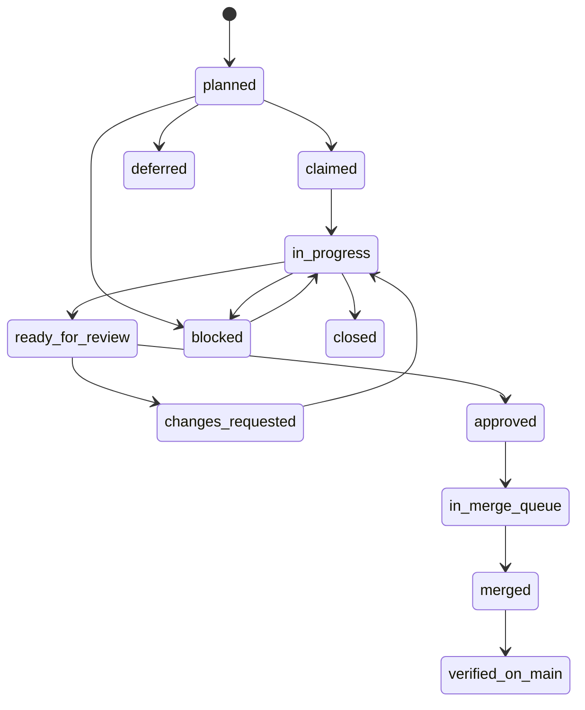

# SDLC workflow and lifecycle

- Default branch: `main`
- Main SHA reconciled: `f692014b9c7eb6a9fe0aa6f27b76b40426f053a7`
- Date: 2026-11-28
- Plan version: 1.1

This workflow describes the owner-confirmed 0.1.0 release scope under plan version 1.1. The lifecycle table and state diagram originated in the v1.0 snapshot; current wave, assignments, exact-head gates and approved preparation/promotion rules are maintained in `14-tracker.md`, `05-merge-plan.md` and `release-0.1.0.yaml`.

| State | Entry/exit criteria | Owner |
|---|---|---|
| planned | Scoped task/acceptance/dependencies; exit when files are claimed. | RM-01 |
| claimed | Non-overlapping files recorded; exit when work starts. | Implementer |
| in-progress | Code/tests underway; exit with focused PR and actual outputs. | Implementer |
| ready-for-review | Rebased, CI green, tests/docs included. | Implementer |
| changes-requested | Reviewer gives actionable findings; exit after fixes/re-review. | Reviewer/implementer |
| approved | Independent approvals and all checks green. | Reviewer |
| in-merge-queue | Dependencies merged, integrator rebased/tested. | INT-01/02 |
| merged | Merge SHA is on main; exit after post-merge QA. | Integrator |
| verified-on-main | Non-author QA records scenario, tests, exact SHA in file 16. | QA |
| blocked (reason) | Decision/dependency/red CI/bug blocks; resume only with recorded resolution. | Current owner/RM |
| deferred | Removed from v1 with v1.1 reason/label. | RM-01 |
| closed | Superseded/no value, keeper linked, evidence preserved. | RM-01/author |

WIP: one active PR per implementer; max three in review per reviewer; current-wave PR cap equals disjoint file groups. Claim paths in tracker before work; no overlap. Only INT-01/02 merge, one at a time in tracker order. Rebase and rerun focused/full tests after each prior merge. No author reviews own changes and no sole reviewer merges their PR.

## Central coordination and durable status

RM-01 is the sole coordination hub. All agents send assignment acknowledgements, progress, blockers, review requests, and handoffs to RM-01; they do not coordinate directly or assume another agent has seen a message. RM-01 relays only the needed information and owns conflict resolution, wave capacity, and status reconciliation. Technical evidence and review discussion also belong in the PR comments so the work is auditable.

For each transition, RM-01 updates both the YAML tracker entry and this Markdown tracker row: state, owner, claimed files, blocker/dependency, date, PR/issue, exact head/main SHA, verification evidence link, and next action. Agent check-ins use the handoff format below. A progress message without a durable tracker update is not a handoff. The orchestrator reloads YAML, tracker, and active PR comments at session start/resume; chat is not durable state. Tracker updates are delivered through the associated PR/plan-change PR so they are reviewable and merged to main. The tracker row includes checkable gates: scope/acceptance, claim, implementation, independent review, CI, merge, and QA-on-main.

Handoff note: `Done | Left | Verify (commands/results) | Source/PR/main SHA | Blocker + owner | Next owner/action | Links`. Post to RM-01 and the associated PR comment; RM-01 writes the durable tracker update and relays to the next owner. Review target one business day; RM reassigns if late. CI failures go to CI-01; two blocked cycles require RM to split or defer.

Plan amendments require `plan-change` PR in this directory, RM-01 approval, synchronized YAML/Markdown, and a changelog row.

RM-approved coherent size exceptions are recorded in `05-merge-plan.md` for PLAN-CHANGE-01 and NEW-01; all exact-head independent review/test and merge gates still apply.

The owner authorized isolated parallel preparation as described in `05-merge-plan.md`; exact path claims and shared-file write isolation remain mandatory. Only current-wave PR promotion and sequential dependency-respecting merges are allowed.
