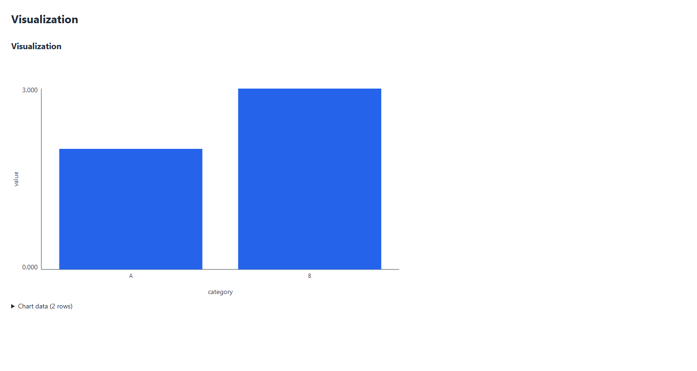
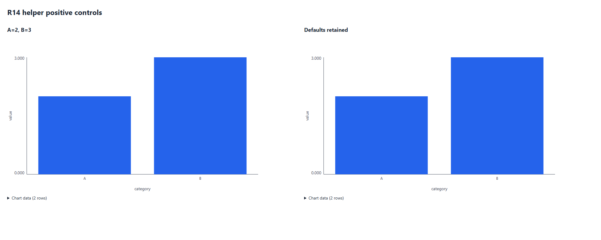

# R14-07 helper-null fix evidence

**Author validation, not independent approval or final-candidate CI.**

- Owner: `ses_de56782e8ffentAvzUUfMncFRA`; source-owner permission: `docs/coordination/tasks/R14-eligible-producer-transfers.md` common + 07.
- Branch: `fix/r14-helper-null`, isolated exact base `5340bc69b7203ad7a9166543062482d819f9b705` plus only the one-line helper fix and NEW regression.
- Product change: explicit `null` reaches the unchanged strict validator; only omitted/explicit `undefined` gets `{}`. No schema, dependency, lock, renderer, normalizer, prompt or existing-oracle edits.
- NEW test is a **byte-identical copy**, not newly credited independent work: tester09 commit `4a585cd2ab683421a19c217d3373478b88e49379`, `packages/deepviz/test/test_r07_tool_spec_null.test.mjs`, SHA256 `08be1d15661d6bd5bf87bdcec7db11ba3097d9eee294db654369564716e32227`. Original R07 filename/labels are intentionally preserved for immutable-oracle/retest compatibility.

## Observed RED → GREEN

| Gate | Before helper source edit | After one-line source edit |
|---|---|---|
| Immutable regression | exit 1: 31 pass / 5 explicit-null failures / 0 skipped | exit 0: 36 pass / 0 fail / 0 skipped |
| Original 8 JSON cases × 5 public wrappers vs JSON Schema | exit 1: 35/40 agreement, only five null mismatches | exit 0: 40/40 agreement |
| Full npm suite | Not redundantly replayed on unchanged baseline; tester09's prior 277/5 is reported history only | exit 0: 282 pass / 0 fail / 0 skipped |
| Build / typecheck | exit 0 / 0 | exit 0 / 0 |
| npm schema check / Python exporter `--check` | Source schema bytes checked, no baseline gate replay | exit 0 / 0 |
| Four Python schema/parity suites | Not run on this baseline | exit 0: 689 pass / 0 fail / 0 skipped |
| npm pack dry-run / diff check | Not run on this baseline | exit 0 / 0 |

`commands.json` records exact argv, exits and durations with explicit local-path placeholders. `run-summary.json` holds the source/build hashes, full wrapper summaries, all counters, browser results, limitations and **60 raw owned file identities**. Raw originals remain in the uniquely owned `C:\Users\bagma\AppData\Local\Temp\opencode\r14p07-run\` directory; no shared environment was installed or changed.

The baseline product tests completed correctly. A collector-only TypeError then occurred while parsing the Windows-cp1252-decoded Unicode marker in Node 26's reporter. The recovery parsed ASCII labels from the preserved output and ran only the previously unexecuted wrapper probe. No install/build/type/regression was repeated to hide the failure; original incomplete collector JSON is retained in the summary.

## Real output and correctness

Playwright used the OWN installed package and existing cached Chromium 159.0.8154.6; no browser installation, CDN requests or shared browser processes. Omitted/default SVG and a valid two-chart dashboard were checked on localhost: `2 → 2` and `2 → 4` counts, A=2/B=3 labels, 260/390 bar heights = 2/3, requested titles, no bootstrap/page/console errors and no external requests. Actual SVG and all three inspected screenshots are preserved and hashed in raw evidence.

Opened actual screenshots:

The 2000px dashboard image shows both complete pairs and readable axes. The original 1500px image revealed the existing intentional horizontal-scroll layout for fixed 900px child plots; it is not presented as clipping-free. No layout/renderer source was changed.

## Independent handoff

Tester09's published recipe at commit `8f8a21f61c33d3527ecb2933427dd0fcded909bc`, `tests/r13_probes/role09/retest-helper-null.ps1`, accepts the unchanged regression and exact clean future producer SHA. A genuinely independent authorized tester should run it and the original wrapper recipe (documented in tester09's `R10-09-helper-null-fix.md`) on the published producer commit. This source author did not spawn, approve itself, close issues or modify PRs/shared branches.

No full Python/scale/DeepAgent/MCP/all-engine browser/final remote-CI claim. Prior Python distribution consumer evidence is tied to its original source and **not transferred** to this later source. R04 owns integration and final acceptance.
