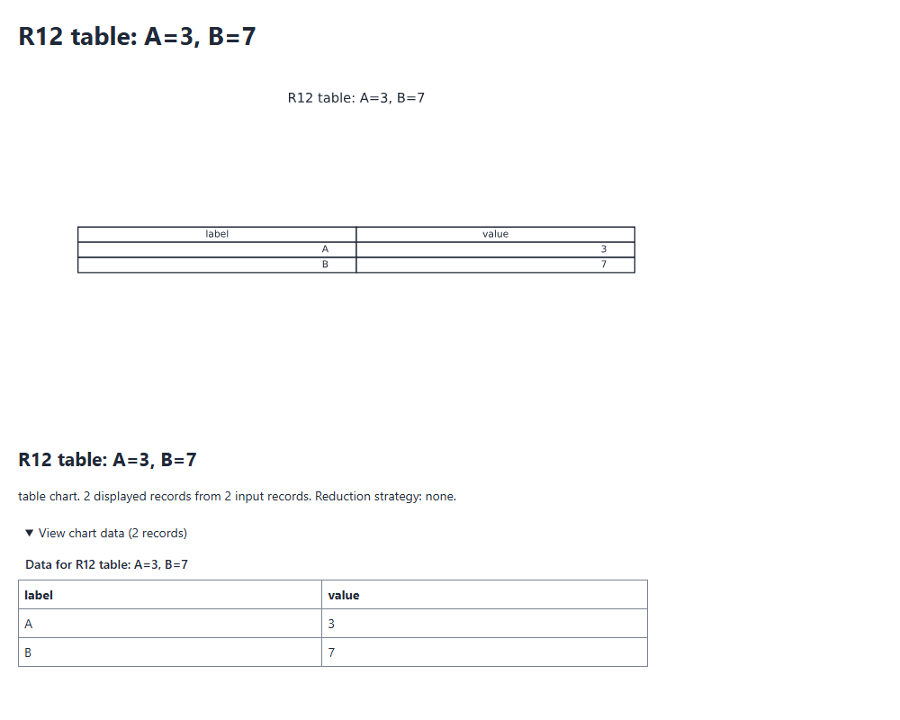
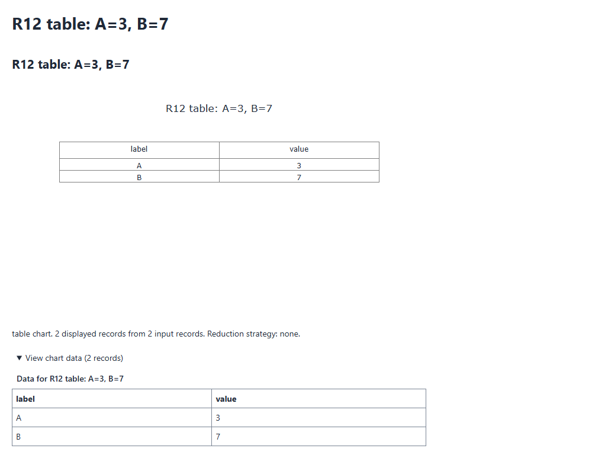
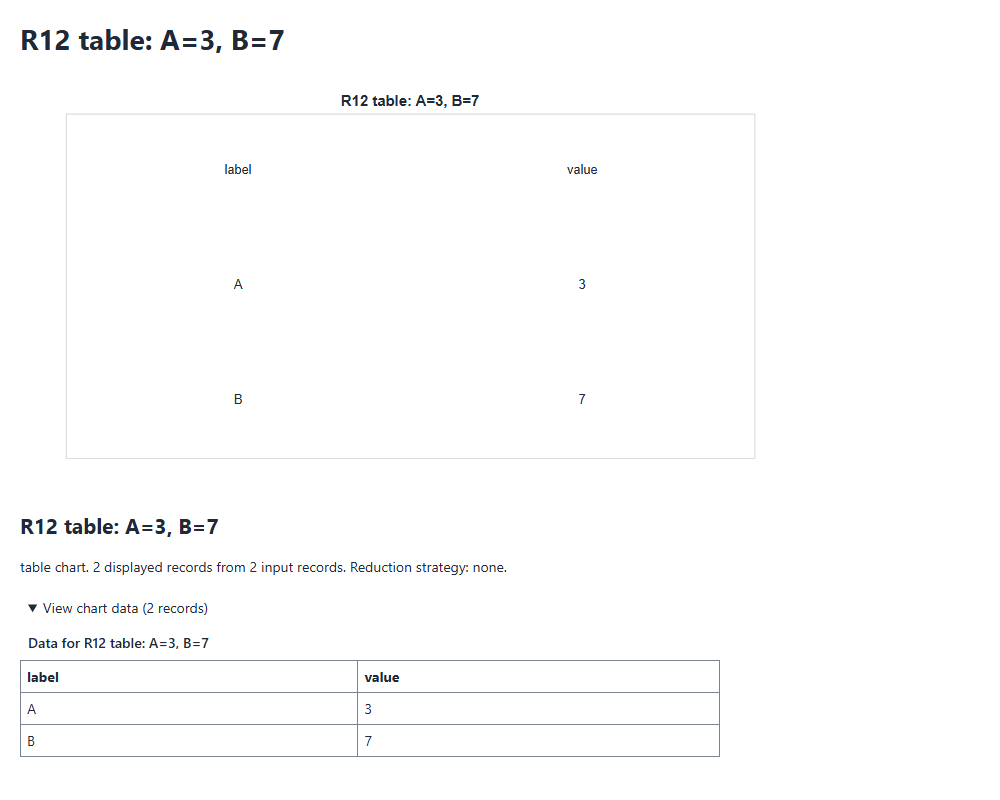
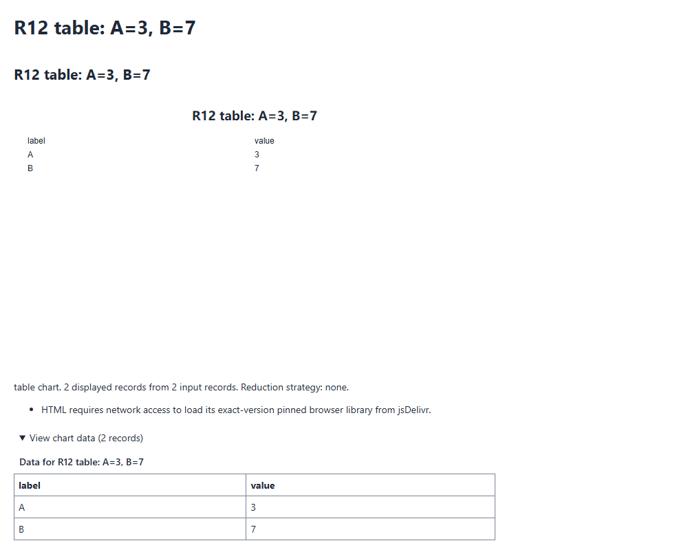
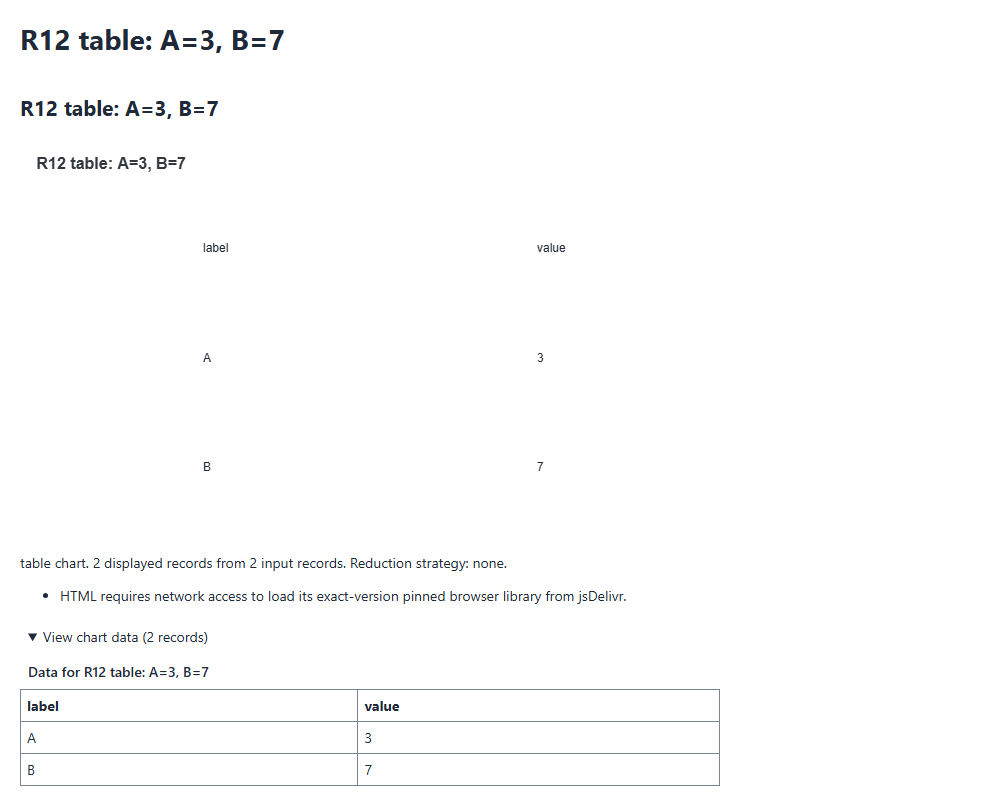

# R04 dense-table and bounded-SUM integration evidence

Tested product: `7bcfb2dcbf99f9deb44a2b5558373bd3aaccd0e6`. This is a **partial, failing candidate**, not a release or final signoff.

- Dense-table source: [`d5b68c4`](https://github.com/sandeshbagmare/deepviz-agent-toolkit/commit/d5b68c470416f93127c8187e8111d0d27d20b108), integrated as `1c721bb`. New permanent tests went from **18 failed /7 passed** to **25 passed**. The shared preflight rejects over 10,000 expanded header/body cells or 16MiB estimated table bytes before native/accessible-table allocation; no silent truncation. This estimate is not a total-memory or final-file-size guarantee.
- SUM source: [`ec9f669`](https://github.com/sandeshbagmare/deepviz-agent-toolkit/commit/ec9f669eff28cd5351da142765b7755e3b2f484f), integrated as `7bcfb2d`. Retains one accounted integer on transient float overflow, not an input list. **Not universally exact:** independent [review R13-01](https://github.com/sandeshbagmare/deepviz-agent-toolkit/blob/dd73e9d498295567e5b90c9d396acfa748e02751/docs/coordination/reports/R13-01-sum-review.md) exposes inherited pre-promotion residual loss, still OPEN P2. Review is not final-head approval.
- Integrated focused Python: **345 passed /9 scale deselected**, Ruff/mypy exit0. Full non-scale Python: **3043 passed /36 failed /5 skipped /9 scale deselected**. npm build/typecheck/schema/pack-dry-run exit0; **269 passed /0 skipped**. Missing independent final-head gates/clean installed distributions/current scale/green CI remain unmet.

`summary.json` contains every full-suite failure/skip name, source and raw-log hashes, exact browser observations, asset hashes and bounded before/after memory-method disclosure. Raw logs/XML stay in the producer's existing local evidence directory; the compact packet does not pretend they were rerun or publicly uploaded.

## Actual images and correctness rationale

All five PNGs were captured from the **real clean-source outputs**, then opened by R04. The native chart and accessible table preserve `label,value` and `A=3,B=7`; both rows and headers are readable without clipping in this two-row fixture. Each browser had zero console/page errors and no unexpected requests. ECharts6.1.0/AntV5.4.8 exact pinned CDN URLs were served **existing local installed bytes**; this is not a live-CDN/offline-interactive guarantee.

| Matplotlib | Plotly | Vega-Lite |
| --- | --- | --- |
|  |  |  |

| ECharts | AntV G2 |
| --- | --- |
|  |  |

No all-kind, all-size, scale, accessibility or independent tester signoff is inferred from these small controls. The public1700B sparse tool fixture was rejected before output creation, preserved the caller's file, and measured **69,587B Python tracemalloc peak /0.0114637s**, versus the separately reproduced **30,698,790B /3.8151666s** baseline. This is per-call Python allocation tracing, not OS RSS or renderer/browser memory.

## Reproduction

Use the existing project venv, own committed source via `PYTHONPATH`, and installed Node tooling read-only. Do not install dependencies or reuse an output directory.

```powershell
python -m pytest -m 'not scale' -q --tb=short -p no:cacheprovider --junitxml=<NEW-result.xml>
python -m ruff check python/deepviz/src/deepviz/normalize.py python/deepviz/src/deepviz/engines.py python/deepviz/src/deepviz/render.py python/deepviz/tests/test_r07_finite_overflow.py python/deepviz/tests/test_r12_table_budget.py
python -m mypy
npm run build
npm run typecheck
npm test
npm run schema:check
npm pack --dry-run --workspace @deepviz/agent-toolkit
python docs/coordination/evidence/R12-generate.py <OWN-source-root> <NEW-artifact-root>
node docs/coordination/evidence/R12-browser.cjs <same-artifact-root> <existing-tooling-root>
```

`npm ci`, final10M and full bare pytest were **not** accepted runs here. One earlier focused command omitted `-m 'not scale'` and timed out120s; its partial output/noXML/zero surviving processes are recorded separately, not a product pass. Detailed execution chronology: [R12 report](../../reports/R12-render-budget.md).
