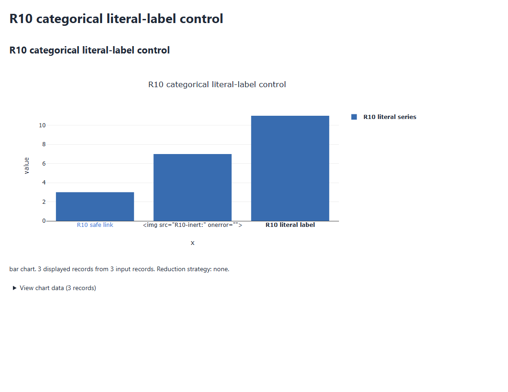
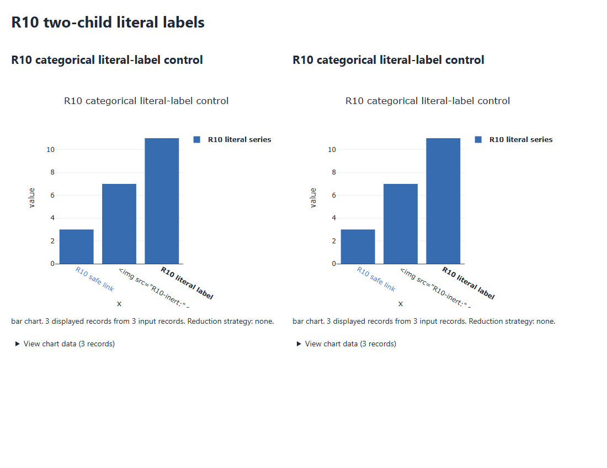
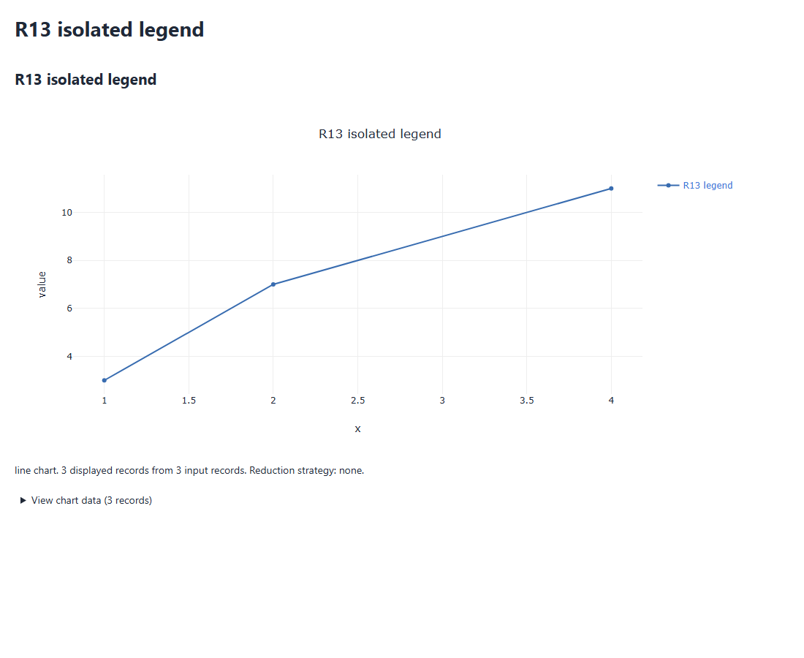
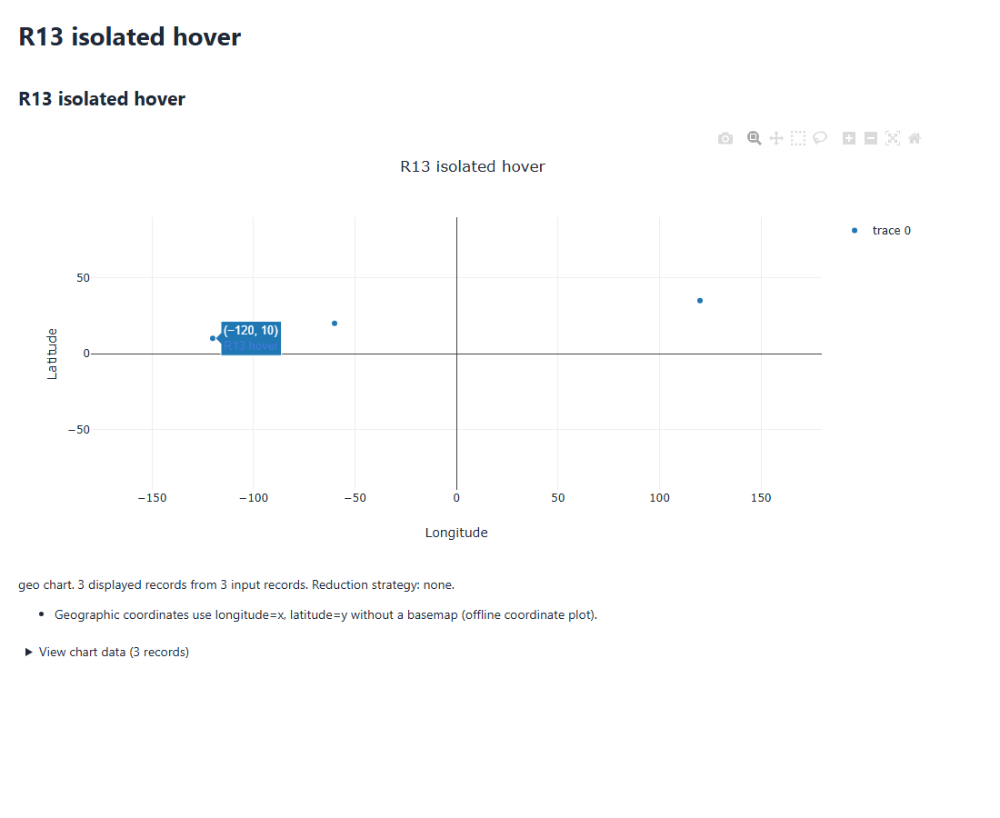
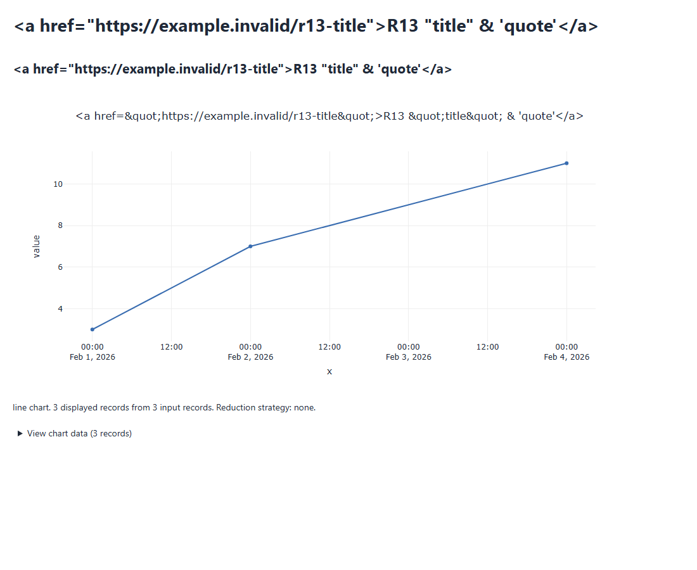

<!-- deepviz-bug-key: F20-PLOTLY-LITERAL-TEXT -->
## Reproduced bug: data text is interpreted as Plotly HTML

Plain data labels must remain literal text. In actual Chromium output, Plotly categorical labels, an isolated legend name, and native hover text turn an inert HTTPS-anchor string into an active SVG link. Native title double quotes are also displayed as `&quot;` rather than the original text.

**Scope/severity:** confirmed HTML/link interpretation and literal-text/data-integrity defect; proposed P2 hardening. **No JavaScript execution, clicked navigation, credential access, or remote exploitation was demonstrated.** No payload link was clicked; all unexpected network requests were blocked. The native-title observation is an inert text-correctness mismatch, not title XSS.

Coordination fix owner: **R04, Python `engines.py::_plotly`** (not the separately released AntV `_antv` function). Related broad stories: #10, #21, #23. Related independent role02 category/series anchor observation is the **same bug**, not another ticket. Complete live open-issue deduplication found no specific existing report of this failure; the three related stories describe general feature/security/visual acceptance.

## Immutable source, probes and actual results

- Tested Python source: **`3aa521a5d41e8f5cfcb21a5efc008bb3ff2cfcab`**. Four loaded production-module Git blobs matched the pinned commit. This is baseline evidence, **not a claim that the moving/final candidate was retested or fixed**.
- Original strict probe/evidence commit: **`c1bf91c5439d585e2ff157752f380cfa4fe85c6d`** — [R10 test](https://github.com/sandeshbagmare/deepviz-agent-toolkit/blob/c1bf91c5439d585e2ff157752f380cfa4fe85c6d/tests/r10_probes/role20/test_plotly_literal_labels.py), [native DOM/values](https://github.com/sandeshbagmare/deepviz-agent-toolkit/blob/c1bf91c5439d585e2ff157752f380cfa4fe85c6d/docs/coordination/evidence/R10-20/strict-red.json), [source-identity hashes](https://github.com/sandeshbagmare/deepviz-agent-toolkit/blob/c1bf91c5439d585e2ff157752f380cfa4fe85c6d/docs/coordination/evidence/R10-20/identity.json), [exact executed command ledger](https://github.com/sandeshbagmare/deepviz-agent-toolkit/blob/c1bf91c5439d585e2ff157752f380cfa4fe85c6d/docs/coordination/evidence/R10-20/commands.md). Actual `pytest` exit **1: 2 failed / 4 passed / 0 skipped, 20.29 s**. The two categorical chart/dashboard cases fail strict anchor absence; numeric/time chart/dashboard controls pass.
- Novel isolated-sink probe/evidence commit: **`f9087d0518e74378e810b9efe6d6630a12044399`** — [R13 test](https://github.com/sandeshbagmare/deepviz-agent-toolkit/blob/f9087d0518e74378e810b9efe6d6630a12044399/tests/r13_probes/role20/test_plotly_sink_discrimination.py), [native DOM/values/source hashes](https://github.com/sandeshbagmare/deepviz-agent-toolkit/blob/f9087d0518e74378e810b9efe6d6630a12044399/docs/coordination/evidence/R13-20/strict-red.json), [exact executed command ledger](https://github.com/sandeshbagmare/deepviz-agent-toolkit/blob/f9087d0518e74378e810b9efe6d6630a12044399/docs/coordination/evidence/R13-20/commands.md). Actual `pytest` exit **1: 3 failed / 0 passed / 0 skipped, 9.63 s**. No xfail, relaxed assertions, source fix or old-six-case replay.
- All nine recorded cases awaited the real native render. Browser helpers themselves exited 0; **zero console/page errors and zero unexpected network requests**. Existing Python 3.12.16 / Plotly 6.9.0, Chromium 159.0.8154.6 / Playwright 1.65.1 / Node 26.13.1; self-contained Plotly HTML. No dependency install or paid model call.
- Reporter/session: independent QA `ses_de567801cffeGZFlt50oYv0Dnt`. This issue records already executed evidence; **no browser/build/SUM/scale rerun was performed to file it**. The later R16 finite-SUM pass does not fix this text bug.

## Literal expected versus actual DOM

The original public-render fixture uses `aggregation='none'`, three rows with y `[3, 7, 11]`, and these categorical x values:

```text
<a href="https://example.invalid/r10-20">R10 safe link</a>

<b>R10 literal label</b>
```

The series field is `<b>R10 literal series</b>`. The `.invalid` address is an inert test sentinel, not an exploitation target.

**Expected:** display each complete original string literally, including `<a ...>...</a>` / `<b>...</b>`, without creating a navigation link or event-handler attribute. Preserve the original manifest records and accessible-table cells, numeric values and coordinates.

**Actual:** one native anchor in the chart and one per child (two) in the dashboard:

```html
<a xlink:show="new" target="_blank" xlink:href="https://example.invalid/r10-20" style="cursor:pointer">R10 safe link</a>
```

Native text drops the anchor/bold syntax, while manifest records and table cells retain the original strings. Three marks per child and y `[3, 7, 11]` are preserved; no event-handler attribute was created by the empty-handler string.

The isolated R13 observations distinguish the other display sinks:

| Sink | Literal input / expected | Actual native output |
|---|---|---|
| Legend only, numeric x `[1,2,4]` | `<a href="https://example.invalid/r13-legend">R13 legend</a>` displayed literally | One SVG HTTPS anchor; native legend text only `R13 legend` |
| Geo native hover, x `[-120,-60,120]`, y `[10,20,35]` | `<a href="https://example.invalid/r13-hover">R13 hover</a>` displayed literally | Before pointer: zero anchors. First actual pointer hover: one SVG HTTPS anchor; tooltip text `(−120, 10)R13 hover`. No click. |
| Native title, ISO-date x | `<a href="https://example.invalid/r13-title">R13 "title" & 'quote'</a>` displayed literally | Native text is `<a href=&quot;https://example.invalid/r13-title&quot;>R13 &quot;title&quot; & 'quote'</a>`; zero anchors/handlers. |

The second geo hover similarly strips `<b>` markup; the third empty-handler image string remains literal. Numeric/ISO-date values, three marks, expected relative pixel spacing (1:2; geo 1:3), and original records remain unchanged. No geometry loss or execution is claimed.

## Actual inspected image evidence

These are the generated PNGs that QA actually opened, not mockups. JSON linked above contains exact artifact/PNG hashes and native DOM:











## Reproduce / independent fixed-source retest

Use existing render extras and Node/Playwright/Chromium. Keep a clean source checkout at the SHA under test and a separate checkout of probe commit `f9087d0518e74378e810b9efe6d6630a12044399` (which includes unchanged R10 tests). Verify actual loaded module paths/Git blobs against the source SHA. **Always use new unique basetemp/XML paths; do not overwrite the recorded baseline.** Exact original executed commands are in the two immutable command-ledger links above.

Portable PowerShell recipe (substitute actual existing paths; not a new run claimed by this issue):

```powershell
$source = '<clean source checkout: 3aa521a5d41e8f5cfcb21a5efc008bb3ff2cfcab, or frozen fixed SHA>'
$probes = '<probe checkout: f9087d0518e74378e810b9efe6d6630a12044399>'
$python = '<existing virtualenv>\Scripts\python.exe'
$env:PYTHONPATH = "$source\python\deepviz\src"
$env:R10_20_NODE_MODULES = '<existing node_modules>'
$env:R13_20_NODE_MODULES = $env:R10_20_NODE_MODULES
& $python -m pytest "$probes\tests\r10_probes\role20\test_plotly_literal_labels.py" "$probes\tests\r13_probes\role20\test_plotly_sink_discrimination.py" -q --basetemp='<NEW unique output directory>' --junitxml='<NEW unique result.xml>'
```

The recorded separate baseline runs total five strict failing cases and four passing controls; do not relabel collector exit 0 as test GREEN. A future fixed-source run must be genuine and independently recorded, not inferred from these results.

## Source-owner direction and acceptance

At the pinned source, [`_plotly` lines 352–411](https://github.com/sandeshbagmare/deepviz-agent-toolkit/blob/3aa521a5d41e8f5cfcb21a5efc008bb3ff2cfcab/python/deepviz/src/deepviz/engines.py#L352-L411) passes raw category/trace-name/geo-hover strings into Plotly rich-text sinks, while the native title uses quote-escaping intended for HTML. This is one Plotly literal-display boundary defect, not five invented issues. Proposal only: apply Plotly-specific literal display-string handling without weakening outer HTML/table/script serialization or changing numeric/time semantics. No production fix has been made by this QA lane.

- [ ] Literal full text is retained for categorical labels, legend/series, hover and native title (quotes/ampersands included); no unexpected bold/HTML interpretation.
- [ ] **Zero data-created SVG/HTML anchors and zero event-handler attributes** in standalone charts and both dashboard children, including after real native pointer hover.
- [ ] Original records/table cells/counts/warnings, y values, numeric/ISO-date/geo coordinate types and relative spacing are preserved. Keep existing HTML/script/table escaping intact.
- [ ] Run the unchanged nine strict cases against a clean frozen fixed source with new outputs: 9 passed / 0 failed / 0 skipped, zero console/page errors/unexpected requests. Inspect real new PNG/DOM evidence; do not click payload links.
- [ ] Manager obtains the required independent review/test evidence and applicable focused gates before merge/closure. Keep this bug open until that evidence exists; this report is not final signoff, green CI, a closure request, or a 900-issue completion claim.
