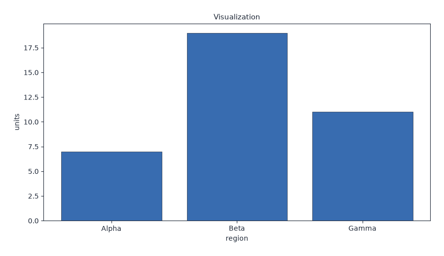

# R21-04 — practical public recommendation-to-render fidelity

**Scoped result:** exact clean **`7bcfb2dcbf99f9deb44a2b5558373bd3aaccd0e6`**, NEW **24 passed / 0 failed / 0 skipped, 2.60s**; scoped Ruff0/mypy0. Actual recommended static PNG **OPENED**, same saved native bars exactly7/19/11, input/output3/3, no loss/mutation. **No product defect found in this finite subset.** Own publication pending execution, not final release acceptance. 2026-11-27.

## Ownership, prework and exact execution identity

- SAME-ID `ses_de5678314ffeuDXtC7RfGsbD6V`; FULL MAIN R21common+04/own actual-ID note/currentcanonical/RESUME/STATE read first; prework report/note saved before substantive work. No spawning, provider, service, install or shared-env writes.
- Existing own publication branch `agents/r10-04-utf8-field-envelope` was clean at `c92e70d08176b19787f4ca5509dbfa2c8d771f23`. It is older source, **not**7bc. Three producer-source differences were detected before testing; no false source equivalence or product cherry-pick.
- Guarded `git worktree add --detach C:/Users/bagma/AppData/Local/Temp/opencode/r21-04-source7bc-ses_de5678314ffeuDXtC7RfGsbD6V 7bcfb2dcbf99f9deb44a2b5558373bd3aaccd0e6` exit0 created a **clean immutable read-only source checkout**. Tests live on the existing own branch but PYTHONPATH points to this exact7bc checkout. Runtime autouse guard checks HEAD, actual imported paths, and immutable Git bytes for`__init__/tools/recommend/normalize/models/render/engines`. Checkout remains clean after tests; source/model/schema diff0. Own branch production/schema remains untouched (diffagainstc92exit0). Old worktrees/evidence preserved.
- Writes ONLY NEW `tests/r21_probes/role04/` (test+README), this report, `evidence/R21-04/` and own actual-ID note. No production/originaltests/model/schema/oracle/policy changes, issue/PR/default/shared branch writes. Root read-only SDLC audit is not issue-write authority; R04 alone integrates/manages issues.
- Actual seven imported source SHA256/blob/path identities,24JUnit case names,12raw-artifact hashes and exact tested-file hashes are in [`../evidence/R21-04/recommendation-results.json`](../evidence/R21-04/recommendation-results.json). Example: public`tools.py`SHA256`ae2390e5616e2e455df6bfdb4471865bafa148eb2853ea5793d144f88a16e0cb`;`recommend.py`SHA256`74daaf467a20948526fd0027fd20ab5e9da6ac2029a169d15415b3d35d345999`.

## Existing tests inspected first / novel scope

Read full`recommend.py`/`tools.py` and connected normalization/real Matplotlib code. Existing`python/deepviz/tests/test_integrations.py:36–46,97–104,120–128,170–185` already cover handle/bar basics, a raw-row privacy check, overlong10Kfield direct-profile check, and six **kind-only** recommendations (including negative/zero). None were rerun as new evidence. Scoped grep found no other profile-cap/recommend-specific tests; a guessed`tests/conftest.py`read was not found, confirmed by glob, not counted as a test failure.

NEW task-success tests add public `ToolSession.normalize_data → recommend_chart(dataset_id) → unmodified recommended spec → normalized records / real native artists`. Recommendations remain bounded editable heuristics, not a causal/semantic model. No old collision/byte-budget/GraphQL/count-overflow matrix replay.

| NEW cases | Count | Independent checks / actual observations |
|---|---:|---|
| Five literal goals, through public handles and real native artists |5| Comparison Alpha/Beta/Gamma7/19/11; ordered date line2026-01-03/04/09with4/1/9; independent scatter(1.5,19),(2.5,10),(5,23); histogram six input values1,1,2,3,5,8with native bin mass6; positive composition North8/South5with wedge fractions8/13and5/13. Exact mappings, counts, no input mutation; all carry bounded editable review warning. |
| Negative/all-zero composition native safety |2| Values−4,9,2and0,0,0recommend bars, **not pie**; real bar heights retain signs/zeros; rationale states nonnegative/positive-total requirement. |
| Missing/all-null/boolean-only measure × relationship/composition |6| Numeric profile empty; editable table with no invented x/y numeric measure, explicit field-selection rationale. |
| Empty distribution |1| Count0/table, no invented measure. |
| NaN/+Inf/−Inf tool boundary |3| Clear finite-JSON error **before** advice cache/artifact allocation; no output directory. |
| Public field-count privacy boundary99/100/101 |3| Exactly≤100fields; truncation false/false/true; sentinel cell values absent from summary/advice JSON; bounded context length. |
| Public field-name256/257-character boundary |1| Exact256-name retained,257-name omitted with explicit`fields_truncated=true`; not rewritten; raw sentinel value never in context. This is profile character count, not prior ingestion UTF8-byte envelope. |
| Numeric ID / mixed numeric strings |2| Bounded observed/review-fields warnings and valid editable mappings; no perfect-semantic-choice requirement invented. Relationship rationale explicitly denies establishing causality; mixed invalid numeric strings do not produce an unsafe pie. |
| Actual public recommended static render |1| Same original recommended spec, original source handle, real figure/native values and actual PNG; exact manifest values/counts/warnings, no input/spec mutation, caller file retained. |
| **Total** |**24**| **0 product failures observed in this subset**. |

### Loss / uncertainty / scope distinctions

- Trend input is already ordered. Rationale requires verifying ordering/time semantics; **no automatic reordering promise** invented.
- Histogram intentionally bins its six original values into distribution geometry; native bin counts sum6. This is a lossy summary, not six independent original marks or a new acceptance claim for every binning policy. Pie fractions intentionally encode relative composition8:5. Only the selected comparison fixture was saved/opened as image.
- Default tool profile is bounded observed data, not exhaustive semantics.100/256limit truncation is visible in public profile; generic recommendation warning says review fields/units/reduction. Ambiguous IDs/strings remain a user-editable heuristic. No defect/ticket invented for unspecified perfect choice.
- Chosen saved comparison has unique categories: automatic`sum` retains exactly7/19/11and3rows, with no loss. Recommendation's **heuristic warning** remains in advice; artifact/native warnings are empty because this fixture needed no lossy reduction/fallback. Both are recorded, not conflated.

## Actual PNG / native correctness evidence

- Actual source PNG`artifacts/local/R21-04/render-final/matplotlib-0r5bkooj/deepviz-u8672bo1/chart.png` was **OPENED via image-reading tool**, not merely checked for existence.900×520light chart: Visualization title, region/units axes and Alpha/Beta/Gamma labels readable; no obvious clipping; tallest Beta19, Alpha7, Gamma11. No browser used or browser/console signoff implied.
- Published byte-identical copy14,452bytes/SHA256 **`5d3282c76acbabc2fe896c0f004ca252c88b580a0605d246fa055cd833636a63`**.
- Observation-only forwarder called real`matplotlib_figure`, inspected artists and returned that untouched same figure to real production`savefig`: heights`[7,19,11]`, exact labels, axis names region/units, notes[]. No fake renderer, no fabricated PNG or rewritten payload/spec.
- `ToolSession.render_chart(advice['engine'], {'dataset_id': advice['dataset_id']}, advice['spec'])` produced the real artifact; manifest records equal literal original rows, input3/output3/strategy`sum`/warnings[]; requested/rendered kind bothbar; input/spec unchanged and caller-owned marker preserved. Raw generated PNG/SVG/HTML/manifest/observations remain under own ignored artifact directory.

## Exact commands / honest failure chronology

From existing own test branch, `$PY=C:/Users/bagma/deepviz-agent-toolkit/.venv/Scripts/python.exe`, `$source=<clean detached7bc checkout>`, `$env:PYTHONPATH="$source/python/deepviz/src"`, `$env:DEEPVIZ_R21_SOURCE_ROOT=$source`, `$env:PYTHONUTF8='1'`; final render root`<own>/artifacts/local/R21-04/render-final`.

| Actual command | Exit/result |
|---|---|
| `& $PY -m pytest tests/r21_probes/role04/test_recommendation_fidelity.py -q --tb=short --junitxml=artifacts/local/R21-04/recommendation-final.xml` |0; **24passed/0failed/0errors/0skipped2.60s** |
| `& $PY -m ruff check tests/r21_probes/role04` |0; all checks passed |
| `& $PY -m mypy tests/r21_probes/role04` |0; one source file/no issues |
| `git -C <source> status --short --branch`; source diffagainstexact7bc |Clean detached7bc; diff0 before/after tests and collector |
| Stdin source/import/Git/JUnit/loghash/native-PNG evidence collector |0; actual7imports/exactGitbytes,24JUnit cases,2test/doc hashes,12raw logs/observations hashed, PNGcopies exact |
| Fresh captured-memory GCM GET/user/repo/ownref |3×HTTP200at2026-11-27T15:03:50.046543UTC; expected`sandeshbagmare`, expectedrepo/pushpermissiontrue, ownrefc92e70d; helpermanager/authorconfigured. **APIwrites0**, no token in args/logs/files; redirects disabled. |

Initial NEW pytest had24pass0fail0skip2.87s/Ruff0; **own harness mypy failed1** because `ModuleType.__file__` is`str|None` and the runtime source guard lacked explicit non-None narrowing. Minimal own-test-only `assert module.__file__ is not None` fixed typing; final NEW suite rerun above. No production bug/fix was inferred. First log/XML/type error and first image preserved locally; only one final PNG is visually accepted/published here.

## Decision, publication and next action

- **Disposition:** useful finite practical PASS, no defect/issue write/closure justified by these cases. Retain existing nonnegative-positive-total pie guard, no-measure table fallback, finite JSON trust boundary, bounded profile/truncation and editable review warning. R14 Unicode-index grammar remains unspecified, not a new bug.
- **Publication pending:** explicit only six owned paths (two NEWprobe/docs, report, evidenceJSON, actualPNG, ownnote), whitespace/scope/secret/hash checks, meaningful owncommit, non-force ownpush and exactactualremoteSHA readback after expected-account verification. No shared branch or producer source integration.
- **Limits:** no original/full suites, global lint/types, distribution/npm/build, currentCI, external model/provider, browser/CDN, other engine renders,10M/RSS or final release/reviewer signoff. Exact7bc execution is not current-MAIN or remote greenCI. Root30open/0closed/1draft0merged/0reviews audit remains root evidence, not a worker mutation grant;900criterion unaffected.
- **Current action:** finish scoped publication and save actual receipt, no running job/local blocker.
- **One executable next action (R04 after receipt):** inspect `tests/r21_probes/role04/README.md` and this exact7bc image/value evidence; retain current recommendation safety heuristics, use NEW test subset for independently pinned future candidate verification. Do not label it wholecandidate approval or a perfect semantic recommender.
