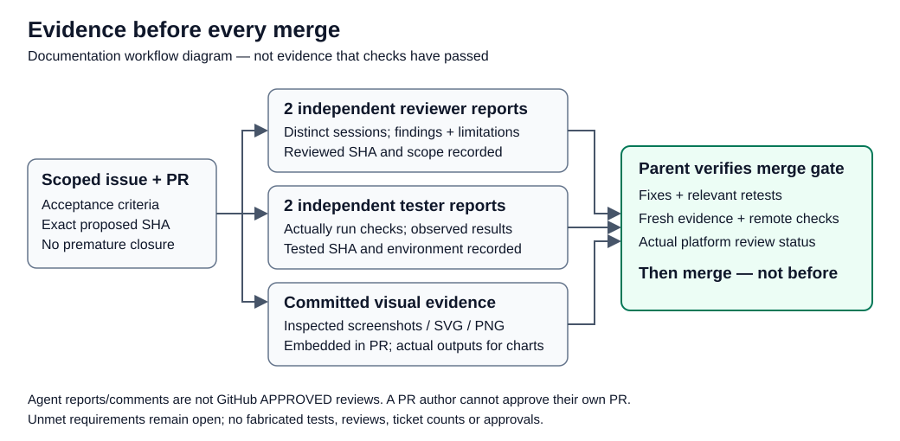

# Review, test, visual and closure evidence policy

## Required merge gate

Every merged PR, including documentation/process PRs, needs:

1. **Two independent reviewer-agent reports** on the actual proposed change, not copied summaries from the implementer.
2. **Two independent tester-agent reports** with independently executed checks and observed results. Two reports quoting the same unobserved log are not two tests.
3. **Committed screenshots/SVG/PNG**, generated from or meaningfully illustrating the deliverable, and embedded in the PR body. Chart features need actual chart renders; an architectural diagram cannot stand in for chart correctness. Documentation-only PRs can embed an inspected relevant diagram, but must label it as documentation evidence rather than a chart-test result.
4. Resolved material findings, linked regressions/retests, appropriate remote checks, and explicit remaining limitations.

The parent coordinates agents and PRs. The process author does not create PRs, merge `main`, close seeded issues or attest to other agents' unobserved checks. A successful seed/read-back is only process evidence.



The process author rendered this SVG with headless Microsoft Edge and opened the resulting [PNG screenshot](review-gate.png). The screenshot is documentation evidence only; this author self-check does not count as one of the independent reports.

## Provenance and freshness

Each report identifies an agent/session ID and role, exact commit SHA, repository/worktree, scope, commands or inspection steps, observed output, findings and limitations. Record the report path or immutable comment URL in the PR. Prefer distinct reviewer and tester sessions (four total) to make independence unambiguous; if a session performs more than one role, disclose that and obtain the parent's explicit acceptance rather than counting it silently twice.

Reports must be independent of the implementation author. Sharing a common brief or fixture contract is fine; copying another report or merely restating an implementation summary is not. Account-level authorship is separate from agent/session provenance.

When the head changes after reports are written, list which reports are stale and why. Run relevant regressions and obtain renewed independent inspection/testing appropriate to the changes; do not carry a blanket “approved” checkbox across unexamined code. Evidence-only additions still require confirming source/artifact correspondence and the current head. Use exact SHAs and scopes so reviewers can see what was actually examined rather than pretending every report covers every future commit.

## Copyable reviewer report

```text
Role: independent reviewer 1 (or 2)
Agent/session:
Author independence statement:
Repository and branch:
Reviewed base..head SHA:
Scope and files examined:
Checks/inspection actually performed:
Findings by severity (or none observed within scope):
Required fixes and verified resolution references:
Limitations / not examined:
Conclusion: ready within scope | changes required | blocked
Report path or comment URL:
```

## Copyable tester report

```text
Role: independent tester 1 (or 2)
Agent/session:
Author independence statement:
Tested SHA and environment/package versions:
Exact commands and exit codes:
Observed result counts (not expected or inferred counts):
Negative/security cases exercised:
Real output files opened and inspected:
Browser/network/optional-extra prerequisites:
Defects and regression/retest references:
Limitations / skipped checks:
Conclusion: passed within scope | failed | blocked
Report path or comment URL:
```

For documentation changes, independently check JSON syntax, manifest uniqueness, issue mapping and acceptance consistency, links/diagram rendering, diff scope and claim provenance. This is not a substitute for application tests on implementation PRs.

## Copyable PR body

Replace every placeholder with actual evidence before checking a box. The parent chooses the branch and opens the PR; this template does not open one.

```markdown
## Outcome and scope
<What changed and what deliberately did not change.>
Refs #<issue>; refs #<epic>
Base: <SHA>; proposed head: <SHA>

## Acceptance mapping
| Issue / criterion | Deliverable | Observed verification | Evidence |
| --- | --- | --- | --- |
| #<N> / <criterion> | <file/API/artifact> | <command + result> | <report/link> |

## Independent reports
- [ ] Reviewer 1: <session, reviewed SHA/scope, report link, conclusion>
- [ ] Reviewer 2: <different session, reviewed SHA/scope, report link, conclusion>
- [ ] Tester 1: <session, tested SHA, exact commands/results, report link>
- [ ] Tester 2: <different session, tested SHA, exact commands/results, report link>
- [ ] Material findings fixed and appropriately re-reviewed/retested: <links>
- [ ] Head changes since reports and evidence freshness addressed: <details>

## Committed visual evidence

<Use actual committed SVG/PNG/screenshots, pin the source commit, and identify the
generation command, source fixture, engine and inspection result. Do not use a
future filename, decorative stand-in or an uncommitted temporary screenshot.>

## Platform review status
Independent agent reports are evidence, not GitHub APPROVED reviews.
Actual GitHub review states: <observed count/identities or not requested>.
Any literal required-approval prerequisite: <actual state; refs #29 if relevant>.

## Verification and limitations
- [ ] Remote workflow: <run URL, SHA, observed status or actual blocker>
- [ ] Security/packaging/scale checks relevant to this scope: <observed evidence>
- [ ] Unsupported/unrun behavior disclosed: <details>
- [ ] No credentials or unrelated files committed.

## Issue closure decision
<Remain open until criteria and gates are met; no blanket automatic closure.>
```

## Closing work honestly

An issue moves conceptually through **planned → implemented → independently verified → integrated**. These are evidence states, not native labels configured by this seed. Marking acceptance checkboxes requires a supporting report or artifact; do not check them merely because a file exists or one happy-path test passes.

The parent may close a story/task only after all its criteria are satisfied and the corresponding deliverable is integrated as intended. A PR may implement multiple tickets, but each ticket needs its own acceptance-to-evidence mapping. An epic closes only after its child scopes and aggregate outcomes are verified; unresolved external acceptance blockers remain visible. A partial delivery should say what was completed and leave remaining scope open rather than rewrite the criteria after the fact.

Avoid auto-close keywords until the full gate is satisfied; use `Refs #N` during development. A merged PR does not retroactively prove a clean install, ten-million-row benchmark, chart inspection, actual GitHub approval or 900 independent resolutions.

## Final audit checklist

- [ ] Read back current repository visibility/default branch and remote branch SHAs.
- [ ] List real issues excluding pull requests; report created/open/closed counts separately.
- [ ] Match every closed issue to a verified deliverable, merged PR and acceptance evidence.
- [ ] Match every merged PR to two independent reviewer reports and two tester reports.
- [ ] Confirm visual evidence files exist at the cited commit and render in the PR body.
- [ ] Check actual GitHub review states separately from agent-report counts.
- [ ] Check actual remote Actions/build/package state rather than local intentions.
- [ ] Verify no unsafe input/code/path behavior is silently permitted.
- [ ] Report measured scales and reduction metadata; label unrun work honestly.
- [ ] Keep #28/#29 open until their explicit acceptance is genuinely met or revised by the user.
- [ ] State every unmet user criterion, including 900 genuine created/resolved issues.
