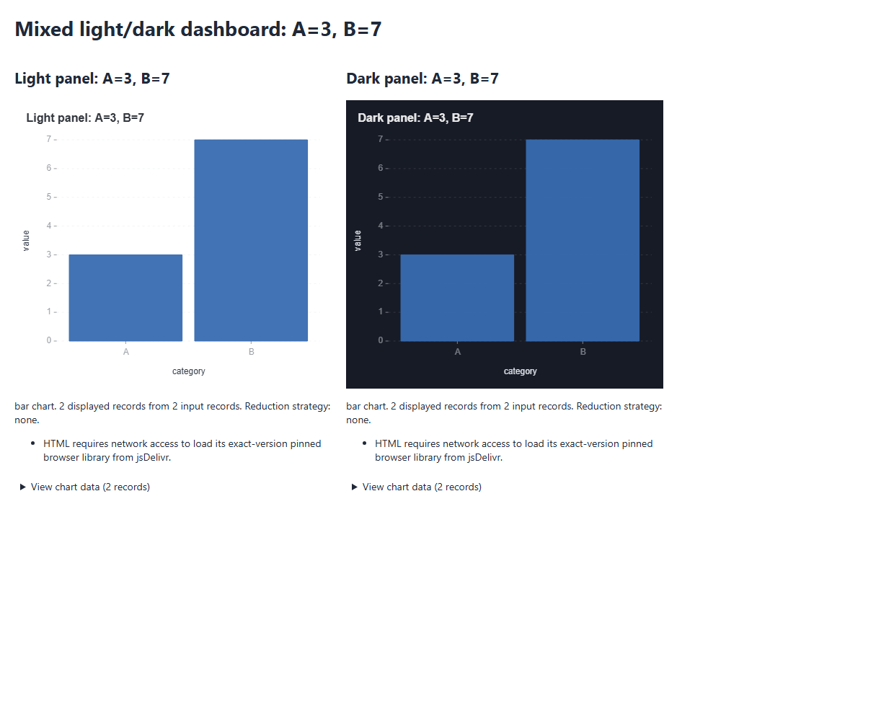

# R04 mixed-theme dashboard evidence

Product source: `6d0e72ebef4b622f8dec2bce2bd07cc23e7a81ce` (unchanged renderer bytes in `3aa521a5d41e8f5cfcb21a5efc008bb3ff2cfcab`).

The light and dark child panels both show A=3/B=7. The dark chart now has its own dark backdrop, so the light native labels remain visible. This Chromium screenshot was actually opened; it is not all-kind/accessibility/final-candidate approval.

- Fixture: `tests/gallery/generate-gallery.py --case dashboard-mixed --engine antv --engine echarts --engine plotly`.
- Generation: three items, zero failures; native Chromium captures: three attempted/captured, zero console/page/resource/runtime failures.
- PNG: 38,734 bytes; SHA256 `a9aa2db2cf1ba9dde0ac231c31568157b607ae295d1335a545c712f7cc331735`.
- Compact module/browser/count/hash evidence: `../../../coordination/evidence/R04-theme-integrated-summary.json`.
- Exact commands and limitations: `../../../coordination/reports/R04-integration.md`.

The full Python suite at this theme source still failed: 40 failed, 3,000 passed, five skipped. The later inspector change only corrects an overstated structural-inspection label; no final full-suite pass is claimed.
