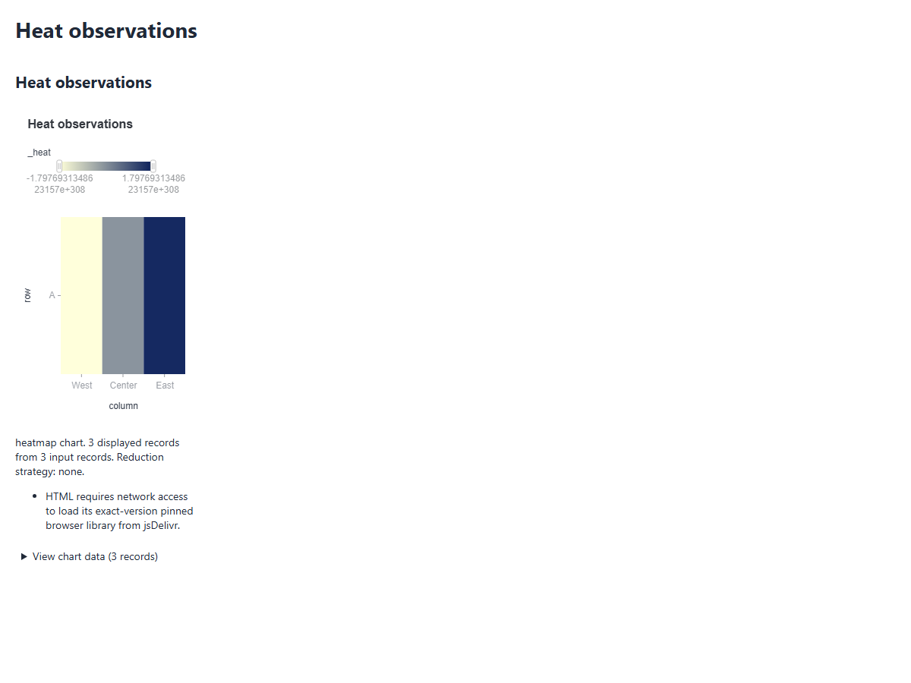
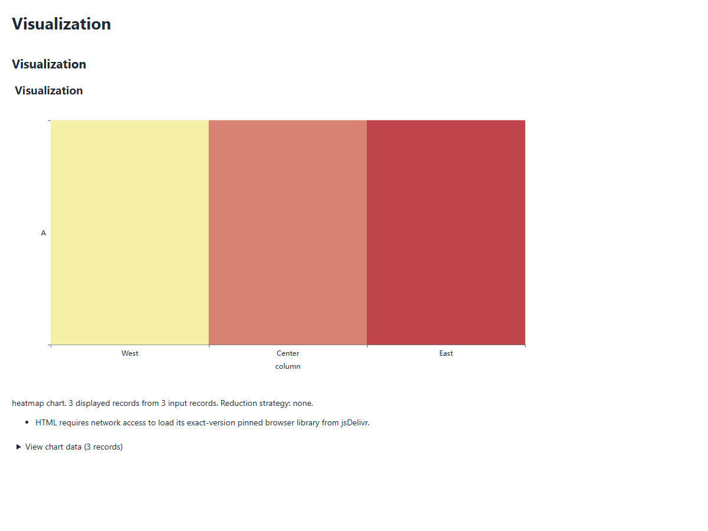
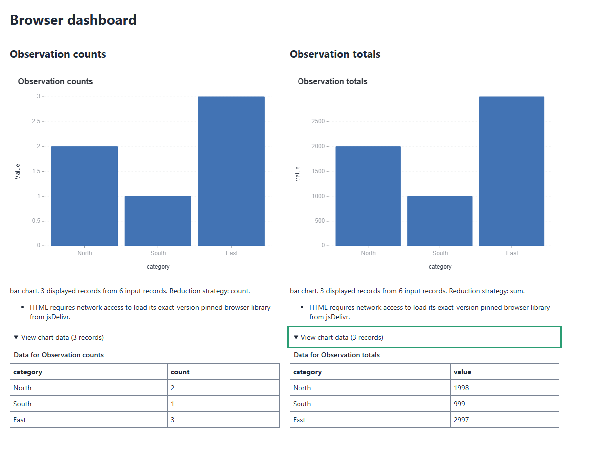
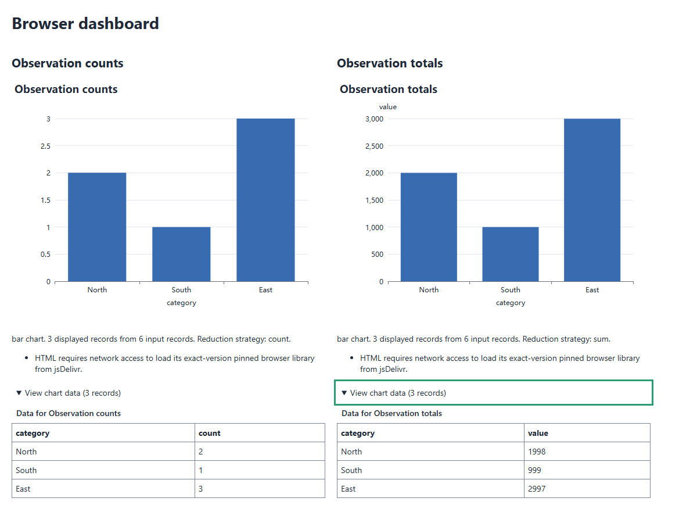
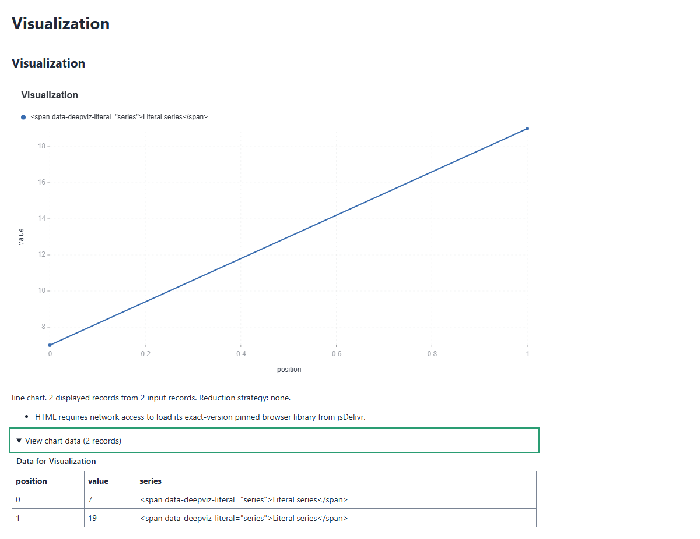
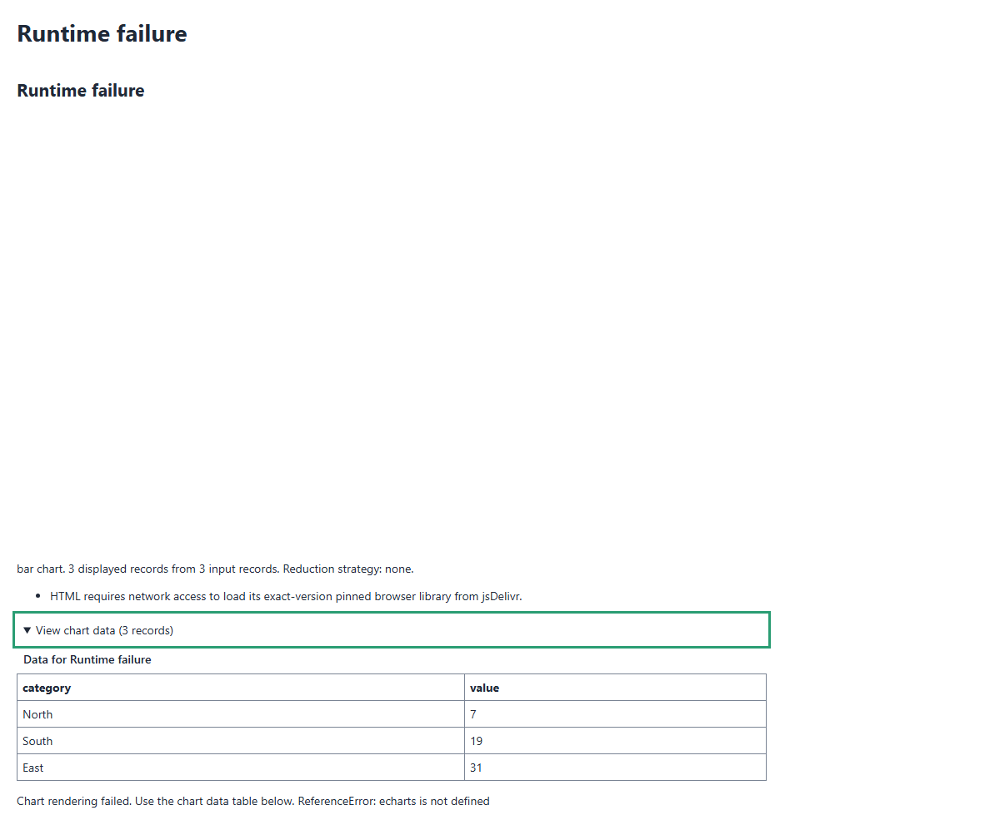

# NEW-04 source verification

Implementation candidate: `9cc5c9e802064d18f253e39795c832128c84afbe`, IMP-04, 2026-11-28.
Status: dependency-overlay verification; independent review, CI, integration and main QA remain pending.
Observed main: `f692014b9c7eb6a9fe0aa6f27b76b40426f053a7`.
NEW-03 base: `79bbb12a396d6d138c1ac54ea93b827aba5bb923`; NEW-01 dependency: `a94f85c47e9a18f01009484a6813738eb8259a03`.
Dependency-only commits: `c8b79fdbe95c3cc2d2fcdbf85f6a2ffcac6ab1dd`, `14539a280ab1cb91f93b2c06f9105cd646f7c2a3`.
Integrators select the NEW-04 product commit after NEW-01/NEW-03 land and rerun review/checks on current main.

## Change and provenance

Selected Python functions: `_echarts` from `3eab699b`, `_antv` from `4429f052`, COUNT selection from `85796dbe`; full SHAs are in checks.json.
Added ECharts 5.6.0/G2 5.4.8, preserved deferred rejecting readiness and keyboard data fallback, fixed COUNT selection, finite-extreme heat colors and 240px G2 numeric legend labels.
G2 line views now disable the HTML tooltip interaction; raw series values remain in native records and accessible data tables.
ECharts overflow uses an auxiliary finite color coordinate; original heat remains native dimension 2 and the tooltip value.
Source product diff: four files, +890/-14; render.py and other NEW-03 functions remain unchanged apart from selected dispatch/bootstrap/COUNT extensions.

## Reproduction and actual results

Interpreter: `C:/Users/bagma/AppData/Local/Temp/deepviz-v010-render-env/Scripts/python.exe` (Python 3.12.16, Playwright 1.65.2, Chromium 159.0.8154.6).
Set `PYTHONPATH=python/deepviz/src`, `DEEPVIZ_BROWSER_TESTS=1`, `DEEPVIZ_BROWSER_DEPS=<npm-layout runtime directory>` with the exact runtime hashes in checks.json.

| Command | Actual result on the frozen source |
|---|---|
| `python -m pytest -q --strict-markers --basetemp=artifacts/local/new04-frozen-full --junitxml=artifacts/local/new04-frozen-tests.xml --tb=short` | 462 passed, zero failures/errors/skips, 45.09s |
| `python -m ruff check .` | passed |
| `python -m mypy` | no issues in five source files |
| `python -m build --outdir artifacts/local/new04-frozen-dist` | wheel and sdist built |
| Wheel source-byte comparison | engines/render/normalize/models: four of four match |
| `git -c core.whitespace=cr-at-eol diff --check HEAD^ HEAD` | passed; preserves the CRLF base source |

23 actual-browser cases: 19 fulfilled and four intentionally rejected; zero page exceptions/unexpected requests. Two denied-runtime cases have only the expected blocked-resource console error.
Controls cover native exact bar data and raster ratios, COUNT, dashboards, all declared native kinds, signed/subnormal/MAX heatmaps, 240px nonoverlapping full legend labels, failure readiness/fallback, and actual mouse-hover literal markup.
Observed RED-to-GREEN: COUNT/adapter 21 failures to focused passes; G2 240px legend two failures to six passing extreme cases; ECharts MAX color one failure to three passing color cases; G2 hover two failures to two passes.
The exact live G2 scene datum oracle also rejects a uniform-double mutation `[14,38,62]` that retains the correct bar ratios. Earlier harness corrections (basetemp parent, PYTHONPATH, missing dependency benchmark, disconnected-pixel/opacity assumptions) are recorded in retained local logs.
Full local logs/JUnit/distributions remain in `artifacts/local/`; browser-observations.jsonl preserves each actual rendered observation, and checks.json contains source/runtime/image/distribution hashes.

## Representative screenshots

## Remaining handoff

RM-01 owns the plan/YAML transition. Independent reviewer/tester reports, protected-branch CI, current-main rebase/integration and non-author main QA are still required. No PR/ready transition, merge, issue closure, RC or final release was performed by IMP-04.
Primary tooltip-interaction reference: https://g2.antv.antgroup.com/en/manual/component/tooltip ; numeric wrapping reference: https://g.antv.antgroup.com/en/api/basic/text .
